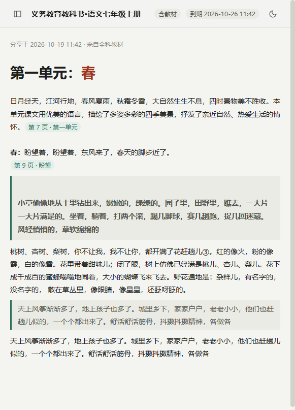
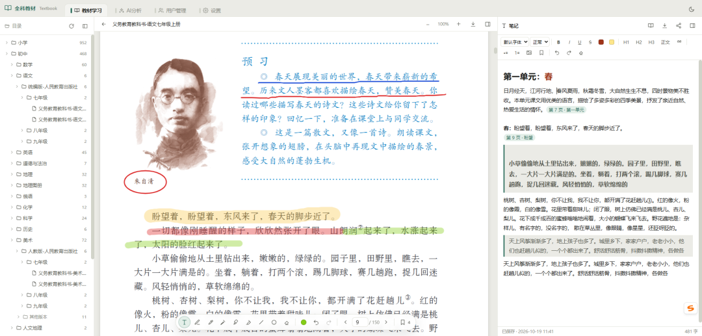
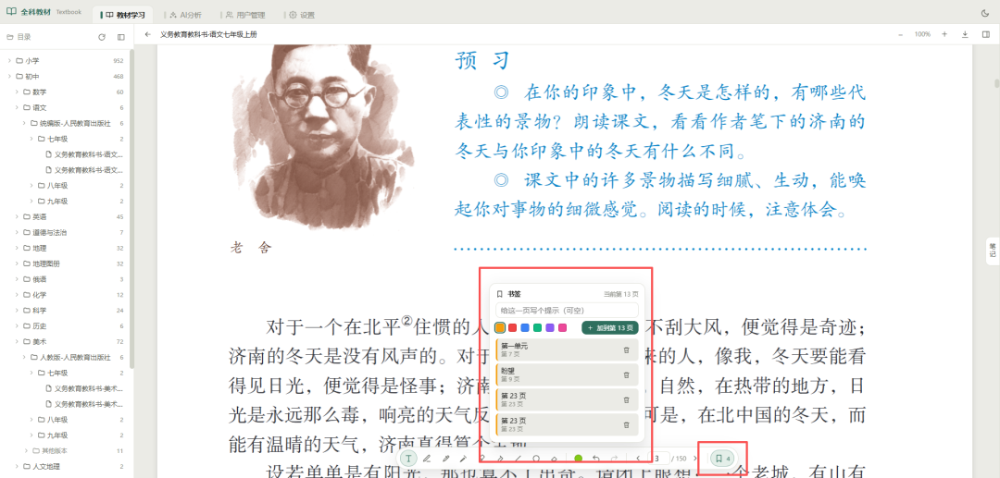

# “小中高”全科教材 + 在线笔记系统——免费下载
> 💡 备注属性未写入，可能是备注属性名称或者类型被修改了，建议将字段类型设置为 rich_text，可以在小程序-操作-修改文章数据库页面进行调整
> 💡 原文链接:[https://mp.weixin.qq.com/s?__biz=Mzg2MDUyNDIxMQ==&mid=2247485412&idx=1&sn=856682edb821e12ffa22118add3ce14a&chksm=cf25e22a9b4c8f2133c2c0823741de80183868f88259f98649e894b071c3866ff41369e1d2cb#rd](https://mp.weixin.qq.com/s?__biz=Mzg2MDUyNDIxMQ%3D%3D&mid=2247485412&idx=1&sn=856682edb821e12ffa22118add3ce14a&chksm=cf25e22a9b4c8f2133c2c0823741de80183868f88259f98649e894b071c3866ff41369e1d2cb#rd)
**全科教材50G**
从小学到中学再到高中教材攒下一堆，笔记也攒下一堆。等孩子毕业想翻出哪个学科的教材复习又发现找不到了。每个家有儿女的家庭都有这样的苦恼吧。于是就有了这套——**《全科教材》**系统，它能把你从小到大的全部教材都整理到一起，目前我已经汇总了50G的pdf文件包把全国从小学到中学、高中、和大学的部分教材都打包了。很多教材来源是靠github上的ChinaTextbook项目列表搜齐的文件，这里也要感谢此开源项目提供的开源支持，所以本项目的教材和系统也都是开源的。
《全科教材》不仅仅是一个文件包，而是基于文件包基础上能通过电脑、ipad、手机打开的一个教材学习和笔记系统。本系统可以多端安装，**Windows、macOS、docker都可以**。想获得安装包和教材包直接在本号内回复“**教材**”即可获得。部署后登录名默认为admin密码admin123登录即可使用。然后再配置一下教材包你存的路径就能读取教材了。
如果只是想尝试一下可在文末“**阅读原文**”进入演示系统查看效果：用户名user密码user7890
**随堂笔记随时记**
你还可以在笔记上标记马克笔和**荧光笔效果划重点**，遇到课本中的具体知识点，还能插书签，把书签嵌入到笔记中一键翻页定位。右侧笔记、左边目录、中间显示教材。如果你搭配手写笔使用就与真实上课没区别。其实更适合大学课堂，如果你大学教材有PDF版，你可以将文件存入系统文件夹一样能读取和展示。上课带着一个ipad就够了。

**借来课堂笔记“抄作业”**
笔记可一键分享，别人想借笔记再也不用拿走本子了，直接一个链接发给他，还可以分享动态笔记，在你本页笔记有任何新增内容都同步更新。但你想分享笔记链接就必须要有外网域名，同时要做好端口映射等操作。如果只是在windows环境下安装通过这个快捷方式**start-windows.cmd**启动的就不行了。顶多是把自己电脑的IP给你家里的ipad通过浏览器登录，录入你电脑的IP地址并加上:9621端口号，可以在家里用电脑当服务器给ipad登录。
最理想状态是安装在NAS里，通过docker容器安装并映射端口出来。

如果你觉得这篇有点用，欢迎点赞
转发。
往期推荐
[飞牛NAS重磅—《全能中台》开源了！（智能家居、视频教学、AI创作...）](https://mp.weixin.qq.com/s?__biz=Mzg2MDUyNDIxMQ%3D%3D&mid=2247485246&idx=1&sn=3a010a79ab473c264f895480b6d79216&scene=21#wechat_redirect)
[AI虚拟女友之—让照片给你跳舞Wan-Dancer开源模型](https://mp.weixin.qq.com/s?__biz=Mzg2MDUyNDIxMQ%3D%3D&mid=2247485203&idx=1&sn=a6f503b55b9ce92fd73dd59e13411cb0&scene=21#wechat_redirect)
[AI虚拟女友之（一致性角色卡）](https://mp.weixin.qq.com/s?__biz=Mzg2MDUyNDIxMQ%3D%3D&mid=2247485171&idx=1&sn=609c884ab27ca44a1cc88b17756911cc&scene=21#wechat_redirect)
[玩飞牛 NAS 没公网 IP 吗——手把手教你免费内网穿透Cloudflare](https://mp.weixin.qq.com/s?__biz=Mzg2MDUyNDIxMQ%3D%3D&mid=2247485029&idx=1&sn=a41322f511c7ed2f459d77e8257021b6&scene=21#wechat_redirect)
[低配显卡也能做AI视频——实测MiniMax-H3（可下载）](https://mp.weixin.qq.com/s?__biz=Mzg2MDUyNDIxMQ%3D%3D&mid=2247484988&idx=1&sn=9239c42b28115098109a4477af26aa11&scene=21#wechat_redirect)
[别用 PS 了，来用免费AI 生产力 —— 实测Z-Image-Turbo做电影海报](https://mp.weixin.qq.com/s?__biz=Mzg2MDUyNDIxMQ%3D%3D&mid=2247484983&idx=1&sn=a35538ccb1e2cdc8407ffff05f9223a8&scene=21#wechat_redirect)
[家庭自建学习平台——新加入电脑桌面监控（请勿滥用于监控老公老婆）](https://mp.weixin.qq.com/s?__biz=Mzg2MDUyNDIxMQ%3D%3D&mid=2247484920&idx=1&sn=d9b3a61d48ee94e5ce41e530958cef55&scene=21#wechat_redirect)
[小爱音箱无会员畅听，一键对接本地NAS音源Songloft（附可下载音源）](https://mp.weixin.qq.com/s?__biz=Mzg2MDUyNDIxMQ%3D%3D&mid=2247484894&idx=1&sn=c342b562403506c3029c844c1d2d7fa7&scene=21#wechat_redirect)
[飞牛NAS自建：中小学生视频学习平台（附源代码可本地安装）](https://mp.weixin.qq.com/s?__biz=Mzg2MDUyNDIxMQ%3D%3D&mid=2247484870&idx=1&sn=3a3a3719423d85d376b142dea164d367&scene=21#wechat_redirect)
