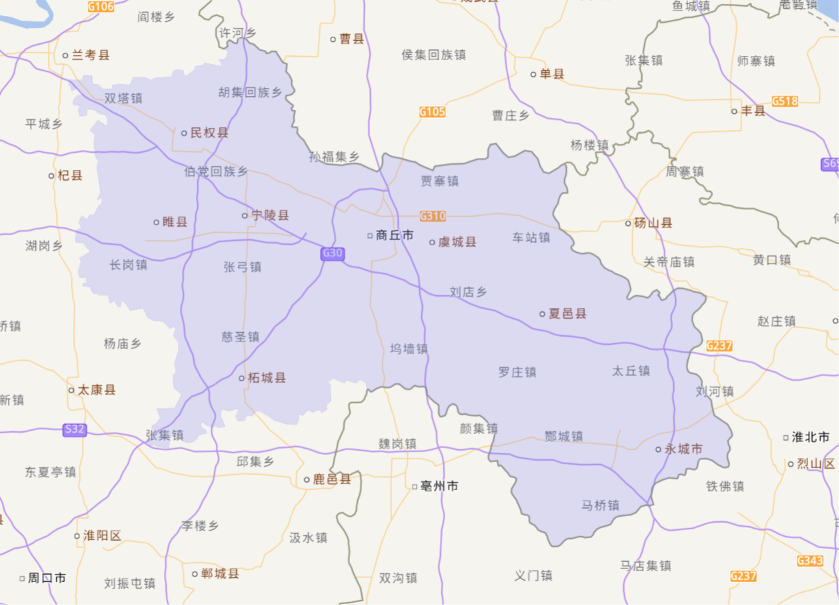
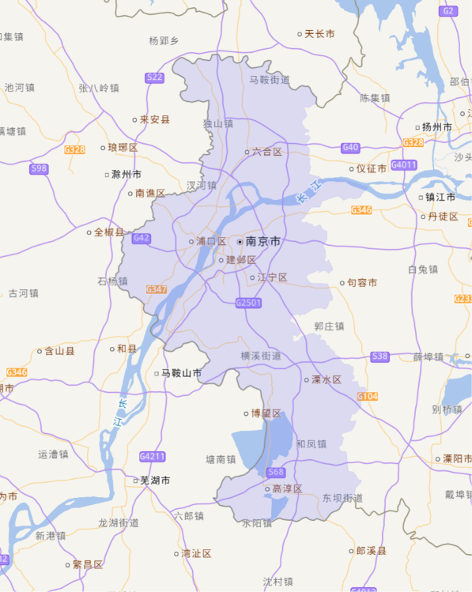
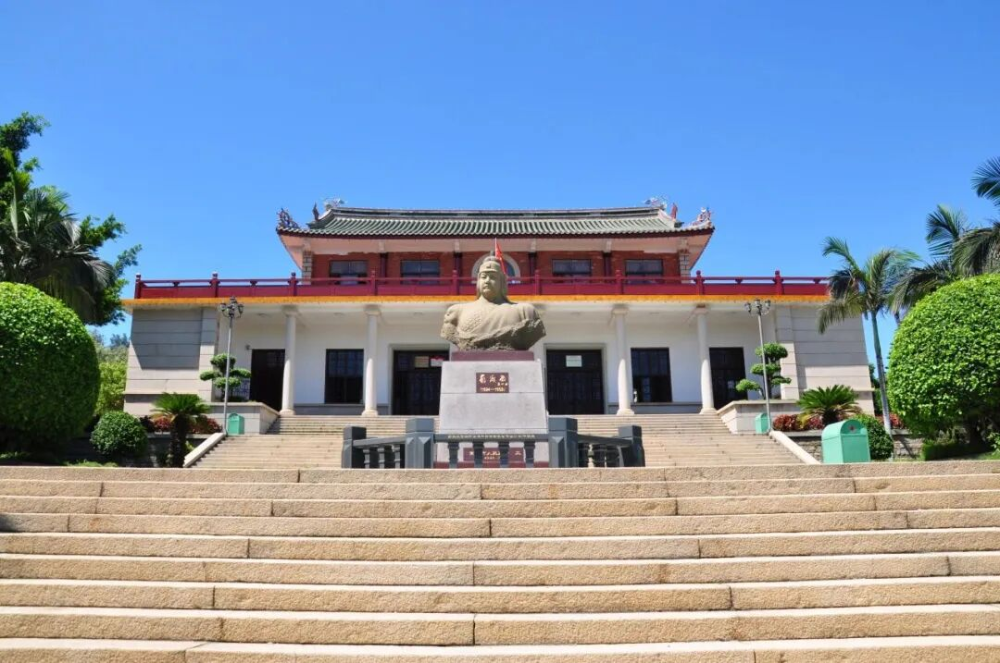
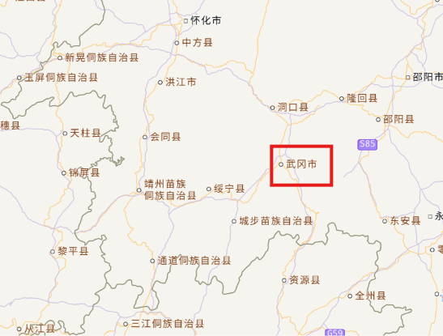
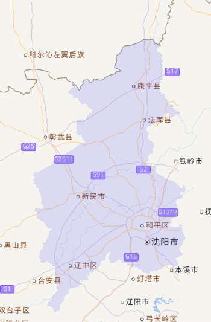
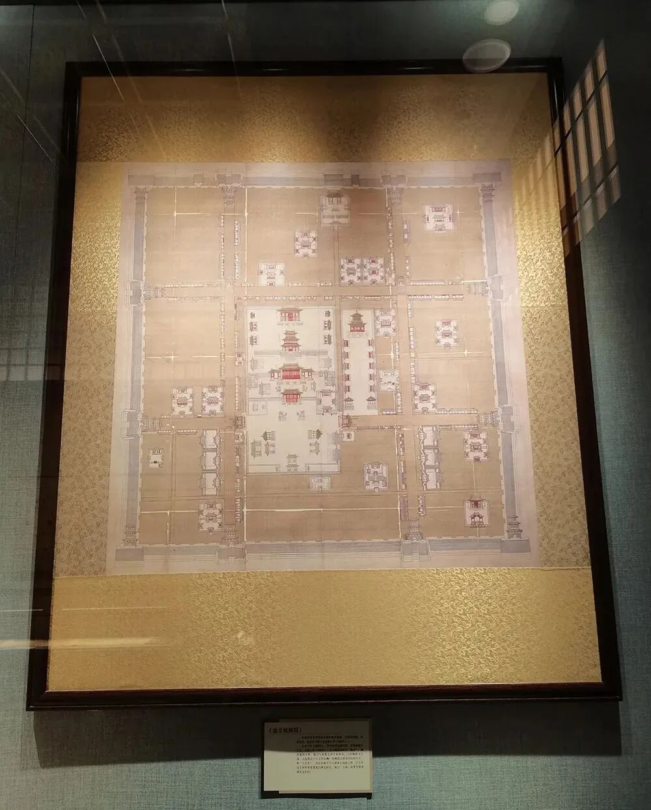

# “应天、顺天、承天、奉天”，历史上这“四大天府”，如今都在哪儿？
> 💡 备注属性未写入，可能是备注属性名称或者类型被修改了，建议将字段类型设置为 rich_text，可以在小程序-操作-修改文章数据库页面进行调整
> 💡 原文链接:[https://mp.weixin.qq.com/s?__biz=MjM5MDg1NjA2NA==&mid=2651088102&idx=1&sn=9e3375dbec605767472359f4597b048d&chksm=bc2132d765e6b07661999b977a65702c3ddeeff2bcf3c7d15981f4dd3f7edd1f881e0aeef84a#rd](https://mp.weixin.qq.com/s?__biz=MjM5MDg1NjA2NA%3D%3D&mid=2651088102&idx=1&sn=9e3375dbec605767472359f4597b048d&chksm=bc2132d765e6b07661999b977a65702c3ddeeff2bcf3c7d15981f4dd3f7edd1f881e0aeef84a#rd)

本 文 约 5000 字
阅 读 需 要 14 分钟
在我国众多古地名中，有一类带“天”字的格外引人注目，这就是历史上著名的“四大天府”：应天府、顺天府、承天府、奉天府。“天”即天子，“天府”就是与帝王有着非常直接的关系的地方，多为某位君王的龙兴之地。从“应”“顺”“承”“奉”这四个字可以看出，古代帝王普遍以正统自居，强调自己顺应天命，统治万民。然而，由于朝代更迭、帝王更替，这四大天府在不同时期指向了不同的地方，有的名称甚至被多个地方共用过，这在中国地名史上是一个非常奇特的现象。
那么，“四大天府”到底对应着今天的哪些城市？每一个名字背后又有着怎样曲折的故事？让我们沿着历史的脉络，逐一探寻。
**应天府：一个名字两座城**
“应天”二字，出自《周易》中的“应乎天而时行”，意思是顺应天意、顺势而为。在中国历史上，先后有两个地方被称为应天府：一个是北宋的应天府，在今河南商丘；另一个是明朝的应天府，在今江苏南京，其间跨越了三百余年。

今河南商丘。来源/天地图

今江苏南京。来源/天地图
河南商丘之所以能获得“应天府”这个称号，与宋太祖赵匡胤密切相关。后周显德六年（959），赵匡胤担任殿前都点检，兼宋州归德军节度使。宋州，就是今天的河南商丘睢阳区一带。次年，赵匡胤发动陈桥兵变，黄袍加身，兵不血刃地登上了帝位。登基之后，他想到了自己曾经发迹的宋州，便定国号为“宋”。可以说，没有宋州，就没有“宋”这个国号。

宋太祖赵匡胤画像。来源/中国国家博物馆
宋真宗景德三年（1006），为纪念商丘作为赵宋帝业肇基之地的贡献，真宗将宋州升格为应天府，管辖五府、十二州、八十一县。大中祥符七年（1014），真宗又御驾亲临应天府，主持隆重的授命仪式，建应天府为南京，成为北宋“四京”之一。
应天府不仅见证了赵匡胤的崛起，还成了南宋的开国之都。北宋灭亡后，康王赵构在应天府登基，改元建炎，史称南宋。而赵构之所以选择在应天府登基，正是因为宋太祖龙兴于此。不过，赵构很快便抛弃了应天府，南下杭州。绍兴二年（1132），应天府被金军占据，转交给伪齐皇帝刘豫，降为归德府。此后随着北方战乱、金元易代，应天府再不复昔日的繁华。
商丘的应天府成为历史之后，过了两百多年，另一个地方又重新拾起了这个名字。元顺帝至正十六年（1356），朱元璋率军攻破了集庆路（今江苏南京），并改集庆路为应天府。这个名字的选择绝非偶然。朱元璋出身贫寒，此时从一介布衣跻身为一方诸侯，需要为自己的崛起找到一个“合法”的解释，改名应天府，便意在宣示自己乃顺应天命、应天而动之人。
至正二十四年（1364），朱元璋即吴王位，定都应天府。洪武元年（1368），朱元璋正式称帝，建立明朝，仍以应天府为都城，称京师应天府。从此，应天府成为明朝的政治中心，也是当时世界上最大的城市之一。

《南都繁会图卷》局部，描绘明代应天府（南京）市井风貌。来源/中国国家博物馆
然而，朱元璋对应天府作为都城并不完全满意。在明人眼中：
“南京城形视江流曲拆，故广袤不相称。大内逼城东，偏颇卑洼。江流去而不还，山形散而不聚。太子太孙皆不禄，疑非帝王都也。”
朱元璋也深感宫城“前昂中洼，形势不称”，故一直在寻求定都于别处的可能性。他曾考虑过开封、凤阳，甚至西安，但因为种种原因，都未能成行。朱元璋最终感叹道：“本欲迁都，精力已倦，又天下新定，不欲劳民，且废兴有数，只得听天！”一代君主的迁都梦想，终究敌不过岁月沧桑。
此后，明成祖朱棣“靖难”成功，从侄子建文帝手中夺取了皇位，又迁都到北京。应天府虽然不再是首都，但作为“留都”，依然保有极高的政治地位。直到清顺治二年（1645），清军攻克南京，将应天府改名为江宁府。从此，“应天府”这个名字彻底退出了历史舞台。
**顺天府：从边地到帝都**
在四大天府中，顺天府是唯一一个名称和地点始终如一、没有争议的，位于今天的北京。“顺天”二字，取自《周易》中的“顺乎天而应乎人”，与应天府一样，都在强调统治的合法性和天命的归属。但顺天府的故事，要从一位藩王说起。
明成祖朱棣还是燕王的时候，他的封地在北平，也就是今天的北京。此地“北枕居庸，西峙太行，东连山海，南俯中原，山川形胜，足以控四夷、制天下，诚帝王万世之都也”。朱棣在北平经营多年，麾下精兵强将如云。建文帝朱允炆即位后大力削藩，朱棣起兵“靖难”，夺取了皇位。
作为自己的起家之地，朱棣深知北平地区战略地位的重要性，为加强中央集权制，巩固统治，他在即位之初就酝酿迁都事宜。永乐元年（1403）正月，礼部尚书李至刚等人上言，称：“北平布政司，实皇上承运兴王之地。宜遵高皇帝中都之制，立为京都。”朱棣于是顺水推舟，下诏“以北平为北京”，改北平府为顺天府。同时，又设北京行部，设尚书、侍郎及礼、户、吏、兵、刑、工六曹郎中等职；在军事方面，设北京留守行后军都督府，统辖60余卫的兵力。在文化方面，则添设北京国子监。经过这一系列举措，北京的地位迅速提高，成为仅次于南京的重要城市。

北京宫城图，图的最下方为北京城墙（明成祖改建北京时仅有内城，嘉靖时扩建外城）和丽正门（后改名为正阳门）。来源/中国国家博物馆
永乐四年（1406）开始，朱棣为大规模改建北京城作准备：首先移民充实北京，多次在北京地区免赋、赈灾、移民、垦田；其次治河通漕转输，重新疏浚开通了大运河，使漕运直达通州；再次伐木采石备料，分遣大臣赴四川、湖广、江西等地采木；最后大规模营建宫殿城阙。到永乐十八年（1420）十一月，北京宫殿城池告成，“凡庙社、郊祀、坛场、宫殿门阙，规制悉如南京，而高敞壮丽过之”。
永乐十九年（1421）正月初一，朱棣“御奉天殿，朝百官，诞新治理”，宣告明朝正式迁都北京。在迁都诏书中，朱棣声称，选定北京为京师是“惟天意之所属，实卜筮之攸同”，且“上以绍皇考太祖高皇帝之先志，下以贻子孙万世之弘规”。并规定，仍旧保留南京的都城地位，与北京并立为两京。
迁都北京的意义极为深远。北京“内跨中原，外控朔漠”，其地理位置对于多民族国家来说尤其宜于定都，而以南京为都，位置偏南，难以控制朔北。朱棣迁都北京，加强了对北疆和东北疆的统治，奠定了明清两代五百余年以北京为首都的基本格局。
清军入关后，亦建都北京，并沿明旧制，以顺天为京府。辛亥革命后，1914年顺天府改称京兆地方，设京兆尹，直到1928年国民政府定都南京，撤销京兆。此后，北京先后被称为北平、北京，但顺天府这个名字，已经深深融入了这座城市的历史中。
**承天府：海峡两岸的天命之名**
承天府的“承天”有承受天命之意，这个名称出现在明代，与两位特殊的人物有关：一位是嘉靖帝朱厚熜，一位是民族英雄郑成功。

郑成功雕像。来源/南安市郑成功纪念馆
明世宗嘉靖帝的生父是明宪宗的第四子兴献王朱祐杬。对于这个异母弟弟，明孝宗“命建藩府于德安府，初梁庄王有故邸、田地在安陆州，帝请改居安陆，诏从之”。安陆即今天的湖北钟祥，嘉靖帝朱厚熜便出生于此。
正德十六年（1521），明武宗朱厚照驾崩，死后无嗣，也没有亲兄弟，于是由近支皇室、武宗的堂弟朱厚熜继承皇位，即明世宗嘉靖帝。嘉靖帝以藩王身份入继大统，在即位礼及生父、生母的名分上，同以杨廷和为首的大臣产生了不同意见，史称“大礼议”。经历了数年的争议后，嘉靖帝在“大礼议”事件中逐步取胜，于是兴献王被“追尊献皇帝，庙号睿宗”，生母蒋氏也被尊为章圣慈仁皇太后。嘉靖十年（1531），又将安陆州升格为承天府，治所在钟祥县。地名“钟祥”二字，也是嘉靖帝亲赐的。
承天府的升格并未止步于此。嘉靖十八年（1539），嘉靖帝南巡承天府，拜谒了父亲的陵寝——显陵。返回北京后，他将承天府进一步升为陪都，称“兴都”，并设立兴都留守司，统领显陵、承天二卫。由此，明朝形成了“两京”（北京、南京）、“两都”（中都凤阳、兴都承天府）的独特格局。

明显陵，地处中国湖北省钟祥市境内。是明嘉靖皇帝朱厚熜的父亲恭睿献皇帝朱祐杬和母亲章圣皇太后的合葬墓。来源/湖北省文化厅

清顺治三年（1646），清朝将承天府改回安陆府，钟祥作为明朝陪都的历史就此落幕。但承天府的故事并未在钟祥终结，十余年后，它跨越海峡，在中国台湾续写了新的篇章。
南明永历十五年（1661），郑成功由金门率军渡海攻台，驱逐了荷兰殖民者。收复台湾后，他随即在当年五月规划行政区域，称全台湾为“东都明京”，并将赤崁城（今台南赤崁楼）改名承天府。承天府领天兴、万年二县，辖今台湾本岛及其附属地区。郑成功以一府二县的设置，宣示自己继承大明正统、承受天命的决心。
康熙二十二年（1683），郑克塽降清，台湾正式纳入清朝版图，海峡两岸实现了统一。清朝废承天府，改为台湾府。从此，海峡两岸的承天府都消失在历史舞台上。
**奉天府：跨越南北的“奉天承运”**
奉天府的诞生是四大天府中最为特殊的。它的名字取自“奉天承运”之意，但令人意想不到的是，最早使用这个名字的地方，不是清朝的发祥地沈阳，而是湖南的一座小城——武冈。 

今湖南武冈。来源/天地图
武冈位于湖南省西南部，地处雪峰山东南麓与南岭北缘交汇处，三面环山、中部低平。崇祯帝自缢后，南明的弘光政权、隆武政权、绍武政权旋起旋灭，此后桂王朱由榔在广东肇庆称帝，即永历帝。永历元年（1647），武冈总兵刘承胤“乃劫上幸武冈。五月，改武冈州为奉天府”。武冈作为南明的“临时首都”，也由此成为中国最早以“奉天承运”命名的地方。然而，永历帝在武冈的日子并不好过。刘承胤专权跋扈，“事皆决于承胤”，永历帝在武冈仅仅驻留了数月，便被迫败走黔滇，“奉天府”自然也烟消云散。
十年之后，清朝在东北的沈阳设立了另一个奉天府。

今辽宁沈阳。来源/天地图
早在天命十年（1625），努尔哈赤便迁都沈阳。天聪八年（1634），皇太极将沈阳改称“盛京”，有满语中“兴盛”之意。清军入关后，都城由盛京迁到北京。随着大批满洲贵族及八旗兵丁的离开，东北成为地广人稀之地。为避免田地荒芜，清廷下令招民开垦，招民多者，授以官职，招徕之民，颁给月粮、种子、耕牛，但这些措施短时间内效果并不明显。有鉴于此，顺治十四年（1657），吏科给事中王益朋上疏称：
“与其悬爵招民，应之者少，不如仿明初之制，将辽阳等处田地酌量分给功臣之家，令其委托家人、庄头耕种，收获供送本主。”
如此“朝廷鲜抛荒之患，亦可因地而得民”。他同时又提出：
“盛京兴王之地，自是上国规模。明洪武升集庆为应天，永乐升北平为顺天，嘉靖升安陆为承天，今辽阳府名亦宜升用天字，知府应改府尹，则名正言顺，足法后世。”
正是由于王益朋的建议，清廷罢辽阳府为辽阳县，以“奉天承运”之意改置为奉天府，府治盛京。从此，沈阳有了“奉天”这个名字，至今已有三百多年的历史。

《盛京城阙图》，描绘了盛京作为奉天府时期的城市样貌。来源/中国第一历史档案馆
作为清朝的陪都，“盛京奉天府”与“京师顺天府”并列，可见其地位的尊贵。清朝在奉天府设府尹一人，秩正三品，掌理奉天府事权，后改由盛京将军兼管。光绪三十一年（1905）改行省，罢奉天府府尹及府丞，置知府一人。光绪三十四年（1908），奉天府隶属奉天省。1928年，东北易帜，奉天省改为辽宁省，奉天市改为沈阳市。虽然“奉天”这个名字已经不再作为正式的城市名称使用，但它作为沈阳的旧称，至今仍深深烙印在这座城市的文化记忆之中。

沈阳故宫。来源/沈阳文旅
回顾四大天府的兴废史，我们可以看到一条清晰的脉络：每一个“天府”的设立，都与一位帝王的个人命运紧密相连，古代统治者通过更改地名，将“天命”具象化为可以触摸的地理实体，以此向天下昭示自己统治的合法性。而地名的更迭，也如同一面镜子，映照着王朝的兴衰。如今，这些天府早已退出了行政区划的舞台，但它们留下的印记依然清晰可辨。当我们行走在这些城市的街头巷尾，或许已经很难感受到当年“天府”的威仪，但那些深埋在历史中的故事，依然在无声地提醒着我们：地名不仅仅是一个符号，它是历史的见证，更是文化的载体，文明的传承。
**参考文献：**
李洁萍编著：《中国历代都城》，黑龙江人民出版社1994年版
（清）穆彰阿撰，潘锡恩等纂修：《大清一统志》，上海古籍出版社2008年版
（清）徐鼒撰，(清)徐承礼补遗：《小腆纪传》，中华书局2018年版
夏维中：《明朝迁都六百年：“永乐北迁”的历史回顾》，《江苏地方志》2020年第6期
曹文宇：《清代奉天府尹研究》，辽宁大学硕士学位论文，2022年
邓涛：《被遗忘的陪都——明代兴都湖广承天府的名与实》，《理论月刊》2024年第1期
*本文系“国家人文历史”独家稿件，欢迎读者转发朋友圈。
END
作者 | 韩靖宇
 编辑 | 胡心雅 
主编 | 周斌
排版编辑 | 徐若曦（实习）
校对 | 张斌 胡瓜 

推荐
2026年9月16日上午10时25分
平陆运河马道枢纽
首航船舶一声汽笛破空长鸣
这条通江达海的世纪巨龙正式通航
随着巨型“人”字闸门缓缓开启
一扇向海图强的时代之门就此打开。
本期，就让我们走近平路运河的前世今生
一起来看这个中华人民共和国成立以来
第一条通江达海的大运河
这件凝聚中国基建硬核实力与数字智慧的
“大国重器”
**点击下方封面，即可购买**
↓↓↓

“**在看**”的永远18岁~

## 摘要

（待补充）

## 我的笔记

（待补充）
