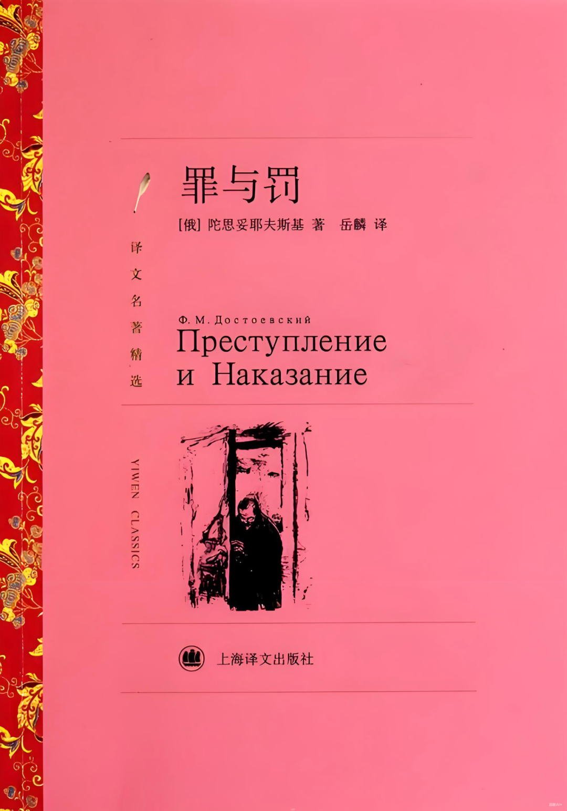

# “悬疑”如何“文学”？
> 💡 备注属性未写入，可能是备注属性名称或者类型被修改了，建议将字段类型设置为 rich_text，可以在小程序-操作-修改文章数据库页面进行调整
> 💡 原文链接:[https://mp.weixin.qq.com/s?__biz=MzAwODczNDM0NQ==&mid=2651466623&idx=1&sn=70bb665e76921a7bd88b6111aad5ce41&chksm=81f4f5a31247113cac0f4fb36744a5a54dcf3bea9a13c7971d3e9429a5bb66ad279789c29f8d#rd](https://mp.weixin.qq.com/s?__biz=MzAwODczNDM0NQ%3D%3D&mid=2651466623&idx=1&sn=70bb665e76921a7bd88b6111aad5ce41&chksm=81f4f5a31247113cac0f4fb36744a5a54dcf3bea9a13c7971d3e9429a5bb66ad279789c29f8d#rd)
**主持人语**：当下的文学创作，似乎已经进入“泛文学”时代。多元文化滋生了文学中的言情、青春、科幻、武侠、侦探等林林总总的类型元素，并把“泛文学”的商业化、功利化性质渗透到纯文学创作中。其中，悬疑化倾向作为一种显著现象，特别是悬疑叙事从小说到影视改编的热潮，正在引发一场跨媒介叙事的文化狂欢。本期的三篇文章，或追溯悬疑文学的历史发展，思考“悬疑”如何“文学”，又是如何与现代文明产生关联；或从悬疑叙事的“出圈”现象出发，探讨纯文学对类型文学要素的借鉴以及未来文学实践之可能；或以具体文本为例，解读悬疑化小说的呈现方式与悬疑叙事背后的人性探寻、现实关怀。现下，这股“悬疑热”还能走多远？悬疑叙事的限度是什么，它又该如何摆脱类型元素的套路化？
——徐勇（厦门大学中国语言文学系）
悬疑文学正在大规模地崛起。仅以2023年播出的电视剧为例，从年初的《狂飙》开始，《平原上的摩西》《光·渊》《尘封十三载》《漫长的季节》《繁城之下》等悬疑剧相继闪亮荧屏，带来国产剧少有的热播现象。这些剧目在豆瓣网站上都得到了八分以上的高分，有的甚至还得到了九分以上的罕见高分。现象级流行影视的背后，是悬疑小说的繁荣。不仅出现了何家弘、紫金陈、蔡骏等悬疑小说家，青年一代纯文学作家的双雪涛、郑小驴等人也相继在相关作品中加入了悬疑元素，表现出创作上的悬疑化倾向。近年来的茅盾文学奖，也授予了《回响》《暗算》两部带有强烈悬疑色彩的作品。毋庸置疑，“悬疑”正日益崛起并成为当代文化生活的重要组成部分。

自《圣经》中所罗门王断案的故事以来，悬疑在西方文学中有着悠久的历史。而作为一种都市文化现象，继爱伦·坡发表《莫格街谋杀案》以来，悬疑小说经历了所谓的“黄金时代”“黑色革命”和“后现代时期”，诞生了福尔摩斯、波洛等享誉全球的侦探形象，并奠定了悬疑小说的基本写作范式。悬疑小说基本由罪犯、侦探和案件推理侦破三个部分构成，借助案情的推理和侦破，悬疑小说或以展现推理的乐趣，或以表现变态畸形的犯罪心理，或侧重对人性的分析，或着重对艰苦环境和激烈打斗的描绘等。根据各自在写作上的侧重，悬疑小说又分出“本格派”“变革派”“社会派”“硬汉派”等多个派别。[1]
当我们在谈论悬疑文学的时候，我们在谈论什么？悬疑小说是现代的英雄神话，也是现代性的强烈表征。本文将以双雪涛的作品《平原上的摩西》作为主要分析对象，以展现当下小说创作的悬疑化现象，并揭示其背后的深刻的当代性内涵。
**一**
小说《平原上的摩西》围绕着十二年前一起出租车司机被杀案展开，有五位出租车司机先后被杀。在案件侦破的过程中，警察蒋不凡遇害。十二年后，“艳粉街”的少年庄树长大成人，成为一名刑警，由他来一步一步解开尘封多年的秘密。原来，十二年前警察蒋不凡遇害的那个夜晚，蒋正在扮作出租车司机“钓鱼”查案。表面上李斐父女当天正好搭乘了蒋车前去问诊，实际上李斐与少年庄树相约要到郊外去放野火，因此偷偷携带了汽油瓶上车。也正是汽油的味道引起了警察蒋不凡的警觉——因为出租车连环杀人案的凶手每次作案必用汽油焚毁汽车。在蒋不凡误判开枪打伤李父并欲将其逮捕的时候，一辆卡车撞倒了出租车，蒋不凡的后脑被车玻璃击中，又被钝物击打，变成了植物人。成年后的庄树凭借警察蒋不凡遗物中的“嘎拉哈”香烟，层层抽丝剥茧，最终侦破案件。在真相逐渐浮出水面的过程中，解谜者庄树发现自己像俄狄浦斯一般深陷在命运的陷阱里。
接下来，我们将逐一分析这一故事中的罪犯、侦探和破案过程等悬疑小说三要素。首先是罪犯。在《悬疑小说创作指导》中，作者弗雷指出谋杀犯必须是一个“极端类型”的“钟形曲线人物”，“真正有意思的人物，都藏在钟形曲线的尾端。他们都是极端值”[2]。罪犯是悬疑小说的轴心，由他来推动故事情节的发展。弗雷进一步给出了塑造罪犯的建议：“这个人物是三维的，具有一种支配性的志趣，聪明且足智多谋，受过很深的心理创伤，并且不能表现出邪恶。而且，他或她很可能生活在对某种事物致命的恐惧之中。”[3]《狂飙》中的高启强，可以说完美地符合这一设定。出身市井底层的鱼贩高启强，在成为京海黑恶势力头目之前受尽了屈辱。他心思缜密，熟读《孙子兵法》且能学以致用。表面上看起来，他与普通的中年大叔无异。当然可以说，从头至尾高启强都生活在恐惧之中。《平原上的摩西》稍有不同，小说设置了两个杀人犯，一个是出租车杀人案的凶犯赵庆革，他出场即退场，只是一个功能性的人物；一个是李守廉，他并非怙恶不悛的罪犯。不同于类型悬疑小说有将人物塑造得扁平化的倾向，《平原上的摩西》通过个体的叙述展开了每一个人的过去，并在各自的讲述中互相描画，这反而赋予了故事中人物相当的人性深度。
其次，侦探一角的塑造。侦探是悬疑小说里最耀眼的存在。身着礼服，手拿手杖，侦探小说“黄金时代”的福尔摩斯、波洛们无不风度翩翩，举手投足间充满了绅士气息。他们沉着冷静，自信而熟练地运用现代技术，再加上娴熟的推理技巧，一步一步为读者解开隐藏的秘密。双雪涛小说中警察没有那般“职业”，蒋不凡在追凶的过程中因误判而丧命；庄树则在即将破案时，陷入了回忆的纠缠之中，行为迟疑而延宕。小说没有了炫技式的推理过程，人物时常沉浸在自己的情绪之中无法自拔。而在主人公的犹豫中，法律被搁置一旁。

最后，悬疑故事的推进。以案情的发生及侦破推动故事情节的发展，小说明显套用了一个悬疑小说的结构方式。故事以人物口述的形式展开，先后涉及了庄家、李家、孙家和蒋家四个家庭。在讲述的过程中，人物之间的关系互相交织，最终编织成一个完整的故事。故事虽然以1995年在“下岗潮”冲击下的沈阳作为背景，但在人物的讲述过程中向前延伸至“上山下乡”时代，往后延展至改革开放以后的市场经济时代。广场上的雕像拆了又建，故事中每一个人无不从急剧转变的历史中因袭了沉重的负担。
综上所述，《平原上的摩西》以悬疑小说的方式展开了对当代生活的探索和追问。那这样的悬疑小说书写方式背后有着什么样的内涵？当我们在谈论悬疑小说时，我们在讨论什么？
**二**
悬疑小说是现代的英雄神话。当代悬疑小说的主人公像古代神话中的英雄们一样，屠杀威胁群体安全的怪兽巨龙，并拯救身处危难的少女。古代的英雄和现代悬疑小说中的英雄共享很多特质：勇气、忠诚、战胜邪恶的决心、为理想而自我牺牲的觉悟，诸如此类。但不同于奥德修斯、阿喀琉斯、伊阿宋等古希腊神话英雄，悬疑小说成立有几个必备的前提条件：首先，法律制度的完善保证了悬疑小说情节设计的合理性；其次，科学技术提供了有效侦探手段，保证侦查活动的合理运作；再次，好奇心是催生悬疑小说的心理原因，而消费主义的兴起则为悬疑小说产生的市场动力。换句话说，悬疑小说的出现依赖法治、科学、市场等客观条件，并且以上条件缺一不可。因此，可以说悬疑小说完全是一种现代发明。作为现代英雄的福尔摩斯一向以博学著称，他总是能轻松自如地调用令人眼花缭乱的知识储备。这在由福尔摩斯系列小说改编的英剧《神探夏洛克》中表现得尤为明显，剧中每当福尔摩斯进行推理思考的时候，屏幕上便会出现密密麻麻的公式和定理。福尔摩斯沉醉其中，喃喃自语，指尖跃动如同正在演奏钢琴。表面上是福尔摩斯在探案，进行各种魔术般的表演，背后实际上是化学、物理学、生物学、刑侦学、博物学等各式各样现代的专业知识在起作用。在小说《平原上的摩西》中，庄树便是将一截烟蒂作为侦破案件的关键线索，从而将整个事件有条不紊地串联起来。更进一步讲，悬疑小说其实是对伟大的启蒙时代不断致敬。社会可能会一时失序，但被启蒙知识所武装的现代骑士们总能力挽狂澜，拨乱反正，科学和法治的旗帜终将再次高高飘扬。
悬疑小说同时是现代性的强烈表征，它同时拥有现代性的多副面孔。正如福柯在他的系列著作中一再论证的“知识就是权力”，在现代社会中知识和权力是互相生产的。疯癫与文明、规训与惩罚之间的关系，也都可以作如是观。如此来看，罪与罚之间便是一场无休无止的猫鼠游戏。现代文明需要福尔摩斯，正如福尔摩斯需要莫里亚蒂[4]，哥谭市需要蝙蝠侠，正如哥谭市需要小丑一样。从这个意义上来讲，现代文明本身就是一场最大的悬疑。
小说《平原上的摩西》中，在平静的城市生活里，突然接连发生五起出租司机被杀案，闹得满城风雨——这是一个失序的世界。当主人公历尽艰辛，侦破案件将真相带到我们面前的时候，世界的危机解除，生活重归于平静。悬疑小说能将现代生活的传奇与日常、祛魅与赋魅、有序与失序、创伤与和解这一对对相反或相成，甚至相互矛盾的概念巧妙地结合在一起，用以表现现代生活的深度。启蒙时代以来的世界是一个以理性为主宰的、诸神消隐的世俗世界。悬疑小说里的世界因而是一个被祛魅的世界，在这个世界里“一切坚固的东西都已经烟消云散了”。但悬疑小说同时是市民的英雄史诗，它讲述的是现代生活给人们带来的震惊体验。随着案件的侦破，悬疑小说展开了日常生活的复杂内在，它由此将日常变为传奇，为已被祛魅的世界重新赋魅。《平原上的摩西》讲述的是一个“罪与罚”的侦探故事，它写出了时代的急剧变革给每一个个体带来的震撼和困惑。这同时也是一个关于救赎的故事——在小说的结尾，庄树发现自己深陷其中，蒋不凡案同时也是一场自己爽约了十二年的约会。故事中的人物在时代的大潮中沉浮磕碰，他们的理想和失落、激情与沮丧，都试图在讲述中获得和解。如果说悬疑小说“黄金时代”的福尔摩斯们追求的是解谜破案的快感，那么当下的悬疑小说更多是借助悬疑展开复杂的社会面向，并借以展开剖析。《平原上的摩西》如此，紫金陈的“推理之王”三部曲也是如此。这或许也是悬疑小说得以在今天大行其道的原因。

一百多年前，陀思妥耶夫斯基以悬疑小说的方式在他《罪与罚》中讲述了一起凶杀案。但他打破常规，很快就向读者解开了谜底。他主动交代了杀死放高利贷者的凶犯，就是饥寒交迫的大学生拉斯科尼科夫。经典悬疑小说中的猜谜桥段并非陀氏的兴趣所在，在小说接下来的情节中，陀氏为主人公布置了精神上的苦刑，开始了对他无休无止的“折磨”。这一场关于“罪与罚”的旷日持久的灵魂拷问，为我们展现了俄罗斯底层生活的艰辛，塑造了忧郁的俄罗斯心灵，还揭示了现代生活中个体的恐惧和不安，更写出了斯拉夫民族独特的现代性体验。有论者认为，托尔斯泰写出了俄罗斯文学的广度，而陀思妥耶夫斯基写出了俄罗斯文学的深度。若作此想，悬疑小说的兴起本身就值得大家期待。
**注释：**
[1]正因悬疑文学的变体较多，同时为了论述上的方便，本文将类型化的“悬疑小说”以及带有悬疑化倾向的文学创作统称为“悬疑小说”或“悬疑文学”。
[2][美]詹姆斯·N.弗雷：《悬疑小说创作指导》，修佳明译，中国人民大学出版社，2015年，第43页。
[3][美]詹姆斯·N.弗雷：《悬疑小说创作指导》，修佳明译，第44页。
[4]福尔摩斯的死对头，福尔摩斯系列中的反派人物。
（作者单位：集美大学文法学院）

沈建阳（1988—），男，福建建阳人，北京大学文学中国现当代文学博士，集美大学海洋文化与法律学院副教授。研究方向为中国现当代文学、文化研究等。迄今已在《文艺争鸣》、《当代作家评论》等刊物发表论文若干。
本文刊发于《创作评谭》2025年第4期，转载请注明。
编校：陈论水
审定：陈蔚文
签发：倪爱珍
**欢迎关注创作评谭公众号**

**订购《俊彩星驰——当代赣籍文艺家访谈与述评》方式**

　　购买《俊彩星驰——当代赣籍文艺家访谈与述评》请转账到以下账户：
　　名称：江西省文艺评论家协会
　　开户行：中国建设银行南昌八一路支行
　　账号：36050100195000001547
　　单价100元（上下册）包邮，备注好姓名、电话、收件地址等信息。如有疑问，请拨打0791-86212926与《创作评谭》编辑部联系。
