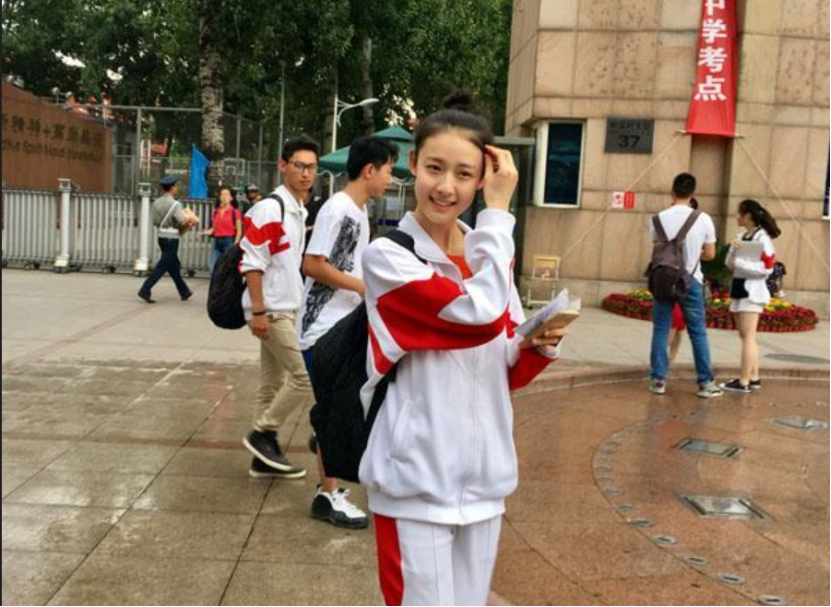

# “清华父亲211母亲，孩子没考上高中”，父亲焦虑做亲子鉴定：父母的光环，不该是孩子的债务
> 💡 备注属性未写入，可能是备注属性名称或者类型被修改了，建议将字段类型设置为 rich_text，可以在小程序-操作-修改文章数据库页面进行调整
> 💡 原文链接:[https://mp.weixin.qq.com/s?__biz=MzkwMzIxNDI2OQ==&mid=2247491810&idx=1&sn=6f5703f031ae1ebb1e8b542a6d4e2b96&chksm=c1086e0d21efe79b4a68836ddb54563272e19db2bc7e2410c37d9b879ba360a1969d7b055386#rd](https://mp.weixin.qq.com/s?__biz=MzkwMzIxNDI2OQ%3D%3D&mid=2247491810&idx=1&sn=6f5703f031ae1ebb1e8b542a6d4e2b96&chksm=c1086e0d21efe79b4a68836ddb54563272e19db2bc7e2410c37d9b879ba360a1969d7b055386#rd)
热搜上一则故事，读来心酸，又让人久久沉默。
一位是清华本硕博连读的父亲，一位是出自211院校的母亲 。二人一路披荆斩棘，是旁人眼里稳稳的学霸范本，是应试赛道里一路开挂的胜利者。他们默认，天赋会顺着血脉稳稳传递，孩子本该顺着这条光亮的路，从容走进高中、走向名校。
可现实迎面泼来一盆冷水：孩子连普通高中都没能考上。

巨大的落差碾碎了父亲长久以来的认知，焦虑、不解、自我怀疑层层包裹住他。他心底藏着一丝微弱、侥幸的猜想：会不会是产房抱错了？是不是这个孩子，本就不属于我们？
于是，他带着孩子去做了亲子鉴定。
一纸报告落定，血缘确凿，孩子确是他们亲生。侥幸碎得干干净净。
很多人讨论这件事，讨论基因、讨论智商、讨论均值回归。可我心里最先浮起的一句话是：从决定去做鉴定的那一刻起，孩子已经输了。输的不是中考，是在父亲心里，他的天资普通，要靠血缘证明，才配被接纳。
纪伯伦在《论孩子》里写：“你的孩子，其实不是你的孩子，乃是生命为自己所渴望的儿女。他们借你而来，却不从你而来，他们虽和你同在，却不属于你。”
我们常常忘记这句话。父母习惯把自己的人生刻度，当成丈量孩子的标尺。学霸父母走过的路，于他们而言举重若轻，便以为孩子也该天生擅长伏案刷题、适应应试节奏。他们不曾想，自己的一路顺畅，本就是人群里极小概率的幸运。
这便是高尔顿提出的“均值回归”。最初研究身高时他发现：极高的父母，孩子往往不会继续突破极限；极矮的父母，孩子也常常向平均身高靠拢。天赋、智商亦是如此，不会在家族里无限叠加、代代拔高。极端出众的个体，下一代向着人群平均值靠拢，才是世间常态。
智商 140 上下的顶尖学霸，本就是人群的少数。数据显示，这类父母的孩子，天赋弱于父母的概率高达 95%，能够复刻父辈名校之路的，不足百分之一。清华父亲难以接受的平凡，恰恰是统计学与遗传学早已写好的规律。父母的耀眼，是小概率奇迹；孩子归于普通，才是大概率的人间真相。
血缘可以传递基因，却传递不了天赋，更承接不了父辈的人生。亲子鉴定验得出血脉，验不出一个人的前程，也验不出一个孩子的价值。
北大历史系赵冬梅教授，也曾走过相似的困境。她的儿子初中没能走完常规的求学轨道，一度脱离了所有人眼中的“正轨”。她没有执着于逼孩子回到应试赛道，没有用自己的名校光环去审判孩子的选择，而是慢慢放下执念，给孩子空间去摸索热爱。
后来这个曾经被视作“掉队”的孩子，成了摄影师、独立纪录片创作者。他跟着车队奔赴派克峰爬山赛，既是摄影师，也是机械师，亲手记录下中国赛车手的征程，拍出属于自己的纪录长片。赵冬梅说，她所求从不是世俗意义上的金榜题名，只盼孩子能够自食其力，寻得内心的安顿与热爱。
这不是放任，不是躺平，而是一种清醒的教育：教育从来不是一道基因遗传题，不是父母优秀，孩子就必须复刻这份光芒。
苏轼写下《洗儿诗》：“人皆养子望聪明，我被聪明误一生。惟愿孩儿愚且鲁，无灾无难到公卿。” 世人都盼孩子天资聪颖、步步争先，可历经世事的东坡，早已看透聪明之外，平安、踏实、自在，亦是难得的福气。
袁枚那句 “白日不到处，青春恰自来。苔花如米小，也学牡丹开”，更是写给无数平凡孩子的诗。牡丹有牡丹的盛大，苔花有苔花的生机。不是所有生命，都要长在向阳的花圃，都要以盛放的艳丽，来证明自己存在的意义。
很多高知家庭，困在一层无形的“学霸滤镜”里。父母的履历、圈层的期待、亲友的目光，层层叠叠压在孩子身上。这份期待慢慢变成枷锁：你是名校父母的孩子，你不能落后，不能平庸，你要替我们证明基因没有辜负。
于是，学习不再是探索自我的路径，变成了偿还父母面子、证明家族基因的任务。孩子背负着“我不能让父母失望”的重担，越紧张，越吃力；越被期待，越想要逃避。内驱力一点点耗散，厌学、逆反接踵而至。他不是不努力，只是一直在用小小的肩膀，扛着父母未曾卸下的光环。
中考只是一次分流，不是人生终审。职高、中专、技能赛道、复读、学艺，条条大路都可以通向自食其力的人生。应试考卷，只考核一部分能力，它看不见一个孩子动手的灵气、共情的温柔、专注的韧性、待人的赤诚。
社会需要站在科研前沿的精英，同样需要踏实肯干、身怀一技之长的普通人。一个人可以不会解复杂的数理题，却能把一台机器修好，把镜头对准动人的瞬间，把一件手艺打磨到极致，把身边的人照料妥当。这些，同样是安身立命的本事。
接纳孩子平凡，不等于放任自流，不是“你怎样都可以”。善良、守信、踏实、有底线，是为人父母要守住的家风；只是我们不必再执着于，孩子一定要光芒耀眼。
孩子平凡，不代表父母失败。
真正成熟的教育，从来不是让孩子替父母延续光环。而是在他跌倒的时候，蹲下来告诉他：你可以暂时落后，但你不必用一场考试，偿还父母的面子。
孩子可以平凡，但他并不平庸。他不必事事第一，可他依旧保有努力的热忱；他走得慢一点，不代表他不配被爱。父母的勋章，是属于父母自己的；孩子的山河，要他自己一步一步去走。
我们总以为，孩子需要一个更高的起跑线。可很多时候，他最需要的，是一个在他失利时，依然愿意站在他这一边的家长；是一份不必光芒万丈，平凡也值得快乐的认可。
不必拿父母的优秀，去丈量孩子的一生。光环是馈赠，不该是债务。
愿每一个孩子，都不必活在父辈的影子里；愿每一位父母，终能读懂：养育的终极意义，不是养出一个复刻自己的学霸，而是护着一个独立的生命，平安、正直、勇敢，慢慢长成他本来的样子。
苔花自有它的花期，山河自有它的归途。
