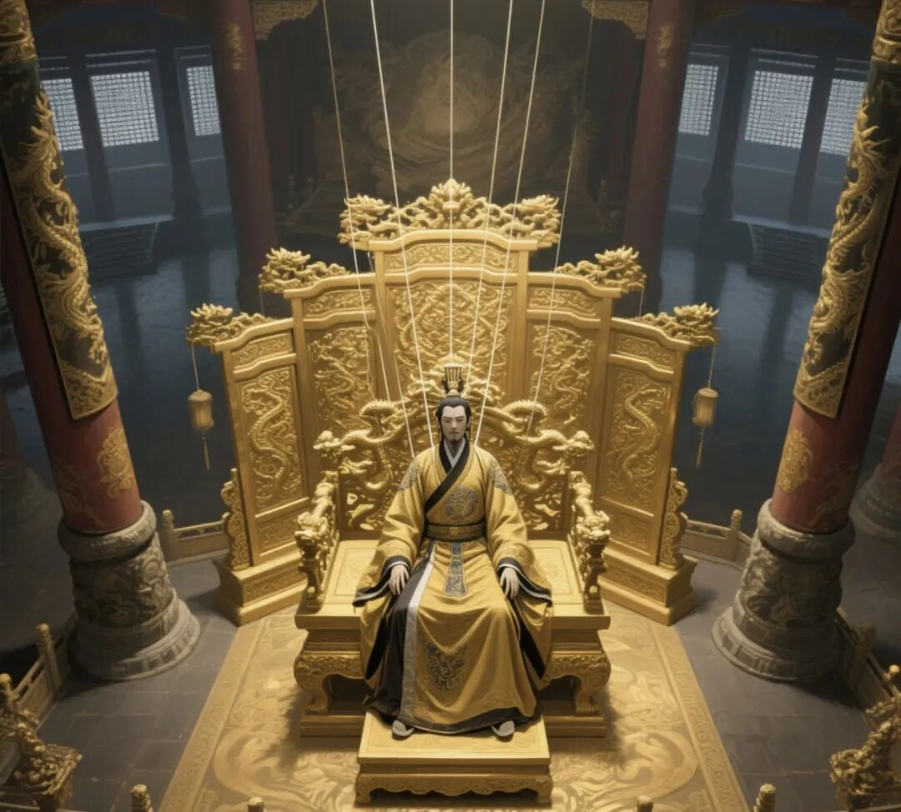
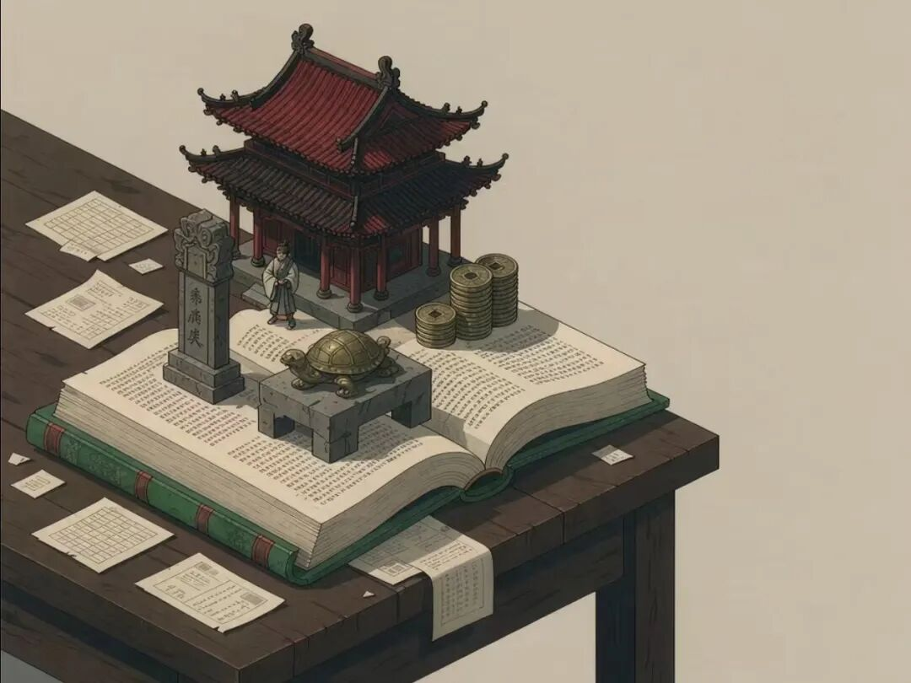
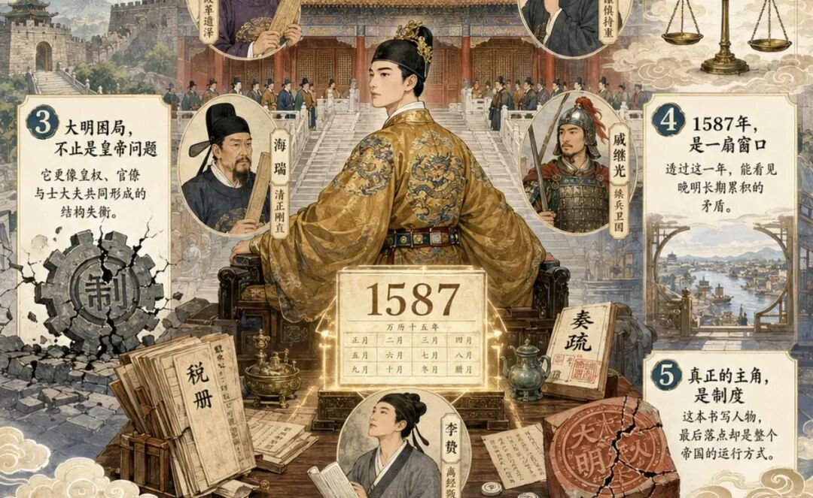

# 《万历十五年》18句暴击，黄仁宇早看穿了体制困境
> 💡 备注属性未写入，可能是备注属性名称或者类型被修改了，建议将字段类型设置为 rich_text，可以在小程序-操作-修改文章数据库页面进行调整
> 💡 原文链接:[https://mp.weixin.qq.com/s?__biz=Mzk4ODM0MDM5MA==&mid=2247486793&idx=1&sn=7243c8a3446d769f10832ec8b779eee3&chksm=c45f93d6b9e0f3cc934bddc29123cfdee5a630ac90eda6fffbcf42278a8be1c58744e4cdf302#rd](https://mp.weixin.qq.com/s?__biz=Mzk4ODM0MDM5MA%3D%3D&mid=2247486793&idx=1&sn=7243c8a3446d769f10832ec8b779eee3&chksm=c45f93d6b9e0f3cc934bddc29123cfdee5a630ac90eda6fffbcf42278a8be1c58744e4cdf302#rd)
**这是一本经典的历史著作，黄仁宇的“大历史观”代表作。
**核心是讲明代政治制度的困境。
1587年看似平淡无事，没有战乱，没有灾荒，但，帝国却已走到尽头。
万历皇帝（消极怠工）、张居正（改革失败）、申时行（和事佬）、海瑞（极端道德）、戚继光（务实武将）、李贽（思想矛盾），每个人都在自己的位置上挣扎，但都逃不出那个僵化的系统。
道德代替了法律，礼仪代替了行政，数字无法管理，制度无法适应现实。
黄仁宇的独特之处在于，他不写“发生了什么”，而是写“为什么什么都改变不了”。
读它，你会看懂一个系统如何悄无声息从内部慢慢烂掉。

**1. 万历十五年，表面上似乎是四海升平，无事可记，实际上我们的大明帝国却已经走到了它发展的尽头。**
这是全书最核心的命题。黄仁宇用“大历史观”告诉我们：一个王朝的崩溃，不是从战火纷飞开始的，是从那些“看似无事”的年份里就已经注定了。
制度僵化、道德代替法律、数字无法管理，这些病灶在1587年已经全部显现，只是当时没人看见。
**2. 中国二千年来，以道德代替法制，至明代而极，这就是一切问题的症结。**
黄仁宇把中国历史的根本问题浓缩在这一句话里。**整个帝国靠“道德”运转，而不是靠“数目字管理”。**
官员断案不依据法律条文，而是依据儒家伦理；国家收税不依靠精确的账目，而是依靠“差不多”的估算。
道德是软性的、模糊的、可解释的，当它代替了法律，整个系统就失去了可操作性和可预测性。

**3. 万历皇帝是世界上最孤独的人。三十年不上朝，不是因为他懒，是因为他发现：他上朝也改变不了什么。**
他贵为天子，却连立谁为太子都不能自己决定。
他想励精图治，却发现所有的奏折都是“道德文章”，所有的官员都在“引经据典”地对抗他。
万历的“怠政”常被当作昏君的典型。但黄仁宇告诉我们，万历是一个极其聪明的人。他看透了这套系统的本质：**文官集团需要的不是一个有作为的皇帝，是一个“垂拱而治”的象征。**
他越有作为，越会被视为“逾越祖制”。
所以他选择了一个最消极也最有效的反抗方式，即“什么都不做”。一个清醒的人面对无法改变的僵化系统时，唯一能做的无声反抗。
**4. 张居正的通盘改革，不过是暂时把问题压下去，而未能从根本上解决。**
张居正推行“一条鞭法”，试图用数字化手段管理帝国财政。
但改革触动了整个文官集团的利益，他死后被清算，十年新政付诸东流。
黄仁宇指出：**在一个没有数目字管理基础的帝国里，任何技术性改革都注定失败**。为改革的工具本身，还没有被发明出来。
**5. 申时行是一个和事佬，他的“中庸”不是智慧，是无奈。**
张居正倒台后，申时行接任首辅，选择了一条完全相反的路——和稀泥。
他试图调和皇帝与文官集团的矛盾，结果两头不讨好。他不是没有能力，而是看透了，在这个系统里，你越努力，越会撞得头破血流。
**6. 海瑞是一个极端的道德主义者，他的问题在于：他把道德当成了万能药。**
海瑞清廉到极致，刚直到极端。
他断案的标准不是法律，是“道德”。穷人和富人打官司，他判穷人赢；哥哥和弟弟争产，他判哥哥赢。
他以为靠道德可以解决一切问题，结果制造了更多问题。
他是清官，但不是一个好官。**因为他不明白，治理一个帝国，靠的不是道德热情，是制度和技术。**
**7. 戚继光是一个务实的武将，他懂得在现实中求生存。**
戚继光抗倭有功，但他不是在真空中打仗的。
他需要张居正的支持才能拿到军费，需要和文官周旋才能保住兵权。
他不是不懂道德，是不被道德绑架。
他是书中最接近“现代管理者”的人物，知道目标是什么，也知道实现目标的路径是什么。
**8. 李贽是一个矛盾的思想家，他批判传统，却找不到出路。李贽的悲剧，是所有思想者的悲剧：他看穿了旧世界的谎言，却没有能力建造新世界的地基。**
李贽反对“以孔子之是非为是非”，主张个性解放，但他没有能力构建一套新的思想体系来替代旧体系。
他是那个时代最清醒的人，也是最痛苦的人。看穿了旧世界的虚伪，却看不到新世界的可能。
**9. 当一个人口众多的国家，各人行动全凭儒家简单粗浅而又无法固定的原则所限制，而法律又缺乏创造性，则其社会发展的程度，必然受到限制。**
黄仁宇把“道德代替法律”的后果说得再清楚不过。
儒家原则是模糊的、灵活的、可以解释的，它无法为复杂的社会提供稳定的预期。没有稳定预期，就没有长期投资，没有技术创新，没有资本主义萌芽。
中国在明代已经落后于西方，不是因为人种，不是因为文化，是因为制度。
**10. 张居正死后被清算，不是因为他做错了什么，是因为他做得太对了。**
他整顿吏治、清丈田亩、推行一条鞭法，每件事都对帝国有利，但每件事都动了文官集团的蛋糕。
在一个“道德至上”的系统里，一个官员追求“效率”本身就是一种冒犯。
因为它打破了所有人默认的游戏规则。

**11. 申时行认为：与其解决一个问题，不如维持一个平衡。**
申时行的“中庸”常被视为平庸。但在黄仁宇看来，这是一个智者在僵化系统里的理性选择。既然所有的问题都无法从根本上解决，那么维持平衡，不让任何一方彻底压倒另一方，就是唯一能做的事。
**12. 海瑞的死，标志着一个时代的终结：那个靠道德就能治理国家的幻想，彻底破灭了。**
海瑞是儒家道德理想的极致化身。
他清廉、刚直、不畏权贵，但他在现实中寸步难行。
他的死提醒所有人，在一个缺乏数目字管理的帝国里，道德不是治理工具，只是道德姿态。
**13. 戚继光的成功，不是因为他比其他人更懂军事，是因为他比其他人更懂政治。**
他能打仗，但他能一直打胜仗，靠的是张居正的庇护、文官的支持、兵源的稳定、军费的充足。
他在道德和现实之间找到了那条细线。既不做道德楷模，也不做纯粹武夫。
**14. 大明帝国的根本问题，不是皇帝昏庸，不是官员腐败，不是外敌入侵，而是：整个帝国无法用数字来管理。**
黄仁宇的“数目字管理”理论，是全书最重要的分析工具。一个帝国的税收、财政、军事、人口，全是一笔糊涂账。
皇帝不知道国家有多少钱，首辅不知道各省的库存，总督不知道军队的实际人数。这种状态下，任何政策的执行效果都是随机性的。
**15. 道德是软性的，法律是硬性的；道德是模糊的，法律是精确的；道德是可解释的，法律是可预期的。**
黄仁宇用这段对比说明：为什么道德不能代替法律。
道德适合用来约束少数精英，法律适合用来管理亿万民众。
当整个帝国都以道德为运行准则时，整个系统就失去了可操作性。
**16. 明朝的灭亡，不是从崇祯上吊开始的，是从万历十五年就开始了。**
这是“大历史观”最深刻的洞见。万历十五年没有战争、没有灾荒、没有政变，但所有的病灶已经扩散到全身。
就像一棵大树，表面枝繁叶茂，树心早已蛀空。风来了，它就倒了。
**17. 中国社会在明代已经发展到了它的极限，如果没有外部冲击，它会一直循环下去。**
改朝换代、治乱循环、分久必合合久必分。这是中国历史的规律。
这不是因为中国人没有创造力，是因为这个系统已经封闭了，所有的能量都消耗在内部的循环里。

**18. 读《万历十五年》，不是为了知道一个王朝的兴衰，是为了知道：一个系统如果拒绝改变，最终会付出什么代价。**
这是全书最深的教训。系统会僵化，人性会惰怠，利益集团会固守。
当整个系统拒绝改变时，表面上它还会继续运转，但内里的瓦解已经无法挽回。等到所有人都看见危机时，改已经来不及了。
