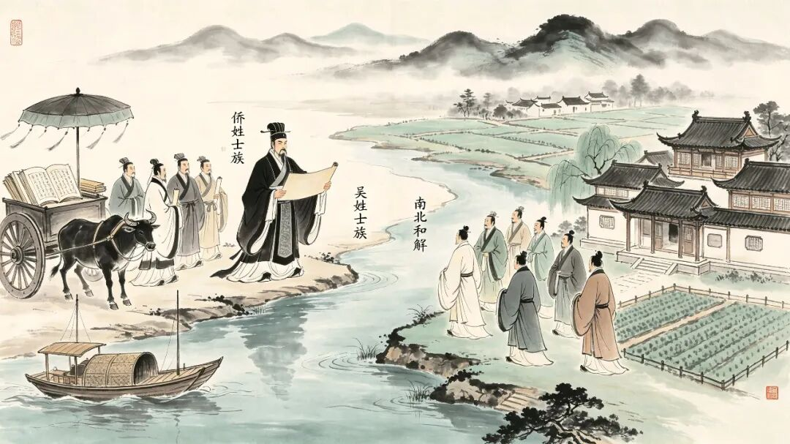
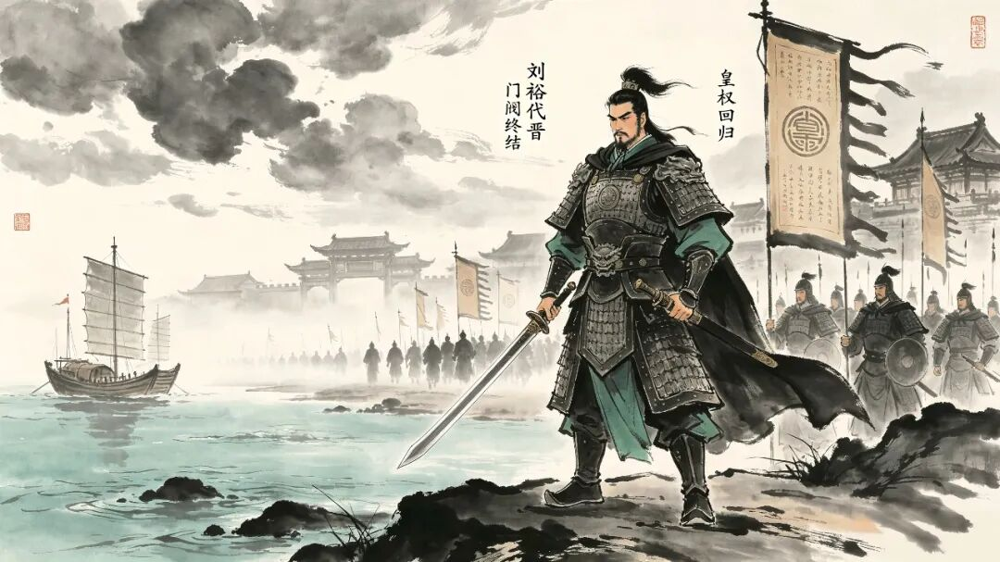

# 《东晋门阀制度》：衣冠南渡之后，中国仅此一次的百年权力平衡
> 💡 备注属性未写入，可能是备注属性名称或者类型被修改了，建议将字段类型设置为 rich_text，可以在小程序-操作-修改文章数据库页面进行调整
> 💡 原文链接:[https://mp.weixin.qq.com/s?__biz=MzkyOTUxODY5OQ==&mid=2247483817&idx=1&sn=861b99495ffdf7c6bfadefed5ee74736&chksm=c36acc83673e487d3c451afcb5c5f95130858e6ab656b3bd0f88b5d4e18a3bb99fb2e63285d0#rd](https://mp.weixin.qq.com/s?__biz=MzkyOTUxODY5OQ%3D%3D&mid=2247483817&idx=1&sn=861b99495ffdf7c6bfadefed5ee74736&chksm=c36acc83673e487d3c451afcb5c5f95130858e6ab656b3bd0f88b5d4e18a3bb99fb2e63285d0#rd)
永嘉南渡，中原士族携百年文脉仓皇南迁。这场逃亡，无意间催生了中国历史上绝无仅有的政治格局。山河破碎、皇权孱弱，司马皇室名存实亡。乱世夹缝之中，诞生了空前也绝后的权力形态——**王与马，共天下**。
田余庆在《东晋门阀政治》中，写出了东晋百年的真相：这不是皇权独大的王朝，也不是权臣篡国的乱世。而是皇权与士族共生、制衡、拉扯、博弈，微妙又危险的百年平衡。
**1. 「王与马，共天下」到底是什么？**
**马**：司马睿（晋元帝，皇族）
**王**：琅琊王氏，南迁第一高门，代表人物王导、王敦。
**史实**：司马睿本是皇室边缘人物，无威望、无根基、无兵权。
西晋覆灭、中原倾覆，若没有琅琊王氏鼎力扶持，他根本无法在江南立足，更无法建立东晋。
从来都不是王氏夺权，而是皇权先天残缺，不得不依附士族立国。王导居中执政，安抚朝野、调和南北士族；王敦坐镇荆州，手握重兵、镇守疆土。
皇族需要士族的声望、人脉、实力，坐稳江山；士族需要皇族的正统名分，保全家族门第与特权。东晋的建立，从始至终，就是一场双向成全的政治合作。于是天下皆知：**王与马，共天下**。
** 2.四大家族轮流上台、互相制衡**
东晋并非只有王谢两家，是几家北方南迁大族，轮流主导政局，形成动态平衡。**完整权力更迭脉络：**
琅琊王氏 → 颍川庾氏 → 谯国桓氏 → 陈郡谢氏

**琅琊王氏**：开启门阀共治时代，奠定东晋百年格局。
**颍川庾氏**：以外戚身份接棒执政，延续士族平衡。
**谯国桓氏**：桓温凭军功强势崛起，三度北伐，权倾朝野，几乎打破百年秩序。
**陈郡谢氏**：淝水之战一战封神，挽大厦于将倾，把门阀政治推向顶峰，也走到了最后的辉煌。
这四大家族，有一个百年默契的底线：
可以争权，可以博弈，但绝不轻易颠覆司马皇权。一旦某一家权势过盛、意图独大，其余门阀便会立刻联手制衡、共同压制。
东晋之所以能在乱世存续百年，靠的是三重极致平衡：皇权与士族的平衡、士族与士族的平衡、上游荆州兵权与下游朝堂政权的平衡。
** 3.隐藏的矛盾：南迁侨姓士族 VS 江南本土吴姓士族**
衣冠南渡，带来的不仅是文脉，更是激烈的资源与权力冲突。

东晋士族分为两大阵营：
**侨姓士族：**跟随朝廷南渡的北方高门，王、庾、桓、谢，属于外来掌权者。
**吴姓士族：**世代扎根江南的本土大族，顾、陆、朱、张，是江南真正的老牌根基。
初期南北矛盾极深：北方士族抢占土地、垄断仕途、把持朝政，本土士族长期被挤压、被排斥，抵触极深。
东晋真正的定鼎之功，不在兵权，而在王导的调和之智。他主动安抚江南、礼遇本土、拉拢吴地士族，让南北两大势力从对立走向合作。可以说：没有南北士族和解，就没有安稳东晋；没有衣冠包容，就没有江南文明崛起。
**4. 秩序崩塌的开端：桓氏父子，打破百年默契**
百年制衡的安稳，终究会被野心打破。
**桓温**：谯国桓氏，三次北伐，手握重兵，权势滔天，有代晋自立的野心。
**桓玄**（桓温儿子）：打破默契，直接起兵造反、短暂篡晋。
桓温掌权后，军功盖世、权倾天下，早已不满足士族共治的规则。他觊觎皇权、操纵朝堂、废立帝王，试图打破延续百年的门阀秩序。幸得其余士族联手制衡，桓温终其一生，未能篡晋。而他的儿子桓玄，彻底撕碎了所有默契。直接起兵叛乱、攻入建康、篡晋称帝。
虽然桓玄之乱很快覆灭，但它印证了一个残酷事实：维持百年的门阀平衡，已经彻底失效、摇摇欲坠。温柔的共治时代，正式走向尾声。
**5.门阀政治的终结：刘裕登场，回归皇权**
门阀政治的消亡，是历史的必然。

长期养尊处优的高门子弟，沉溺清谈、轻视实务、不习兵戈。门第高贵，却逐渐丧失治国能力与血性担当。士族慢慢空心化，繁华之下早已腐朽。
与此同时，乱世淬炼出的寒门武将悄然崛起。出身低微的刘裕，凭北府兵军功平定战乱、收拾残局，一步步掌握天下兵权。他不靠士族扶持、不看门第脸色，以绝对实力终结乱世、代晋建宋。
自此：门阀共治的百年特例彻底落幕，皇权重新回归中央。
