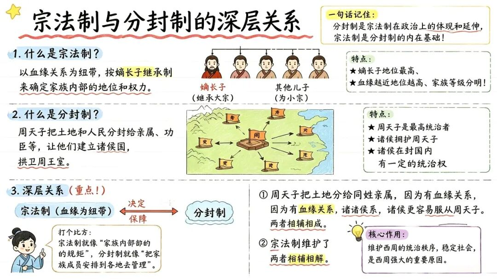
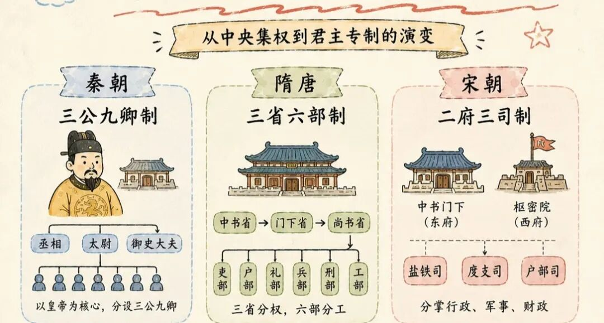
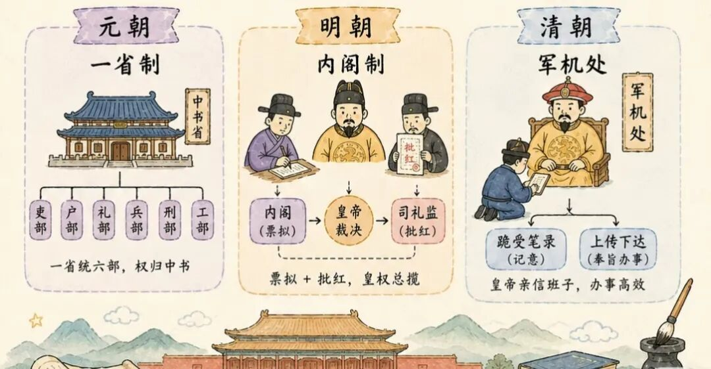
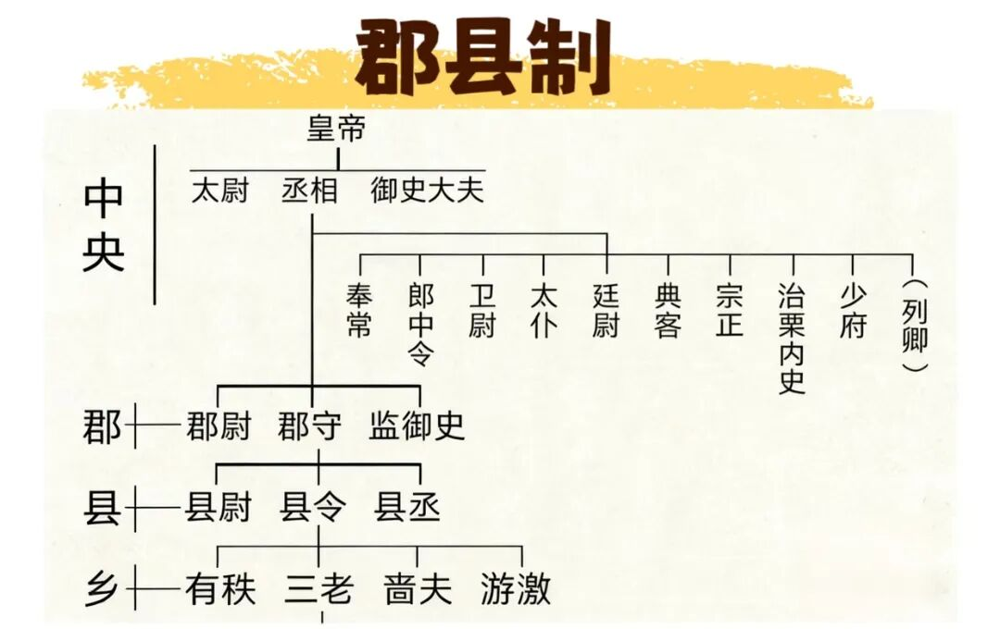

# 《中国古代官制》看懂古代权力的骨架
> 💡 备注属性未写入，可能是备注属性名称或者类型被修改了，建议将字段类型设置为 rich_text，可以在小程序-操作-修改文章数据库页面进行调整
> 💡 原文链接:[https://mp.weixin.qq.com/s?__biz=MzkyOTUxODY5OQ==&mid=2247483835&idx=1&sn=a2e6f0ac23d5da9c27b6b640b0912769&chksm=c3a97e0de3ab24fdfeed608712fd2ec187e83d306903fef5238b15cbc5c137a7f7fcc4ca3285#rd](https://mp.weixin.qq.com/s?__biz=MzkyOTUxODY5OQ%3D%3D&mid=2247483835&idx=1&sn=a2e6f0ac23d5da9c27b6b640b0912769&chksm=c3a97e0de3ab24fdfeed608712fd2ec187e83d306903fef5238b15cbc5c137a7f7fcc4ca3285#rd)
现代人想要入门历史，常常被一堆眼花缭乱的官职困住：丞相、内阁大学士、军机大臣，刺史、节度使、知州……这些头衔到底谁大，管什么，又是怎么一步步变到今天的？
如果想要一套清晰、入门的线索，读懂中国两千多年王朝的权力运转，这本由王俊编著的《中国古代官制》，恰好合适。它属于「中国传统民俗文化——政治经济制度系列」，不堆砌晦涩考据，顺着时代脉络，把古代王朝整套官吏体系铺展开来，帮我们看懂：所谓官制，就是一个王朝的骨架。
这本书核心讲两件事：
一是朝廷设置哪些机构、安排什么岗位；
二是官员如何选拔、考核、升迁与管理。
全书藏着两条贯穿始终的主线：
相权不断被拆分削弱，皇权持续走高；
地方权力不断回收，中央集权一步步加固。历朝所有官制变革，大多绕不开这两个方向。
**一、中枢：帝国最核心的权力博弈**
王朝最高层制度的更迭，是全书最核心的部分，也是历史转折的标志。
**先秦**是贵族政治，依托分封与宗法制，实行世卿世禄，官职依靠血缘世袭，家国一体，还没有成熟的官僚体系。 

**世卿**： 指的是官职的世袭。贵族子弟可以凭借血缘关系，父死子继，世代担任“卿”这样的高级官职。
**世禄**： 指的是俸禄的世袭。这些贵族不仅当官，还享有封地（也叫“采邑”）和土地上的赋税收入，并且这些财富也可以代代相传。
**秦，**统一之后，诞生三公九卿制，并在汉代完善。丞相掌行政，太尉掌军事，御史大夫负责监察百官；下面设九卿，分别掌管礼仪、财政、司法、皇室事务等，中国职业官僚体系就此落地。
**隋唐**，三省六部制登场，这是一套精巧的分权制衡设计。中书省负责草拟诏令，门下省拥有封驳审核之权，可以驳回不妥的诏书，尚书省负责政令执行；尚书省下分吏、户、礼、兵、刑、工六部，这套部门框架，长久影响后世。
**宋代，**吸取藩镇之乱的教训，设立二府三司。行政归中书门下，军政交给枢密院，财政独立归于三司。权力被切得细碎，最大限度避免权臣专权，代价就是机构臃肿，行政效率低下。

**明朝，**是重大转折点，朱元璋直接废除丞相，六部直接对接皇帝。后来内阁应运而生，内阁大学士手握票拟权，可以给出处理政务的意见，但始终没有法定宰相的权力，最终决策权牢牢握在皇帝与司礼监手中。
**清代，**走到君主专制的顶峰：军机处。它没有固定官署，没有定员，没有品级，大臣都是皇帝亲信，军国机要在此商议，外朝很难插手。

**二、地方：中央与地方长久的拉扯**
中枢之外，地方官制，决定一个王朝能不能稳住广袤国土，也是治乱的关键。
**秦代，**推行郡县制，抛弃分封，由中央直接管辖地方，是大一统的基石。

**汉代，**增设刺史，原本只是派出的监察官员，日久天长，慢慢演变成手握军政大权的地方长官。
**唐代，**设置节度使，最初是边防需要，后期节度使手握地方财权、兵权、行政权，最终酿成藩镇割据。
**宋代，**吸取教训，推行以文驭武，派遣文臣担任知州，极力压缩地方的兵力与财力，实现“强干弱枝”，地方很难起兵叛乱，却也丧失抵御灾害、边防应变的力量。
**元朝，**开创行省制度，行省作为中央派出机构，这套框架，正是如今省级区划的源头。
**明清**，省、府、县三级格局稳定下来。而在县衙之下，还有乡里制度，作为帝国伸向乡土最末端的触角，维系基层秩序。
除此之外，古代还有专门适配边疆的特殊官制，比如唐代的都护府，辽代南北面官，分治游牧部族与汉人，用来适配多民族的治理需求。
**三、监察与特务：王朝的监视网络**
一套官制想要运转，就少不了监察体系。
谏官，负责规劝帝王，在唐代发展成熟；
御史，则纠察百官，检举贪腐与越权。
到明代，在常规监察之外，诞生厂卫——锦衣卫、东厂、西厂这套特务体系，独立于正常司法监察之外，是皇权延伸出来的特殊工具。清代还有八旗、绿营两套并行的军事官制，支撑王朝武力。
**四、选官：谁可以走进朝堂**
用什么样的方式挑选官员，直接决定社会流动，也是这本书单独划出的一大板块。
**世卿世禄（先秦）**：血缘决定一切，贵族世代承袭官职。
**察举征辟（汉代）**：依靠地方举荐，看重德行声望，后期慢慢被门阀把持。
**九品中正制（魏晋南北朝）**：由中正官评定人才品级，最终固化阶层，留下“上品无寒门，下品无势族”的局面。
**科举制（隋至清末）**：分科考试选拔官吏，是古代最具备公平性的上升通道，给寒门留下向上的机会，支撑官僚体系持续更新。
选拔完成之后，还有配套管理：考课制度定期核验政绩，决定升降奖惩；回避制度，不让官员在故土任职，防止勾结营私；还有爵位、品级，用来划定官员身份高低。
**五、官吏的另一面：俸禄、休假与致仕**
官吏有俸禄，也就是朝廷发放的薪俸；
有休沐，属于古代官员的假期；
致仕，就是我们今天所说的退休。
当然，这套体系自带弊病：朋党相争、卖官鬻爵，都是这套制度运转到后期常常滋生的顽疾。
这本书作为一本科普入门读物，没有深挖纷繁细碎的冷门官职，而是搭建起一条清晰的主线。
当我们读懂这套官制就会明白：史书里的朝代更迭，不只是帝王将相的故事，背后是一套权力制度不断调试、制衡、收紧，直到慢慢僵化的过程。
