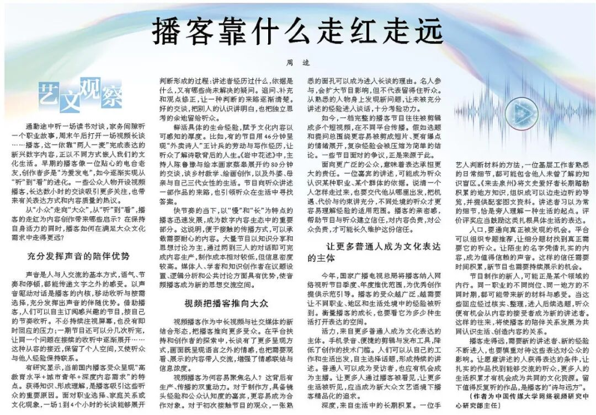
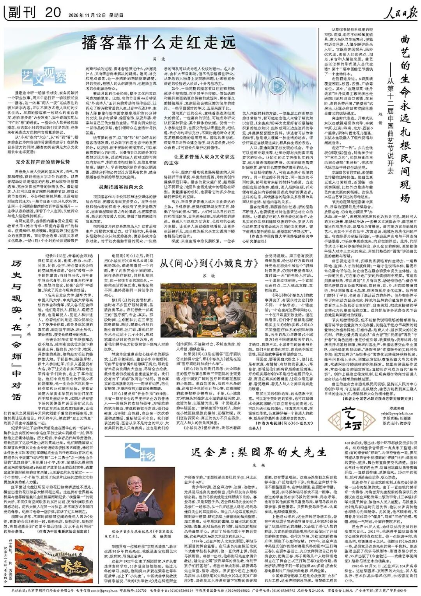

# 《人民日报》｜周逵：播客靠什么走红走远
> 💡 备注属性未写入，可能是备注属性名称或者类型被修改了，建议将字段类型设置为 rich_text，可以在小程序-操作-修改文章数据库页面进行调整
> 💡 原文链接:[https://mp.weixin.qq.com/s?__biz=MzI2NzA0NzY3Mw==&mid=2649711047&idx=1&sn=beadda69ada7e90baf05a77c06d78fcb&chksm=f3b475767d7d5346c133964b443c49ebd197cb90a186500a827b10cce4c5c4f442c09dac22ee#rd](https://mp.weixin.qq.com/s?__biz=MzI2NzA0NzY3Mw%3D%3D&mid=2649711047&idx=1&sn=beadda69ada7e90baf05a77c06d78fcb&chksm=f3b475767d7d5346c133964b443c49ebd197cb90a186500a827b10cce4c5c4f442c09dac22ee#rd)
人民日报　艺文观察
二〇二六年十一月十二日　第20版
**播客靠什么走红走远**
周　逵
中国传媒大学
通勤途中听一场读书对谈，家务间隙听一个职业故事，周末午后打开一场视频长谈……播客，这一依靠“两人一麦”完成表达的新兴数字内容，正以不同方式嵌入我们的文化生活。早期的播客像一位贴心的电台老友，创作者多是“为爱发电”，如今逐渐实现从“听”到“看”的进化。一些公众人物开设视频播客，长达数小时的交谈吸引更多关注，也带来有关表达方式和内容质量的热议。
从“小众”走向“大众”，从“听”到“看”，播客的走红为内容创作带来哪些启示？在保持自身活力的同时，播客如何在满足大众文化需求中走得更远？

《人民日报》2026年11月12日第20版
01
**充分发挥声音的陪伴优势**
声音是人与人交流的基本方式，语气、节奏和停顿，都能传递文字之外的感受。以声音驱动对话是播客的内核，移动收听与按需选择，充分发挥出声音的伴随优势。借助播客，人们可以自主订阅感兴趣的节目，按自己的节奏收听。不必持续注视屏幕，也没有即时回应的压力；一期节目还可以分几次听完，让同一个问题在接续的收听中逐渐展开……这种从容的接近，保留了个人空间，又使听众与他人经验保持联系。
有研究显示，当前国内播客受众呈现“高教育水平+城市青年+深度内容需求”的特点。获得知识、形成理解，是播客吸引这些听众的重要原因。面对职业选择、家庭关系或文化现象，一场1到4个小时的长谈能够展开判断形成的过程：讲述者经历过什么，依据是什么，又有哪些尚未解决的疑问。追问、补充和观点修正，让一种判断的来路逐渐清楚。**好的交谈，把别人的认识讲明白，也把独立思考的余地留给听众。**
鲜活具体的生命经验，赋予文化内容以可感知的厚度。比如，有的节目用46分钟呈现“外卖诗人”王计兵的劳动与写作经历，让听众了解诗歌背后的人生。《岩中花述》中，主持人陈鲁豫与绘本画家蔡皋展开约80分钟的交谈，谈乡村教学、绘画创作，以及外婆、母亲与自己三代女性的生活。节目向听众讲述一部作品的来路，也引领听众在生活中寻找答案。

故事FM《如此「地下写作」三十年》，讲述者王计兵，46分钟

《岩中花述》S9E3，陈鲁豫对话绘本画家蔡皋，约80分钟
快节奏的当下，以“慢”和“长”为特点的播客迅速发展，成为数字内容生态中的重要部分。这说明，**便于接触的传播方式，可以承载需要耐心的内容。**大量节目以知识分享和思想讨论为主，通过两到三人的对话即可完成内容生产，制作成本相对较低，但信息密度较高。媒体人、学者和知识创作者在议题设置、逻辑分析和公共讨论方面具有优势，使音频播客成为新的思想交流空间。
02
**视频把播客推向大众**
视频播客作为中长视频与社交媒体的新结合形态，把播客推向更多受众。在平台扶持和创作者的探索中，长谈有了更多呈现方式，画面既呈现语言之外的情感，也把需要观看、展示的内容带入交流，增强了情感联结与信息浓度。
视频播客为何容易聚焦名人？这背后有生产、传播的双重动力。对于制作方，具备镜头经验和公众认知度的嘉宾，更容易成为合作对象。对于初次接触节目的观众，一张熟悉的面孔可以成为进入长谈的理由。**名人参与，会扩大节目影响，但不代表留得住听众。**从熟悉的人物身上发现新问题，让未被充分讲述的经验进入谈话，十分考验功力。
如今，一档完整的播客节目往往被剪辑成多个短视频，在不同平台传播。假如选题和提问总围绕更容易被剪成短片、更有爆点的情绪展开，复杂经验会被压缩为简单的结论。一些节目面对的争议，正是来源于此。
面向更广泛的公众，意味着表达承担更大的责任。一位嘉宾的讲述，可能成为听众认识某种职业、某个群体的依据。说清一个人怎样走过来，也要交代他从哪里出发，把机遇、代价与约束讲充分，不同处境的听众才更容易理解经验的适用范围。播客的亲密感，帮助节目与听众建立信任，**对内容负责，对公众负责，才可能长久维护这份信任。**
03
**让更多普通人成为文化表达的主体**
今年，国家广播电视总局将播客纳入网络视听节目季度、年度推优范围，为优秀创作提供示范引导。播客的受众越广泛，越需要让不同职业、地区和生活处境中的经验被听到。衡量播客的成长，也要看它为多少种生活打开表达的空间。
**活力，来自更多普通人成为文化表达的主体。**手机录音、便捷的剪辑与发布工具，降低了创作的技术门槛。人们可以从自己的工作和生活出发，自主选择话题，形成持续的讲述。普通人可以成为受访者，也应有机会成为主播。让更多人通过播客被看见，让更多生活被听见，应当成为新大众文艺语境下播客精品化的追求。
**深度，来自生活中的长期积累。**一位手艺人判断材料的方法，一位基层工作者熟悉的日常细节，都可能包含他人未曾了解的知识盲区。《来去泉州》将文史爱好者长期踏勘积累的地方知识，组织成可以边走边听的导览，并提供配套图文资料。讲述者习以为常的细节，恰是旁人理解一种生活的起点。评价评奖应当鼓励这类扎根具体生活的表达。

《来去泉州》，文史爱好者边走边听的泉州导览，并配有图文资料
**入口，要通向真正被发现的机会。**平台可以组织专题推荐，让细分题材找到真正需要它的听众。让陌生的名字凭借扎实的内容，成为值得信赖的声音。这样的信任需要时间积累，新节目也需要持续展示的机会。
节目制作的新人，可能正是某个领域的内行。同一职业的不同岗位、同一地方的不同时期，都可能带来新的材料与感受。当这些回应经过核实、整理，进入后续选题，听众便有机会从内容的接受者成为新的讲述者。这样的往来，将使播客的陪伴关系发展为共同认识生活、创造内容的关系。
播客走得远，需要新的讲述者、新的经验不断进入，也要慎重对待这些表达对公众的影响。让愿意讲述的人获得表达的条件，让扎实的作品找到能够交流的听众，更多人的生活积累才有机会成为共同的文化资源。留下值得反复听的作品，是播客的“诗与远方”。

当日第20版副刊版面
原载《人民日报》2026年11月12日第20版　艺文观察
作者为中国传媒大学网络视频研究中心研究部主任
