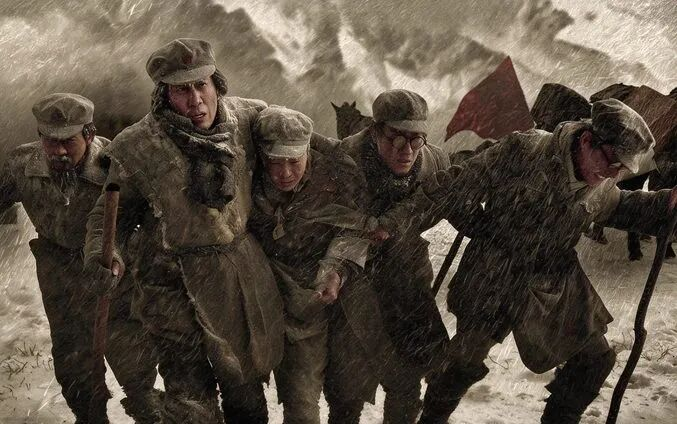
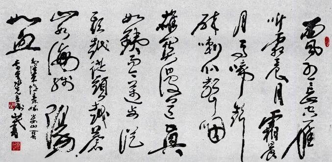
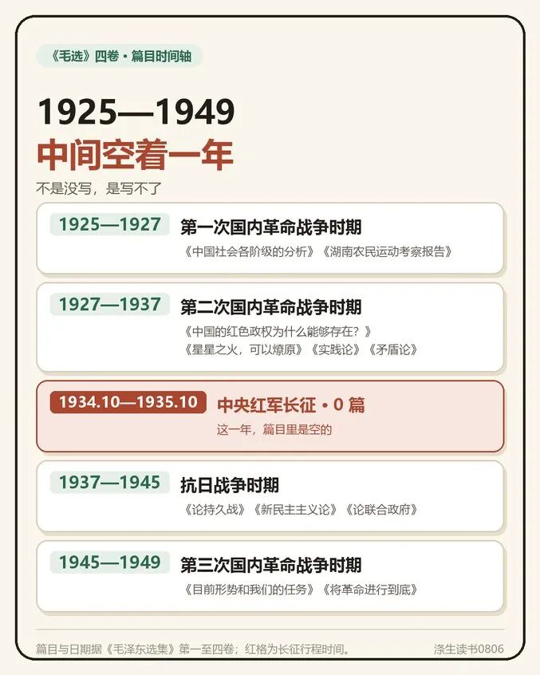
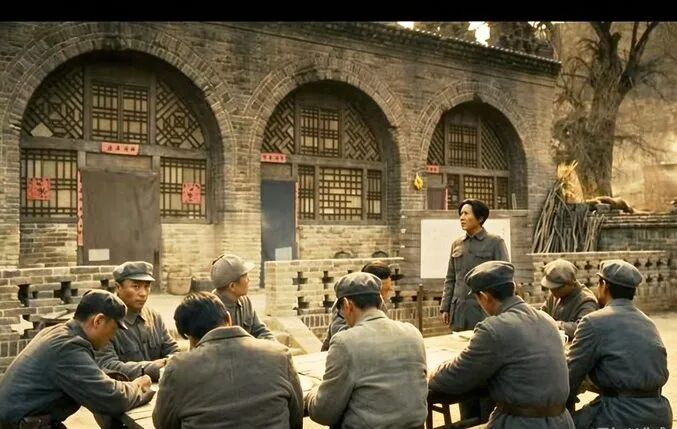

# 《伟大的长征》追完了，我去翻《毛选》：四卷里，没有一篇写在长征路上
> 💡 备注属性未写入，可能是备注属性名称或者类型被修改了，建议将字段类型设置为 rich_text，可以在小程序-操作-修改文章数据库页面进行调整
> 原文链接:[https://mp.weixin.qq.com/s/oStqRtJQVuM4MJA52hLr7Q](https://mp.weixin.qq.com/s/oStqRtJQVuM4MJA52hLr7Q)
**随笔 · 长征**
四卷里空着的那一年，是他们替我们赶的路。
《伟大的长征》播到雪山草地那几集，弹幕里最多的一句是“不敢看第二遍”。
我也是。看完那几集，我把《毛泽东选集》一至四卷的目录从头翻了一遍，翻完愣了很久——
**从 1934 年 10 月中央红军出发，到 1935 年 10 月到达陕北，整整一年，四卷里没有一篇是那一年写的。**
有位读者前天也问了同一件事。他去翻过，以为是版本不全。
不是版本不全。**是写不了。**

图 01　《伟大的长征》剧照 · 过雪山
**那一年的日子，容不下一张桌子**
先说三个“不具备”。
**01没有落脚点。**队伍日夜行军，路线随时调整，今天宿营的村子，明天可能就是战场。写长文要坐下来、摊开纸、连着几天想同一件事，而那一年的常态是：随时准备走。
**02没有纸笔。**纸张、笔墨都是紧缺物资，连粮食都早已断绝。过松潘草地，泥潭暗藏杀机，暴雨冰雹说来就来，脚下的淤泥能吞人，树皮、草根、皮带都成了充饥之物；翻夹金山，寒风刺骨、空气稀薄，很多战士在严寒里永远停在山路上。那种条件下，纸是要留给地图和命令的。
**03没有整块时间。**白天赶路、警戒、作战，夜间还要开会研判敌情、布置防务、处理伤员。所有人包括指挥核心的第一任务，是带着队伍活下去、冲出封锁线；他的精力几乎全部投在军情、部署、路线抉择上。
理论长文需要的“整块安静时间”，是那一年的奢侈品。
**诗写得出，文章写不出**
这里有一层最容易混的地方：长征路上，他明明留下了一批诗词——《忆秦娥·娄山关》《十六字令三首》《七律·长征》《清平乐·六盘山》，都是那一年写的。
既然能写诗，为什么写不了文章？
因为载体不是一回事。
诗词短，几十个字，可以在马背上颠着打腹稿，战斗结束、寻到片刻闲暇记下几句就成篇；情绪到了，句子自己会来。
理论长文要复盘斗争经验、梳理路线问题、系统阐释，要资料、要推敲、要反复改。**这是桌面工作，不是马背工作。**

图 02　毛体书法〈忆秦娥·娄山关〉
**诗是情绪，文是体系。情绪随身带，体系需要案头。**
**最硬的证据：那两篇，都是站稳之后才写的**
不用推测，看篇目和日期就够了。
**《论反对日本帝国主义的策略》**，写于 1935 年 12 月，瓦窑堡会议之后——那时中央红军已经到达陕北。
**《中国革命战争的战略问题》**，成文于 1936 年 12 月，在相对安定的陕北，回望土地革命战争、完整复盘长征的得失，才得以系统落笔。
一个在到达陕北两个月后，一个在整整一年后。**长征的经验，是走出长征才写下来的。**血与火里换来的东西，要先活下来，才有机会变成文字。

图 03　《毛选》四卷篇目时间轴：中间那一年空着
**长征途中其实有文字，只是不是“文章”**
这一点要说清楚，否则容易走到另一个极端：好像那一年什么都没留下。
留下的不少——军委电报、作战指示、会议决议。但它们的性质不同：电报的读者是部队，要回答“今天怎么走”；决议是集体文件，不是个人署名的理论著作。它们是即时指挥的产物，不是事后总结的体系。
还有一层现实困境：在不间断的转移作战中，文件手稿随时有落入敌手的风险。为了保密和轻装，大量文稿需要精简、甚至销毁，长篇底稿很难保存下来。
所以那一年不是空白，**是文字都长成了命令的样子。**
**那一年最要紧的事，是让人活下来**
把这几层合起来看，其实很朴素。
那一年最要紧的事只有一件：把队伍带出去，把人带出去。四卷里没有一页写于那一年——因为连写字的时间，都拿去换命了。
我们今天能坐在桌前，安安静静把这四卷读完，读到那些从容推敲过的句子，靠的正是他们当年没有那点从容。
**这四卷里没有一页写于长征路上；但这四卷的每一页，都写着那一年。**

图 04　《伟大的长征》剧照 · 陕北窑洞
**所以这件事，讲的其实是次序**
再说回我们自己。
我们每个人都有自己的“长征期”：换行业的第一年、孩子刚出生的那两年、创业还没跑通的那段、家里出事的那几个月。那种时候逼自己“写总结、做规划、想清楚人生方向”，往往不是帮助，是加码。
**先活下来，再总结。这不是懈怠，是次序。**
那些后来真正有用的判断，几乎都是等硝烟散了才写下来的：长征的复盘在陕北写，大战的经验在战后写，你人生里最硬的那点东西，往往也是过了草地才想明白。
**马背上能吟出诗，写不了指南；先走出草地，才写得出下一步。**
轮到你了
**你有没有一段“过了草地才想明白”的日子？**
留言说个时间就够了，比如“2019 年那半年”。我一条条看。
本文史料依据《毛泽东选集》第一至四卷篇目及公开党史资料整理，观点为本号梳理。
涤生读书0806 · 每周二、周四、周日 20:06
