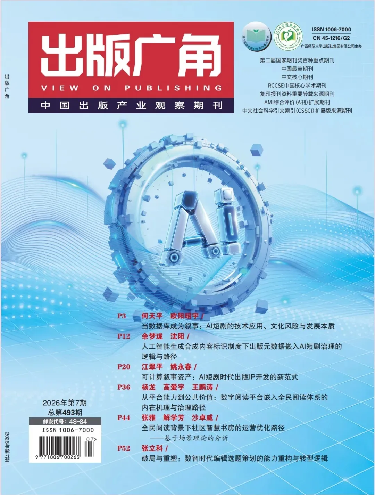
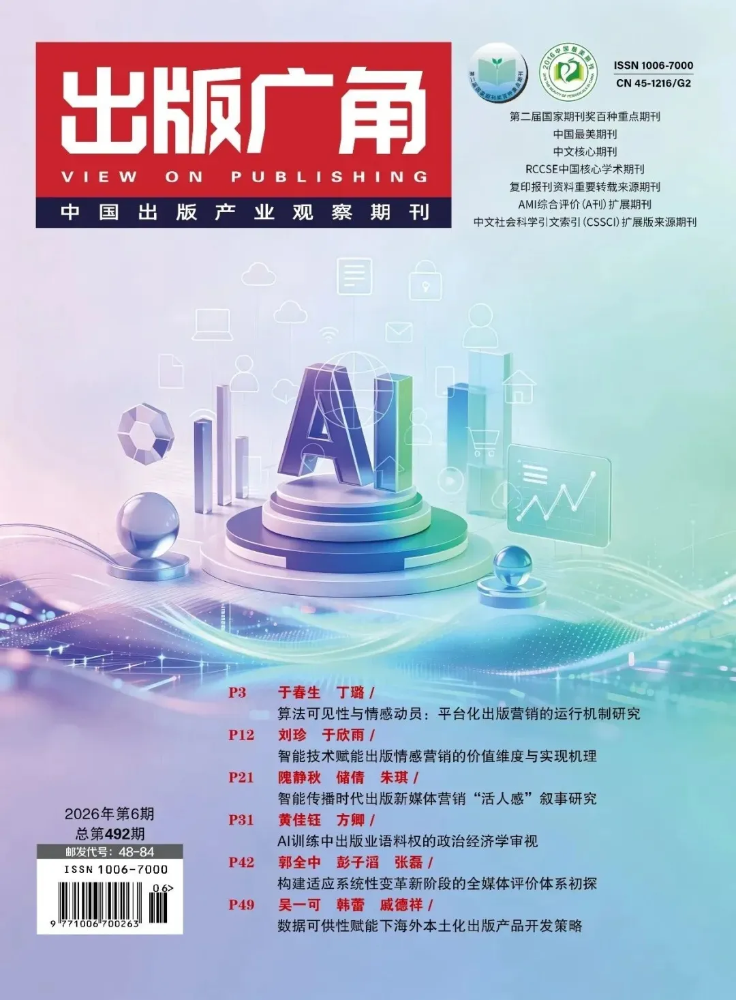
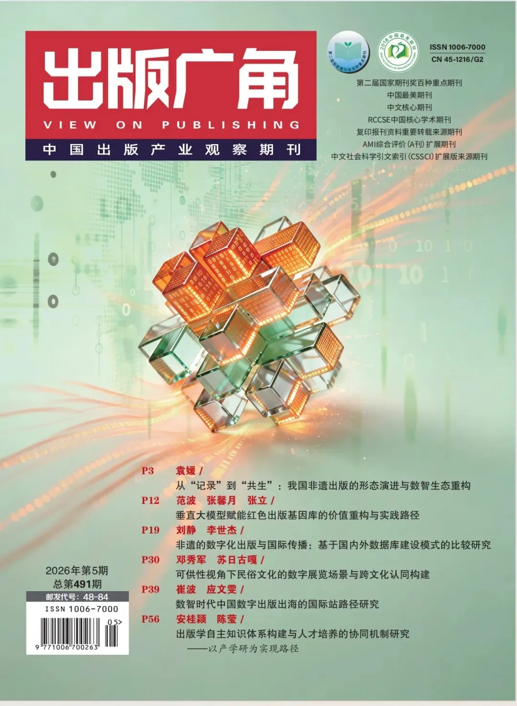
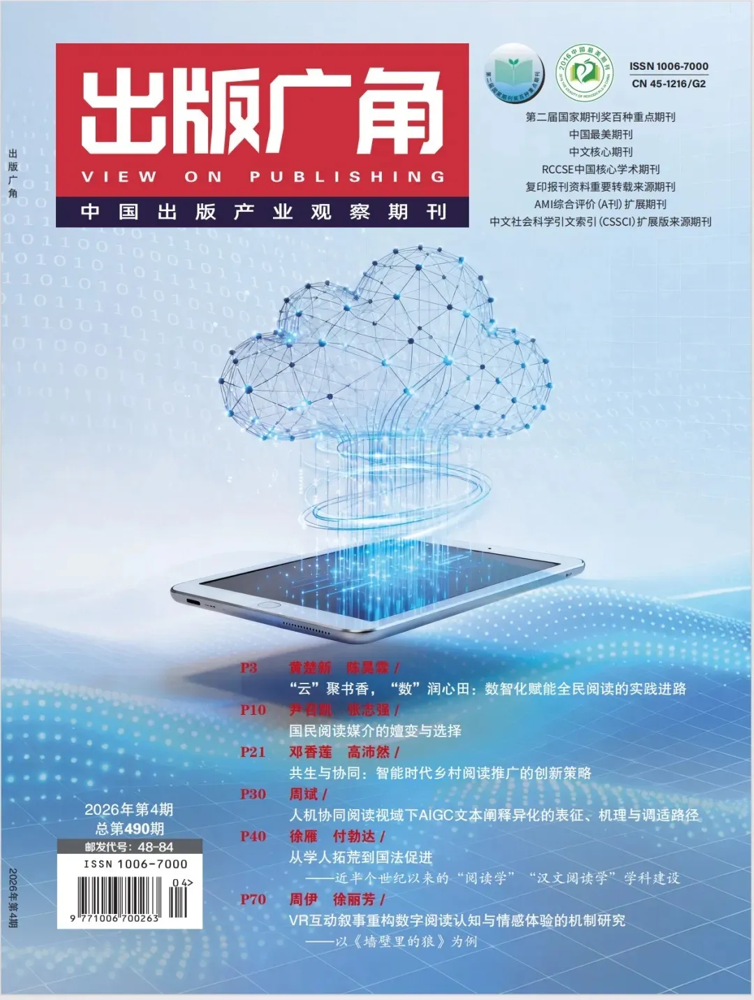
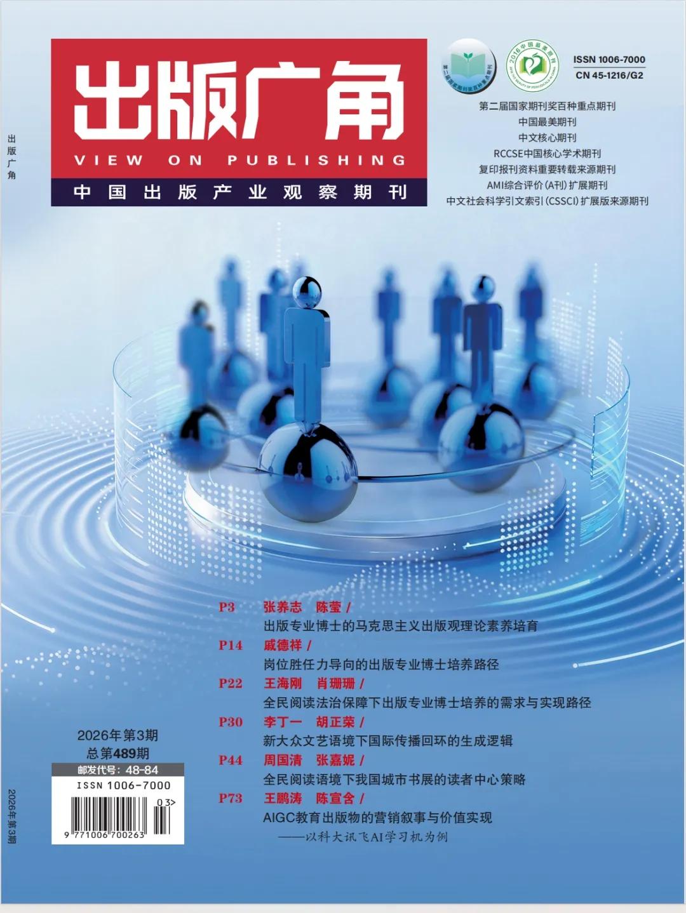
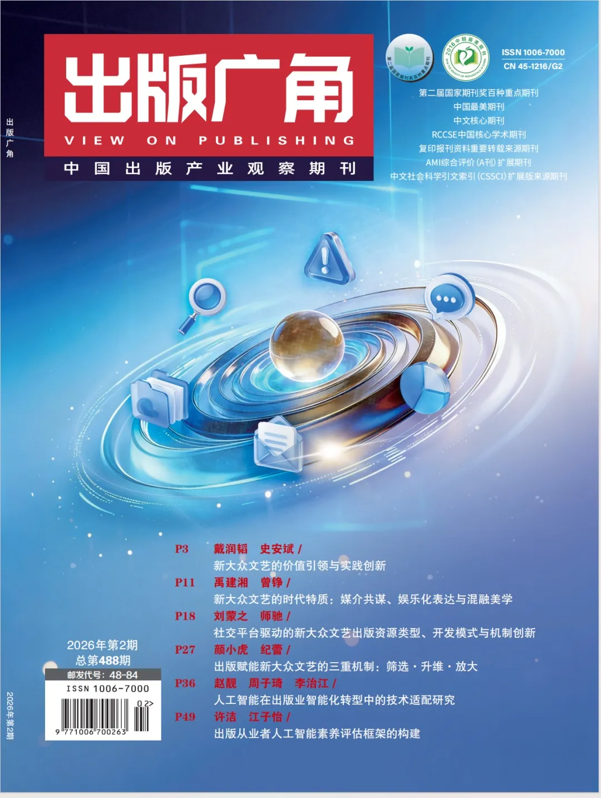
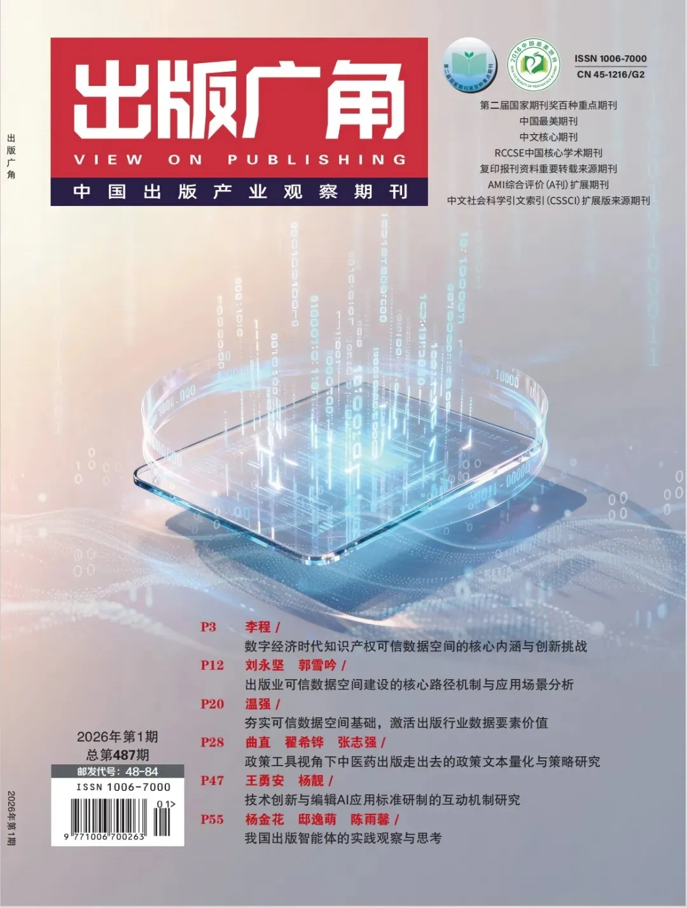

# 《出版广角》杂志征稿启事
> 💡 备注属性未写入，可能是备注属性名称或者类型被修改了，建议将字段类型设置为 rich_text，可以在小程序-操作-修改文章数据库页面进行调整
> 💡 原文链接:[https://mp.weixin.qq.com/s?__biz=Mzg3MTY2NDQ4Mg==&mid=2247521119&idx=2&sn=8aeeb124257e78c5b2e0560a58eb810a&chksm=cf5754aabcf096b90e8abd6fa01624819c12b5af046ec2ef40fba718d75192c83f061bdce4bb#rd](https://mp.weixin.qq.com/s?__biz=Mzg3MTY2NDQ4Mg%3D%3D&mid=2247521119&idx=2&sn=8aeeb124257e78c5b2e0560a58eb810a&chksm=cf5754aabcf096b90e8abd6fa01624819c12b5af046ec2ef40fba718d75192c83f061bdce4bb#rd)
**征**
**稿**
**启**
**事**
**《出版广角》杂志**
《出版广角》是中国新闻出版行业的专业学术期刊，以“中国出版产业观察期刊”为办刊宗旨，以宽广的视角、敏锐的眼光和客观的文字，担当起新闻出版学术期刊的使命责任。期刊曾获 “国家百种重点社科期刊”等国家级荣誉称号，是中文核心期刊、CSSCI扩展版来源期刊、RCCSE中国核心学术期刊、AMI综合评价(A刊)扩展期刊、复印报刊资料重要转载来源期刊。

**<**
**滑动查看上一期封面**
**>**
**栏目丨邮箱丨电话**
**常设栏目：时代出版、新观察、产业视域、出版融合、学术研究、期刊探索、青秀园地、编辑实务**
**投稿邮箱：cbgj48-84@163.com**
**联系电话：0771-5583044**
**重点选题方向**
- **出版业高质量发展
**
- **数智赋能出版融合创新
**
- **中国特色出版学科专业建设
**
- **出版走出去与国际传播
**
- **全民阅读与书香社会建设**
- **学术期刊与中国自主知识体系建构**
**投稿须知**
一、坚持正确的政治导向，积极落实党中央宣传工作要求，杜绝一切反党反社会主义的言论，杜绝一切崇洋媚外的言论。
二、稿件须为**原创作品**，选题新颖、观点明确、论证严谨、数据真实、文字精炼，有一定的学术性、思想性和创新性，对行业有一定的借鉴启发意义。
三、稿件字数以**8000字符**（计空格）为宜。
四、稿件须按学术论文体例撰写，且**查重率、AIGC检测不超过12%（自查）**。
五、投稿一律采用**Word格式电子稿**，题目下方写明**作者姓名、单位、联系电话**。
