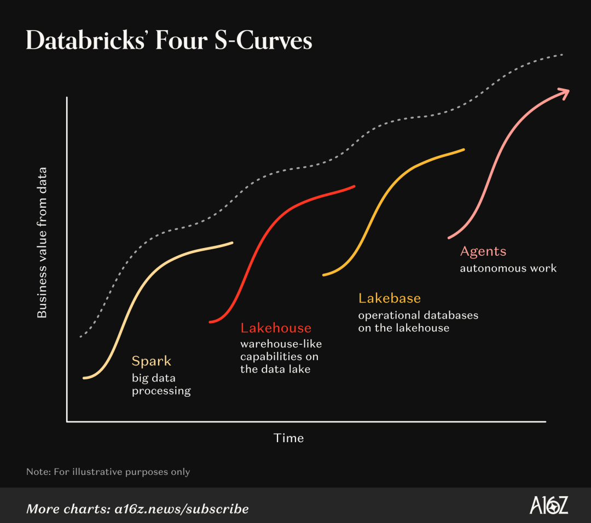
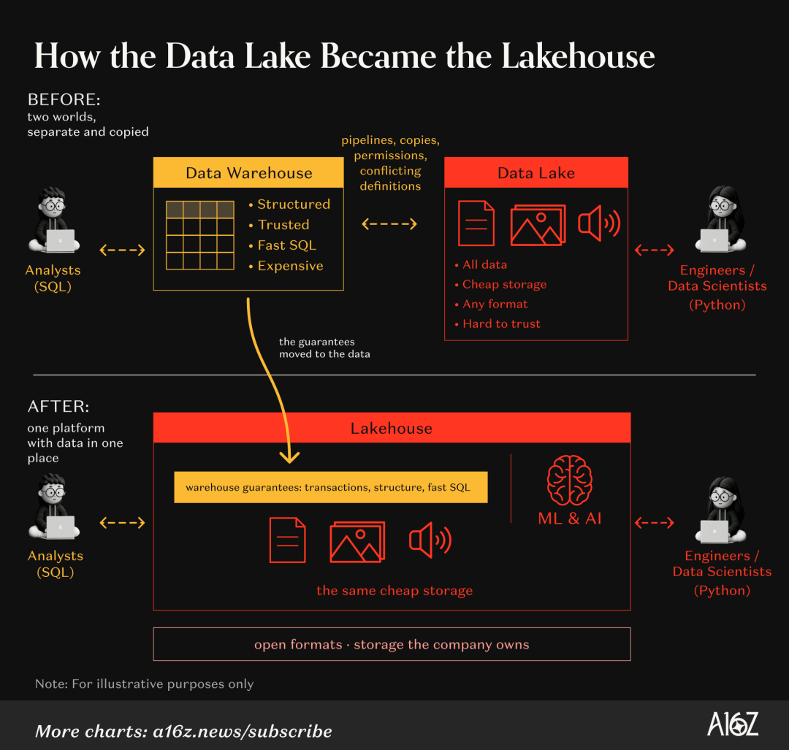
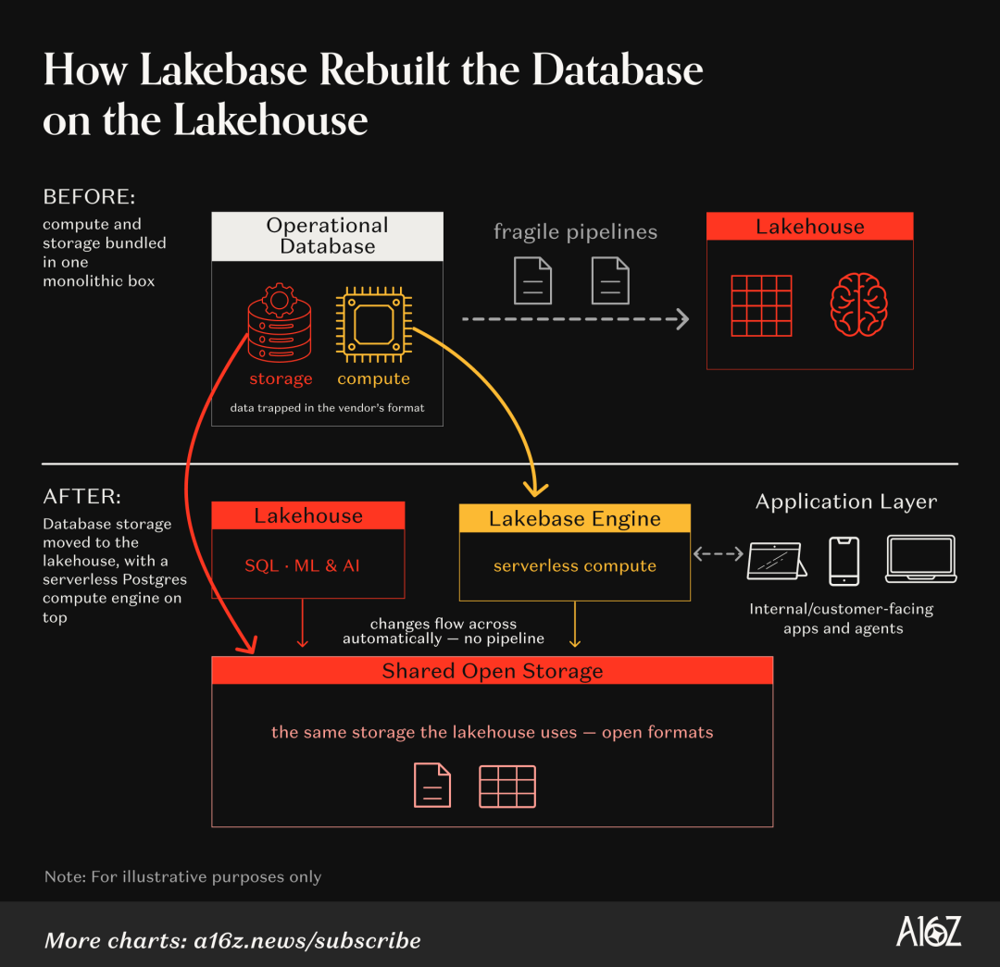
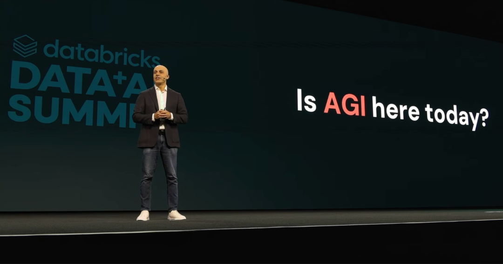
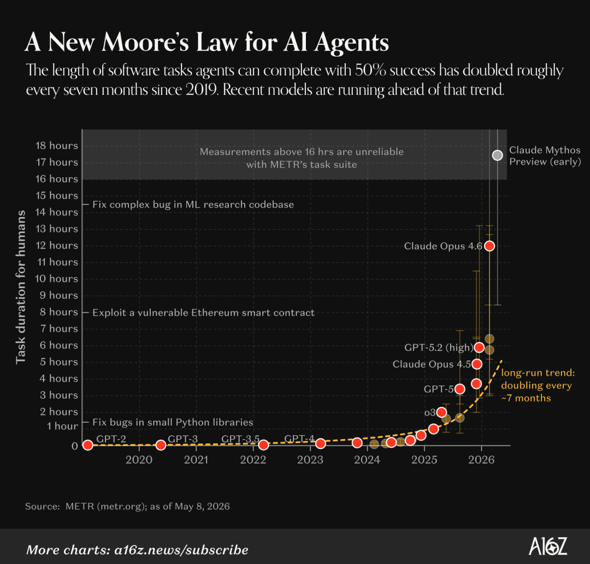
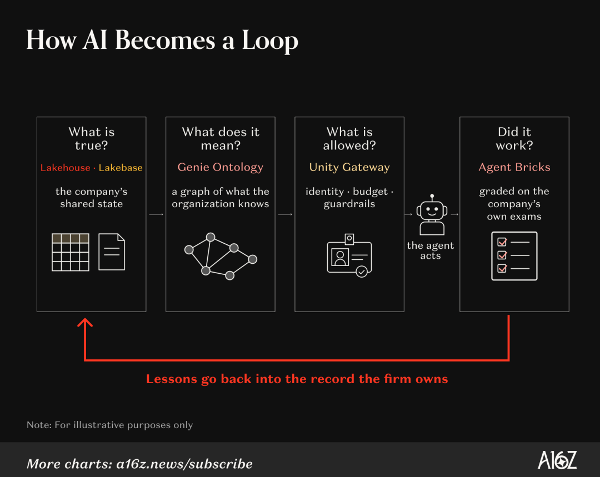

# 《创业维艰》作者最新万字长文：AI让懂业务的人重新说了算
> 💡 备注属性未写入，可能是备注属性名称或者类型被修改了，建议将字段类型设置为 rich_text，可以在小程序-操作-修改文章数据库页面进行调整
> 💡 原文链接:[https://mp.weixin.qq.com/s?__biz=MjM5ODAyMjg3Ng==&mid=2650760135&idx=1&sn=50a33ca76566e72d0382874c259e5811&chksm=bfc3f93e74c21aa2c8892b5ff1d3afe32ea47c93be3c8afed02370b986852b99a3e1507f50f8#rd](https://mp.weixin.qq.com/s?__biz=MjM5ODAyMjg3Ng%3D%3D&mid=2650760135&idx=1&sn=50a33ca76566e72d0382874c259e5811&chksm=bfc3f93e74c21aa2c8892b5ff1d3afe32ea47c93be3c8afed02370b986852b99a3e1507f50f8#rd)
**编者按 / 原文信息**
本文完整译自 a16z 联创 Ben Horowitz 与 Mike McGuiness 于 2026 年 10 月 27 日发表的深度长文 **Databricks & the Future of the Firm**（《Databricks 与企业的未来》），包含原文全部 6 幅架构图与现场配图。
硅谷顶级风投 a16z 联席创始人本·霍洛维茨（Ben Horowitz，《创业维艰》作者）刚刚发了一篇万字长文《Databricks 与企业的未来》，拆解了估值 1900 亿美元、年化收入突破 70 亿美元的数据巨头 Databricks。
这家公司正在干一件改变商业底座的大事：**把企业的数据状态、老员工脑子里的业务规则、权限护栏与结果考卷合为一体，打造一套“智能体的记录系统（SORA）”。**有了这套底座，成千上万个 AI 智能体就能跨过传统管理层，直接自主干活并自我进化。
受限于软件生态与科层惯性，中国也许没有像 Databricks这样的巨型智能体底座，大公司往往也被部门墙和历史包袱锁死。但恰恰因此，超级个体和极小团队迎来了最大的红利：
我们没有任何科层包袱，完全可以借用这套原理，在本地建起属于自己的“个人智能体底座”，把记忆、规则和考卷攥在自己手里，指挥多个 AI 智能体并行干活，十个人甚至一个人，就能活成一家拥有数据飞轮的“超级小公司”。
全文很长，完整图文译本附在后面。我先拎出 30 条硬核洞见与金句（括号里是我顺手记下的几句旁白）：
1、未来二十年，人生最剧烈的五大改变之一是：“你整天在班上都忙些什么？”AI 对职场的长期冲击未必是“人人都是程序员”，而是“人人都是管理者”。
2、改写人类工作的，是正在同时爆发的两场突破：一是“把目前在做的任务描述出来，让智能体自动做完”；二是“把主动权交还给离问题最近的人”，让他们直接调动资源去抓机会、当场行动，不再等待信息和权力在层层科层中流转。
3、大多数人从没想过一个事实：你每天的工作内容，其实是被公司的记录系统和底层数据库技术锁死的。底座决定了信息的流动方式，也决定了谁有资格做决定。
4、三年前，数据巨头 Databricks 上的每一次交互都有人类参与；今天，来自 AI 智能体的查询量已经正式超过了人类，每天有超过 1700 万个数据库由智能体自己启动。
5、过去几十年，软件是一小群工程师写出来给所有人用的；往后，人只需要说出想要什么结果，软件自己想办法去实现它。
6、没有校验和结构的数据湖，最后都会变成“数据沼泽（Data Swamp）”。不管是企业还是个人，把未经核实的资料一股脑塞进池子里，你无法从一堆自己都不敢信的数据里榨出任何价值。
7、数据库正在变得像代码一样可以“秒级分身”：哪怕是百万 GB 级的庞大数据库，也能在几秒钟内拉出一个隔离分支，让智能体在上面大胆做实验，试错了随手扔掉，丝毫不伤及主库。（这就是塔勒布说的反脆弱：底线锁死不归零，顶端用极低成本高频试错。）
8、智能体有一条新摩尔定律：它能独立完成的任务时长，每 7 个月翻一番。2022 年它只能干人类 30 秒的活儿，今天能干完资深工程师一整天的工作，到 2030 年代初将能独立完成人类干上好几年的任务。
9、“AI 没有智力问题，只有上下文问题。”今天的顶尖模型已经能答对“人类终极考试”里过半的难题，但在大多数公司里，大家甚至不敢让它去改一行客户记录。再聪明的人，不给他看历史资料、不告诉他权限边界、不给他结果反馈，他也干不成任何活儿。
10、帕兰提尔（Palantir）CEO 卡普的判断：**“未来市场上所有的价值，都将归于两样东西：芯片，以及‘本体论（Ontology）’。”**所谓本体论，就是把老员工脑子里那些不成文的黑话、规则、谁说了算、哪个销售报的“九成把握”其实得砍一半，全都搬进系统。一旦接上这张认知地图，AI 回答准确率直接从 50% 跳到 84.5%。
11、要让智能体自主干活，企业的记录底座必须实时回答四个顶层问题：什么是真实的（状态）、数据代表什么含义（本体）、谁有权限做什么（护栏），以及结果到底奏效了没有（团队自己出考卷，让 AI 形成自我进化的闭环）。
12、计算机史上的每一次浪潮，都是一场围绕“记录系统”的新战争：大型机时代赢家是 IBM，客户端时代是 Oracle 和 SAP，SaaS 时代是 Salesforce；今天第四次王座之争已经打响，赢家将是“**智能体的记录系统**”。
13、诺奖得主科斯问：企业为什么存在？因为内部协调比去市场上每次讨价还价更便宜。当智能体把内外部协调成本同时打下来，十个人就能干成过去上千人的事，过去算不过账的新公司将被批量创造出来。
14、诺贝尔奖与图灵奖双料得主赫伯特·西蒙定律：**“把企业的记忆集中化，就能把决策去中心化。”**状态和护栏越集中，一线的个人和智能体越能安全地自主行动，因为大家只需要跟共享记录对表，不需要开会对齐。（我折腾个人 AI 工作台 LifeOS，核心也是这一条：底层记忆和红线集中且唯一，多个智能体才能放开手脚替我干活。）
15、“最热门的新编程语言是英语（以及你的母语）。”知与行的壁垒正在同时坍塌，不懂代码的业务员直接用自然语言调数据、搭工具，自己发现问题当场解决。
16、推特与 Block 创始人杰克·多西的宣言：“公司运转得快还是慢，取决于信息流；而科层制和中层管理阻碍了信息流。”二十世纪的公司长成金字塔，是因为那时候“组织架构图”和“信息传递路线”是同一回事；现在，AI 正在接管“信息传话筒”的工作。
17、当系统接管了信息协调，人去干什么？杰克·多西说：“去模型目前还去不了的地方：直觉、鲜明的方向感、文化语境、信任关系、房间里的微妙气氛，以及犯错代价关乎生死的决断。”
18、企业权力的第一幕是“老板和专家说了算”，但它死于规模。因为没有任何一个创始人能凭个人大脑装下十万名员工每天发生的事，一旦公司变大，控制权就不可避免地从创始人和行业专家手里滑落。
19、企业权力的第二幕是统治了过去八十五年的“职业经理人社会”。财富 500 强的高管大多既不懂业务技术也并非创始人，他们今天管医疗、明天管金融，靠充当“人肉信息路由器”夺走了公司的控制权，用牺牲速度与生命力换取了规模。
20、企业权力的第三幕正在发生：**AI 正在终结统治商业一个世纪的职业经理人阶层。**当智能体接管了信息协调，控制权时隔八十五年重新回到创始人和一线手艺人手里，人类第一次可以同时拥有“十万人的规模”与“第一天的创业生命力”。
21、埃隆·马斯克的预言更加激进：**保留“人在回路（Humans in the loop）”的公司必输。**马斯克说，在 AI 时代还非要保留“人在回路”，就好比用着电子表格，却偏要留几个格子让人工拿笔去算一样荒谬。
22、在抵达马斯克说的全自治终局之前，黑色幽默的一幕出现了：经理人主义的衰落，看起来更像是“每个人都变成了管理者”。你未必有真人下属，但你每天的工作变成了界定问题、拆解任务、派活给并行干活的智能体，然后像批阅下属方案一样，批准一部分，把另一部分写上批注打回重做。
23、用不着担心 AI 把执行变便宜后，人就不值钱了。在经济学上，“执行”与“判断”是互补品：当常规执行的成本打到地板上，市场对“指引方向的判断力”的需求反而会暴涨。
24、大数学家怀特海百年前的名言：**“文明的进步，在于不断扩大我们‘无需思考就能完成的重要操作’的数量。”**人与公司的进化也是如此，一次驯服一个闭环。每当人类纠正一次智能体闭环，下一次执行就会更好；当某个闭环能稳稳当当自己跑时，人就从这个闭环里抽身出来，转身去攻克下一个未知问题。
25、所有对手都能租到同一个顶尖模型，凭什么你有护城河？看两家租用同一个模型的银行：第一家只发提示词拿结果；第二家把每次判断的事实、人工否决记录、哪笔赚钱哪笔暴雷全记在自己的底座里。一年后换上新一代模型，第一家还在从零写提示词，第二家的新模型直接继承了全部家底。模型随时可换，记忆永不归零，这就是“主权企业”。
26、微软 CEO 纳德拉说，**人的判断力（人类资本）与自己拥有的 AI 能力（Token 资本）在闭环中复利**，“这个闭环本身就是公司的新 IP”。
27、英伟达 CEO 黄仁勋说，**英伟达几乎所有流程都始于一个“数据飞轮”**，正是这个飞轮让他用 3 万名员工撑起 3 万亿美元市值，做成“世界上最大的‘小公司’”。真正构成护城河的从来并非静态的数据，而是长在数据之上、帮你比别人更快改进决策与作品的那个飞轮。（企业有数据飞轮，个人也有人生飞轮：你是谁、怎么选、怎么干，加上每一次撞击现实后的递归自我改进，转起来就是一个人最大的复利。）
28、当智能体把客户寻找和切换替代品的成本降到零，所有生意都面临同一张生死考卷：你为客户创造新价值的速度，必须跑赢免费替代品追赶的速度。
29、十年前巨头出 6 倍估值要收购刚死里逃生的 Databricks，霍洛维茨问了创始人一句直击灵魂的话：“卖掉它你能赚很多钱；但如果你像我一样，下半辈子回头看都会想：我错过了那唯一一次机会，我原本该把它一路带到底的。你是想带着这种遗憾活下去，还是只想拿钱？”创始人挂掉电话说：“我们绝不卖。”十年后，这家公司估值 1900 亿美元。
30、未来几十年，人们整天在班上都会忙些什么？霍洛维茨在结尾给出了最诚实的回答：任何还没有被摸索清楚的事情。那些“我们已经知道怎么做”的工作，智能体都会接过去；留给我们的只剩三件事：**评判什么是好的，敏锐察觉什么发生了变化，以及决定接下来应该创造什么。**
以下是完整原文。
**《Databricks 与企业的未来》**
Ben Horowitz & Mike McGuiness
未来二十年，我们生活的方方面面都将发生巨变。其中稳居前五的一个问题是：“你整天在班上都忙些什么？”
围绕这个问题，两项巨大的突破即将发生。第一项是**智能体自动化（agentic automation）**：“描述一项我们目前正在做的任务，然后把它自动化。”第二项是**赋予员工主动采取行动的权力**。最贴近问题的一线人员越来越能够直接去调查并抓住机会采取行动，而不必等待信息和权限在层层科层体系中流转。
这两件事对于每个人整天的工作内容而言，都是根本性的改变——而且是向好的改变！**如果**——这是一个很大的“如果”——组织真的能够进化到这种新的工作方式。一个人“日常工作是什么”，其中有**大得惊人的部分**受制于**其雇主所使用的记录系统（system of record）和决策机制**。而这本身又受制于**他们所使用的数据库技术，以及这项技术所赋予的可能性**。没有多少人会去思考这后半部分。
这时，Databricks 登场了。在他们的影响力圈层（那些非常了解他们的人）之外，Databricks 可能是硅谷最低调的故事，尽管他们的年化收入（run rate）现已突破 70 亿美元，同比增长 80%。你肯定听说过他们，但除了知道他们 1）是一家数据公司，2）对智能体（agents）很重要（尽管也许不太确定为什么）之外，并没有多少人真正知道 Databricks 是做什么的。
Databricks 的故事是一连串狂野事件的组合，也是一款产品“生逢其时”的机缘巧合的典范。三年前，Databricks 上的每一次交互都有人类参与。今天，这家公司看到的来自智能体的查询已经超过了人类，每天有超过 1700 万个数据库由智能体启动。这一趋势还将继续。
这个故事包含四个部分：
1）Databricks 究竟是做什么的？你可能在广告牌上见过的“湖仓一体（Lakehouse）”和“湖库（Lakebase）”是什么？为什么它们是恰逢其时的架构突破？
2）什么是“记录系统（system of record）”，如果智能体要在真实的企业内部工作、做出真实的决策并为企业的知识库做贡献，为什么它们需要一种新型的记录系统（SoR）？
3）**企业本身究竟是什么？**如果智能体与人的数量比达到 1000:1，企业会发生怎样的变化？企业该如何实现差异化并创造价值？
4）在这个新世界里，**人们整天的工作**是什么？AI 在工作中的承诺通常被宣传为：“普通人现在拥有了软件工程师的超能力。”但长期的影响未必是“人人都是工程师”，它可能更接近于“人人都是**管理者**”。
这或许是其中赌注最高的一环。我们正在实时见证构建了 20 世纪的那套管理模式的**全面瓦解**——正如詹姆斯·伯纳姆（James Burnham）在其名著《经理人革命》（**The Managerial Revolution**）中所记录的那样。八十五年前，伯纳姆描述了信息技术和组织复杂性如何催生出一种企业运营模式：一小撮职业经理人阶层在公司内部集中了决策权。今天，得益于新一波技术浪潮，一线的专业实践者正在重新夺回责任——而我们所有人都将因此受益。
这就是 Databricks，以及为什么它将驱动企业的未来。
### 从 Spark 到智能体
Databricks 最近常被描述为“一家赶上了 AI 浪潮的数据公司”。但实际上，这家公司是在浪潮到来十年前由一群 AI 研究人员创立的。这项业务是近二十年来叠加在一起的四条技术 S 曲线——Spark、Lakehouse（湖仓一体）、Lakebase（湖库），以及现在的智能体（Agents）——每一条曲线都为下一条曲线创造了创新窗口。为了真正理解这一连串潜能释放的过程，我们需要花一分钟聊聊数据库技术。

2009 年，阿里·戈德西（Ali Ghodsi）还是加州大学伯克利分校的访问学者，他观察着互联网公司如何利用庞大的数据集来预测人们会点击什么、购买什么、观看什么。那个时代人们言必称“大数据”。当时的主流框架是 Hadoop，雅虎、Facebook、Twitter 和 LinkedIn 等公司用它在成千上万台廉价的商用服务器上并行处理数据工作负载。在 Hadoop 出现之前，处理更大规模工作负载的标准做法是从甲骨文（Oracle）或 IBM 等厂商那里购买每台耗资数百万美元的大型机，因此 Hadoop 是一个极具吸引力的替代方案。
Hadoop 的致命缺陷在于，计算的每一轮都必须先将结果保存到磁盘，下一轮才能开始。当集群中的某台廉价机器出现故障时，这样做更容易恢复工作，这是一个合理的选择。但对于像机器学习这样的迭代式工作负载——你需要做出预测、衡量误差、更新模型，然后不断重复——它就慢得令人痛苦。Hadoop 把每一轮都当作一个新任务，每次都要从磁盘重新加载相同的数据，因此模型每改进几秒钟，集群就要花上好几分钟来搬运数据。
这个问题启发了伯克利的博士生马泰·扎哈里亚（Matei Zaharia）编写了 Apache Spark 的第一个版本。Spark 延续了 Hadoop 将数据处理工作分散到廉价机器上的创新，但允许应用程序在各轮计算之间将频繁重用的数据保留在服务器快得多的内存中，而不是每次都从磁盘加载——同时又不牺牲容错能力。这让此类重复性工作负载的速度最高提升了十倍。实验室于 2010 年将其开源；三年后，Ali、Matei 和另外五位研究同仁创立了 Databricks，旨在将运行 Spark 所需的分布式基础设施的复杂性——集群、扩缩容、安全性——抽象化，隐藏在一个面向企业的单一平台背后。
Spark 加速了数据处理，但数据存放在**哪里**又是另一个问题。那个时代的企业数据占据着两个截然不同的世界。**数据仓库（Data warehouses）**保存着结构化、可信赖的记录，让分析师可以用 SQL 向其提问，并支撑起每一个仪表盘和季度报告。**数据湖（Data lakes）**则为其他所有东西提供廉价存储，比如文档、图像、录音和日志。数据湖很便宜，所以团队把所有东西都往里倒；但在存入时没有任何检查或结构化处理。尽管围绕数据湖生长出了像 TensorFlow 和 PyTorch 这样庞大的开源 AI 工具生态系统，但人们很难从一堆自己无法信任的数据中提取价值，这也让数据湖得了一个“数据沼泽（data swamps）”的绰号。
两套系统各自解决了一个问题，却制造了一道鸿沟。工程师和数据科学家用着 Python 生活在数据湖里，而分析师则用着 SQL 生活在数据仓库里。每当一方需要另一方的数据时，就得有人搭建一条数据管道（pipeline）把它搬过去。这给公司留下了大量的副本、管道、权限设置和相互冲突的定义。但在 2010 年代末，Databricks、Uber 和 Netflix 各自独立地找到了同一种解决方案。他们的项目（Delta Lake、Hudi 和 Iceberg）在数据湖的文件之上增加了一个表层（table layer），赋予了它们类似数据仓库的保障，比如原子性更新（all-or-nothing updates）、模式管理（schema management）和版本化历史记录。公司不再需要为了可靠性和性能而把数据搬到独立的数据仓库中，现在可以直接在数据原本所在的同一套存储上运行数据仓库风格的工作负载。正是这一突破让一种全新的架构成为可能。
2020 年，Databricks 通过融合数据湖和数据仓库，发明了“湖仓一体（lakehouse）”。它将数据湖廉价、灵活的存储与数据仓库严格的可靠性和快速查询性能结合在一起，随后让仓库级 SQL 和机器学习成为同一底座上的一等公民工作负载。原本什么都装的廉价存储变得足够可信，终于可以作为工程师、数据科学家和数据分析师共享的数据底座。“最好的数据仓库就是湖仓一体（The best data warehouse is a lakehouse）”，这句宣传语应运而生，而客户们似乎也深表认同。如今，Databricks 的 Lakehouse 年化收入已超过 15 亿美元，同比增长超过 100%。
亚马逊首席技术官沃纳·威格尔（Werner Vogels）在 2020 年 1 月的一篇博客文章中从客户的角度阐述了这一逻辑。“如果你想在没有数据湖的情况下，把所有这些数据整合进传统的数据仓库，那将需要大量的数据准备工作以及提取、转换和加载（ETL），”他解释道，“你将不得不权衡要丢弃什么，并不断改变一个僵化系统的结构。”数据湖允许你以任何格式导入数据，从而消除了这些妥协。数据湖也是机器学习和 AI 的强大基石，正如 Vogels 所写，机器学习和 AI“在庞大、多样化的数据集上才能蓬勃发展”。

但还剩下一道鸿沟。湖仓一体统一了公司用于分析的数据，却没有统一其应用程序运行所依赖的数据。管理日常业务运营实时事务（如处理付款或用户登录）的**操作型数据库（operational database）**，仍然通过一张脆弱的管道网与湖仓缝合在一起。计算与存储依然捆绑在一个庞大的单体黑盒子里，数据被困在专有格式中，这使得数据库迁移成为任何组织中最令人胆寒的技术项目之一。
于是，在 2025 年，Databricks 收购了 Neon。这是一家无服务器（serverless）Postgres 数据库公司，其数据库当时绝大部分已经是由 AI 智能体创建的，并且代表了一个全新的数据库架构品类，称为“湖库（lakebase）”（这也启发了 Databricks 将整合 Neon 后的产品命名为“Lakebase”）。正如湖仓一体（Lakehouse）在数据湖之上重建了数据仓库一样，湖库（Lakebase）也将同样的理念应用到了操作型数据库上。它将存储与计算分离，使数据可以廉价地存储在数据湖中，而计算资源则随需求动态扩缩。而且，由于操作型数据库和湖仓共享相同的底层存储，数据库的变更会自动对分析师、工程师和智能体可用，无需再搭建和维护复杂的管道网。Databricks 将这种事务与分析的统一称为 **LTAP**（Lake Transaction/Analytical Processing，湖上事务/分析处理）。

这种分离让数据库的表现更像代码。即便是 PB 级规模的数据库也能在几秒钟内完成复制，因为 Lakebase 只复制变更部分。这让智能体可以创建一个隔离的分支（branch），在上面进行实验，完成后直接丢弃——即便是 Databricks 自己，也是直到最近才充分意识到这一特性的价值。Lakebase 于去年推出，年化收入已经突破 1 亿美元，而智能体是其最高产的用户。“我们认为，从长远来看，这可能会是一个比现有数据库市场还要庞大的市场，”Ali 说道。
这项技术解锁来得正是时候。几十年来，公司里的软件都是由一小群工程师构建，再由其他所有人使用的。我们正在走向这样一个世界：人们只需声明自己想要的结果，软件自己去弄清楚如何实现它。未来不再是成千上万名员工读写由中央团队管理的寥寥几个数据库，而是公司拥有成千上万个数据库，由数以百万计的智能体去进行读写。
### 智能体的记录系统

今年 6 月，Ali 在公司的 Data + AI 峰会上站在约 30,000 名观众面前，请认为通用人工智能（AGI）已经到来的人举手。他目测大概只有十分之一。
“我们认为 AGI 已经在这里了，”他告诉台下观众，并指出当今的前沿模型已经能够解答“人类终极考试（Humanity’s Last Exam）”中超过一半的问题——这份试卷包含由一百多个领域的专家编写的 2,500 道题目，曾被认为难到没有任何 AI 能够解答。
当 ChatGPT 在 2022 年问世时，它能处理人类大约花三十秒完成的编程任务。今天的前沿智能体可以完成熟练工程师需要整整一个工作日才能完成的编程任务。独立评估实验室 METR 的研究人员追踪了自 2019 年以来各模型智能体能够独立完成的任务时长，发现这一时长大约每七个月就会翻一番。最近，进展甚至更快，并且在编程之外的领域也呈现出类似的趋势。如果这一趋势保持到 2030 年代初，智能体将有能力完成需要人类花费数年时间才能完成的任务。

然而，在今天的大多数企业内部，人们仍然不敢放心地让 AI 去可靠地更新 Salesforce 里的记录。
“AI 没有智力问题，”Ali 解释道，“它有的是**上下文（context）问题**。”即便是再聪明的人类，如果无法访问公司的数据、没有行动权限、缺乏反馈，或者不掌握其他员工脑子里的知识，也几乎毫无用处。Ali 给出的答案是他所谓的“智能体的记录系统（system of record for agents）”。
也许你看过 Palantir 首席执行官亚历克斯·卡普（Alex Karp）谈论“本体论（ontology）”的视频片段。“市场上所有的价值都将流向芯片和我们称之为本体论的东西，”他断言道，“本体论让你能够拿来一个大语言模型（LLM），使用它、精炼它，并将它强加于你的企业之上。”至于这在实践中究竟意味着什么，通常留给听众自己去体会。
每家公司都有一套本体（ontology）——一个关于“存在什么、这些事物如何关联、词汇代表什么含义，以及当两个来源发生冲突时以哪个为准”的工作模型。它的一部分存在于数据库、仪表盘、政策文件和文档中，但很大一部分只存在于有经验的员工脑子里。而且它永远处于未完成状态：合同会变，权宜之计会变成流程，例外会变成规则，官方记录会逐渐偏离工作实际开展的方式。关于“谁决定什么”以及“记住哪些决定是对的”，情况同样如此——权限（authority）与评估（evaluation）和本体一样，往往都是不成文的。人们几乎在不知不觉中弥补了这一切：销售副总裁的职责就是得知道，那笔最大的承诺订单之所以停滞，是因为客户方的内部推动者正在悄悄去别家面试；得知道某个销售代表嘴里的“90% 把握”实际上只有 50%——并在预测报告呈交 CEO 之前把水分砍掉。
为了让智能体能够自主行动，目前存在于人脑中的大部分本体、权限和评估，都必须迁移到企业的记录系统中。Databricks 押注湖仓（Lakehouse）是它天然的归宿，因为公司其余的数据都存储并治理在那里。“如今，湖仓已经成为了记录系统，”Ali 表示，“我称之为 **SORA**——智能体的记录系统（System of Record for Agents）。”
员工可以通过 Genie 与这个记录系统进行交互。Genie 是 Databricks 于 2024 年推出的自然语言界面，让公司里的任何人都可以向其数据提问，并越来越多地在它之上构建智能体。在底层，这套记录系统必须横跨整个企业，并持续回答四个问题——Databricks 正在这四个方向上发力：
**什么是真实的（What is true）？** Lakehouse 和 Lakebase 已经保存了状态（state）。
**它意味着什么（What does it mean）？** Databricks 的 Genie Ontology 不会在每次有人提问时让 AI 遍历公司所有数据去大海捞针，而是持续构建一张组织知识图谱，比如收入是如何计算的，或者上周站会纪要里讨论了什么。工程师们将其命名为一个致敬 Google PageRank 的算法——**OntoRank**，它通过权衡“谁创建了某个定义”、“该定义被使用的广泛程度”以及“最近一次修改的时间”等属性，对哪些知识具有权威性进行排序。在 Databricks 的测试中，将智能体锚定在公司的本体（ontology）之上，使回答的准确率从约 50% 提升到了 84.5%。
**什么是允许做的（What is allowed）？** 当每个员工都是人类时，“每个员工一个登录账号”的旧访问控制模型还能奏效；但当员工每天启动数百个智能体时，这套模型就崩溃了。“你不可能把每个专有的、孤立的数据库的访问权限挨个授予你的智能体，”Ali 解释道。Databricks 的 **Unity Gateway** 为公司里的每一个模型、智能体和 AI 工具赋予了身份、预算和护栏（guardrails），并通过追踪日志（traces）记录下每一次操作，使公司能够清楚地看到其 AI 系统在做什么、访问了什么数据，以及花费了多少成本。
**它奏效了吗（Did it work）？** Databricks 为企业提供了两种构建智能体的方式。业务团队在 Genie 中构建智能体，将一段提示词（prompt）转化为一个可共享的智能体，在公司数据上进行推理，并越来越多地在 Slack 或 Salesforce 等应用中直接采取行动。工程师则在 Databricks 面向生产级 AI 智能体的开发者平台 **Agent Bricks** 中构建更深度定制的智能体。无论哪种方式，Databricks 都允许团队编写自己的“考卷”——定义什么是可接受的结果、什么是绝不能犯的错误——并为他们提供工具，针对公司对特定任务“什么是好”的定义来持续优化每个智能体。这就是 AI 形成闭环（loop）的方式。

企业计算的每一次平台范式转移，都会引发一场围绕“记录系统”的新战争。IBM 主宰了大型机时代。Oracle 和 SAP 成为客户端-服务器（Client-Server）时代企业的基石，而 Salesforce、Workday 和 ServiceNow 则分别为销售、人力资源和 IT 构建了 SaaS 时代的记录系统。智能体是下一次范式转移。
但哪家厂商会赢，远不如“智能体将如何改变企业本身”这个问题宏大。
### 企业的性质
在 1937 年发表的论文《企业的性质（The Nature of the Firm）》中，经济学家罗纳德·科斯（Ronald Coase）提出了一个根本问题：企业为什么会存在？如果市场可以通过价格和契约来协调经济活动，为什么要把人们聚集到公司内部，让管理指令来支配他们的工作？
他的答案归结为**交易成本（transaction costs）**。寻找合适的人、就“以什么价格做什么事”进行谈判，以及对全过程进行监督，都需要耗费时间和金钱。企业用一种更加开放的安排取代了市场中那些重复发生的交易——在这种安排下，管理者在商定的范围内直接调配资源。但在企业内部组织工作同样不是免费的。随着公司规模扩大，更多信息必须经过更多人的传递，最终，在内部多组织一笔交易的成本，会高到与直接从市场上购买相当。在科斯的论述中，企业会不断扩张，直到这两种成本相等为止。
四十年后，同时斩获诺贝尔奖与图灵奖的极少数大师之一赫伯特·西蒙（Herbert Simon）观察到，将企业的记忆集中化，反而使其决策得以去中心化。一份共享的计算机记录，他写道，“允许每一个去中心化的决策点独立采取行动”，因为系统会自动将这些行动与共享记录进行核对与调平。
对航空公司而言，波士顿的售票员在卖出飞往芝加哥的最后一个座位之前，不必给其他每一个售票员打电话。她只需查询那份记录；当她卖出座位时，这份记录对所有人来说都同步更新了。集中化的状态（centralized state）让去中心化的行动（decentralized action）变得更加安全，因为人们只需与记录进行协调，而不必彼此互相协调。
关系型数据库将这一原则扩展到了整个公司。曾经需要报告、会议和管理层交接的工作，变成了一次针对共享记录的查询，这让公司能够协调更多的产品、地点、人员和交易，而无需按相同比例增加管理人员。到了 1990 年代，互联网让外部世界也能直接写入企业的记录，一个在线交易平台因此能够在数百万陌生人之间协调买家、卖家、库存与支付。
由于外部交易成本和内部组织成本同时下降，数据库时代并没有让所有企业一致变大或一致变小。相反，它允许跨度更广的企业形态存在：大企业有能力管理高得多的复杂性，而小企业则可以租用或购买曾经需要整个部门才能具备的能力。
AI 很可能也会带来同样的结果。在企业内部，智能体可以通过自动化汇报、检索和常规任务来降低协调成本。在企业外部，它们可以帮助寻找和评估供应商、谈判常规条款并监督执行结果。就像之前的数据库一样，AI 将提高能够存在的企业与市场的复杂性上限。但它更具深远意义的影响，或许在于它将如何改变企业的**形态（shape）**。
二十世纪的典型企业之所以呈金字塔形，是因为科层制（hierarchy）就是它的信息处理系统。事实通过报告和会议向上汇报，决策再向下传达，信息流动的版图与组织架构图完全重合。管理层决定哪些数据值得收集或分享，这意味着公司对自身的认知水平，取决于其管理者选择收集什么信息。
数据库改变了这种结构，但只改变了一部分。共享记录让人们能够直接获取信息并更独立地采取行动，但这通常仍局限于别人预先设计好的流程之内。在计算机时代的很大一部分时间里，是一小群管理者、运营团队和工程师定义了公司的数据库模式（schemas）、指标、应用程序和工作流——使用这些系统的员工人数，远远多于参与设计这些系统的人数。
这不仅限制了人们能做什么，也限制了组织能知道什么。例如，一名客服代表每周都会听到好几次同样的投诉，但如果她的经理没有写一份把这个问题捕捉下来的报告，那她所知道的这件事，公司就是不知道的。至于真正去修复这个问题，那完全又是另一回事了。
如今，知（knowing）与行（doing）两方面的技术壁垒正在同时坍塌。
正如安德烈·卡帕西（Andrej Karpathy）在 2023 年所说：“最热门的新编程语言是英语。”自然语言界面让更多的领域专家能够直接审视和追问公司的数据，而不必等待懂 SQL 或 Python 的人去预判或回答每一个问题。在拥有百年历史的全球医疗保健企业诺和诺德（Novo Nordisk），科学家们过去常常要等待数据工程师为他们编写查询语句。现在，他们只需直接对 Genie 说：“把我们所有的肥胖症数据调出来”，系统就能瞬间提取出相关的临床试验、洞察和可视化图表。
而且，在划定的权限范围内，员工被赋予了创造解决方案的能力，从而节省数小时甚至数天的工作量。在电动汽车制造商 Rivian，一位没有任何 SQL 经验的财务分析师使用 Genie 为首席财务官（CFO）搭建了一个收入仪表盘，而一位供应链分析师则构建了一个跟踪入境库存发货的应用。
这并不意味着每个人都可以未经批准就访问公司的所有数据或资源。随着工作变得更加分布式，共享的本体、权限和问责机制反而变得更加重要。记录系统将状态和护栏集中化，同时将“谁可以提问、谁可以设计工作流、谁可以采取行动”去中心化。
今年 3 月，杰克·多西（Jack Dorsey）写了一篇题为《从科层制到智能（From Hierarchy to Intelligence）》的宣言，描述了他的公司 Block 是如何开始测试这一理念的极端版本的。“有史以来第一次，”他写道，“一个系统可以维护整个企业持续更新的模型，并用它来协调工作——而这种方式在以前需要人类通过层层管理来传递信息。”
Ali 的“智能体记录系统”类似于 Jack 所谓的公司“世界模型（world model）”——对组织运营、决策、能力和优先级的一个持续更新的表征。处于公司边缘（一线）的人们将模型锚定在现实世界中，而模型则提供采取行动所需的共享上下文。“人们会触及模型目前还去不了的地方，”Dorsey 解释道，“他们能感知到模型无法察觉的事物：直觉、鲜明的方向感、文化语境、信任动态、房间里的气氛。他们会做出模型不该独自做出的决定，尤其是伦理决策、全新的情境，以及犯错代价关乎存亡的高风险时刻。”其结果是，企业只需要更少的管理层级就能完成协调，同时即便工作变得更加分布式，领导者对工作的可见度反而更高了。
Databricks 已经在为 Block 提供部分底层基础设施。它管理和治理着 Block 旗下横跨 Square、Cash App 和 TIDAL 的 PB 级数据，Block 还使用 Databricks 将其 AI 编程助手 goose 锚定在公司的业务上下文中。
对 Dorsey 来说，这种新架构的核心竞争优势在于速度。“公司运转得快还是慢，取决于信息流，”他指出，“科层制和中层管理阻碍了信息流。”
Ali 在大方向上赞同 Dorsey，但做了一个区分。“我在哲学层面上同意 Jack Dorsey，”他说，“但问题是，这是否也同样适用于人类的组织架构图（org chart）？”他认为，人们把两件事混为一谈了：组织架构图，以及信息在公司内部的流动方式。“十年前、二十年前，这两者是同一回事。”了解正在发生什么的唯一方法就是问你的下属，你的下属再去问他们的下属，沿着组织树上上下下——但现在不再是这样了。“在任何会议上，我对任何事情有任何问题，Genie 基本上都能回答我，”他补充道。企业仍然需要管理者，只是不再需要那么多“信息路由器（information routers）”了。培养人才、帮助团队决定什么才是最重要的事，以及察觉某个人什么时候不开心，依然需要人类的注意力。
因此，尽管两人在“究竟会有多少科层消失”这一点上存在分歧，但他们都看到，AI 正在接管信息路由的工作——而正是因为当年公司变得过于复杂、离开管理者就无法运转，这项信息路由工作才赋予了二十世纪企业管理者巨大的权力。
### 第二次经理人革命
八十五年前，紧随大萧条之后，詹姆斯·伯纳姆（James Burnham）撰写了《经理人革命》（**The Managerial Revolution**）一书，预见了企业运作方式乃至资本主义本身运作方式的一场巨变。走出大萧条时，当时流行的一种时髦态度认为，创业型资本主义作为一种经济趋势已经走到尽头，某种新制度注定会取代它。社会主义集体化是当时时髦的提议之一，国有化则是另一个。
伯纳姆看懂了正在发生什么。他阐述了第三种形态——不仅是一种公司结构，而且是一种全新的社会秩序，称为**“经理人社会（managerial society）”**。在这个体系中，决定性的统治阶级既不是传统的资本家所有者，也不是工人，而是操纵着大型企业和国家机器的职业经理人、规划者、官僚和高管。
他认为，现代机构在技术上过于复杂，已无法由资本家个人亲自指挥。由于没有任何 CEO 能够事无巨细地了解一家拥有十万名员工的公司内部发生的一切，控制权便会逐渐从所有者和领域专家手中转移到行政管理者手中。
在二十世纪下半叶，经理人主义（Managerialism）取得了近乎完全的胜利。“财富 500 强公司的大多数高管并不是公司所从事领域的专家，他们当然也不是这些公司的创始人，”马克·安德森（Marc Andreessen）评论道，“他们是职业经理人，事实上，在他们的职业生涯中，他们可能会管理许多不同种类的业务——他们可能在医疗行业干一阵子，再去金融服务业，然后再去别的行业。”
但这场胜利正在耗尽其生命力。伯纳姆所描述的“经理人阶层”所带来的规模化能力与职业可靠性，是以牺牲速度和适应性为代价的——尤其是在面对日新月异的技术变革时。
Marc 提出，或许在像 Databricks 这样严谨的底座之上应用智能体，能够创造出第三种模式，兼得两全之美。它有助于保留创始人的活力与适应性，同时重构实现规模化所需的管理工作。通过将一部分原本使管理层成为必需品的信息路由和协调工作自动化，同时由企业的记录系统赋予边缘（一线）人员采取行动所需的上下文与权限，智能体将使这种运营方式变得让更多创始人触手可及。
埃隆·马斯克（Elon Musk）将 Marc 的想法更推进了一步。今年早些时候，他预测**保留“人在回路（humans in the loop）”的公司将会输掉竞争**。他认为，在 AI 时代保留“人在回路”，就好比使用一个还需要人工去计算其中某些单元格的电子表格。
关于最终的终点，Elon 或许是对的——没人知道完全自治的公司还有多远，预测从几年到永远不可能都有。但在那一天到来之前，极具讽刺意味的是，**经理人主义的衰落，看起来可能更像是“每个人都变成了管理者”**。并不是每个人都会有直接下属，但会有越来越多的人负责定义工作规范（specifying work）、委派执行（delegating execution）、检查结果（inspecting results）并更新流程（updating the process）。第二次经理人革命与其说是管理的消亡，不如说是**职业经理人阶层对管理垄断权的终结**。
软件工程师今天对此感受尤为深刻，因为他们的工作正在从手工编写代码，转变为管理一支编程智能体团队。工程师的一天看起来越来越像管理者：界定问题范围，将其拆解为任务，委派给并行工作的智能体，然后审查提交回来的代码合并请求（pull requests）——批准一部分，将另一部分附上批注打回重做。随着智能体在更多领域变得强大，更多的知识工作者也将经历类似的转变：从亲自执行每一个步骤，转向定义规范、委派任务和评判工作成果。诺和诺德的科学家和 Rivian 的供应链分析师已经在用 Genie 指挥智能体去完成过去需要一整支工程师或数据科学家团队才能完成的工作，从而将那些技术团队解放出来，专注于最具战略意义的工作。
这对人类的生产力和薪资来说是个好消息，因为**执行（execution）与判断（judgment）在经济学上是互补品**：当 AI 降低了常规执行的成本时，对指导执行的“判断力”的需求就会上升。
数学家阿尔弗雷德·诺斯·怀特海（Alfred North Whitehead）在一个世纪前曾观察到：“**文明的进步，在于扩展那些我们无需思考就能完成的重要操作的数量。**”企业的进步也是如此，**一次攻克一个闭环（one loop at a time），变得越来越自主**。每当人类修正一次智能体闭环，这次修正都应当让下一次执行变得更好。而当某个闭环证明它能够可靠地完成一项边界清晰的工作时，人类就会从这个闭环中抽身，转向下一个尚未解决的问题，并将自己学到的经验留在企业的共享记录中。
但是，正如伯纳姆大概也会注意到的那样，企业要想保持主权独立（sovereign），就必须拥有自己的模型，以及处在边缘（一线）的人们教会它的一切。
### 主权企业
在智能体企业中，优秀的人才将比以往任何时候都更有价值。但优秀的人才也会来来去去。与此同时，模型在不断进步，每个竞争对手都可以租用到同样的模型。那么，在这个新世界里，企业究竟该如何建立可持续的竞争优势？
设想有两家银行租用同一个前沿模型来辅助做出信贷决策。第一家银行向模型发送提示词，收到回答，然后记录下最终决定。第二家银行不仅记录决定，还记录下是哪些事实产生了这个回答、每一次人工推翻（override）的情况、哪些决策表现良好、哪些失败了，并在全过程中不断调整其策略。一年后，当一个更好的模型问世时，只有其中一家把银行建设得更好了。如果你更换了公司里的 AI 模型，而新模型能够继承你的业务定义、权限体系、经过评估的案例、客户历史记录以及来之不易的例外规则，这就是可持续竞争优势的基石。如果新的 AI 模型只是和所有其他公司一样，从同一个提示词重新开始，那就毫无竞争优势可言。
第二家银行就是人们开始称之为“主权企业（sovereign firm）”的形态。如果某家模型提供商提高价格、更改条款或下线某个模型，企业可以随时切换提供商，而不会丢失自己积累的认知。随着模型变得越来越聪明、企业对它们的依赖程度越来越高，这种独立性只会变得愈发重要。
在最近的一篇文章中，微软首席执行官萨提亚·纳德拉（Satya Nadella）出于不同的原因得出了类似的结论。他指出，**AI 模型会不断吸收人类和组织的专业知识并将其大宗商品化（commoditize）**，因此“每家公司都必须构建我所谓的**人力资本（human capital）**和**词元资本（token capital）**”。人力资本是公司员工的知识、判断力、关系网和独创性，而词元资本则是公司构建并拥有的 AI 能力。这两者在一个学习闭环中产生复利效应，而“这个闭环将成为企业新的知识产权（IP）”。
数据是词元资本的基石。“每家公司的业务数据都是他们的金矿，”英伟达首席执行官黄仁勋（Jensen Huang）在 Databricks 2024 年 Data + AI 峰会上告诉听众，并解释说**在英伟达，从芯片设计到供应链，几乎每一个流程都始于一个数据飞轮。“正是它，让我们有可能成为世界上最大的‘小公司’之一**，”他说。当时，英伟达的估值超过 3 万亿美元，却只有区区 30,000 名员工。“原因当然在于，我们公司内部有太多的 AI 在帮我们干活，做着不可思议的事情。”黄仁勋相信这将会适用于每一家公司。“这是一个非凡的时代，”他说，“而这一切都始于数据。”
Databricks 押注的是，数据以及建立在数据之上的闭环，应当存在于由企业自己掌控的系统中。这甚至包括 Databricks 自己耗费数年时间针对企业工作负载优化的专用模型。重要的是**闭环（loop）**，而不仅仅是数据本身——自 2023 年起，在这一点还没成为所有人的共识之前，Databricks 就一直专注于此。仅仅拥有所有权本身并不是护城河，但它能防止企业的记忆被困在某家供应商的技术栈里。只有当数据以及在其上进行推理的 AI 能够帮助企业比竞争对手更快地改进决策和产品时，真正的护城河才会浮现。
Databricks 很早就练就了这种肌肉。Spark 是开源的，所以客户完全可以直接下载并自己运行。但创始人们最终明白，如果他们能让 Spark 运行起来更简单、更快速、更安全，并且对企业更有用，客户就会心甘情愿地为 Databricks 买单。为了生存，他们必须以比免费替代方案追赶更快的速度，为客户创造价值。而随着智能体降低了寻找和切换到替代方案的成本，越来越多的公司将面临类似的考验。
### 你一生中最好的那个点子
大约十年前，Ali 打电话向我寻求建议。世界上最大的一家公司提出要收购 Databricks，出价大约是其上一轮融资估值的六倍。
考虑到仅仅两年前这家公司还差点死掉、连 C 轮融资的领投方都找不到，这看起来简直是一个梦幻般的结局。我们在 2013 年领投了他们的 A 轮——当时这家公司只有七位伯克利学者，唯一的经常性收入（recurring revenue）是出售他们自己办的会议的门票；而在没有其他人愿意出手的时候，我们又联合 NEA 站出来领投了他们的 C 轮。
Ali 对那次对话的记忆比我还清晰：
> 💡 “嘿，你想怎么做都行。无论你选哪条路，我都支持你。而且老实说，如果你以这个数字卖掉公司，对我来说真是太棒了：我们在 a16z 能赚一大笔钱，我能给投资人带来好几倍的回报。说心底话，就我个人利益而言，卖掉可能是更好的选择。但我只是在回想过去。我曾担任 Loudcloud 和 Opsware 的 CEO——当年我在那家公司拿到的牌，根本比不上你手里这家公司。当我回头看时，人生中有多少次机会能拥有一家像 Loudcloud 或 Opsware 这样的公司，更别提像 Databricks 这样的公司了？这可是一个大得惊人的市场。你可以现在卖掉，赚很多钱，你这辈子在世俗意义上会超级成功。

接着：
> 💡 “但如果你是个像我一样的人，在余生里你都会不断回想：‘我错过了那唯一的一次机会。那就是我这辈子最重要的一件事，我本该把它一路做到底的。而现在我永远也不会知道，我原本能把它带到多远的地方。’所以，你是想带着这种遗憾度过余生，还是只想拿钱走人？无论你做什么决定，我都支持你。”

Ali 道了声谢，挂断了电话。然后他对自己说：“我们绝不卖。这事绝不会发生。”
你根本不可能再遇到“这么好的市场机会”配“这么优秀的创业者”了。这是罕见中的罕见。我们见过伟大的创业者，但他们的市场机会有限；我们也见过拥有巨大市场机会的公司，但创业者的格局不足以撑起那个机会。而在这起案例中，我们同时拥有了这两者。
上个月，Databricks 的年化收入突破了 70 亿美元，同比增长 80%，估值达到 1900 亿美元。事实证明，这位创业者的格局足够大。
而它的潜在市场规模（TAM），正是企业本身的底座——一套共享的记录系统，用来定义什么是真实的、数据意味着什么、谁有权限做什么，以及什么奏效了。有了这个底座，人类和智能体就可以自主行动，而不必把每一个决定都交给层层管理去流转审批，同时他们行动的结果又会回流到企业自己拥有的记录系统中。
协调成本将会下降，公司用现有的人手就能做成更多的事，过去根本算不过账的新公司将会被创立出来——因为十个人将能够做到过去需要成千上万人才能做到的事。而且，在 AI 能够做到优秀人才所能做的一切之前——那还有很长的路要走——这只会让优秀的人才变得更有价值，而不是更贬值。
去执行别人设计好的固定流程的人将会减少，因为智能体会接管那些“已经被摸索清楚该如何做”的工作。更多的人将投身于那些尚无人解决的问题——评判什么是好的、敏锐察觉什么发生了变化，并决定接下来应该创造什么。
在未来的几十年里，人们整天在班上都会忙些什么？诚实的回答是：**任何还没有被摸索清楚的事情**。**随着智能体和企业将越来越多“我们已经知道怎么做”的工作自动化，人类将与这种新型智能并肩协作，去构建不可思议的新事物，去解决那些过去遥不可及的难题**。
感谢 Mike McGuiness 与我（Ben Horowitz）共同撰写本文。
想了解更多AI的前沿，欢迎加入“孤独大脑·人生花园”，请你点下方 ⬇️
[构建你的“财富-认知-健康-关系”复利飞轮](https://mp.weixin.qq.com/s?__biz=MzIzMzU3NDAxOQ%3D%3D&mid=2247484247&idx=7&sn=87704347006b39153c0fd5a5bef19754&scene=21#wechat_redirect)
