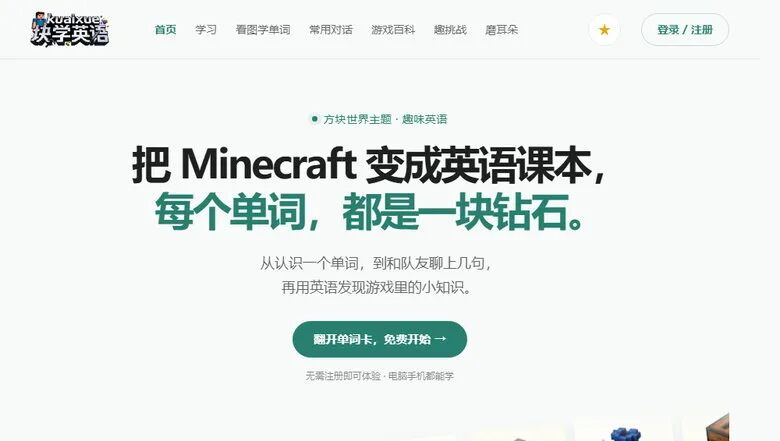
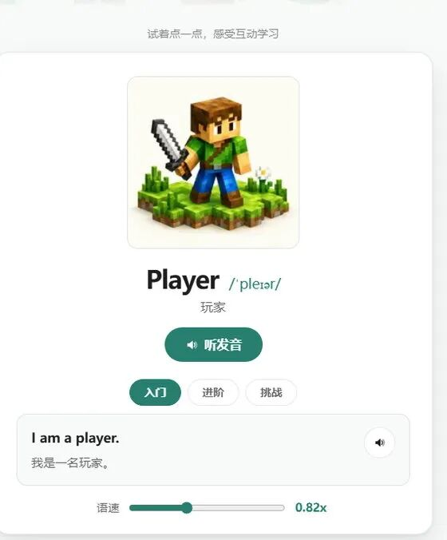
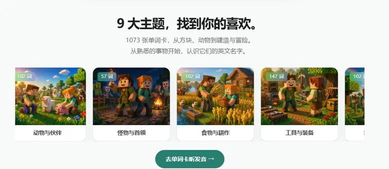
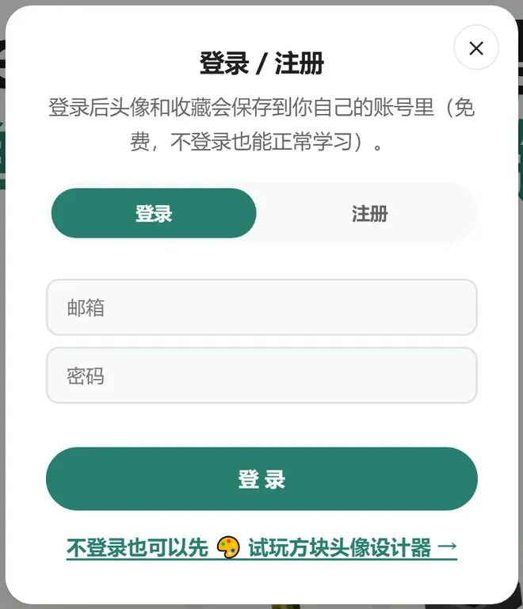
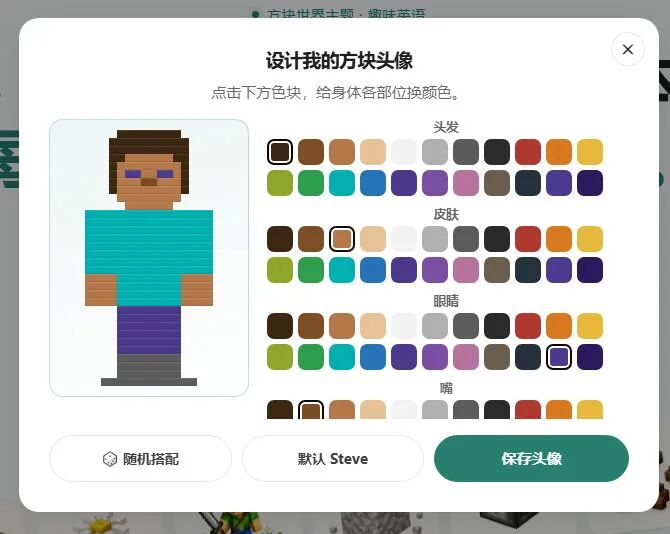
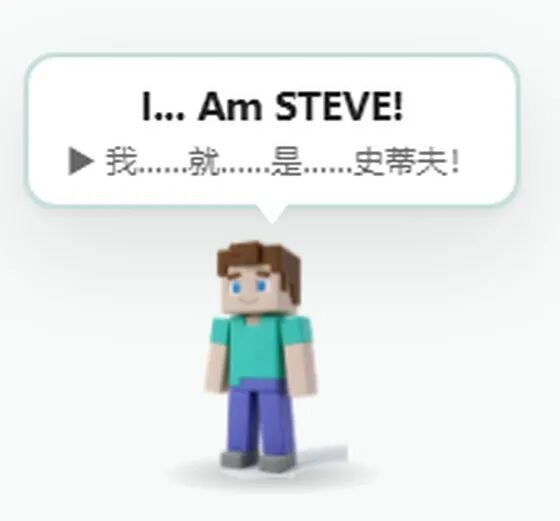

# 《块学英语》第一课：打开网站， 先认识这四样东西
> 💡 备注属性未写入，可能是备注属性名称或者类型被修改了，建议将字段类型设置为 rich_text，可以在小程序-操作-修改文章数据库页面进行调整
> 💡 原文链接:[https://mp.weixin.qq.com/s?__biz=MzcwMjQ5NzA4MQ==&mid=2247483723&idx=1&sn=7789f9b6ea3f8645c77672244fa45960&chksm=f5f38e5c66b4afb6e213c47ef7ddf82ce4fc6d1c60c5d8dc70de191e8420bdf370528cf89fbd#rd](https://mp.weixin.qq.com/s?__biz=MzcwMjQ5NzA4MQ%3D%3D&mid=2247483723&idx=1&sn=7789f9b6ea3f8645c77672244fa45960&chksm=f5f38e5c66b4afb6e213c47ef7ddf82ce4fc6d1c60c5d8dc70de191e8420bdf370528cf89fbd#rd)
块学英语 · 上手指南 · 第 1 篇 / 共 6 篇
首页、登录、方块头像、右下角的小人
写给第一次使用的小朋友和家长
第一次打开 **kuaixue.site**，可能会愣一下：该点哪儿？
这篇把最常用的四个地方讲清楚。看完你就能自己玩了。
### 一、首页：一句话告诉你这里是干什么的

首页第一屏
最上面有一行很大的字：**「把 Minecraft 变成英语课本，每个单词，都是一块钻石。」**
下面那个绿色按钮写着**「翻开单词卡，免费开始」**，点它就对了。
再往下，是一大片斜着的方块图。每一张小图都是一个单词，它们会慢慢往两边滑。
滑着滑着，中间会浮出一张卡片，上面写着 **Player**（玩家）。点**「听发音」**，它就会念给你听。

首页中间的试学卡片：点「听发音」就出声
卡片最下面还有一条**语速滑杆**。觉得念太快，往左拖一点，慢慢听。
继续往下，是 **9 大主题**，一共 **1073** 个单词。这一排可以左右滑，后面还有。

9 大主题：卡片左上角的数字，是这个主题有多少个单词
### 二、登录：其实可以先不登录
右上角有个**「登录 / 注册」**，很多人一看到就想关掉。先别急——
**不登录，所有功能都能用。**看单词、听发音、做题、收藏、捏头像，一样不少。
登录只多两样东西：**头像跟着你走**、**收藏跟着你走**。换台电脑、换个手机，东西还在。

登录窗口：不登录也能正常学习
真要注册，分两步：先填邮箱和密码，点**「发送验证码」**；再去邮箱里找那 **6 位数字**，填进来就好了。
**小提示**
验证码没收到？先翻一下**垃圾邮件箱**，它经常被拦在那儿。
「重新发送」要等 **60 秒** 才能再点，不是坏了。
### 三、方块头像：捏一个自己的小人
登录后点右上角你的名字，就能看到**「🎨 设计我的方块头像」**。
不登录也有入口：点「登录 / 注册」，窗口最下面那行小字就是。

头像设计器：左边实时变，右边点色块
这个小人是**你自己捏的**，不是选一张现成的图。能换七样东西的颜色：头发、皮肤、眼睛、嘴、衣服、裤子、鞋子，每样 **22 种**颜色。
点一下色块，左边马上就变。不用点确定，点了就是改了。
底下三个按钮：**🎲 随机搭配**、**默认 Steve**、**保存头像**。
**小提示**
随机出来的样子不喜欢，再点一次 🎲，每次都不一样。
只想改一点点？先点「默认 Steve」回到起点，再单独换衣服颜色，不会越改越乱。
### 四、右下角的小人 Steve
首页右下角站着一个方块人，他叫 **Steve**（史蒂夫）。
点他一下，他会冒出一个白色气泡：上面是英文，下面是中文，还会念出来。

点一下 Steve，他会冒出一个中英双语气泡
他会说 **20 句**不一样的话，每次随机，而且不会连着重复。这些全是《我的世界》电影里的台词。
他还会做动作：跳、转圈、跳舞、鞠躬、摇晃、吓一跳。气泡大概 4 秒后自己消失。
此外，**他还能被拖着走**。按住拖到哪儿都行，但拖不出屏幕，怎么甩都会完整留在画面里。
他只待在首页。点进其他页面，他就躲起来了，免得挡住按钮。
下一篇：一张单词卡，怎么把一个词学透。
