# 《增广贤文》古籍 | GujiStudio 可视化排版
> 💡 备注属性未写入，可能是备注属性名称或者类型被修改了，建议将字段类型设置为 rich_text，可以在小程序-操作-修改文章数据库页面进行调整
> 原文链接:[https://mp.weixin.qq.com/s/f2eFTFFlv7YrNOySNcgfxw](https://mp.weixin.qq.com/s/f2eFTFFlv7YrNOySNcgfxw)
使用 GujiStudio 可视化排版，非常简单的简单。

GujiStudio将一个古籍排版做成了一个图书项目出版流程：创建项目->编辑内容->版式调整->封装设计->导出成品。
第一步：创建图书项目。
指定存储目录，选择A4横版式，点击创建项目就正式进入排版工作了。

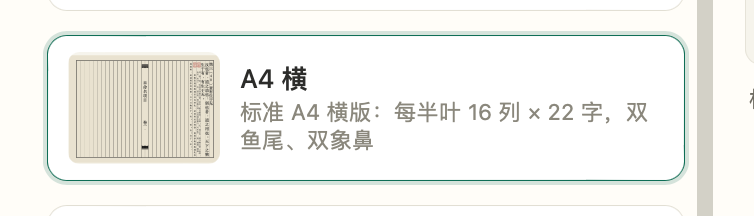
第二步：输入内容。
在图书编辑中添加章节，在右侧编辑器中输入内容。

第三步：版式调试。
在版式模板库中选择远程分享的模板：朱框大字版式，点击[套用到当前图书]。
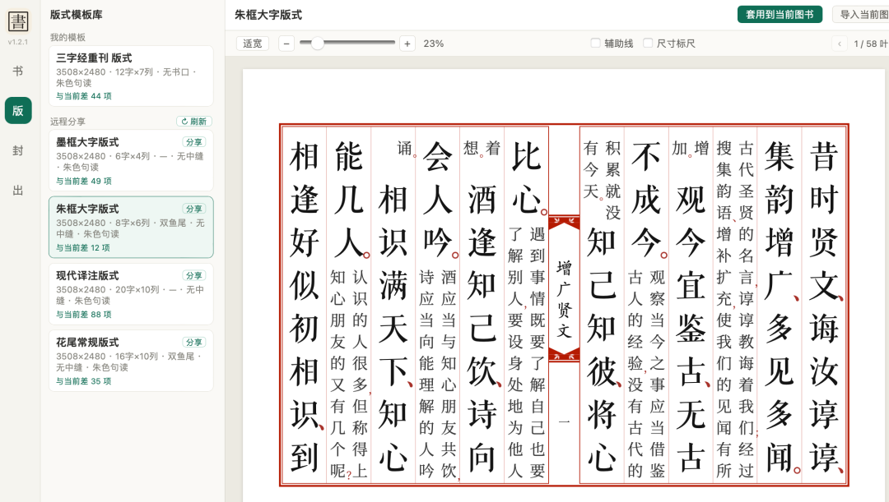
在版式参数中 修改 半叶列数 15和每列字数 20，修改正文字体 汇文明朝体（本机需安装）。 
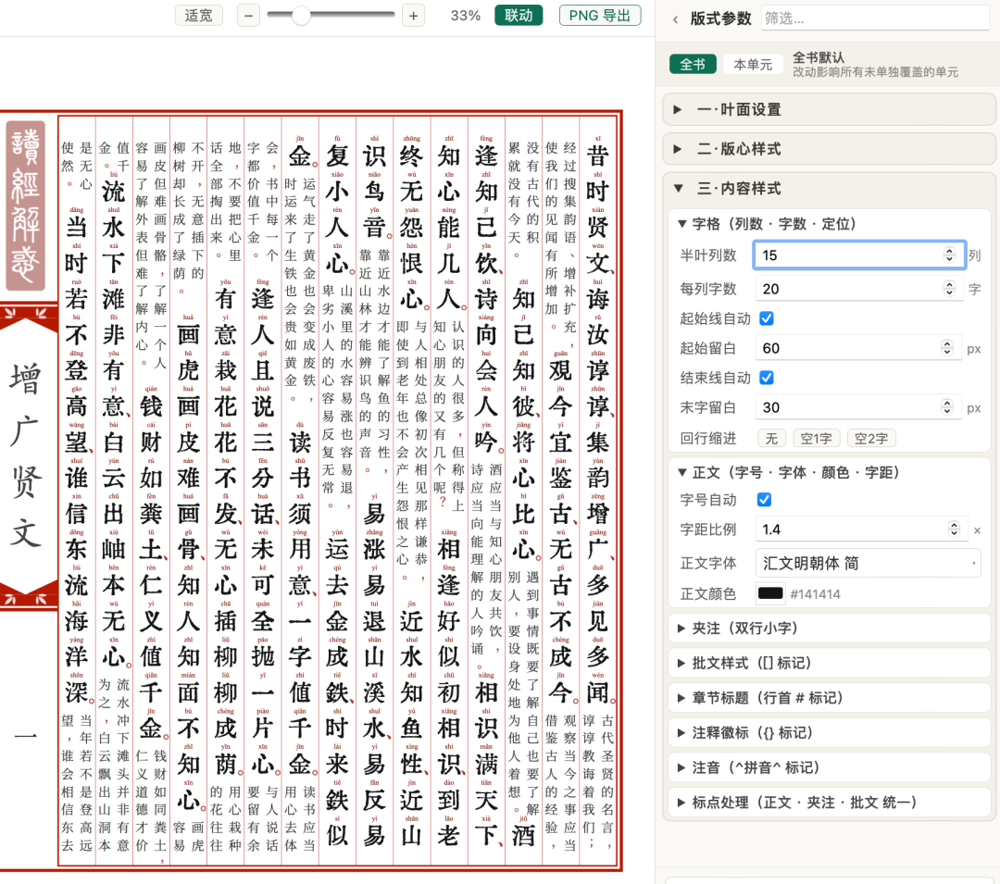
第四步：分享导出。
可以导出PNG。
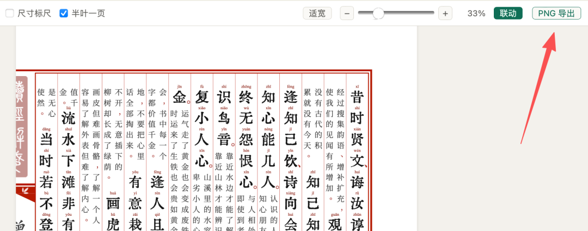
或者在出版发行中 选择PDF/PNG导出。
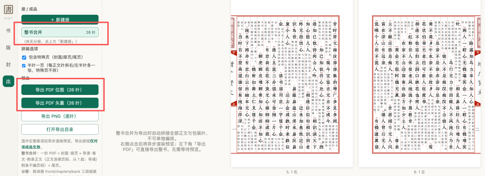
---
### 成品展示：
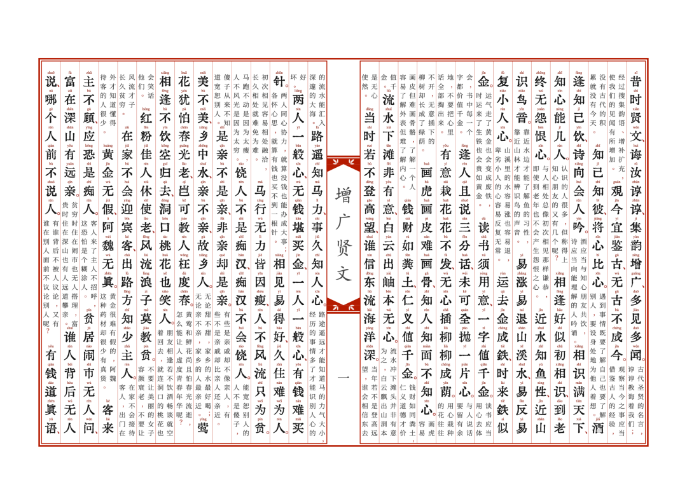
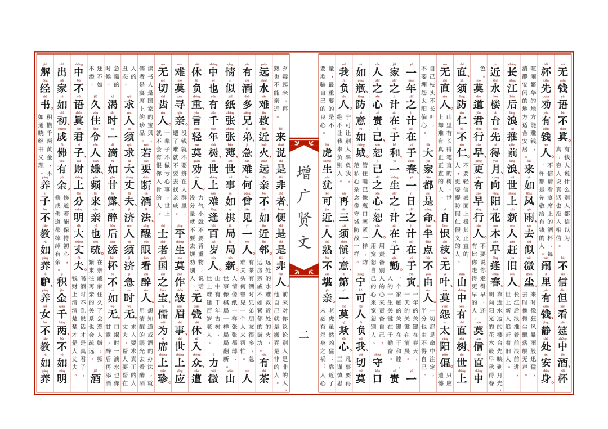
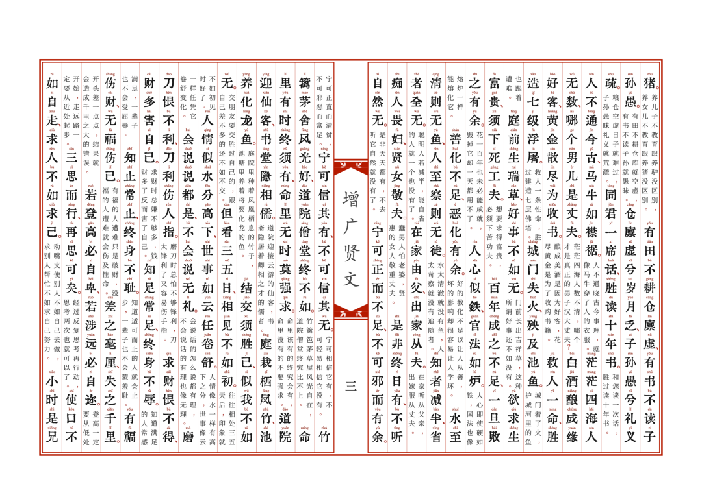
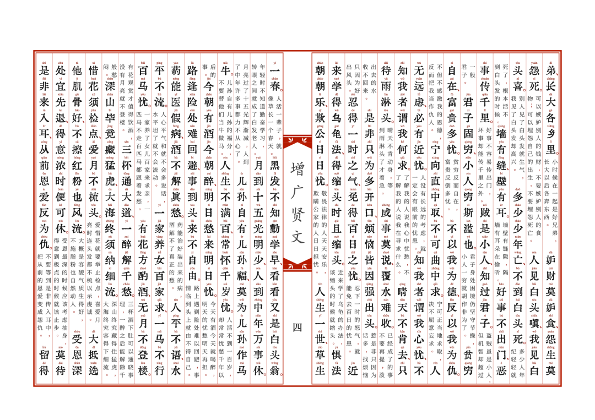
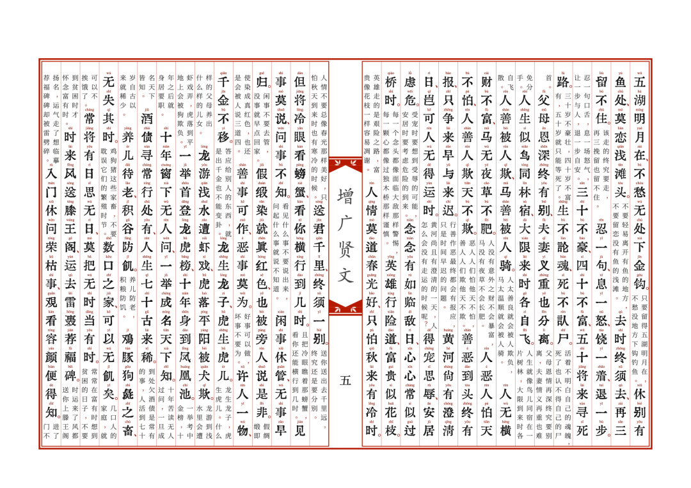
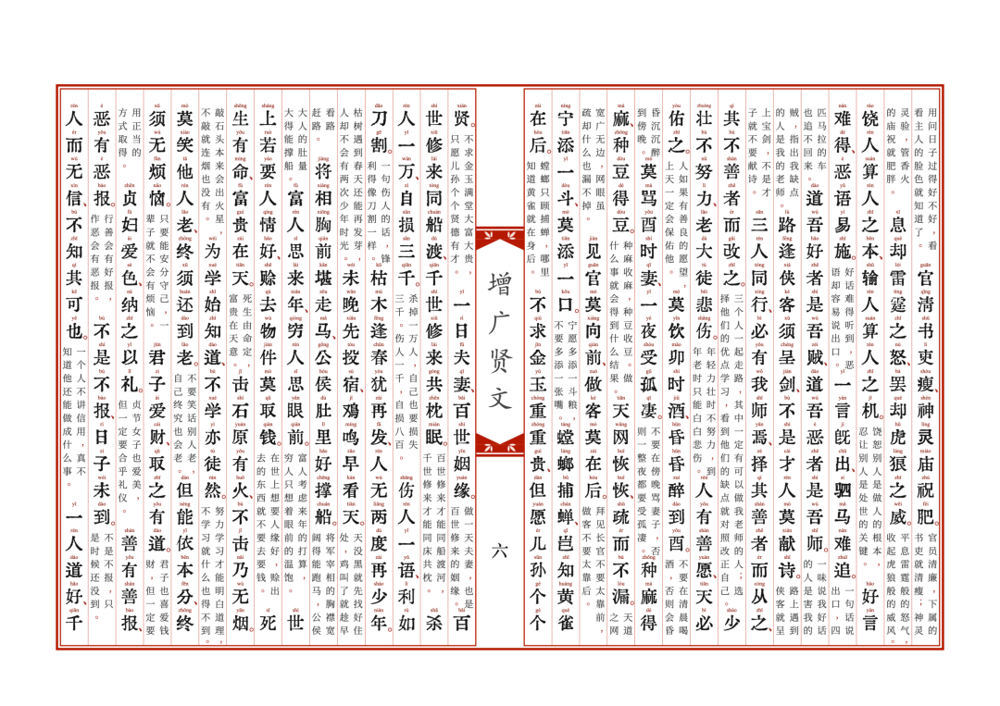
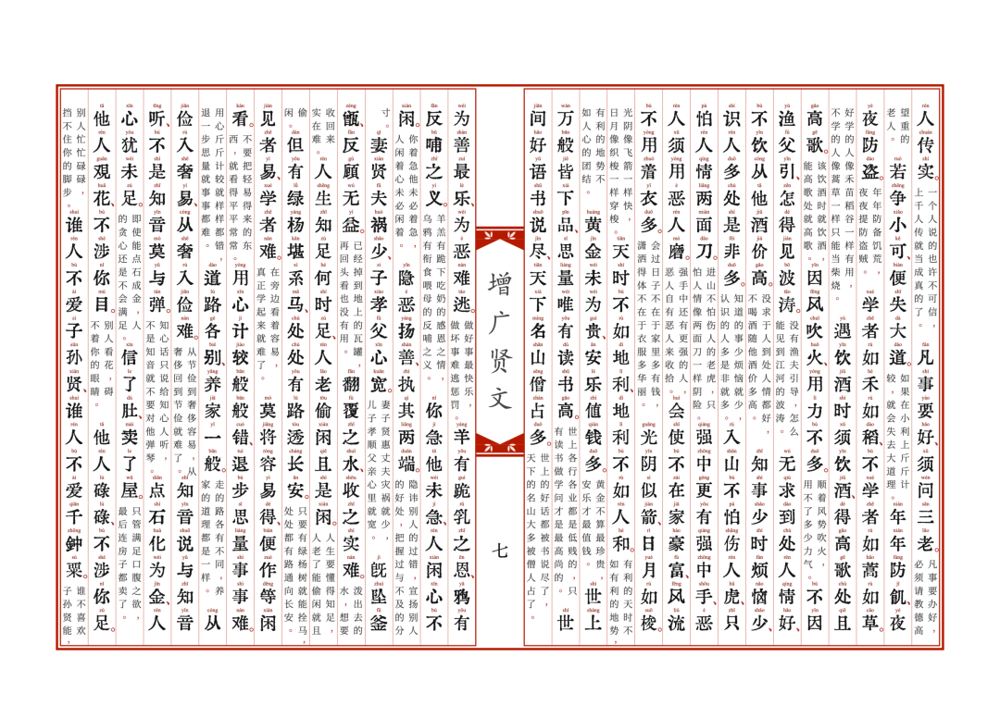
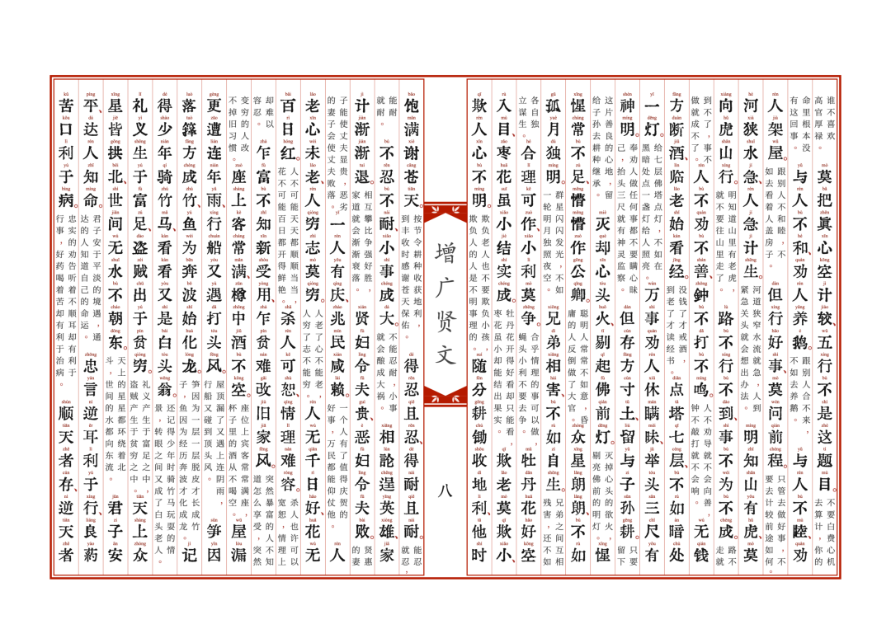
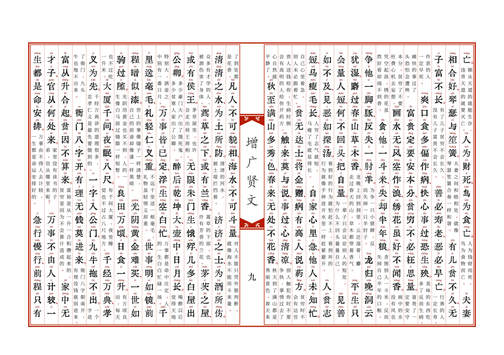
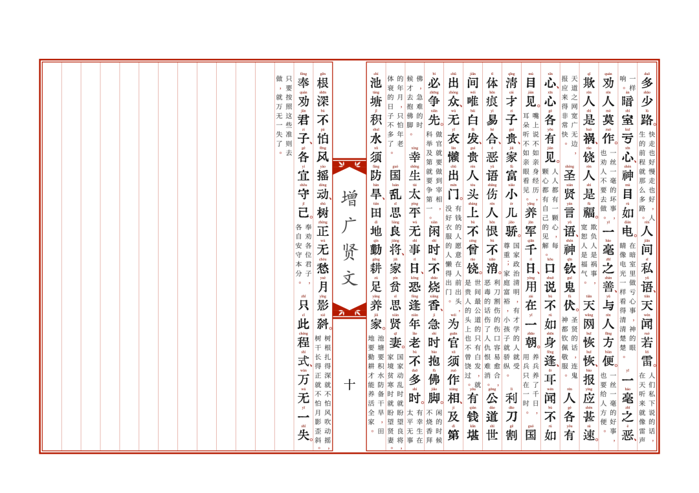
---
### 更多推荐
[免费轻量简捷可视化古籍排版软件GujiStudio V1.2 发布](https://mp.weixin.qq.com/s?__biz=MzU2MDUyNTU3OA%3D%3D&mid=2247486713&idx=1&sn=60978cad778510300d6d3bfef1fb14a9&scene=21#wechat_redirect)
[MDX1.4 新版本发布：持续打造简单、优雅的 Markdown 公众号排版工具](https://mp.weixin.qq.com/s?__biz=MzU2MDUyNTU3OA%3D%3D&mid=2247486335&idx=1&sn=f285edddd754a7b98e86015ed3e60555&scene=21#wechat_redirect)
喜欢的朋友欢迎点赞、收藏、转发！感谢赞赏支持，你的每一份打赏都是我坚持更新的动力。
