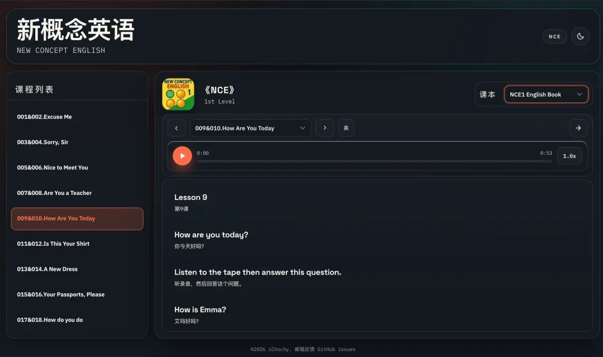
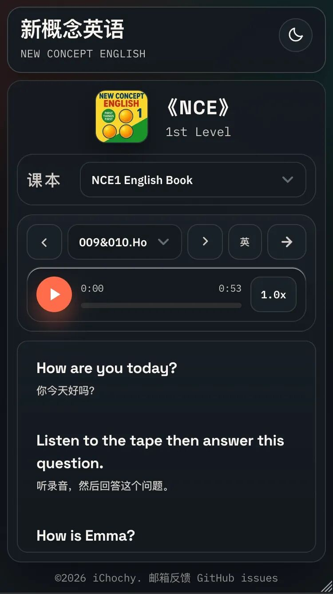

# 《新概念英语》全四册在线课文朗读、单句点读、中英对照
> 💡 备注属性未写入，可能是备注属性名称或者类型被修改了，建议将字段类型设置为 rich_text，可以在小程序-操作-修改文章数据库页面进行调整
> 💡 原文链接:[https://mp.weixin.qq.com/s?__biz=MzkwODQzNzk1OQ==&mid=2247502749&idx=1&sn=62e830d42906f5b921ad7e97d4295ced&chksm=c19641ca6753c0692ea34b9fa1ebcda85639be603d279a185ff865b34cf5a05d17ccf7048f7f#rd](https://mp.weixin.qq.com/s?__biz=MzkwODQzNzk1OQ%3D%3D&mid=2247502749&idx=1&sn=62e830d42906f5b921ad7e97d4295ced&chksm=c19641ca6753c0692ea34b9fa1ebcda85639be603d279a185ff865b34cf5a05d17ccf7048f7f#rd)
> 💡 ❝
**NCE（新概念英语在线点读系统） 是一个采用纯 HTML/CSS/JavaScript 编写的开源《新概念英语》全四册在线点读网站，无需安装软件或注册账号，打开浏览器就能逐句点读、中英对照跟读，还支持通过静态目录外挂你自己的学习资源。
**

#### 要点
- **多模式点读与跟读：** 点击任意句子即可播放对应原版音频；除“单句点读（读完即停）”外，还支持单句循环、本课循环、全书连播及 `0.5x–2.0x` 六档倍速调节。
- **四档字幕与断点续播：** 每句课文配中文翻译，支持在中英双语、纯英文、纯中文、模糊遮罩（方便盲听自测）四种显示模式间一键切换；浏览器本地自动记忆上次学习的课本、进度及深浅色主题，并预加载下一课。
- **全四册覆盖（含双版本音源）：** 内置标准美音版（音频源自 `tangx/New-Concept-English`）与 85 版两套全四册资源，从零基础到考研/雅思/托福水平一站配齐：
第一册《First Things First》： 144 课，词汇量约 600 词，适合零基础打好语音和语感。
  第二册《Practice and Progress》： 96 课，词汇量约 1500 词，系统梳理语法体系，听说读写同步提升。
  第三册《Developing Skills》： 60 课，词汇量约 2500 词，训练进阶阅读与复杂句型。
  第四册《Fluency in English》： 48 课，词汇量约 3500–4000 词，冲刺流利表达与学术阅读。
- **播放器与资源解耦：** 这是项目最核心的架构设计——一份学习资源就是一个独立的静态目录（`book.json` 课程描述文件 + 每课的 `.mp3` 音频 + 用 `|` 分隔中英文的 `.lrc` 歌词），前端播放器与课本内容完全分离，可挂载任意自制有声教材。
#### 上手
- **在线零门槛直接学：** 手机、平板或电脑浏览器直接打开在线地址即可选册学习（支持添加到手机主屏幕全屏使用），这是绝大多数用户的日常打开方式。
- **外挂自定义课本（3 步接入）：** 若想自建或接入其他教材，只需：① 按规范生成 `book.json`、`.mp3` 与 `.lrc` 文件并上传至静态托管服务（GitHub Pages、Vercel、OSS、Nginx 等）；② 在仓库 `data.json` 的 `books` 数组中注册该课本的 `key`、`title` 和资源 `path`；③ 部署后访问 `https://你的域名/#KEY` 即可直达该课本。
- **跨域（CORS）配置避坑：** 外挂资源的静态服务器必须返回跨域响应头（如 `Access-Control-Allow-Origin: *`），否则浏览器会拦截 `book.json` 与 LRC 歌词文件的加载。
- **AI 字幕与版权红线：** 中文字幕由作者自研 Python 工具 `iGSTT` 调用 Gemini AI 生成，偶有偏差可作参考或提 Issue/PR 修正；音频与教材内容整理自网络，**仅供个人学习研究、严禁商业用途**，作者明确建议购买官方正版教材与音频。
项目由 80 后程序员 iChochy 开发（另有 2 位社区贡献者参与），作者目前正在与白血病（CMML）抗争，仍坚持维护项目与分享技术。项目采用 MIT 协议开源，当前 4.0k Stars（3,970）、684 Forks。
> ❝
> **项目地址： https://github.com/iChochy/NCE，在线体验： nce.ichochy.com
> **
