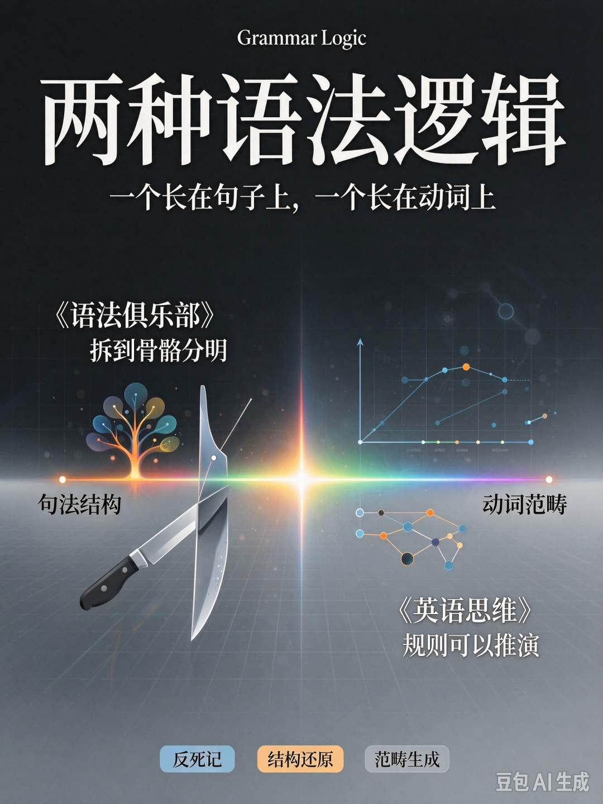

# 《语法俱乐部》和《英语思维》：两本反死记的书，两种完全不同的练法，一本教你拆句子，一本教你推时态
> 💡 备注属性未写入，可能是备注属性名称或者类型被修改了，建议将字段类型设置为 rich_text，可以在小程序-操作-修改文章数据库页面进行调整
> 💡 原文链接:[https://mp.weixin.qq.com/s?__biz=MzI3NjU0MDk2MQ==&mid=2247488316&idx=1&sn=a8dd5dbed049ee647c22cb198a6445d2&chksm=ea7770a4a80b6b5ac3019fc97a8f26a3e8a391f383fe65f698c153bd72827d44d6ae62879342#rd](https://mp.weixin.qq.com/s?__biz=MzI3NjU0MDk2MQ%3D%3D&mid=2247488316&idx=1&sn=a8dd5dbed049ee647c22cb198a6445d2&chksm=ea7770a4a80b6b5ac3019fc97a8f26a3e8a391f383fe65f698c153bd72827d44d6ae62879342#rd)

**《语法俱乐部》和《英语思维》：两本反死记的书，两种完全不同的练法，一本教你拆句子，一本教你推时态**
**摘要**
- 两本都不主张死记，但一个练句子结构，一个练动词体系。选哪本，要看你卡在长难句，还是卡在时态非谓语。
- 《语法俱乐部》强在拆句，《英语思维》强在推动词。它们不是谁替代谁，而是在训练两种不同的语法能力。
如果你正在《语法俱乐部》和《英语思维》之间犹豫，先别急着问“哪本更厉害”。
更值得问的是：**你现在最卡的是句子，还是动词？**
这两本书都被读者归到“讲语法逻辑”这一类，也都反对死记硬背。但它们对“逻辑”的理解并不一样。一个把重点放在句子结构上，一个把重点放在动词体系上。选错了，不一定书不好，而是没有对上你当下的痛点。
**一、先别比高低：它们治的不是同一种“语法痛”

**
很多人学语法的痛苦，大概分两种。
一种痛，是长句读不懂。单词认识，从句一多就迷路；非谓语一出现，就不知道它在修饰谁；句子一长，主干就找不到了。
另一种痛，是动词理不清。时态靠背，非谓语靠记，语态、语气、完成进行混在一起，总觉得规则很多，却连不成一条线。
《语法俱乐部》更像第一种痛的对症药。
《英语思维》更像第二种痛的解决方案。
所以这两本书的关系，不是“谁更权威”，而是“谁更对你的问题”。
**二、《语法俱乐部》：把句子当结构来训练

**
旋元佑这本书最突出的地方，是句法线条清楚。
它的训练路线大致是：先看简单句，再看复句、合句，最后进入简化从句。学习者要反复判断：句子主干在哪里，修饰成分挂在哪一层，从句是怎么接上去的，又是怎么被压缩、被省略的。
书里很有辨识度的部分，就是名词从句、形容词从句、副词从句如何一步步压缩成非谓语形式，复杂长句如何回推到较简洁的底层结构。时态在书里也不是单独展开的大理论，而是被放回句法结构里解释。
这套训练想培养的，是你对句子“形”的敏感。
读长句时，不要一头扎进单词里，先找骨架：谁做什么，主干在哪，枝叶挂在哪一层。练久了，会形成一种拆句的手感。
它的优势很明确：**长难句拆解、从句压缩与还原，训练感很强。**
代价也在这里。为了句法解释的简洁，有些地方会做结构归并，部分读者会觉得牵强；零基础直接上手也容易吃力，因为它默认你对句子成分已经有一点感知。也有老师批评过它把一些点讲得太绕，这个评价未必全面，但说明了一件事：这本书的逻辑，不是靠概念说服你，而是靠反复拆句练出来的。
它更像一种**操练型逻辑**：跟着拆、跟着压、跟着还原，慢慢形成对句子结构的肌肉记忆。
**三、《英语思维》：把动词当系统来推演

**
谢瑞的《英语思维》走的是另一条路。
它最显眼、也最有讨论度的做法，是把“时”和“态”拆开看：一个管时间坐标，一个管动作状态。十六种时态不再是十六个孤立格子，而是两个维度交叉出来的结果；书里还进一步把时态扩展到二十四种，作为维度继续细分后的组合。非谓语动词也被放进同一条动词逻辑里：它们不是四种硬记形式，而是同一个动作在不同阶段的呈现。
这就是它和《语法俱乐部》最大的不同：
**旋元佑更关心句子怎么搭、怎么拆；谢瑞更关心动词规则为什么能这样推。**
当然，《英语思维》的句法部分并不是没有体系。它从词类、句子成分、基本句型讲到主从句和单复句，讲的是“词类怎么落到成分上，成分怎么撑起句型，单句怎么长成复句”。有读者把它概括为“理科生式讲法”：爱讲道理、爱画图、爱把关系摆清楚。
但它的进入成本也在这里。一套追求内部自洽的推演框架，遇到真实语言的细颗粒时，需要读者在某些节点上自己“绷紧”。比如有长评提到，书里把一般态放进非谓语四态里，逻辑上能自洽，但一般态在非谓语层面并没有独立形态标记，读者需要自己区分“原形是概念、一般态是态”。也有人批评它术语多、理论感重，对初学者不算轻松。
它更像一种**推导型逻辑**：你先接受作者设定的概念前提，然后沿着动词原形、时、态、非谓语这条链往下走。一旦接受，链条是连贯的；但接受本身，需要一段适应期。
**四、两种“逻辑”，差别到底在哪

**
把两本书放在一起看，最准确的概括是：
**《语法俱乐部》给的是句子体系，《英语思维》给的是动词体系。**
《语法俱乐部》的逻辑，落在句法的精简和还原上。它教你修剪一棵枝蔓横生的句子树，先看主干，再看枝叶怎么长出来。你学会简化从句，就获得了一种对句子“形”的控制力。
《英语思维》的逻辑，落在动词范畴的溯源和推演上。它把时态从需要背诵的格子，变成可以自己往下推的线。你接受“时/态二分”的前提，就获得了一种对动词“神”的推演能力。
一个训练你看见句子骨架，一个训练你看见动词脉络。
前者是结构分析的逻辑，后者是范畴生成的逻辑。
这也解释了为什么有经验的读者会建议：如果时态、非谓语总理不清，可以先看《英语思维》铺动词线；如果从句套从句、长句一读就卡，可以先用《语法俱乐部》练拆句。顺序反过来也行，关键看你当下最痛的是什么。
**五、怎么选：看卡点，不看名气

**
如果你主要卡在：
- 长句读不懂；
- 从句套从句；
- 非谓语和从句的转换不清楚；
- 想练句子压缩和还原；
那《语法俱乐部》更直接。

如果你主要卡在：
- 时态总靠背；
- 非谓语和时态关系混乱；
- 词类、成分、句型糊成一团；
- 想要一条能自己推下去的动词逻辑；
那《英语思维》更对路。
但要注意，两本书都不适合当速查词典，也不适合当刷题手册。它们都要求读者投入一段不短的认知重建期。换来的不是多背几条规则，而是一套能自己往下走的语法理解方式。
**最后一句**
如果你需要一把刀，去拆长句，先看《语法俱乐部》。
如果你需要一张图，去理动词，先看《英语思维》。
两本书不是替代关系，而是两种训练：
**一本练“拆句”，一本练“推时态”。**
