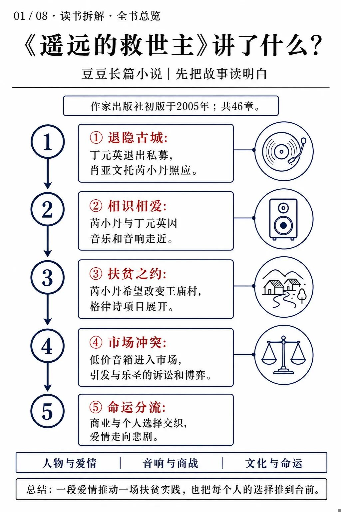
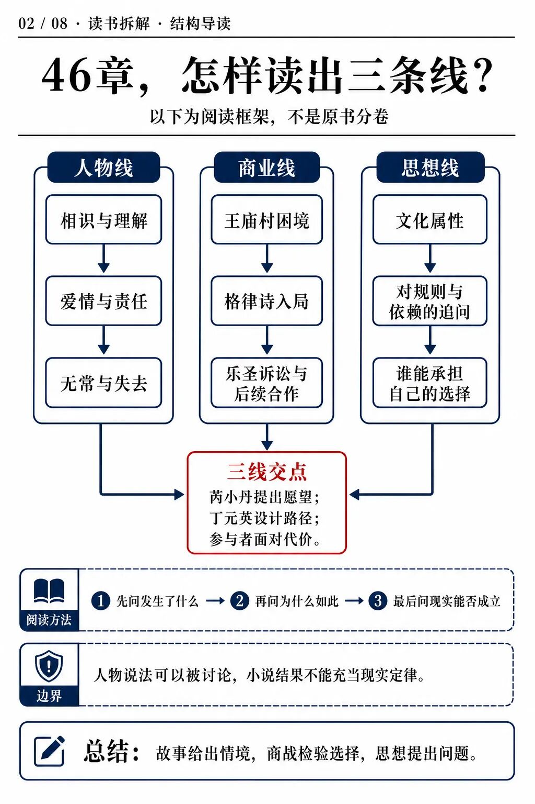
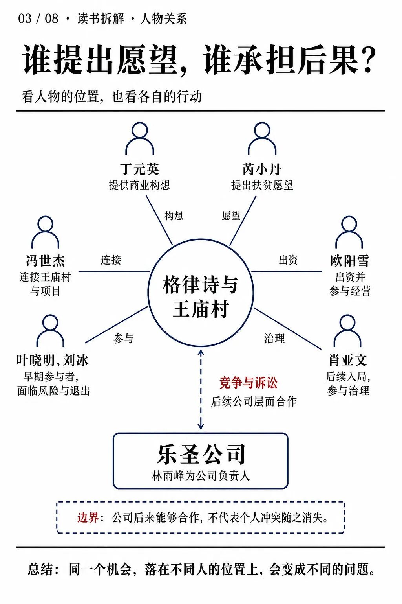
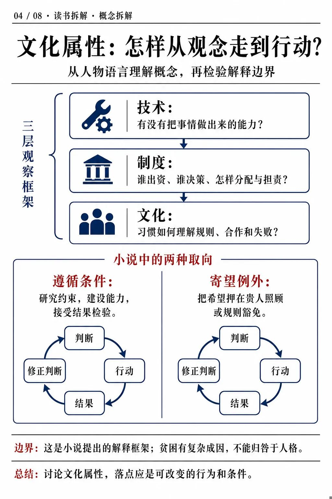
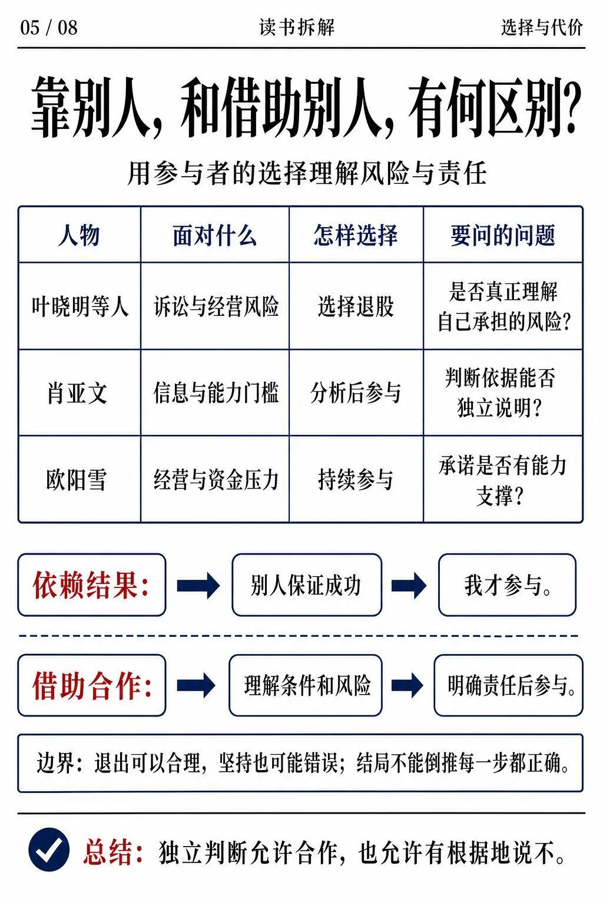
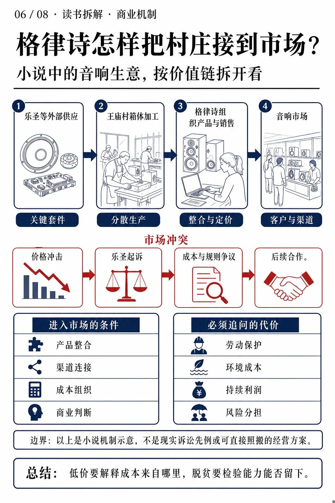
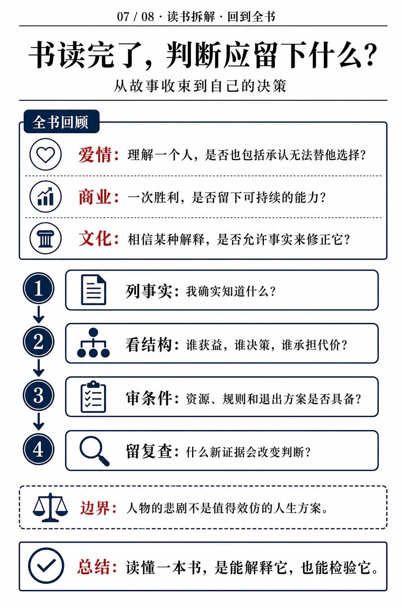
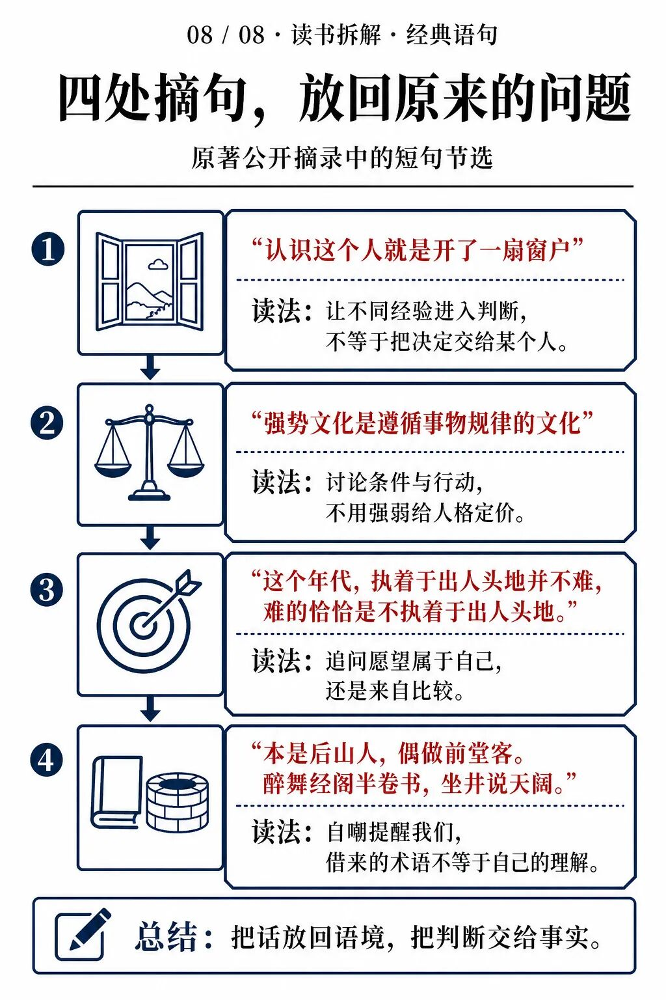

# 《遥远的救世主》到底讲了什么？从故事结构读到商业与人性
> 💡 备注属性未写入，可能是备注属性名称或者类型被修改了，建议将字段类型设置为 rich_text，可以在小程序-操作-修改文章数据库页面进行调整
> 💡 原文链接:[https://mp.weixin.qq.com/s?__biz=MzUyOTg5ODIwOA==&mid=2247486624&idx=1&sn=f4263f4199652ada8b3dcc02ed252a0f&chksm=fb2ee5014b6136fee5af4da55d59e702f18a51edc138f0eb5e435611b141cae0231ab9b60055#rd](https://mp.weixin.qq.com/s?__biz=MzUyOTg5ODIwOA%3D%3D&mid=2247486624&idx=1&sn=f4263f4199652ada8b3dcc02ed252a0f&chksm=fb2ee5014b6136fee5af4da55d59e702f18a51edc138f0eb5e435611b141cae0231ab9b60055#rd)
杰克船长 · 读书拆解 · 01
《遥远的救世主》是豆豆的长篇小说，2005年由作家出版社出版，后来改编为电视剧《天道》。小说共46章，把一段爱情、一场音响商战和关于“文化属性”的讨论编织在一起。
它最值得追问的，是这样一个矛盾：一个声称不该依赖救世主的人，却以近乎“救世主”的能力，替别人设计了一条改变命运的路。这条路带来了机会，也带来了代价。
先把故事和结构讲明白，再讨论它提出的问题。下文涉及主要情节与结局。
### 一、这本书讲了一个什么故事
丁元英退出私募基金业务，来到古城暂居。原来的助手肖亚文请朋友芮小丹照应他。芮小丹是一名女刑警，两个生活轨迹迥异的人，因为音乐、音响和交谈，逐渐相知相爱。
芮小丹希望丁元英为贫困的王庙村做一件事。这个愿望，把私人爱情引向了现实世界：怎样让缺少资本、技术与市场连接的村民，获得持续挣钱的机会？
围绕音响生意，格律诗项目展开。冯世杰连接村庄与项目，叶晓明、刘冰等人参与其中，欧阳雪出资并进入经营。村里的加工能力与外部套件、产品组织、销售渠道被重新连接。
格律诗以低价进入市场，冲击了林雨峰所在的乐圣公司。诉讼把价格背后的生产方式、成本结构和商业规则推到了台前。面对风险，早期参与者选择退股，肖亚文随后入局；公司层面的竞争又走向后续合作。
故事没有停在生意成功。芮小丹在执行任务遭遇重创后自尽，林雨峰、刘冰也走向悲剧。丁元英可以推演一场商战，却无法替所有人消除恐惧、欲望、误判与无常。商业结果和人生结果，在这里分开了。

### 二、46章怎样组成一个整体
全书的章名主要采用序号。为便于理解，可以把它读成三条相互牵动的线。**这是本文的阅读框架，不是原书分卷。**
第一条是人物与爱情线。它让我们看到丁元英如何被理解、芮小丹如何选择，以及两个人面对责任和失去时的限度。
第二条是格律诗与市场线。它把抽象讨论放进出资、生产、定价、诉讼和经营之中：一个方案究竟能不能运转，需要具体条件来回答。
第三条是思想线。文化属性、规则、依赖与觉悟等讨论，散布在交谈、审讯、论道和人物行动里。这些人物的语言构成了小说的思想张力，但不因此自动成为经过验证的社会定律。
三条线在王庙村交汇：爱情提出愿望，商业组织实现路径，参与者用自己的选择检验理解；结尾的悲剧，又反过来质疑“看懂规律就能掌控人生”的想象。

人物关系也要一起看。提出愿望的人、设计路径的人、出钱的人、生产的人和承担经营后果的人，并不处在同一个位置。读懂这种差别，后面的分歧才有来由。

### 三、文化属性到底在解释什么
丁元英把技术、制度和文化作为观察社会的三个层面。放在格律诗的情境中，技术关心能不能做出产品；制度关心怎样组织、分配与担责；文化关心人们习惯怎样理解机会、规则与失败。
小说对“强势文化”的说明，落在遵循事物规律；对“弱势文化”的批评，则指向寄望强者照顾、希望破格获取的取向。它提醒读者：愿望不能代替条件，仰慕高人也不能代替自己的能力。
但这套说法有明显的解释边界。现实中的贫困，还与教育机会、健康、公共服务、资本条件和制度安排有关。把所有困境归结成某种文化或心态，会漏掉大量可以被改变的外部约束。
更有用的读法，是把概念变成问题：我在等待谁给答案？哪些条件尚不具备？能通过学习、协作或改变规则解决什么？这样，讨论才会落到行动，而非给某一类人贴上“强者”“弱者”的终身标签。

### 四、为什么有人退出，有人能够接住机会
叶晓明等人的退出，肖亚文的后续参与，以及欧阳雪的持续经营，常被读成“谁相信丁元英，谁就能赢”。这种读法恰好取消了独立判断。
每个人掌握的信息、专业能力、资金余量和风险承受力不同。对一个能够承受诉讼的人可行的决定，对另一个家庭可能意味着无法承担的损失。不能因为知道了结局，就要求当时所有人都做同一个选择。
可以讨论的是判断过程：退出有没有弄清真实风险？入局有没有研究经营与法律条件？坚持是否只因为相信某个人？如果无法向别人说明自己的依据，参与就更接近押注。
合作当然需要信任，但信任应当有范围、有信息支撑，也允许复查。**借助别人的能力，与把自己的判断交给别人，是两件事。**一个值得依靠的合作者，也应允许你提出问题和有根据地拒绝。

### 五、格律诗的商战赢在哪里，又省略了什么
从商业角度看，格律诗连接了原本分散的环节：外部套件、村庄加工、产品整合和市场渠道。村民的劳动因此有机会进入一个更大的交易网络。
丁元英的构想还利用了不同组织之间的成本差异。成熟企业与分散加工者承担的场地、人员和生产组织成本不同，价格战便把这些差异暴露出来。诉讼和舆论进一步改变双方的谈判位置，后续合作才获得空间。
然而，低价本身不能证明效率更高。应当继续问：节省的是无效环节，还是把劳动保护、环境处理、设备损耗和生活成本转给了家庭？一次订单带来的收入，能否支撑下一轮生产？关键组织者离开后，业务还能不能继续？
这是产业分析可以从小说里带走的方法：**沿价值链寻找能力，也沿价值链寻找被转移的成本。**若不查这些，所谓“商业奇迹”可能只是账目之外的代价暂时没有显现。
书中的诉讼属于虚构情节，不能作为现实法律结论。把这套方案搬到今天，更需要重新检验质量、用工、环保、合同与可持续利润。

### 六、芮小丹的存在，让这本书超出了商战
芮小丹提出扶贫愿望，使爱情不只停留在两个人的生活中。她的职业、日常选择与精神追求，也让她拥有独立于丁元英的行动方向。
这构成两人的吸引力，也造成难题：理解对方，是否意味着同意对方的一切选择？尊重自主，与在危险中表达关切、提供帮助之间，边界究竟在哪里？
丁元英面对她最后的处境，成为全书最有争议的部分之一。读者可以欣赏人物对自主的重视，同时质疑作者是否让人物过于理想化，是否用悲剧维持了这种理想。
尤其不能把芮小丹的死亡概括成“更高境界”的证明。重伤不降低一个人的尊严，继续生活也有价值。小说让人难过、让人争论，正因为这些选择不能被一套漂亮理论轻易消解。
### 七、读完之后，留下怎样的判断能力
回到全书，爱情让人面对另一个人的自主，商业让人面对具体利益与成本，关于文化的讨论则让人追问自己习惯怎样作决定。它们共同指向一个困难：我们需要帮助，又不能让帮助替代自己的理解。
下次面对机会，可以沿四步复查：先列出知道的事实；再画出利益、决策与责任的关系；接着确认资源、规则和退出条件；最后写下会让自己改变判断的新证据。
这四步不保证成功，却能让我们知道，究竟凭什么相信某条路。小说的价值，也在于为这种追问提供了一个足够复杂的情境。
**一本书读深了，应该既能讲清它如何成立，也能指出它在哪里仍需追问。**

### 附：四处经典语句，放回语境再读
第一处：“认识这个人就是开了一扇窗户”。这是关于肖亚文如何看待认识丁元英的价值。值得借鉴的是接触不同经验、打开思考，而不是把某个“高人”当成人生答案。
第二处：“强势文化是遵循事物规律的文化”。这句话需要连着人物对条件和依赖的讨论来读。所谓规律，应当接受具体事实检验；不能只因说话者有权威，就把其判断当作规律。
第三处：“这个年代，执着于出人头地并不难，难的恰恰是不执着于出人头地。”它可以帮助我们分辨：目标来自真实需要，还是来自比较。但改善生活、争取合理回报，仍然有充分价值。
第四处是《自嘲》的前半段：“本是后山人，偶做前堂客。醉舞经阁半卷书，坐井说天阔。”它也适合反过来提醒读者：读了几句术语，并不等于已经理解了世界。

杰克船长｜把产业看清，把书读深。
### 来源与口径
• 豆豆《遥远的救世主》，作家出版社，2005年初版。书目与版本参考：豆瓣2005版；完整46章目录参考2025版书目。
• 故事范围交叉参考微信读书本书页面的公开简介与目录。本文为公开资料基础上的结构化解读，未声称逐页精校全书。
• 四处短引文核对自公开摘录首页及下一页，对应摘录标注的第一、九、十章。公开摘录由读者提交，未拿纸本逐页复核，不沿用其页码；前两句及诗句为节选。
• 三线结构、商业拆解、现实应用与图片均为本文归纳。关于结局的讨论同时参考《山寨版救世主》等公开书评以识别争议，未把书评判断当成小说原文。小说情节与电视剧细节不互作证据。
