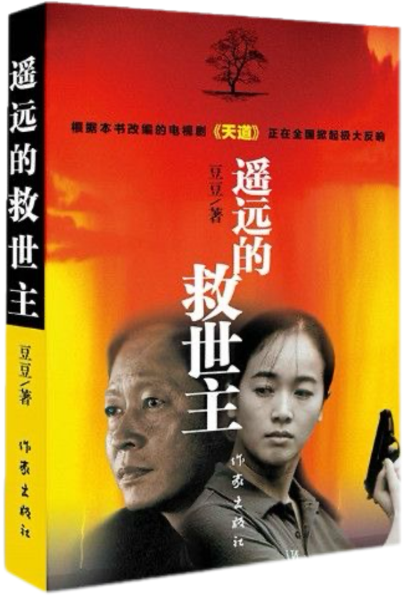
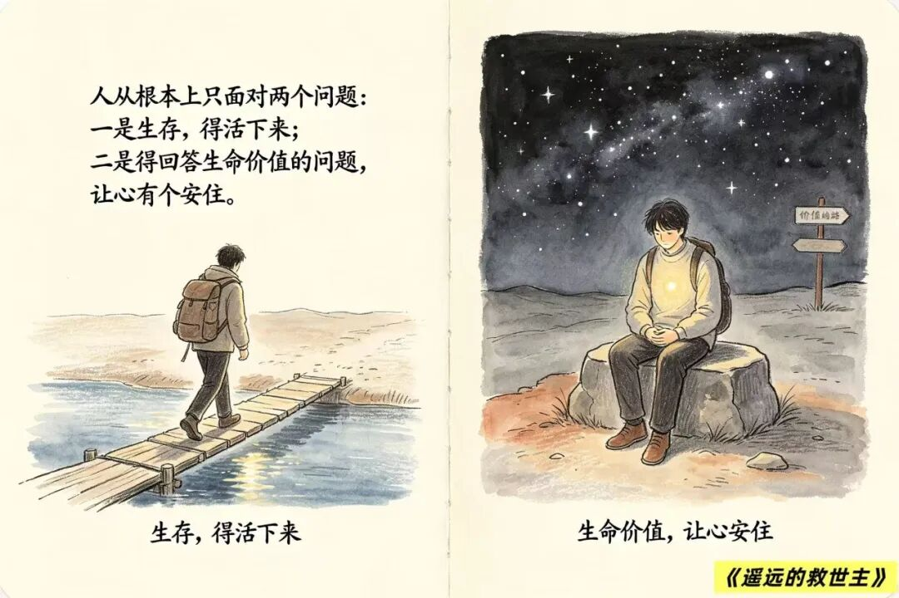
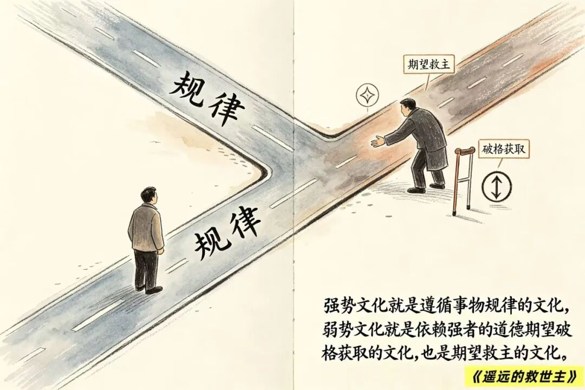
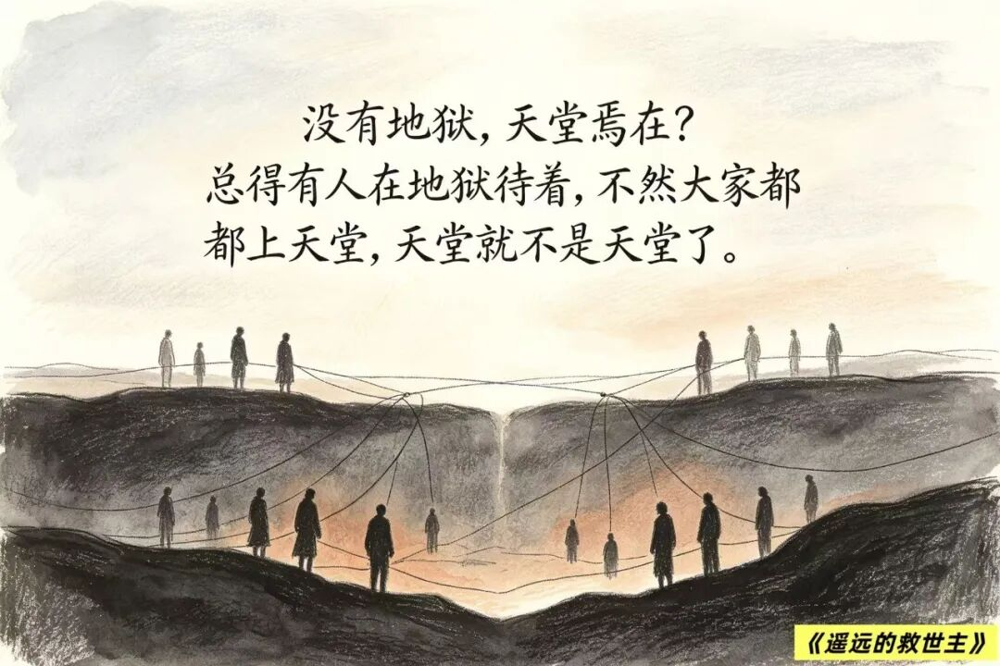
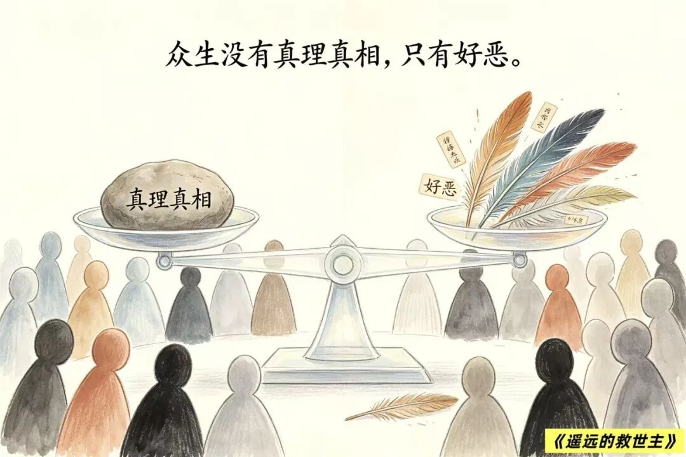
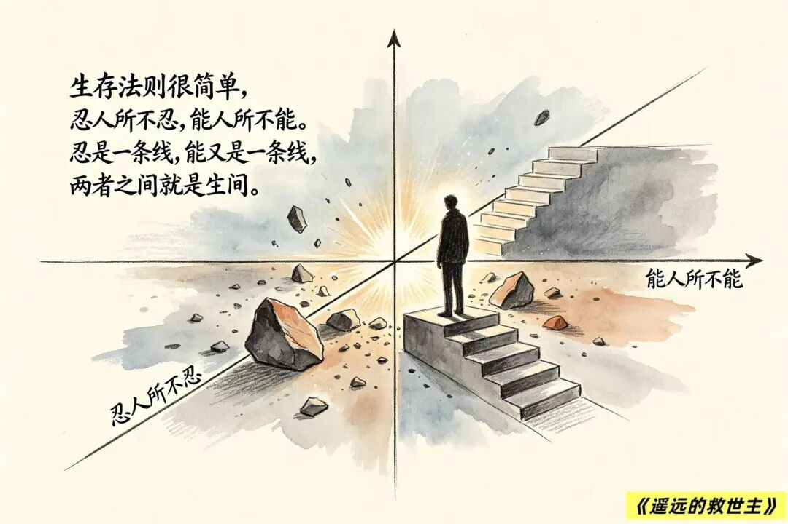

# 《遥远的救世主》：一篇文章讲透全书干货（推荐！）
> 💡 备注属性未写入，可能是备注属性名称或者类型被修改了，建议将字段类型设置为 rich_text，可以在小程序-操作-修改文章数据库页面进行调整
> 💡 原文链接:[https://mp.weixin.qq.com/s?__biz=MzE5ODQwMDUyMw==&mid=2247488697&idx=1&sn=fb78f59697b864c0ccfb54da9f863b12&chksm=9738d093b80a5262da1a1db72d36d493554975ac541c253680669ee588b25e00b1f88bb1a3a5#rd](https://mp.weixin.qq.com/s?__biz=MzE5ODQwMDUyMw%3D%3D&mid=2247488697&idx=1&sn=fb78f59697b864c0ccfb54da9f863b12&chksm=9738d093b80a5262da1a1db72d36d493554975ac541c253680669ee588b25e00b1f88bb1a3a5#rd)
《遥远的救世主》（改编为电视剧《天道》）是女作家豆豆的代表作。这是一部表面写商业商战和凄美爱情，深层却在剖析“中国文化属性”、“人的觉醒与自我救赎”的哲学小说。

**01**
** 这本书讲了些什么？**
**一、 序幕：这个“怪人”到底是谁？**
问： 这本书一开篇就显得神秘兮兮的，主角丁元英到底是个什么样的人？ 
答： 他被朋友评价为“可以是魔、是鬼，但绝不是人”。他曾是德国顶级私募基金的操盘手，在股市里用狠辣的数学模型大肆收割资本。
但他因为“良心未泯”——不愿意帮外资大规模掠夺中国股市的资金，宁可自己背负巨额违约金，强行解散了基金，随后隐居到贫困落后的小城古城。

书里有个细节：丁元英在古城隐居、资金被冻结时，穷到靠吃泡面和卖自己心爱的原版黑胶唱片度日。有一次去路边吃馄饨，他先付了钱，吃完要走时，老板娘记性不好又问他要了一次钱。丁元英没有争辩一句，默默地又掏出钱递过去。
我的感悟：这个细节把他的性格立住了——他不是懦弱，而是极度通透。在丁元英眼里，与不讲理或底层生存者争论对错的“沟通成本”，远大于那几块钱的馄饨钱。认知不在一个维度的人，争辩就是对生命的浪费。
**二、 起因：一场以“神话”为名的礼物**
问： 那么，隐居的丁元英为什么又出山了？故事的转折点是什么？ 
答： 因为爱情，或者说是“同频共振”的灵魂相遇。照顾丁元英的是古城当地的女刑警芮小丹。小丹是个家境优渥、容貌绝美但活得极其纯粹、独立的女性。两人在灵魂交锋中相爱了。在临近回德国之前，小丹向丁元英要了一份世俗难容的礼物：“给我写一个神话，让贫困村王庙村脱贫致富。”
问： 扶贫是政府的事，丁元英一个人怎么扶？ 
答： 这就是全书最精彩的商业布局。丁元英选中的突破口是音响行业。
王庙村是个除了贫穷和廉价劳动力一无所有的村子。丁元英没有给村民捐一分钱，而是成立了一家叫“格律诗”的音响公司，利用王庙村村民“不怕苦、不怕脏、不计工时、不睡整觉”的极限制造成本，把音响机箱、喇叭做到极致的高性价比。

在启动这个项目前，丁元英上五台山，给寺庙捐了重金，专门与高僧智玄大师论道。他去求的不是佛祖保佑，而是求一个“心安与圆融”。因为他清楚地知道，他为了救王庙村，接下来要用“狼性商业法则”踩碎另一个无辜企业。大师送了他四个字：“大爱不爱”，但也看出了他此行必见血光。
我的感悟：很多人以为丁元英是神，但五台山论道暴露了他的“人性残缺”。他能洞悉规律，却依然在“出世”与“入世”的因果中挣扎。真正的杀伐决断背后，是对业力和规则的深深敬畏。
**三、 高潮：商业屠杀与人性的照妖镜**
问： “格律诗”后来怎么掀起轩然大波的？ 
答： 丁元英布了一个惊天奇局：他先是让格律诗假意寻求国内音响巨头“乐圣公司”的代工和零配件，乐圣总裁林雨峰以为只是小打小闹，签了合同。 

随后，在全国音响大展上，格律诗毫无征兆地降价近50%暴跌销售！乐圣音响瞬间被逼入绝境，林雨峰暴怒，以“不正当竞争”将格律诗告上法庭，索赔巨款，誓要置格律诗于死地。
问： 官司打响后，格律诗内部发生了什么？ 
答： 这里迎来了全书对人性剖析最残酷的段落——退股风波。面对乐圣的天价索赔，格律诗的三个原始股东（古城的发烧友叶晓明、冯世杰、刘冰）吓破了胆。他们原本只想跟着高人发财，一旦面临可能倾家荡产的风险，立刻逼着董事长欧阳雪（小丹的闺蜜）退股保本。
结果呢？丁元英早就料到了诉讼的每一步：农户分散加工不受《劳动法》最低工资限制、乐圣的合同具有法律效力……格律诗最终胜诉！乐圣不得不反向寻求与格律诗合作，总裁林雨峰因骄傲与绝望，驱车坠崖自杀。
刘冰这个角色值得所有人警惕。他退了股，却厚着脸皮留在公司当司机混饭吃。在公司起死回生后，他心理极度失衡。丁元英在临走前给了他一个封好的文件袋，说是能证明乐圣清白、击垮格律诗的“绝密商业内幕”，嘱咐他“只要格律诗不亏待你，你别打开，它是你保住饭碗的护身符”。 

但刘冰贪得无厌，企图拿着这个文件袋去敲诈欧阳雪。当他拆开文件袋时，赫然发现里面全是一沓沓白纸！绝望、羞愧与贪婪交织之下，刘冰从高楼一跃而下。
我的感悟：丁元英并没有杀刘冰，杀刘冰的是刘冰自己的贪婪与侥幸。现实中太多像刘冰一样的人：能力配不上野心，想吃红利却不敢承担风险，自作聪明，最终被自己的算计吞噬。
**四、 终局：神话的代价与天道的落幕**
问： 那芮小丹呢？她得到了她想要的“神话”吗？ 
答： 神话成了，但神仙眷侣却走向了毁灭。芮小丹在办案回城的路上，偶遇了四名穷凶极恶的通缉犯。作为警察的职业本能，她选择跟踪并呼叫支援。

在支援赶来前，为了防止罪犯逃窜，她孤身一人与匪徒交火，身受重伤、双腿被炸断、容貌尽毁。在增援赶到的那一刻，她用配枪结束了自己的生命。
问： 为什么她要自杀？丁元英接到她最后的电话时，为什么不劝她？ 
答： 这是全书争议最大、也最让人心碎的细节。小丹在决定迎敌前，给丁元英打了一个电话，只是说了句：“我碰上他们了。”丁元英在电话那头沉默了许久，只说了一句：“保重。”他没有歇斯底里地劝她快逃。
我的感悟：很多人骂丁元英冷血。但丁元英太懂芮小丹了：小丹是一个“自性具足”的女人，生得璀璨，死亦要保留尊严与职责。如果劝她逃，就是否定了她生命的价值底色。

小丹死后，丁元英一口鲜血喷在茶几上。他洞察天道，却终究抵不过失去知己的人间至痛。神话的完成，最终以救世主最爱之人的献祭为代价。
**五、 核心哲思：什么是“遥远的救世主”？**
问： 读完这本书，它的书名《遥远的救世主》究竟想表达什么？ 
答： 书里提出了一个核心命题：文化属性。
弱势文化： 期待救世主、期待神仙皇上、期待贵人相助的文化。其本质是依附、等待，把自己的命运交托他人。
强势文化： 遵循客观规律（天道）、按规矩办事的文化。

王庙村的人以为丁元英是他们的“救世主”，但丁元英从头到尾只做了一件事：逼着他们遵循市场规律去残酷竞争。
最终感悟：这世上从来就没有救世主。 如果你把希望寄托在某个人、某种制度或某种神力身上，那这个“救世主”永远是遥远而虚幻的。 
真正的天道不是玄学，而是“实事求是”。神即是道，道法自然，如来。能救你的，从来只有你自己对客观规律的认知、尊重与践行。这不仅是王庙村的救赎，也是我们每一个普通人在现实生活里的立身根本。
