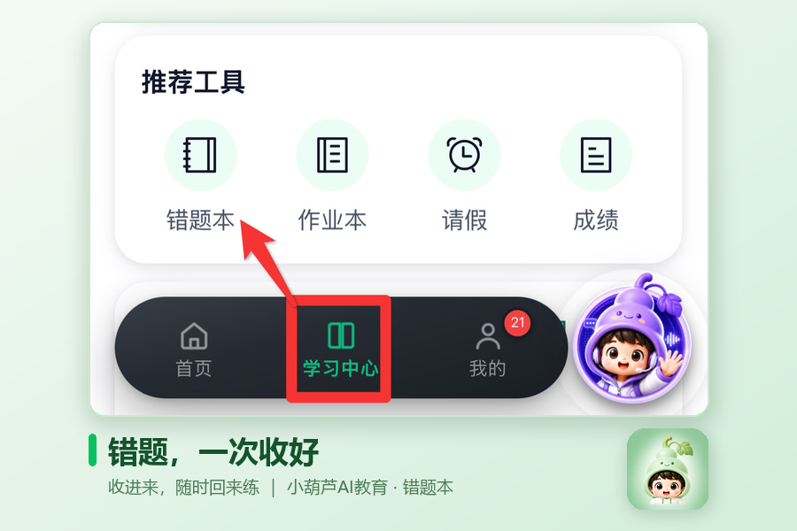
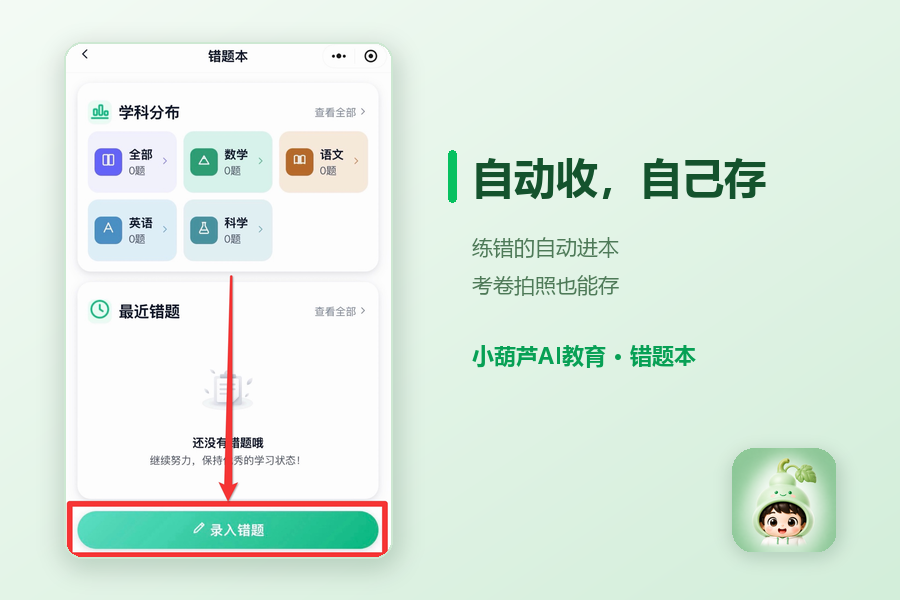
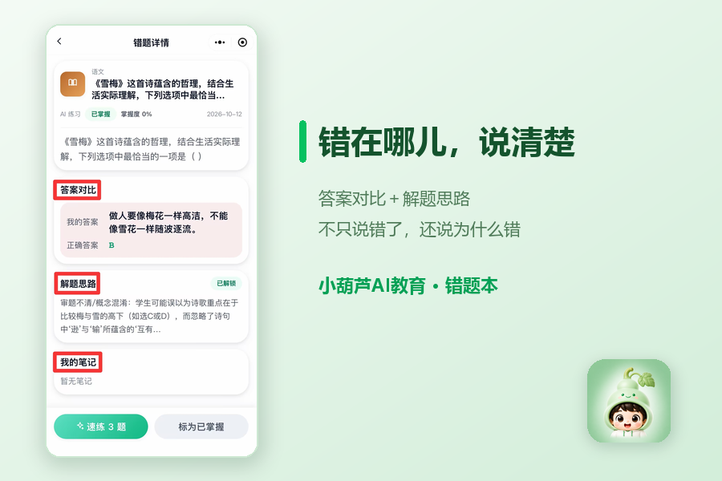
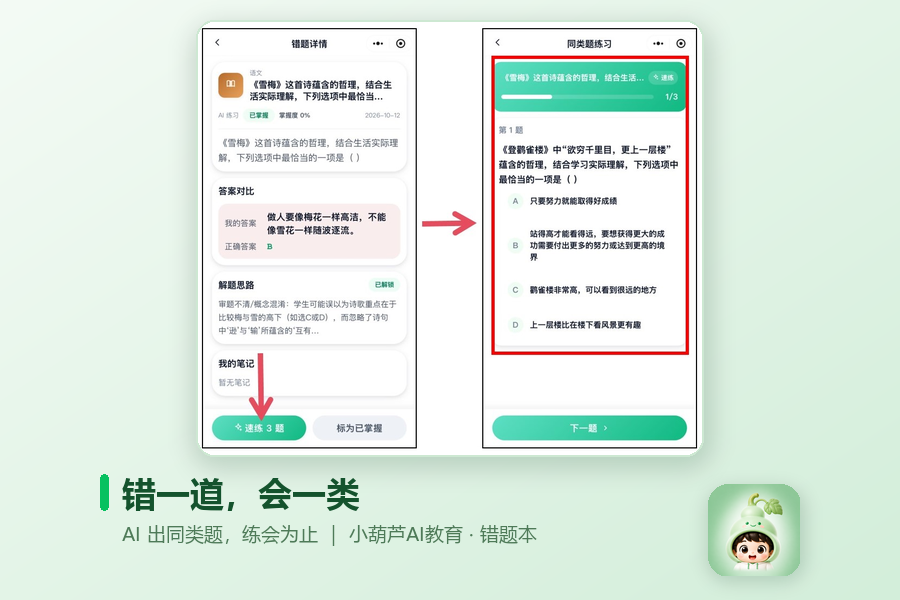

# 「错题本」全新上线：做错的题，一处收齐
> 💡 备注属性未写入，可能是备注属性名称或者类型被修改了，建议将字段类型设置为 rich_text，可以在小程序-操作-修改文章数据库页面进行调整
> 💡 原文链接:[https://mp.weixin.qq.com/s?__biz=Mzk2OTA1NDg4NA==&mid=2247484952&idx=1&sn=210ab1a777c7f9833873fa4bc9c055fe&chksm=c5fb7bb8643063bb09758d860e4913ae16da49c44b7a04938af3faeb36d1462eb889d4da6c92#rd](https://mp.weixin.qq.com/s?__biz=Mzk2OTA1NDg4NA%3D%3D&mid=2247484952&idx=1&sn=210ab1a777c7f9833873fa4bc9c055fe&chksm=c5fb7bb8643063bb09758d860e4913ae16da49c44b7a04938af3faeb36d1462eb889d4da6c92#rd)
孩子的错题，常常只有孩子自己知道。家长问起来，得到的往往是"都改了"三个字；想帮着练一练，又翻不到当初那张卷子。练习里做错的、考试里做错的、课外班做错的，各自散着，没人帮着收。
**小葫芦AI教育**里的「**错题本**」，想帮孩子把这份"散落"接住——它在小程序学习中心「**推荐工具**」的第一位，打开就是把做错的题一处收齐、随时回来练。
### 一、入口：从学习中心进入「推荐工具」
打开小程序，进入学习中心，页面里的「**推荐工具**」板块，排在第一位的就是「错题本」。

### 二、错题怎么进本：自动收，也能自己存
错题进来有两个口子。
其一是自动：孩子在 **AI 推荐练习**里做错一道题——无论是当节课的巩固练习，还是近一周的精准推荐题都会自动进「错题本」，自动按学科分类，不用专门摘抄。
其二是手动：考试卷、课外教材上的错题，也能收进来。拍张照、或从相册选一张，选择学科并填写错题和答案，**图文形式保**存好，零散的错题慢慢沉淀成孩子自己的错题本。

### 三、点开一题看什么：错在哪儿，说清楚
每道错题点开，是完整的**错题详情**：答案对比、解题思路，错在审题不清还是概念混淆，都摊开来讲。不是只丢一个"错了"，而是说清"为什么错"。

### 四、怎么练透：速练，AI 出同类题
详情页点一下"**速练3题**"，AI 会围绕同类题型重新出题。错了一道，就再练一道同类型的，把一种题型真正练会，而不是这道题背下来就完了。

---
打开错题本，孩子随时能把曾经错过的地方，一点点练扎实。
打开小程序 → 学习中心 →「推荐工具」第一位 → 错题本。散落在外面的错题，从今天起，一处收齐。
> 用好小程序，建言共成长。
>

## 摘要

（待补充）

## 我的笔记

（待补充）
