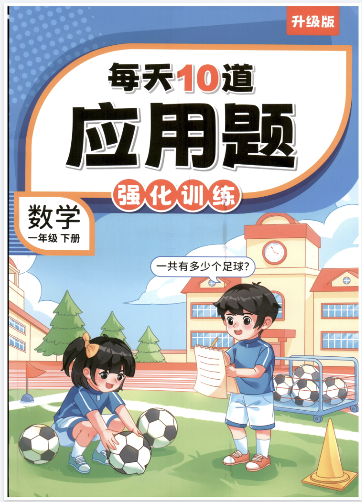
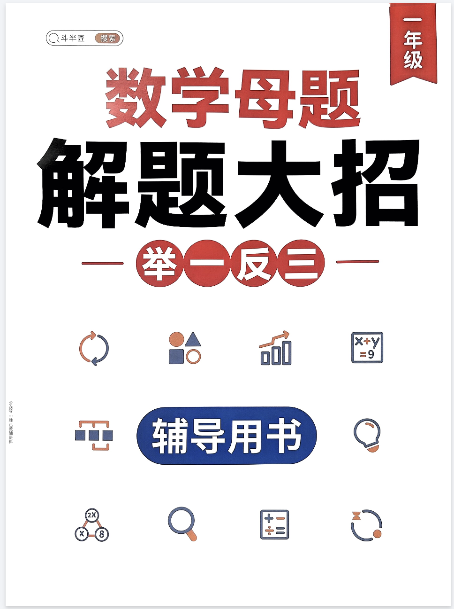

# 【26春】最新1-6年级下册数学《全册应用题专项练习》+《斗半匠-每天10道应用题强化训练》附答案 高清电子版可打印
> 💡 备注属性未写入，可能是备注属性名称或者类型被修改了，建议将字段类型设置为 rich_text，可以在小程序-操作-修改文章数据库页面进行调整
> 💡 原文链接:[https://mp.weixin.qq.com/s?__biz=MzYzMTUyNjc5Mg==&mid=2247493895&idx=1&sn=4c6e6edd213b459f487e6363619d1b96&chksm=f15e5b4eadfea59b9902ba0791bafe6c4aa72d5acc674126d76edd8227a5a6ae0473293ccc9e#rd](https://mp.weixin.qq.com/s?__biz=MzYzMTUyNjc5Mg%3D%3D&mid=2247493895&idx=1&sn=4c6e6edd213b459f487e6363619d1b96&chksm=f15e5b4eadfea59b9902ba0791bafe6c4aa72d5acc674126d76edd8227a5a6ae0473293ccc9e#rd)
点击 蓝字关注 获取更多资料

今天就给大家整理了 **26春最新1-6年级下册数学《全册应用题专项练习》**，严格同步26春最新课本，覆盖1-6年级全学段，每道题都附带详细答案，高清电子版可直接打印，帮孩子专项突破、精准提分！
**链接限时分享，请及时保存**
**26春小学数学《应用题专项练习》1-6年级下册总链接：：**
**https://pan.quark.cn/s/9c25827b3527**
**1.新一下数学《重难点思维应用题》八大类常见思维题归纳合集（含答案85页）**
**https://pan.quark.cn/s/b9ec1b5449ec**
**2.二年级(下)数学期末常考8种易错应用题**
**https://pan.quark.cn/s/560d6273fc6a**
**3.三下数学全册易错应用题专项**
**https://pan.quark.cn/s/5ee0efa296b1**
**4.四年级(下)数学寒假预习八大类型应用题**
**https://pan.quark.cn/s/9ae0f860e65e**
**5.五下数学[期末必考应用题母题90道(含答案)】**
**https://pan.quark.cn/s/d585bb5930b8**
**6.六年级下数学常考易错应用题(75道)**
**https://pan.quark.cn/s/7ba2e5a68742**

**《斗半匠-每天10道应用题强化训练》数学上下册总链接：**
**https://pan.quark.cn/s/23c063f59247**
**1.斗半匠《每天10道应用题》1年级上册.pdf**
**https://pan.quark.cn/s/c389fd13b2d4**
**2.斗半匠《每天10道应用题》2年级上册.pdf**
**https://pan.quark.cn/s/79afb0a67ad2**
**3.斗半匠《每天10道应用题》3年级上册.pdf**
**https://pan.quark.cn/s/051e278bb2b3**
**4.斗半匠《每天10道应用题》4年级上册.pdf**
**https://pan.quark.cn/s/48c86b25a34c**
**5.斗半匠《每天10道应用题》5年级上册.pdf**
**https://pan.quark.cn/s/444a7e32e711**
**6.斗半匠《每天10道应用题》6年级上册.pdf**
**https://pan.quark.cn/s/0a94b3b68d03**
**7.小学数学1年级下册《每天10道应用题强化训练》.pdf**
**https://pan.quark.cn/s/8acfa8615bfb**
**8.小学数学2年级下册《每天10道应用题强化训练》.pdf**
**https://pan.quark.cn/s/82cfb5197de5**
**9.小学数学3年级下册《每天10道应用题强化训练》.pdf**
**https://pan.quark.cn/s/b6ee10e9bee9**
**10.小学数学4年级下册《每天10道应用题强化训练》.pdf**
**https://pan.quark.cn/s/9ba1b52c41aa**
**11.小学数学5年级下册《每天10道应用题强化训练》.pdf**
**https://pan.quark.cn/s/6bb2c09120ec**
**12.小学数学6年级下册《每天10道应用题强化训练》.pdf**
**https://pan.quark.cn/s/b7aa427a4532**

**斗半匠数学母题解题大招总链接：**
**https://pan.quark.cn/s/3fc4aeb0fe72**
**1.数学母题解题大招一年级**
**https://pan.quark.cn/s/cb0188490218**
**2.数学母题解题大招二年级**
**https://pan.quark.cn/s/1601619c806e**
**3.数学母题解题大招三年级**
**https://pan.quark.cn/s/903c76641c29**
**4.数学母题解题大招四年级**
**https://pan.quark.cn/s/70f2bfff05a7**
**5.数学母题解题大招五年级**
**https://pan.quark.cn/s/5d50a637d3c9**
**6.数学母题解题大招六年级**
**https://pan.quark.cn/s/8e8d392ea203**
**注意：下载链接只能复制，无法直接点击。**
**请复制连接，微信里发给自己，即可打开链接免费下载**

点赞
收藏
分享
**获取完整电子版：**
①：点击左下角**阅读原文获取资料记得给个“赞”**和**“在看”**，感谢🙏！
②：在公众号**消息对话框中**发送：**0411**
说明
本微信公众账号分享的资源均通过网络等公共合法渠道获得，仅供试用！版权属于原出版机构或影像公司，本资源为电子载体，传播分享仅限于家庭使用与交流心得、参考和辅助购买决策，不得以任何理由在商业行为中使用，若喜欢此资源，建议购买实体产品。文章中的视频及图片均来自网络，版权归原作者或原出版社所有。如有侵权，请及时联系删除。

**领取更多资料请点下方**
**阅读原文**
