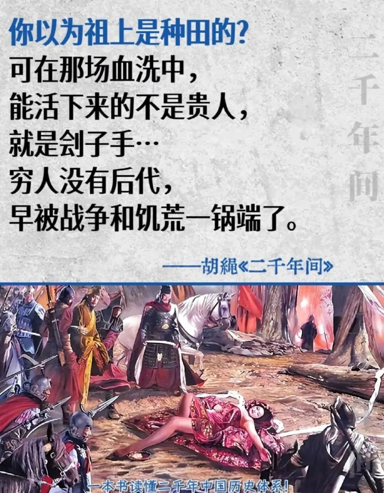
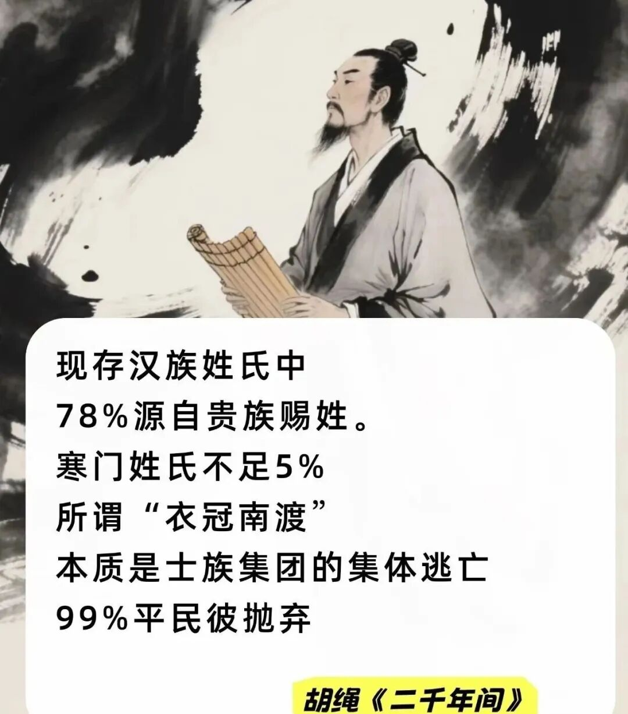
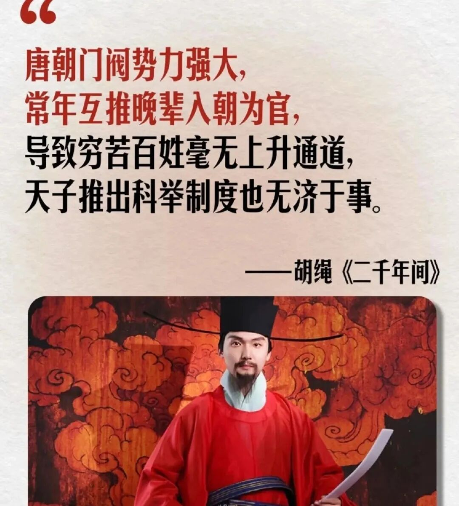

# 【今日推荐】胡绳：穷人没有后代，你的祖上不是权贵，就是刽子手
> 💡 备注属性未写入，可能是备注属性名称或者类型被修改了，建议将字段类型设置为 rich_text，可以在小程序-操作-修改文章数据库页面进行调整
> 💡 原文链接:[https://mp.weixin.qq.com/s?__biz=MzA3NTU1NTUxNQ==&mid=2652856930&idx=1&sn=409c9585437528249100443dd97a4c70&chksm=8584b3e82864bf0ac302f9ade191f74f67cce2328aaa19e7c7cbdfc7be9298f817b4eb01803e#rd](https://mp.weixin.qq.com/s?__biz=MzA3NTU1NTUxNQ%3D%3D&mid=2652856930&idx=1&sn=409c9585437528249100443dd97a4c70&chksm=8584b3e82864bf0ac302f9ade191f74f67cce2328aaa19e7c7cbdfc7be9298f817b4eb01803e#rd)
点击蓝字
关注我们

《两千年间》，指尖拂过书页，仿佛推开了一扇通往历史深处的窗。
全书随处可见一针见血的论断，读来常有醍醐灌顶之感。比如谈到那些高高在上的皇帝，他直言：“假如皇帝和一般人不同，那么我们倒不妨说，这不同之处正在于皇帝中大半是精神不健全，在智力上很低能的人。”一句话，便撕开了皇权神圣的外衣。
他这样剖析科举制度下的官僚：“这些念了一辈子死书，好不容易戴上乌纱帽的人，对于现行统治秩序自然是竭诚效忠无疑的了。”然而他又犀利地指出，这群追求个人利益的官僚，最终会成为“从内部来腐蚀整个统治政权的贪欲无厌的蛀虫”。这种充满张力的辩证分析，让历史不再是脸谱化的简单叙事。

而胡绳的目光，始终投向那些在史书中“像牛马一样地生活着，也像牛马一样地劳作着的农民”。他写道：“要懂得中国，必须懂得中国的农村；要懂得中国的历史，必须懂得中国农村的历史。”
皇权与官僚的共生：“唐太宗行科举，见考生鱼贯入场，笑曰：‘天下英雄尽入吾彀中矣。’科举制以中央集权为轴心，将读书人捆绑于仕途，看似选拔人才，实则巩固统治。

当国难临头，这群‘文不能安邦，武不能临阵’的儒生，便只能另寻新主——因为他们的人生目标，本就只是做官而已。”农民战争的局限：“农民起义领袖常以‘均平’为口号，却无法突破小农经济的桎梏。
李自成攻入北京后，迅速腐化，终致失败。历史证明，农民可以摧毁旧王朝，却无法建立新秩序——他们缺乏超越封建框架的意识形态与组织能力。”边疆冲突的根源：“汉族统治者常以对外战争转移内部矛盾，实则农耕文明与游牧文明的冲突源于经济模式差异。
长城以北的草原无法支撑农耕，而游牧民族人口膨胀后，必南下劫掠。宋朝冗军严重却疆域狭小，正因农耕民族不善扩张，而游牧民族为生存不得不战。”
封建制度的必然灭亡：“变法运动屡屡失败，非因改革者无能，而是封建制度已如枯木，任何修补皆无济于事。当历史的车轮滚滚向前，旧时代终将被撇在身后——这是谁也违拗不了的前进主潮。”

猜你喜欢：
[【今日推荐】叔本华：人生的本质就是痛苦和无聊的循环](https://mp.weixin.qq.com/s?__biz=MzA3NTU1NTUxNQ%3D%3D&mid=2652856769&idx=1&sn=65159cd773e9f602c0eff7dec510ee7c&scene=21#wechat_redirect)
[张小娴：结束肉体关系，才能变成灵魂伴侣](https://mp.weixin.qq.com/s?__biz=MzA3NTU1NTUxNQ%3D%3D&mid=2652856723&idx=1&sn=b7e9377ad4cc6e0c3ada85cc238e4b9b&scene=21#wechat_redirect)
[王安忆：遍地民工](https://mp.weixin.qq.com/s?__biz=MzA3NTU1NTUxNQ%3D%3D&mid=2652856662&idx=1&sn=fff8e64cceb31b02406d5292062612b7&scene=21#wechat_redirect)
[短篇小说 | 铁凝：省长日记](https://mp.weixin.qq.com/s?__biz=MzA3NTU1NTUxNQ%3D%3D&mid=2652856351&idx=1&sn=b4f168d6873822ad52befa21d480bdf3&scene=21#wechat_redirect)

