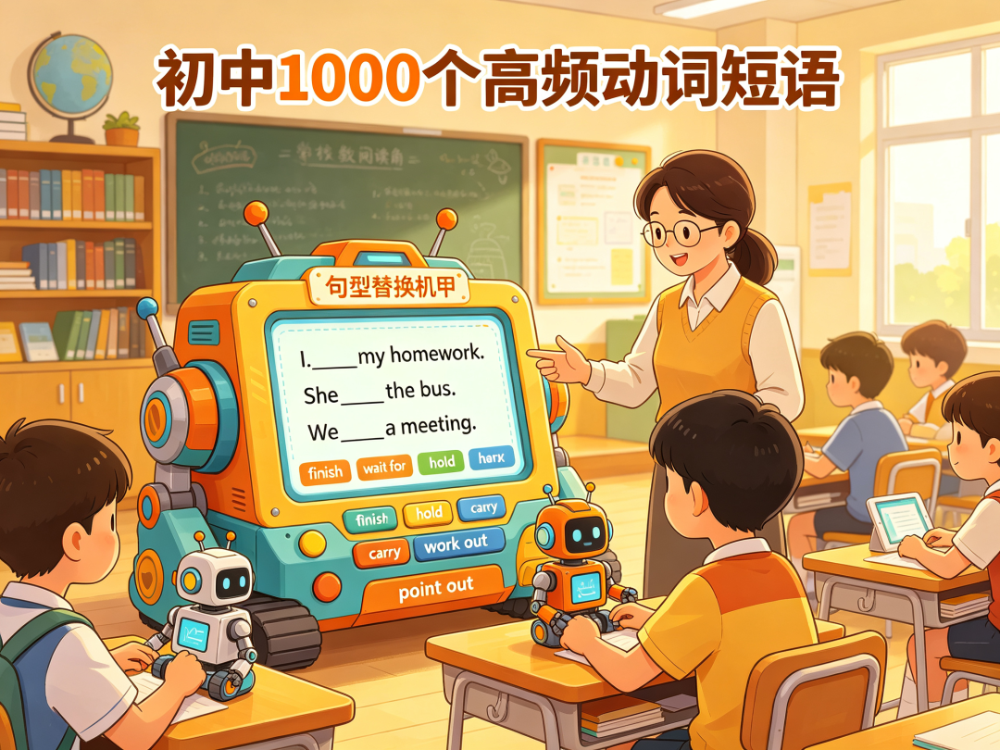

# 【带音频】初中完形填空1000个高频动词短语，吃透短语重难点，读文更快、做题更准（建议收藏）
> 💡 备注属性未写入，可能是备注属性名称或者类型被修改了，建议将字段类型设置为 rich_text，可以在小程序-操作-修改文章数据库页面进行调整
> 💡 原文链接:[https://mp.weixin.qq.com/s?__biz=MzYyMjMzODMwMg==&mid=2247495647&idx=1&sn=cdc0761b51f376edf0bf7cd04ace7682&chksm=fe3576b3b404dc8b7426da724834db635e324b60704b28c5bf128a408bb24180a11a1d345b23#rd](https://mp.weixin.qq.com/s?__biz=MzYyMjMzODMwMg%3D%3D&mid=2247495647&idx=1&sn=cdc0761b51f376edf0bf7cd04ace7682&chksm=fe3576b3b404dc8b7426da724834db635e324b60704b28c5bf128a408bb24180a11a1d345b23#rd)
原创声明：本文内容为原创整理，未经允许请勿模仿、搬运（二创等），违者将依法维权并举报。
不少孩子做完形总卡壳，单词单独认识，放到句子里就看不懂，很多都是栽在动词短语上。完形考点里，动词短语占比很高，记零散了很容易混淆丢分。特意整理了初中完形填空 1000 个高频动词短语，搭配音频跟读，不用死背。吃透这些重点短语，读文章不容易卡顿，理解句意更顺畅，做题判断也会更稳。

**一**
**PART 01**
**事情怎么开头、怎么撑住、怎么收尾**
完形里总有一道题问“后来这件事怎么样了”。开头、继续、中断、收尾，四个动作各有各的说法，选错一个，整段的节奏就乱了。
**001begin with** 以……开始
**002start with** 从……开始
**003start off** 开始；出发
**004start out** 起初是；启程
**005get started** 开始动手
**006go ahead** 继续进行；请便
**007go on doing** 继续做同一件事
**008go on to do** 接着做另一件事
**009go on with** 把……继续下去
**010carry on with** 继续做下去
**011keep at it** 坚持做下去
**012keep up** 保持（原有水平）
**013keep it up** 继续保持
**014stick with** 坚持（某个选择）
**015hold on to** 坚持不放
**016hang on** 坚持；稍等
**017press on** 坚持前进
**018push on** 继续努力
**019move on to** 转向（下一件事）
**020take on** 承担；呈现
**021come to an end** 结束
**022bring to an end** 使……结束
**023put an end to** 终止
**024draw to a close** 接近尾声
**025wind up** 收尾；结束
**026wrap up** 结束；包好
**027call it a day** 今天到此为止
**028cut short** 打断；缩短
**029leave off** 停止
**030quit doing** 戒掉做某事
**031stop to do** 停下来去做
**032stop doing** 停止做（正在做的）
**033pause for** 停下来（做某事）
**034hold up** 耽搁；举起
**035delay doing** 推迟做
**036push back** 推迟
**037call off** 取消
**038do away with** 废除
**039shake off** 摆脱
**040throw off** 摆脱
**041cast aside** 抛弃
**042leave aside** 暂时搁置
**043put aside** 放到一边
**044lay aside** 放下；留存
**045give way to** 让位于
**046make way for** 给……让路
**047pave the way for** 为……铺路
**048lay the foundation for** 为……打基础
**049set the stage for** 为……做好准备
**050get down to business** 言归正传
**051come around to** 转而接受
**052warm up to** 对……热络起来
**053ease into** 慢慢进入
**054slide into** 不知不觉陷入
**055fall into** 陷入（某种状态）
**056slip into** 溜进；陷入
**057settle into** 适应（新环境）
**058settle down** 安定下来
**059settle for** 勉强接受
**060make do with** 凑合着用
**061do with** 处理；需要
**062do without** 没有……也行
**063go about** 着手做
**064get around to** 抽出时间做
**065set out to do** 着手做
**066proceed to** 接着进行
**067proceed with** 继续进行
**068resume doing** 恢复做
**069return to** 回到
**070get back to** 回到（某事上）
**071come back to** 回到（话题）
**072take over from** 接替
**073hand over to** 移交给
**074pass on to** 传给
**075step down** 辞职下台
**076step aside** 让位
**077bow out** 退出
**078drop out** 退出；辍学
**079back out** 退出（承诺）
**080pull out** 退出；撤离
**081opt out** 选择退出
**082sit out** 坐着不参加
**083count down** 倒计时
**084wear off** 逐渐消失
**085die down** 逐渐平息
**086fade away** 逐渐消失
**087pass away** 去世
**088run its course** 自然结束
**089play out** （事情）发展下去
**090end up doing** 最终做了
**091end in** 以……告终
**092finish up** 最后落到
**093finish off** 完成；吃光
**094polish off** 迅速做完
**095round off** 圆满结束
**096kick off** 开始（活动）
**097open the door to** 为……打开大门
**098get off the ground** 顺利启动
**099fall through** 落空
**100give up on** 对……不再抱希望
**二**
**PART 02**
**谁导致谁：因果、影响和“取决于”**
完形最爱在这种地方挖空：前面一个动作，后面一个结果，中间那个词决定了整段是顺还是反。这类空错一次，往往会连着错两道。
**101lead to** 导致
**102result in** 导致
**103result from** 由……造成
**104give rise to** 引起
**105bring on** 引起
**106trigger off** 引发
**107spark off** 引发
**108touch off** 引发
**109set in motion** 启动（连锁反应）
**110call forth** 唤起
**111give birth to** 产生；催生
**112bring forth** 产生
**113contribute to** 促成；有助于
**114account for** 解释；占（比例）
**115stem from** 源于
**116arise from** 由……产生
**117derive from** 源自
**118originate from** 起源于
**119come of** 由……而来
**120grow out of** 由……发展而来
**121be rooted in** 根源在于
**122lie in** 在于
**123consist in** 在于
**124rest on** 取决于
**125hinge on** 取决于
**126rest with** 取决于（某人）
**127be up to** 取决于
**128be down to** 归因于
**129boil down to** 归结为
**130amount to** 等于；意味着
**131come down to** 归结为
**132reduce to** 简化为
**133lead up to** 导致；引出
**134make for** 促成
**135conduce to** 有助于
**136be conducive to** 有助于
**137do harm to** 对……有害
**138do good to** 对……有益
**139take a toll on** 对……造成损害
**140weigh on** 给……造成压力
**141bear on** 与……有关
**142have a bearing on** 与……有关
**143play a part in** 在……中起作用
**144play a role in** 在……中扮演角色
**145have a hand in** 参与；插手
**146make an impact on** 对……产生影响
**147have an effect on** 对……有影响
**148exert an influence on** 对……施加影响
**149leave a mark on** 在……上留下印记
**150leave behind** 留下
**151give off** 散发（气味、光）
**152throw out** 散发（热、光）
**153send out** 发出（信号）
**154let out** 发出（声音）
**155flare up** 突然爆发
**156blow over** 平息
**157die out** 灭绝
**158wipe out** 消灭
**159kill off** 使灭绝
**160rule out** 排除
**161shut out** 排除在外
**162leave out** 遗漏
**163miss out** 错过
**164gloss over** 掩饰
**165cover up** 掩盖
**166brush aside** 无视
**167shrug off** 不理会
**168play down** 淡化
**169tone down** 缓和
**170water down** 削弱
**171sum up** 总结
**172add up** 说得通；相加
**173figure in** 把……算进去
**174factor in** 把……计入
**175take into account** 考虑到
**176allow for** 考虑到
**177make allowance for** 考虑到
**178weigh up** 权衡
**179mull over** 反复琢磨
**180think over** 仔细考虑
**181point to** 表明
**182point up** 强调
**183bear out** 证实
**184bear witness to** 见证
**185vouch for** 为……担保
**186be indicative of** 表明
**187speak for** 代表……说话
