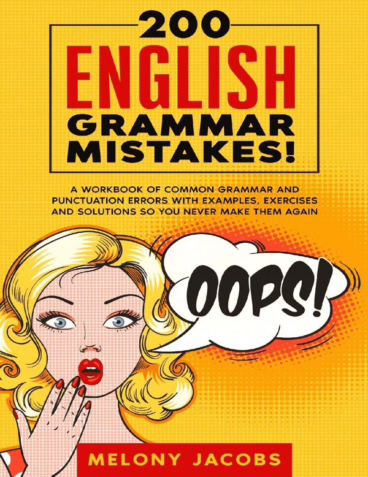
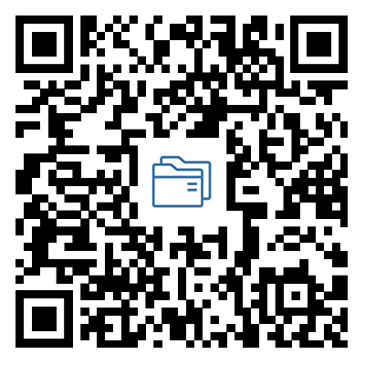

# 【推荐】语法练习册：200 English Grammar Mistakes!
> 💡 备注属性未写入，可能是备注属性名称或者类型被修改了，建议将字段类型设置为 rich_text，可以在小程序-操作-修改文章数据库页面进行调整
> 💡 原文链接:[https://mp.weixin.qq.com/s?__biz=MzAxOTE2MjcxNw==&mid=2649633253&idx=3&sn=f0979bb2dfcdfb79f914aa57695fd0bf&chksm=826a20bf127dbeb9e89cee579cf869b98e5866c0e48634a340587be696326ed2b8ba98912e1e#rd](https://mp.weixin.qq.com/s?__biz=MzAxOTE2MjcxNw%3D%3D&mid=2649633253&idx=3&sn=f0979bb2dfcdfb79f914aa57695fd0bf&chksm=826a20bf127dbeb9e89cee579cf869b98e5866c0e48634a340587be696326ed2b8ba98912e1e#rd)

**牛津英语教与学**
**「江苏省牛津版初中英语教与学资源及互动交流平台 」**
我们一直在努力，请和我们一起努力！

本期推荐资源为《200 English Grammar Mistakes!》，它是由梅洛妮·雅各布斯创作，是2020年出版的英文原版语法练习册。该书并不从头讲解完整语法体系，而是聚焦200个高频语法、用词以及标点错误。全书分为三大板块：基础语法错误、易混淆词汇辨析、句式与标点错误。书中针对每一类错误，均提供错误例句、修正范例，并配套带答案的练习题。

（资源封面及内容页预览）
资源介绍
这本书适合初中高阶、高中生以及大学生等中等水平学习者，尤其适合提升书面写作，也适配国内英语考试的改错训练。但它不适合零基础学习者，全书无中文注解，定位是查漏补缺，并非语法入门教材。
在实际使用中，学生可以借助这本书排查、修正写作里的各类病句；教师也可以节选书中习题用作课堂小测或课后作业。它更适合作为语法补充巩固材料，不建议当作主力语法课本使用。
资源获取

（扫码或点击阅读原文订阅推荐资源）
