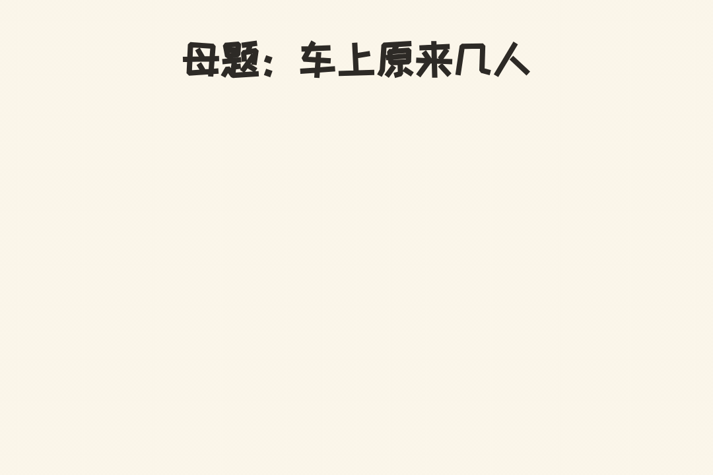
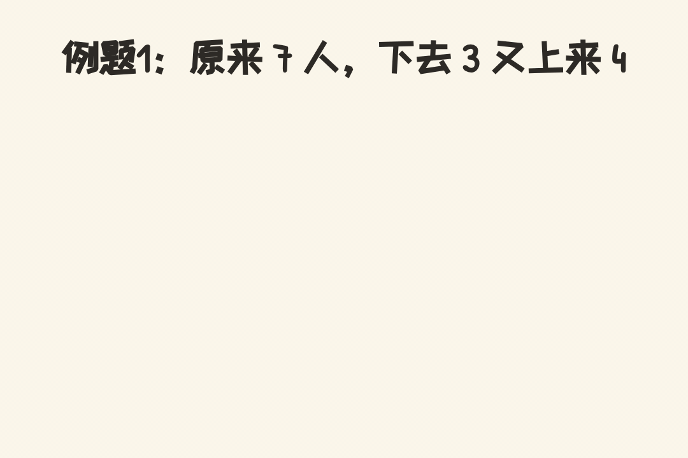
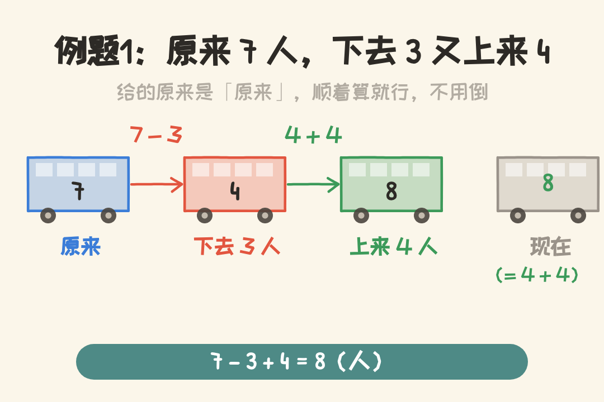
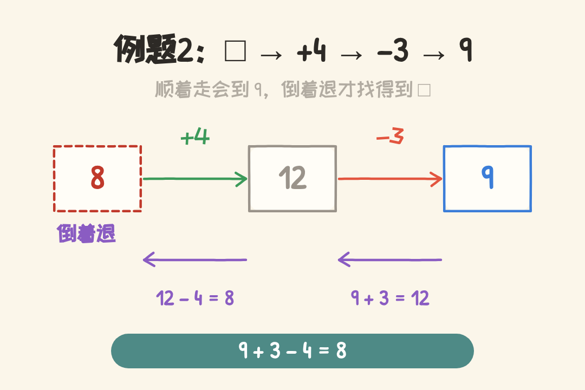
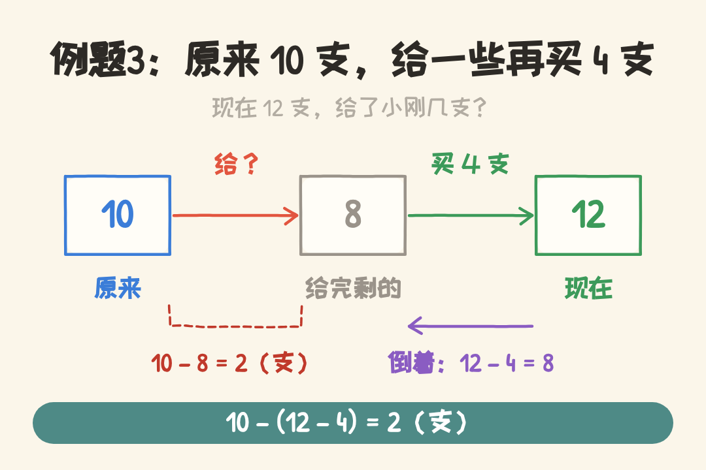
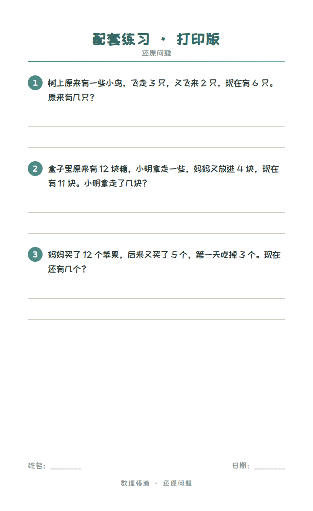

# 【数理悟道】一年级奥数思维 · 还原问题（连加连减）
> 💡 备注属性未写入，可能是备注属性名称或者类型被修改了，建议将字段类型设置为 rich_text，可以在小程序-操作-修改文章数据库页面进行调整
> 💡 原文链接:[https://mp.weixin.qq.com/s?__biz=MzkwNzQ2MTM5OQ==&mid=2247517036&idx=1&sn=63eb03c73db7343713ae44cf03427872&chksm=c12c18fb2685c21f456933ceed196f35db4e75397a8ae1f36cd9527c68fe12a4f4b631ebff7c#rd](https://mp.weixin.qq.com/s?__biz=MzkwNzQ2MTM5OQ%3D%3D&mid=2247517036&idx=1&sn=63eb03c73db7343713ae44cf03427872&chksm=c12c18fb2685c21f456933ceed196f35db4e75397a8ae1f36cd9527c68fe12a4f4b631ebff7c#rd)
**数理悟道**
一年级奥数思维
Mathematics · Enlightenment
**还原问题（连加连减）**
**从结果倒着找回原来**
Tips：文末有例题可打印给小朋友练习哦~
公交车上原来有一些人，到站上来 3 个人、下去 2 个人，现在车上有 5 个人。原来车上有几个人？
孩子提笔就来：5 加 3 减 2，等于 6，三下两下写完。
可他没想明白一件事：上来的 3 个人是后来才上的，下去的 2 个人是原来就在车上的。倒着算的时候，到底谁该加、谁该减，一错就全反了。
这种「给现在、找原来」的题，诀窍就一条：倒着走，加变减、减变加。
**01**
**母题 · 车上原来几人**
**题目**
公交车上原来有一些人，到站上来 3 人、下去 2 人，现在车上有 5 人。原来有几人？
**最容易错的一步**
孩子多半会写成 **5 + 3 − 2 = 6**，说原来有 6 人。
错在哪？上来 3 人是让车「变多」的，倒回去应该减；下去 2 人是让车「变少」的，倒回去应该加。加减方向一搞反，答案就差了 2。
**动图看一遍**

     
原来 4 人 → 上来 3 → 7 人 → 下去 2 → 5 人

     
上来 3 人、下去 2 人，现在 5 人 → 倒着推回去
**分步倒着算**
1. 现在车上是 5 人，这是「上完 3 个、下完 2 个」以后的结果。
2. 倒着走第一步，退回到「下去 2 人」之前：这 2 人当时还在车上，加回来，**5 + 2 = 7**。
3. 再退回到「上来 3 人」之前：这 3 人还没上车，减掉，**7 − 3 = 4**。
4. 也可以一步写：**5 + 2 − 3 = 4**。
**验算：4 + 3 − 2 = 5，正好回到现在 5 人。✓**
**答案：原来车上有 4 人。**
**02**
**例题精讲**
例题 1 · 顺着算现在有几人
**题目**
公交车上原来有 7 人，下去 3 人，又上来 4 人。现在车上有几人？
**第一步不是算，是看清题目给的是「原来」还是「现在」。**
给的是原来 7 人，问的是现在，那就顺着算，不用倒。这题和母题方向正好相反，是专门摆在一起对照的。
下去 3 人，车上先少 3：**7 − 3 = 4**。
又上来 4 人，车上再多 4：**4 + 4 = 8**。
也可以一步写：**7 − 3 + 4 = 8**。
**看图算**

     
顺着走：原来 7 → 下去 3 → 4 → 上来 4 → 8

     
完整过程：7 − 3 + 4 = 8
**验算：8 − 4 = 4，4 + 3 = 7，正好回到原来 7 人。✓**
**答案：现在车上有 8 人。**
例题 2 · 口算链，倒着退回去
**题目**
口算链条：□ → +4 → −3 → 9，□ 是几？
**链条最后一站是 9，可最先那个方框里填几，得从 9 往回退。**
9 是「减 3」以后的数，退回去要把 3 加回来：**9 + 3 = 12**。
12 又是「加 4」以后的数，退回去要把 4 减掉：**12 − 4 = 8**。
所以方框里填 **8**：8 → +4 → 12 → −3 → 9，正好走到 9。
**倒着走一遍**

     
顺着走是 +4 再 −3，倒着退就是 +3 再 −4
**验算：8 + 4 = 12，12 − 3 = 9。✓**
**答案：□ 是 8。**
例题 3 · 中间被拿走多少
**题目**
小明原来有 10 支笔，给小刚一些后，妈妈又给他买了 4 支，现在有 12 支。小明给了小刚几支笔？
**这里问的不是「原来」，是「中间给出去多少」，一样得倒着退。**
先退掉最后一件事：现在 12 支是买完 4 支以后的，买之前只有 **12 − 4 = 8**（支）。
这 8 支就是给完小刚以后剩下的。小明原来 10 支，剩下 8 支，给出去的是 **10 − 8 = 2**（支）。
所以倒着退到底只是第一步，还得回头拿「原来 10 支」比一比，才知道中间少了多少。
**看图退一遍**

     
10 支 → 给了一些 → 8 支 → 买 4 支 → 12 支
**验算：10 − 2 = 8，8 + 4 = 12，正好是现在的 12 支。✓**
**答案：小明给了小刚 2 支笔。**
**03**
**归纳**
**还原问题，一句话：给现在找原来，倒着走，加变减、减变加。**先分清题给的是「原来」还是「现在」，再决定正着算还是倒着算。
1. 先看清方向：给原来求现在，正着算；给现在求原来，倒着算。
2. 倒着算时，从最后的数出发，按事情发生的相反顺序退，每一步把加减反过来：上来（加）改减，下去（减）改加。
3. 退到没有动作可退，停住的那个数就是要求的结果；如果问的是中间被拿走多少，退到中间那一站，再拿原来比一比。
题目怎么问、怎么算，列在一块儿：
| **题目怎么说** | **怎么算** | **关键一步** |
| 给原来，求现在 | 原来 + 上来 − 下去 | 照着顺序算，不用倒 |
| 给现在，求原来 | 现在 + 下去 − 上来 | 倒着退，加减掉个个儿 |
| 给现在，求中间给出多少 | 先退到最后一步之前，再拿原来比 | 退到底只是第一步 |
**家长可以这样讲**
「这种题，先不动笔，先问一句：题里给的是『原来』还是『现在』？给的是现在、要找原来，那就得倒着算。倒着算就像倒着走路——上车改成下车，下车改成上车，加 3 改成减 3，减 2 改成加 2。你拿 5 块积木当车上现在的人，先放回 2 块（这 2 个人刚下车，得先请回来），再拿走 3 块（这 3 个人是后来才上车的，得请下去），手里剩下 4 块，原来就是 4 人。」
倒着算，加减掉个个儿。
**04**
**配套练习**
下面这张练习卷，长按保存，打印出来就能让孩子练。
**可打印练习卷**

     
长按图片 → 保存 → 打印
↓ 下面是答案，做完再看 ↓
**练习 1** 树上原来有一些小鸟，飞走 3 只，又飞来 2 只，现在有 6 只。原来有几只？
答案
6 − 2 + 3 = 7 只。✓
**练习 2** 盒子里原来有 12 块糖，小明拿走一些，妈妈又放进 4 块，现在有 11 块。小明拿走了几块？
答案
11 − 4 = 7，12 − 7 = 5，拿走 5 块。✓
**练习 3** 妈妈买了 12 个苹果，后来又买了 5 个，第一天吃掉 3 个。现在还有几个？
答案
12 + 5 − 3 = 14 个。✓
**结**
**小结**
还原问题拗不过来的，是方向：正着算顺着加加减减，倒着算要把加减都掉个个儿。看清题给的是「原来」还是「现在」，先定方向，再动笔。
倒着算，加减掉个个儿。
数理悟道 · 一年级奥数思维
