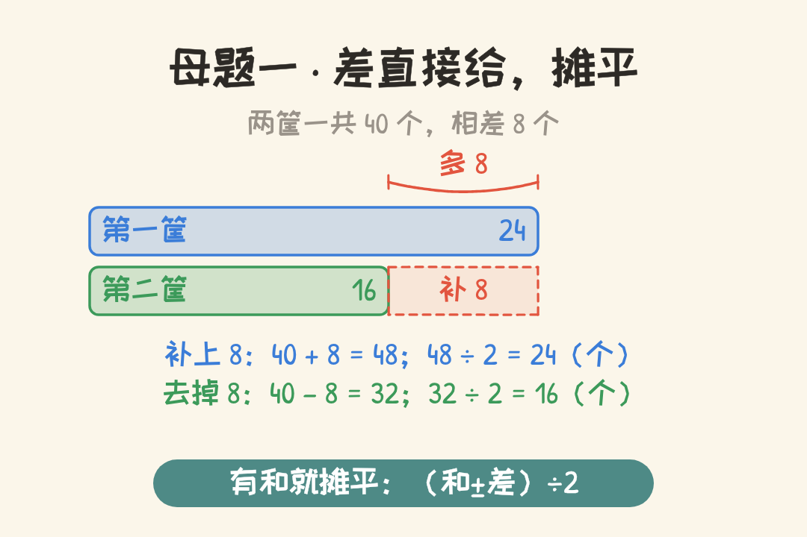
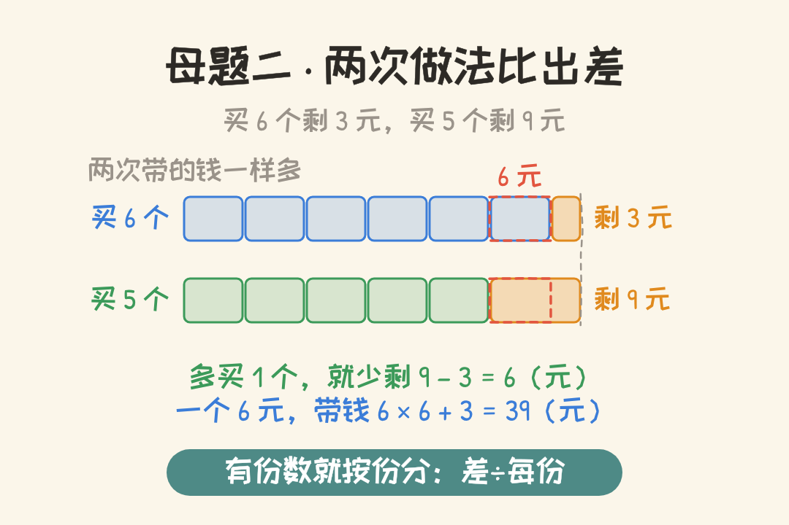
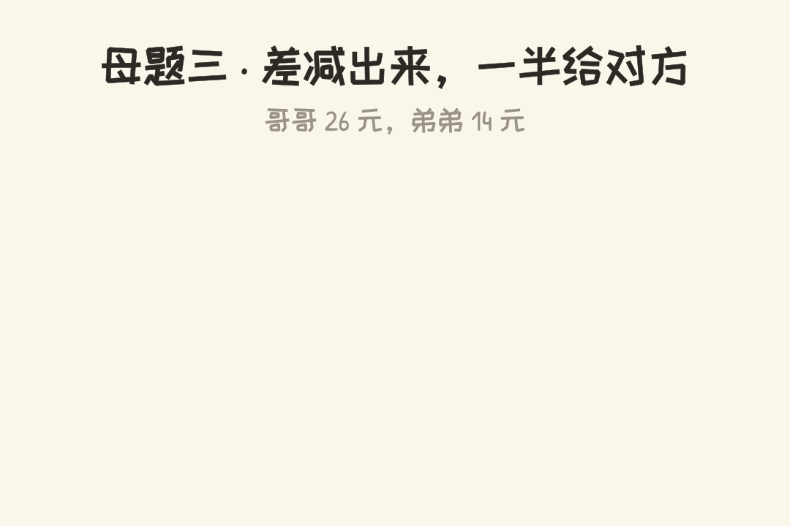
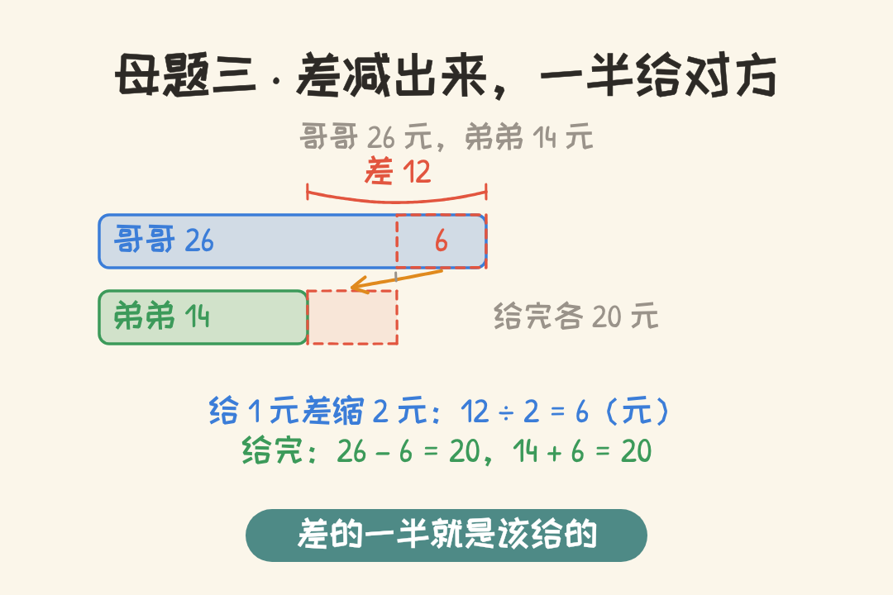
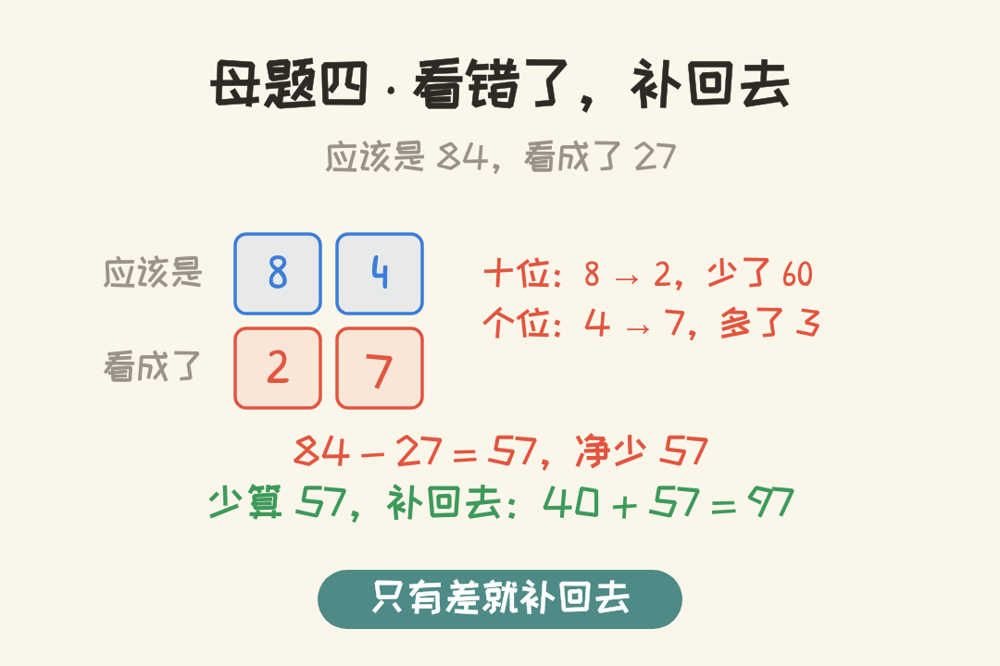
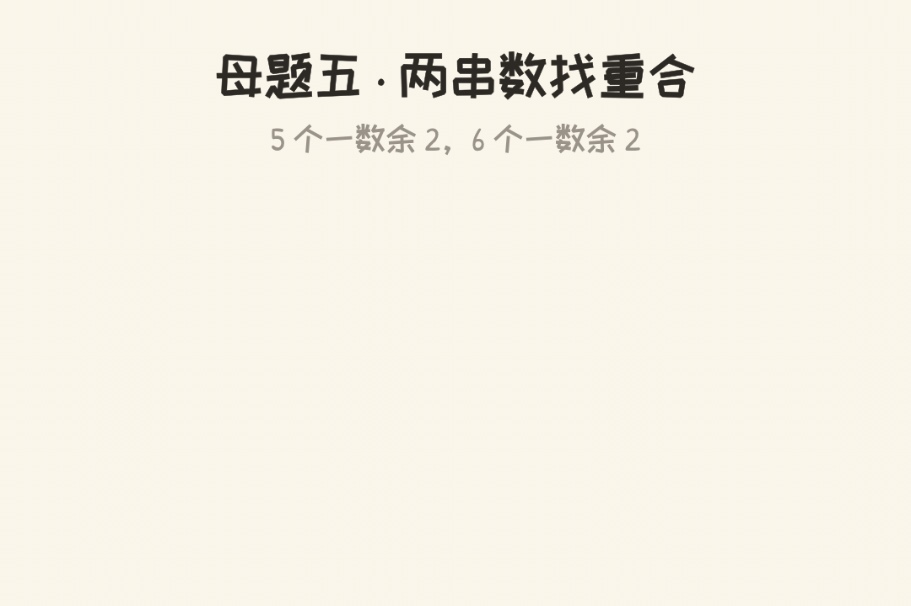
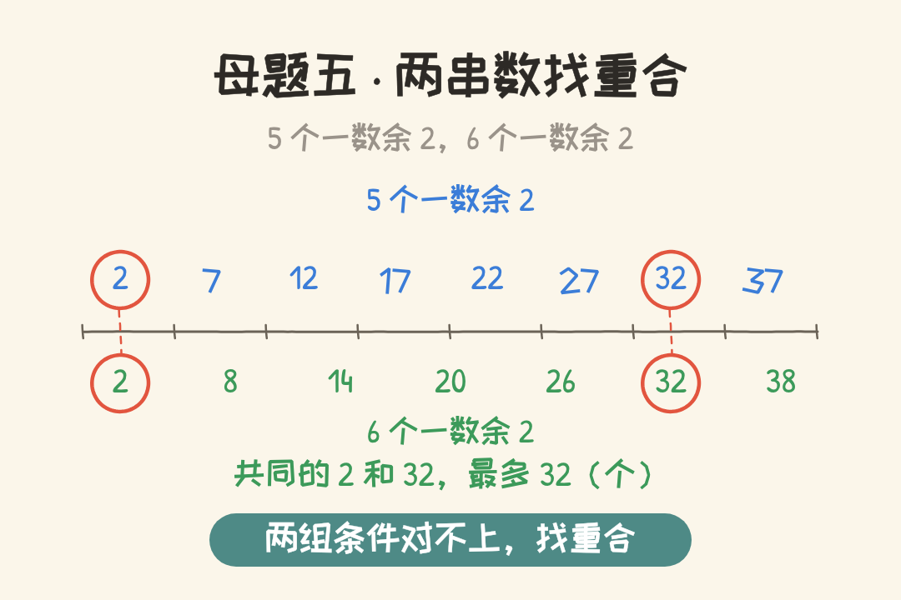
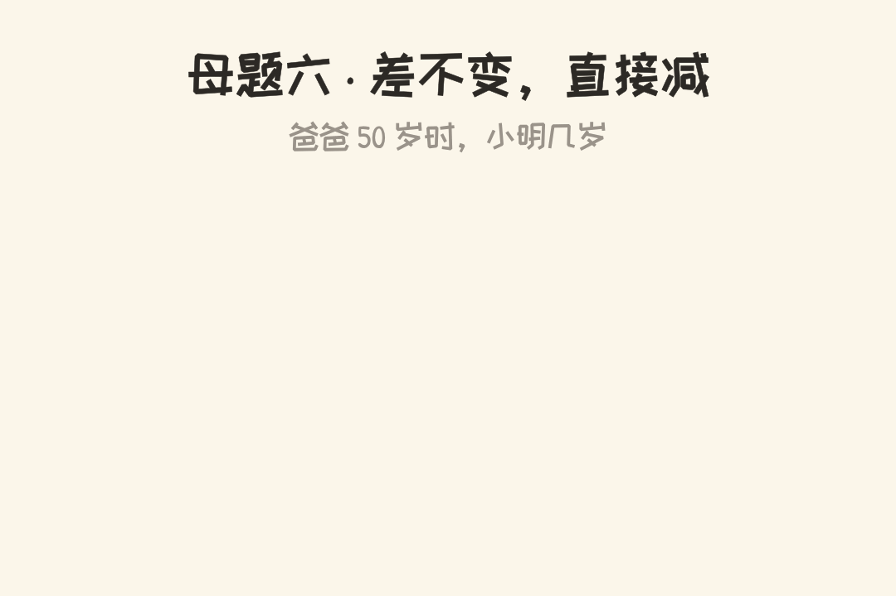
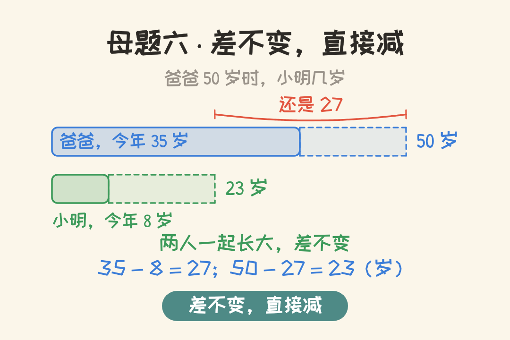
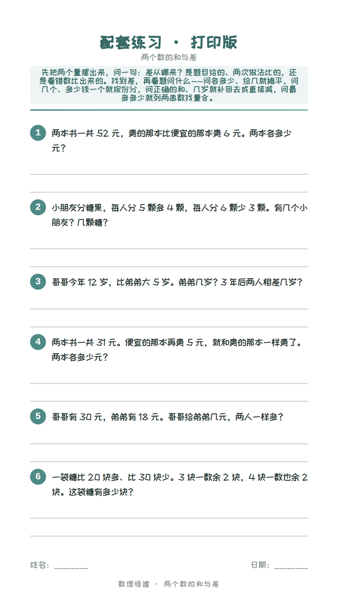

# 【数理悟道】二年级奥数思维 · 两个数的和与差（和差、盈亏、年龄、错中求解、余数）
> 💡 备注属性未写入，可能是备注属性名称或者类型被修改了，建议将字段类型设置为 rich_text，可以在小程序-操作-修改文章数据库页面进行调整
> 💡 原文链接:[https://mp.weixin.qq.com/s?__biz=MzkwNzQ2MTM5OQ==&mid=2247519149&idx=1&sn=cb8123dc49aeac121f286083f648279a&chksm=c1817c4f3002d47478e3cbb4f1c489b9b57fc1a3cd430413f75b431ef7c0d8c1c6245a92a4ac#rd](https://mp.weixin.qq.com/s?__biz=MzkwNzQ2MTM5OQ%3D%3D&mid=2247519149&idx=1&sn=cb8123dc49aeac121f286083f648279a&chksm=c1817c4f3002d47478e3cbb4f1c489b9b57fc1a3cd430413f75b431ef7c0d8c1c6245a92a4ac#rd)
**数理悟道**
二年级奥数思维
Mathematics · Enlightenment
**两个数的和与差**
**6 类和差题，一招：先找差**
Tips：文末有配套练习卷，可打印给孩子练一练
「两筐水果一共 40 个，第一筐比第二筐多 8 个，两筐各多少？」孩子套（40+8）÷2 很熟；换成「买 6 个毽子剩 3 元、买 5 个剩 9 元」，或「哥哥给弟弟几元，两人一样多」，他就不认得是同一类题了。
和差、盈亏、年龄、错中求解、余数，孩子把这些题当成 6 套方法在背，换一道题就重背一个公式。
其实它们只做两件事：先把两个量摆在一起找差，再看这个差怎么用。
差有的直接给，有的藏在两次做法里、看错的数里、两串数错开的地方——差从哪来各不相同；用法就看题问什么——有和就摊平，有份数就按份分，只有差就补回去、差不变就直接减，两条件对不上就列两串数找重合。起手却只有一句：先找差，再看这个差怎么用。
**01**
**先分清 · 差怎么用**
找到差以后别急着算，先看题问什么——题问什么，差就怎么用。
| **差怎么用** | **题面里问什么** | **差从哪来 · 怎么用** | **落在这格的题** |
| ① 摊平：把差劈成两半 | 「一共…多…，各多少」；「两人各有多少，给几才一样多」 | 和、差都直接给 →（和 ± 差）÷ 2；两数都给出 → 差 ÷ 2 就是该给的 | 母题一、母题三 |
| ② 按份分：差里有几个一份 | 「买几次、分几次，剩多剩少」 | 两次做法比出来 → 总差额 ÷ 每份差 | 母题二 |
| ③ 原样用：该补补、该减减 | 「数看错了」「几年后几岁」 | 并排比出 57 → 补回去；差 27 不变 → 直接减 | 母题四、母题六 |
| ④ 对照找重合：没有差可减 | 「两个条件各余几，最多多少」 | 列两串数 → 找共同的那几个 | 母题五 |
四格的判别全在题面那几个字上：问「各多少、给几」就摊平，问「几个、多少钱一个」就按份分，问「正确的和、几岁」就原样用，问「最多多少」就找重合。扫一眼，差的用法就定了。
**02**
**六个母题 · 先找差，再看怎么用**
母题一 · 差直接给，摊平
例题 1 ·
**题目**
两筐水果一共 40 个，第一筐比第二筐多 8 个。两筐各多少个？
**先看什么：和 40、差 8，两个都直接给。差和和都有，就把差摊平。**
列式：多的那筐 (40 + 8) ÷ 2 = 24（个）；少的那筐 (40 − 8) ÷ 2 = 16（个）
**答案：第一筐 24 个，第二筐 16 个 ✓**
**动画演示**

     
多的 8 个先标红，再补到少的那筐：补上 8 两筐就一样多

     
补 8 得 24，去 8 得 16：和 40、差 8 各走一次，答案就出来了
**通法：大数 =（和 + 差）÷ 2，小数 =（和 − 差）÷ 2。**
母题二 · 两次做法比出差，按份分
例题 2 ·
**题目**
买 6 个毽子，带的钱剩 3 元；买 5 个，剩 9 元。一个毽子多少元？带了多少钱？
**先看什么：两次剩的钱不一样，差在「多买的那个」上。9 − 3 = 6 元，正好是 1 个毽子的钱。**
列式：总差额 9 − 3 = 6；每份差 6 − 5 = 1（个）；6 ÷ 1 = 6（元）；6 × 6 + 3 = 39（元）
**答案：一个毽子 6 元，带了 39 元 ✓**
**动画演示**

     
两次带的钱一样长，多买 1 个的那一格，正好等于两次剩钱的差

     
9 − 3 = 6 是 1 个的价；6 个要 36 元，再加剩的 3 元共 39 元
**通法：总差额 ÷ 每份差 = 份数。差里有几个「一份」，就摊几份。**
母题三 · 差减出来，一半给对方
例题 3 ·
**题目**
哥哥有 26 元，弟弟有 14 元。哥哥给弟弟几元，两人一样多？
**先看什么：两人各有多少都直接给，先减出差 26 − 14 = 12。给 1 元，哥哥少 1、弟弟多 1，差缩 2 元。**
列式：差 26 − 14 = 12（元）；12 ÷ 2 = 6（元）
**答案：给 6 元 ✓**
**动画演示**

     
差 12 从中间劈成两半，一半挪过去，两条就都到 20

     
给 1 元差缩 2 元：差 12，给出 6，两人都是 20 元
**通法：差 ÷ 2，就是该给的钱。**
母题四 · 看错了，补回去
例题 4 ·
**题目**
小丽做加法，把一个加数个位的 4 看成 7、十位的 8 看成 2，算出的和是 40。正确的和是多少？
**先看什么：把那个加数写出来并排比——应该是 84，看成了 27。84 − 27 = 57，少了 57。差多大，就原样补多大。**
列式：算错的和 40，比正确的少 57 → 40 + 57 = 97
**答案：97 ✓**
**动画演示**

     
两个数上下并排写：十位少了 60、个位多了 3，净少 57

     
错的和 40 少算了 57，补回去就是 97
**通法：把两个数原原本本写下来，并排一摆，差多少补多少。**
母题五 · 两串数找重合
例题 5 ·
**题目**
一筐苹果不到 40 个。5 个一数余 2 个，6 个一数也余 2 个。最多有多少个？
**先看什么：这道题的「差」不是两个数相减，而是两串数之间的错位——5 个一组、6 个一组，错开之后又对上的地方，才都余 2。**
列式：5 个一数余 2 → 2、7、12、17、22、27、32、37；6 个一数余 2 → 2、8、14、20、26、32、38；共同的 2 和 32，不到 40 里最多 32（个）
**答案：最多 32 个 ✓**
**动画演示**

     
两串数一上一下排开，共同的 2 和 32 被红圈圈住

     
两串数找重合：2 和 32，不到 40 个里最多取 32
**通法：列两串数，找共同的那几个。**
母题六 · 差不变，直接减
例题 6 ·
**题目**
小明今年 8 岁，爸爸今年 35 岁。当爸爸 50 岁时，小明几岁？
**先看什么：两人一起长大，差永远不变。差 35 − 8 = 27。差不变，就直接拿爸爸的年龄减。**
列式：爸爸 50 岁，小明就是 50 − 27 = 23（岁）
**答案：23 岁 ✓**
**动画演示**

     
两条年龄条一起往前长，中间那截差 27 一直不变

     
差 27 不变：爸爸 50 岁，50 − 27 = 23 岁
**通法：年龄差不变，跟着大的算。**
**03**
**带走 · 速查表、错法表、边界**
**速查表**
| **看见什么** | **差在哪** | **这个差怎么用** |
| 一共多少、多多少 | 直接给了 | 摊平：（和 ± 差）÷ 2 |
| 两人各有多少、给几才一样多 | 两数相减 | 摊平：差 ÷ 2 就是该给的 |
| 两次买，都剩 | 剩减剩 | 按份分：总差额 ÷ 每份差 |
| 两次买，一剩一差 | 剩加差 | 按份分：同上 |
| 数字看错了 | 两个数并排比 | 原样补：正确 = 错的 ± 差 |
| 几年后几岁 | 差不变 | 直接减：大数 − 差 |
| 两个条件各余几 | 两串数重合 | 对照：列两串找共同 |
**错法对照表**
| **题** | **孩子会算成** | **差在哪** |
| 和差 | 40 ÷ 2 = 20，再 ±8 | 20 是平均数，不是大数；÷2 要放在加减之后 |
| 盈亏（都剩） | 9 + 3 = 12，再 ÷1 | 都剩要相减，一剩一差才相加 |
| 给几个 | 26 − 14 = 12，给 12 元 | 给出 12 元，差缩了 24，反而超了 |
| 错中求解 | 40 + 3 + 60 | 十位 8 看成 2 是少了 60，方向反了 |
| 余数 | 只列一串就答 | 必须两串都列，找重合 |
| 年龄 | 50 − 8 = 42，当成答案 | 拿爸爸的年龄减小明今年的年龄，减出来的不是小明的岁数；要先求差 35 − 8 = 27 |
**判据边界：这套方法只在「两两对照」时成立。**三个量以上，差不止一个——甲比乙多 4、乙比丙多 2，两个差各自摊开，谁跟谁对齐都说不清。（和 + 差）÷ 2 这时也不能硬套：14、10、8 三个数，和是 32、最大相差 6，套进去 (32 + 6) ÷ 2 = 19，可答案明明是 14，所以 14、10、8 这组正好当反例。这时要换个标准：拿中间那个当标准，比它多的记 +几、比它少的记 −几。像 13、10、7，中间是 10，另外两个是 +3 和 −3，多的少的正好抵消，30 ÷ 3 = 10，就是中间那个。一旦不是等间隔（偏差抵不平），就得先把总数调平再除。数量一多，摊平不再是一个除法能解决的事。
**家长可以这样讲**
做题前先让孩子用手指把两个量摆出来：谁多、谁少、多多少。找到差不急着算，先问一句「题问的是什么」——问各多少、给几元才一样多，就把差摊平、劈成两半；问买几个、多少钱一个，就把差按份数分下去；问正确的和、问几岁，就差多大补多大、差不变就照着减；问两个条件各余几，就老老实实列两串数，找重合。碰上看错的题，别急着口算，直接拿纸把原来的数和看错的数上下并排写，十位对着十位、个位对着个位，写完孩子自己就看出差多少了。年龄题最省事：两人一起长，差永远是那个数，直接拿大数减。
**04**
**练一练**
下面这张练习卷，长按保存，打印出来就能让孩子练。
**可打印练习卷**

     
长按图片 → 保存 → 打印
↓ 下面是答案，做完再看 ↓
**变式 1 · 和差（换数字）**练习 4
**题目**
两本书一共 52 元，贵的那本比便宜的那本贵 6 元。两本各多少元？
**答案：(52 + 6) ÷ 2 = 29（元）；(52 − 6) ÷ 2 = 23（元）✓**
练的是：和与差都直接给，÷2 放在加减之后。
**变式 2 · 盈亏（一多一少）**练习 5
**题目**
小朋友分糖果，每人分 5 颗多 4 颗，每人分 6 颗少 3 颗。有几个小朋友？几颗糖？
**答案：总差额 4 + 3 = 7；每份差 1；7 ÷ 1 = 7（人）；5 × 7 + 4 = 39（颗）✓**
练的是：一多一少，差要相加。
**变式 3 · 年龄（差不变）**练习 6
**题目**
哥哥今年 12 岁，比弟弟大 5 岁。弟弟几岁？3 年后两人相差几岁？
**答案：12 − 5 = 7（岁）；3 年后两人仍相差 5 岁 ✓**
练的是：两人一起长，差不变。
↓ 下面是练习，做完再看答案 ↓
**练习 1** 两本书一共 31 元。便宜的那本再贵 5 元，就和贵的那本一样贵了。两本各多少元？
答案
便宜的那本加上 5 元，两本就一样贵：31 + 5 = 36（元），36 ÷ 2 = 18（元）是贵的那本；18 − 5 = 13（元）是便宜的那本。✓
**练习 2** 哥哥有 30 元，弟弟有 18 元。哥哥给弟弟几元，两人一样多？
答案
差 30 − 18 = 12（元）；给出 1 元差缩 2 元，12 ÷ 2 = 6（元）。✓
**练习 3** 一袋糖比 20 块多、比 30 块少。3 块一数余 2 块，4 块一数也余 2 块。这袋糖有多少块？
答案
3 块一数余 2：23、26、29；4 块一数余 2：22、26；共同的是 26，所以这袋糖有 26 块。✓
数理悟道 · 二年级奥数思维
