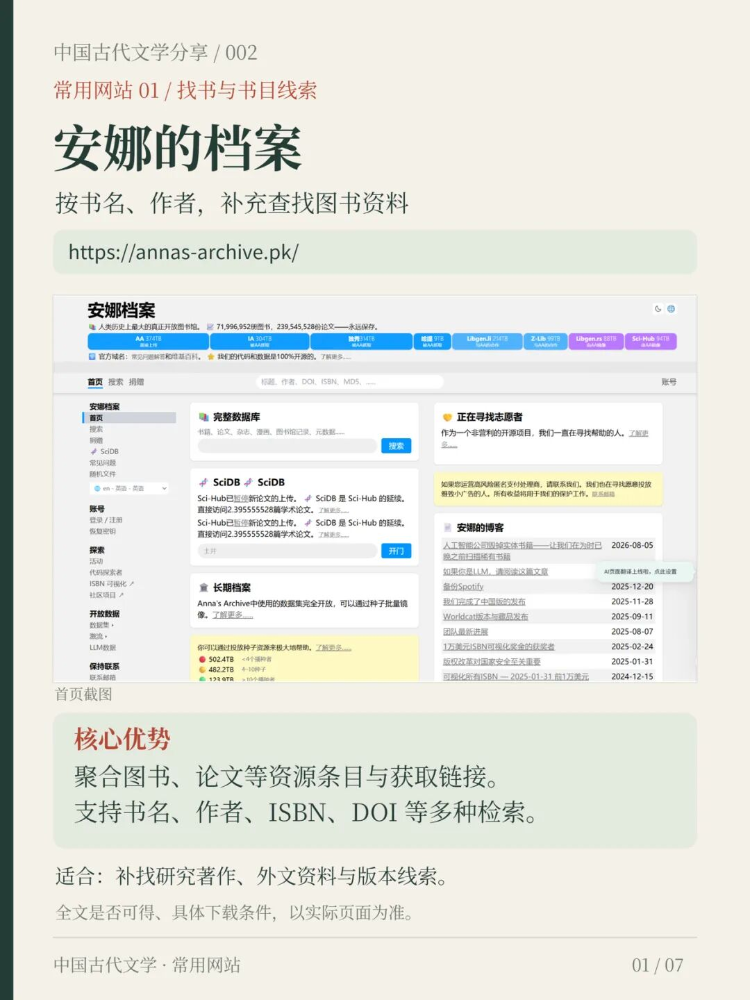
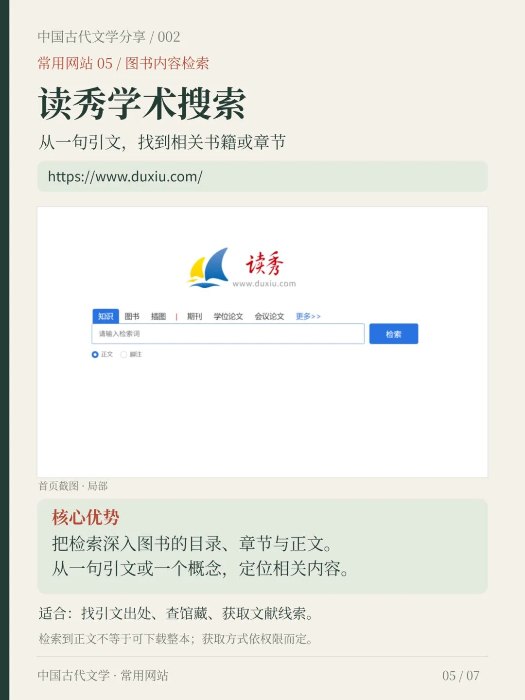
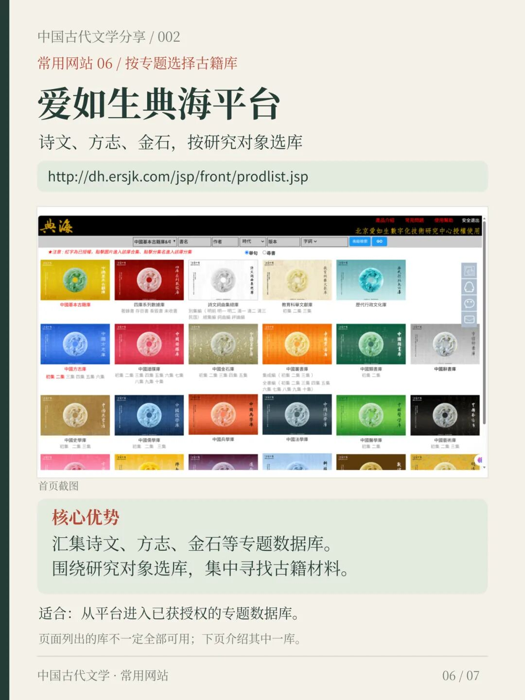
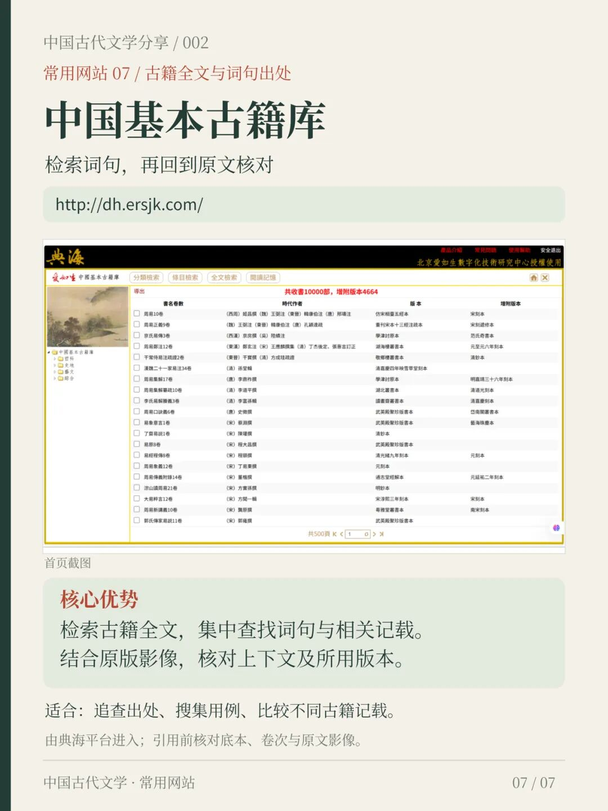
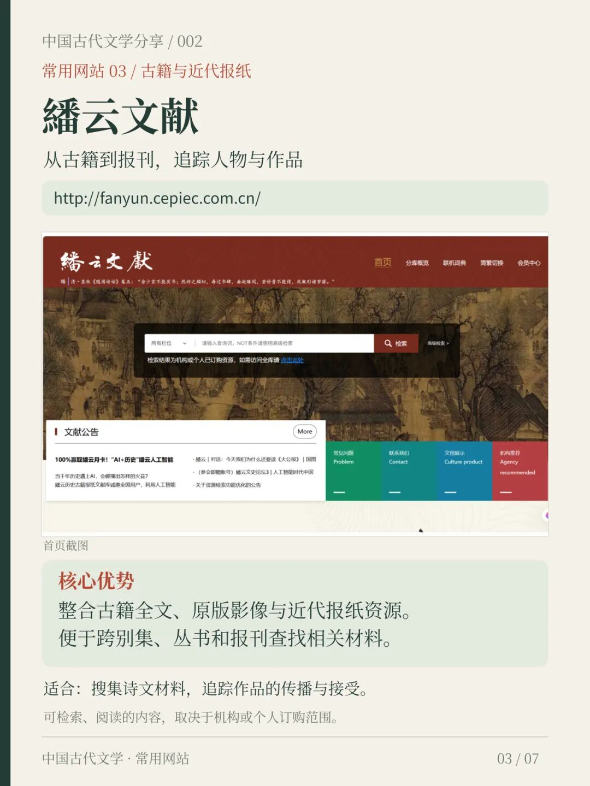
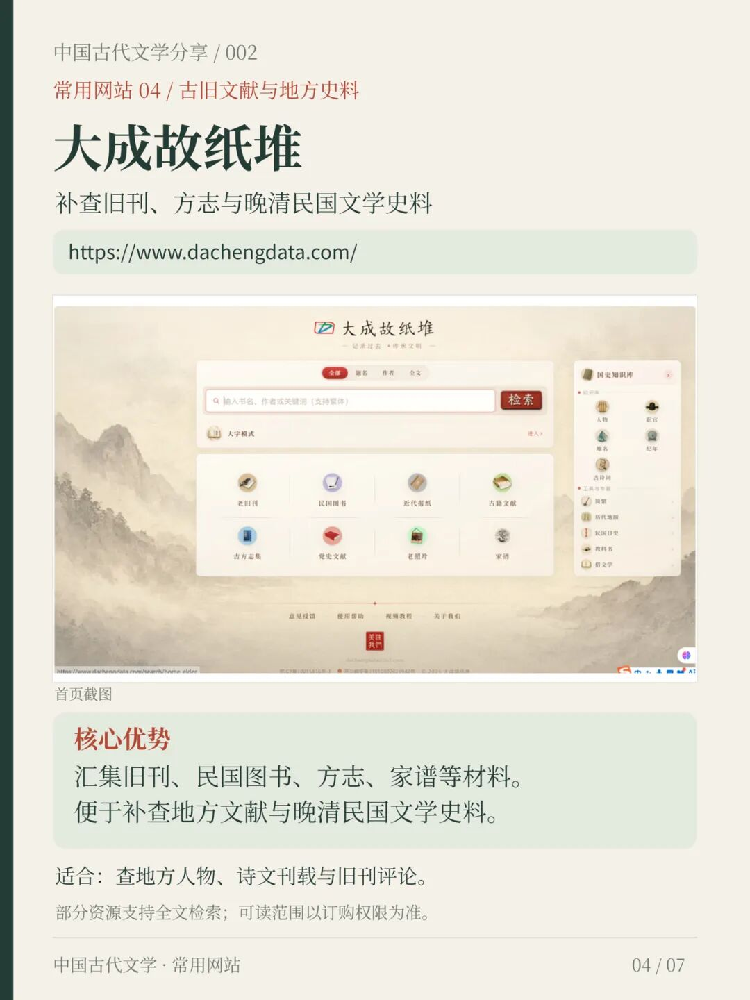
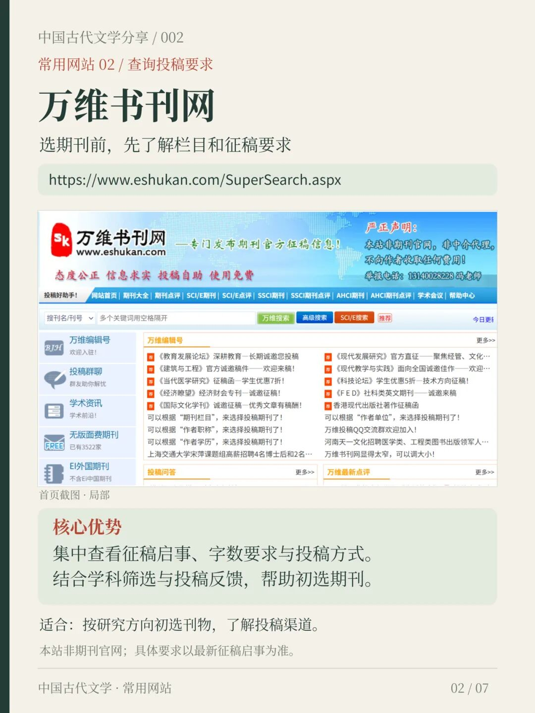

# 【文献网站】中国古代文学常用网站
> 💡 备注属性未写入，可能是备注属性名称或者类型被修改了，建议将字段类型设置为 rich_text，可以在小程序-操作-修改文章数据库页面进行调整
> 💡 原文链接:[https://mp.weixin.qq.com/s?__biz=MzcwMTQ3MDY5OA==&mid=2247483652&idx=1&sn=3402bd62df7482308a99c4233e1d5e95&chksm=f5cdd67c53c3e5312b47cb62f2799174a9314825ac7f7dd18cc4cc7f34efed6b6f3ce2d64fc6#rd](https://mp.weixin.qq.com/s?__biz=MzcwMTQ3MDY5OA%3D%3D&mid=2247483652&idx=1&sn=3402bd62df7482308a99c4233e1d5e95&chksm=f5cdd67c53c3e5312b47cb62f2799174a9314825ac7f7dd18cc4cc7f34efed6b6f3ce2d64fc6#rd)
1️⃣安娜的档案
https://annas-archive.pk/

个人感觉是全网最全的搜书网站了，拼多多淘宝的搜书客服也基本都是在这个网站搜书。
2️⃣读秀
https://www.duxiu.com/

这也是极其常用的网站，检索图书、期刊、学位论文等。

3️⃣爱如生
http://dh.ersjk.com/jsp/front/prodlist.jsp

这个网站更是古代文学的重量级，内容已经在图上了，主要是古书检索。

4️⃣中国基本古籍库
http://dh.ersjk.com/

从爱如生进去，很常用，检索古籍。

5️⃣繙云文献
http://fanyun.cepiec.com.cn/

古籍与近代报纸检索。

6️⃣大成故纸堆
https://www.dachengdata.com/

以晚清民国史料为特色。
7️⃣万维书刊网
https://www.eshukan.com/SuperSearch.aspx

最后补充一个载有期刊信息和投稿要求的网站，包含了投稿需要的字数、格式、邮箱等等。
