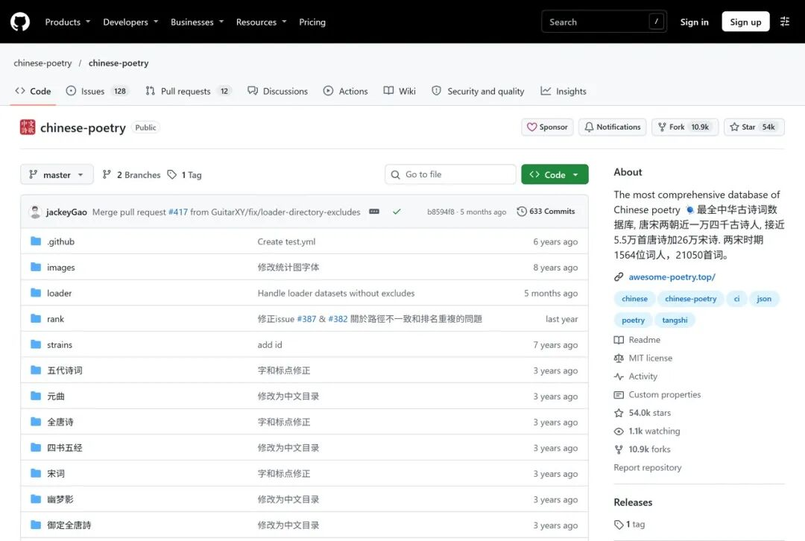
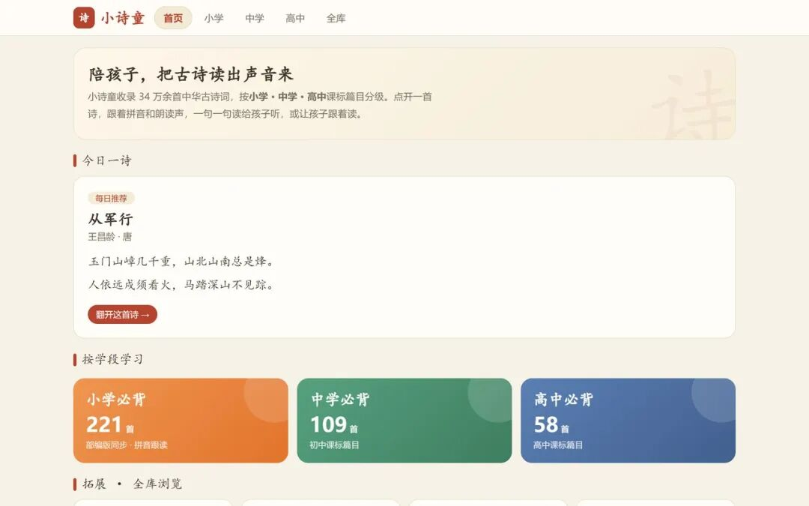
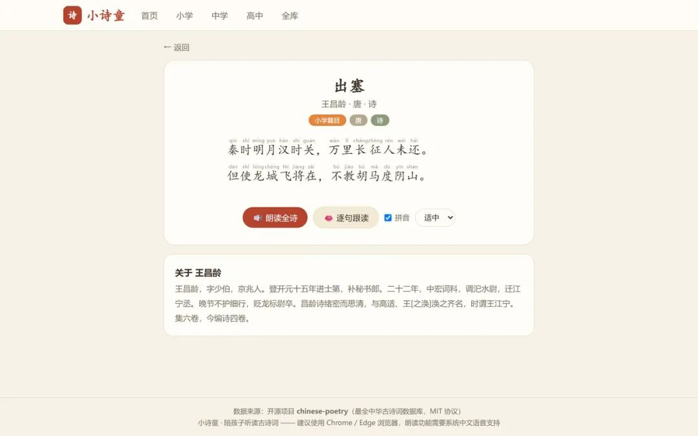
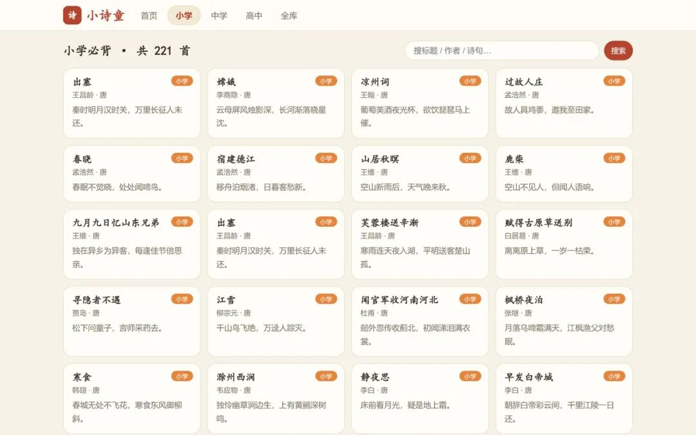
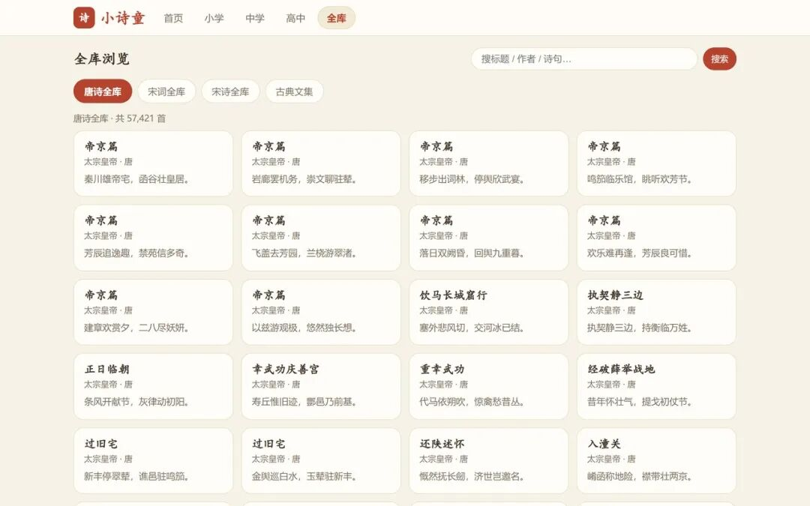
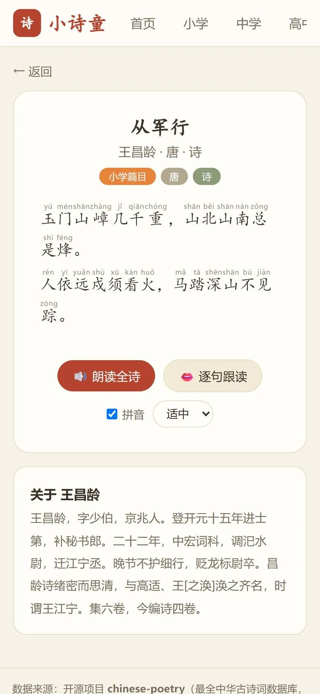

# 【真神奇】我用 AI 做了个 古诗听读小神器34万首诗 · 逐字拼音 · 点开就听
> 💡 备注属性未写入，可能是备注属性名称或者类型被修改了，建议将字段类型设置为 rich_text，可以在小程序-操作-修改文章数据库页面进行调整
> 💡 原文链接:[https://mp.weixin.qq.com/s?__biz=MzAxMDU4ODI0Mw==&mid=2648939517&idx=1&sn=3563762476440df3cc80afd13b346376&chksm=82556bb3d2f493962c3ab8b39dc97562a666ca0e013e15311253cd80ce6e2d4bd7a694a5475f#rd](https://mp.weixin.qq.com/s?__biz=MzAxMDU4ODI0Mw%3D%3D&mid=2648939517&idx=1&sn=3563762476440df3cc80afd13b346376&chksm=82556bb3d2f493962c3ab8b39dc97562a666ca0e013e15311253cd80ce6e2d4bd7a694a5475f#rd)
又是辅导娃背古诗的晚上。我举着手机搜《出塞》的朗读音频，广告先播十秒；好不容易找到带拼音的版本，字小得像蚂蚁；想让孩子跟着逐句读，得手动暂停、回退、再暂停……
那一刻我就冒出一个念头：**能不能自己做一个？**要求不高——34 万首诗随便翻、每个字头顶带拼音、点一下整首读出来、还能一句一句带着娃跟读。
于是，我和 AI 一起，花了一个下午，把它做出来了。这篇文章就是这个应用的诞生记，**所有截图都是真实运行画面**，文末可以免费领取。
**01 · 挖到一座开源宝藏**
做应用，先得有数据。市面上的诗词数据要么藏在收费 App 里，要么散落在各种网页上格式混乱。而 GitHub 上这个叫 **chinese-poetry** 的开源项目（https://github.com/chinese-poetry/chinese-poetry），可以说是一座已经挖好的金矿：

▲ GitHub 仓库真实截图：54K+ Star，10.9K Fork，MIT 协议
它是目前全网**最全的中华古诗词开源数据库**：接近 5.5 万首唐诗、26 万首宋诗、2.1 万首宋词，外加《诗经》《楚辞》《论语》、元曲、花间集……整整 600 多次提交、维护了近十年的数据，全部以规整的 JSON 格式开放，**MIT 协议，商用免费**。
换句话说：把中国近一千年的诗歌，打包成了一行代码就能读取的数据库。这样的项目，Star 不上 5 万都说不过去。
**02 · 从一个想法到一个应用**
数据有了，接下来就是把「给孩子用」这件事想清楚。我定了三条原则：
**① 听读为主**——孩子认字有限，声音是最低门槛的入口；
**② 逐字拼音**——一年级娃也能自己指着读；
**③ 按学段分级**——小学、中学、高中课标必背篇目各成一区，家长不用大海捞针。
然后，剩下的活儿几乎全部交给了 AI。我的工作方式特别简单：**我说想法，AI 写代码；AI 跑数据，我盯结果。**整个过程大致分三步：
**第一步，搬数据。**让 AI 克隆整个数据集。这里 AI 就踩了第一个坑——直连 GitHub 下载时连接被重置（curl 56 错误），AI 立刻切换到国内镜像仓库，2,285 个文件顺利落地。
**第二步，洗数据。**原始数据是繁体的——「駱賓王」「西陸蟬聲唱」，小朋友哪看得懂。AI 写了一套处理脚本：用 OpenCC 把 34.5 万首诗全部转成简体、给 1.3 万位诗人挂上小传、再按教育部课标篇目把诗分成小学 / 中学 / 高中三个学段，最后切成 19 个数据分片，让网页打开时不卡。
**第三步，搭应用。**纯前端网页，不装 App、不用注册，浏览器打开就能用。拼音是本地引擎实时标注的，朗读用的是浏览器自带中文语音。
**🔧 AI 也翻过车（真实踩坑实录）**
· 第一版数据处理完，33 万首诗只剩 4.8 万首——排查发现是去重逻辑误伤，25 万首宋诗神秘「消失」，修复后全量找回；
· 「常娥」「桃花谿」这类异体字，繁简转换库不认识，篇目匹配集体失灵，补了异体字映射才治好；
· 唐诗三百首里藏着「横吹曲辞 出塞 一」这种类书前缀标题，得写专门的标题清洗规则。
这就是 AI 编程最真实的样子：**它写得飞快，但每一版结果都得有人盯着验收。**不过说真的，换我自己手写这些数据处理逻辑，一个下午是绝对不够的。
**03 · 应用长什么样（真机截图）**
打开首页，宣纸底色的界面，没有广告，没有登录框。每天自动换一首「今日一诗」，下面是三个学段入口：

▲ 首页真实截图：今日一诗 + 三个学段 + 全库入口
随便点开一首《出塞》，重点来了——**每个字的头顶都有拼音**，孩子可以自己指着读；点「朗读全诗」整首播一遍，点「逐句跟读」，当前读到哪句哪句就高亮，一句一句带着娃走：

▲ 诗详情页真实截图：逐字拼音、朗读全诗、逐句跟读、语速调节
学段列表里，每首诗都标好了出处朝代和首句，小学 221 首、中学 109 首、高中 58 首，跟着课标走，考前复习特别顺手：

▲ 小学必背列表真实截图
学有余力？「全库」里有整座宝库：唐诗 57,421 首、宋词、宋诗 25 万首、还有诗经楚辞元曲，支持按标题、作者、诗句搜索。想找「春风又绿江南岸」的下句？搜一下就有了：

▲ 唐诗全库真实截图：57,421 首在线浏览与搜索
家长在厨房、孩子在书桌？手机浏览器打开同一个页面，一样的拼音和朗读，全都在：

▲ 手机端真实截图：同一页面，自适应排版
**04 · 这个小应用里装了什么**
**345,638** 首诗词全库（唐诗 57,607 / 宋诗 254,248 / 宋词 21,053 / 元曲 11,057 / 诗经 305 / 楚辞 65）
**13,238** 位诗人小传，繁体全部转简体
**388** 首课标必背篇目按小学 / 中学 / 高中分级
**0** 元费用、**0** 个广告、**0** 次注册
技术栈也简单得可以复刻：**Python + OpenCC** 洗数据，**原生 HTML/JS** 搭界面，**pinyin-pro** 做拼音，**Web Speech API** 做朗读。没有服务器、没有数据库、没有后端——整个应用就是一个文件夹，拷到哪台电脑都能跑。
**🎁 想让孩子用上？**
**点亮「赞」和「在看」**，让更多家长看到这篇文章
然后到公众号后台**回复「小诗童」**
领取完整应用包（解压即用、无需安装）+ 数据处理全套源码
最后，把最大的感谢送给开源项目 **chinese-poetry**（github.com/chinese-poetry/chinese-poetry，MIT 协议）——是近十年社区的数据整理与纠错，才让普通人也能站在 34 万首诗的肩膀上做产品。分级篇目参考教育部中小学课标必背古诗文目录整理。
如果你也想用 AI 把「某个念头」变成一个真能用的工具，别等——现在开始，比你想的容易得多。
· · ·
