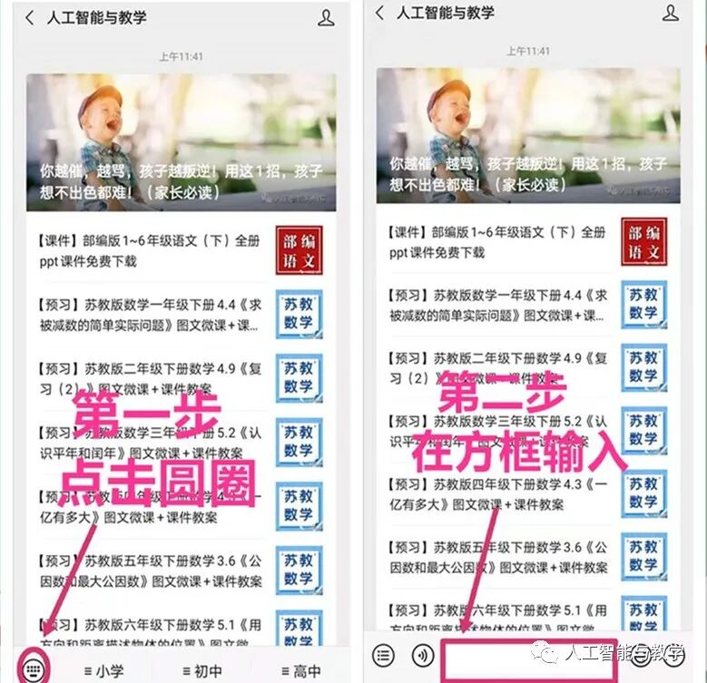

# 【知识总汇】小学数学1-6年级 应用题、公式、单位、分数、小数、练习等汇总 |可下载
> 💡 备注属性未写入，可能是备注属性名称或者类型被修改了，建议将字段类型设置为 rich_text，可以在小程序-操作-修改文章数据库页面进行调整
> 💡 原文链接:[https://mp.weixin.qq.com/s?__biz=MzUxNTMyMzgzNQ==&mid=2247580833&idx=3&sn=873edf959a568838f5fbb6e5147050d1&chksm=f8665cdefd6bda5ef715ec528996334084e603e5b2f39eada21f49680a038bf3da96719ec9e6#rd](https://mp.weixin.qq.com/s?__biz=MzUxNTMyMzgzNQ%3D%3D&mid=2247580833&idx=3&sn=873edf959a568838f5fbb6e5147050d1&chksm=f8665cdefd6bda5ef715ec528996334084e603e5b2f39eada21f49680a038bf3da96719ec9e6#rd)
**请收藏好以下图片预课资料**

**（点击上图可观看视频及下载课件教案）**
**获取电子版请拉到文末**
**获取电子版请拉到文末**
[【预习】小学数学1~6年级（上下）全册图文同步微课](http://mp.weixin.qq.com/s?__biz=MzI4MzcxMzcwOA%3D%3D&mid=2247580576&idx=3&sn=4e161204e719deb8e784d0c6f5ec3f58&chksm=eb857263dcf2fb7596676778406b1e5794f3df2799044ec57b4fafa1bc80923f290b4294fd2e&scene=21#wechat_redirect)

[【运算法则】小学数学1~6年级运算必备的二十七法则](http://mp.weixin.qq.com/s?__biz=MzI4MzcxMzcwOA%3D%3D&mid=2247582288&idx=5&sn=db08d412023f67702494c13a7d035206&chksm=eb854b93dcf2c285794334696fa247c91beaee400d4e10a0e5c518acdb84c2dcf73de00442fe&scene=21#wechat_redirect)

[【必考题】小学数学1-6年级必考题型及口诀](http://mp.weixin.qq.com/s?__biz=MzI4MzcxMzcwOA%3D%3D&mid=2247582288&idx=4&sn=3ac342ecc01bdbca1c9932360b00b368&chksm=eb854b93dcf2c285046cd34c6c84eebc6925b00029664ebe39cb6bdc58feceab9c5b68068df7&scene=21#wechat_redirect)

[【易错题解析】小学数学1-6年级下册 典型易错题解析](http://mp.weixin.qq.com/s?__biz=MzI4MzcxMzcwOA%3D%3D&mid=2247582288&idx=3&sn=385bf63ac88cf8bfccb4aa4e90466ffa&chksm=eb854b93dcf2c2850bb1f6218ad53e6e82abd0c63a0953170bd2b33bebc7016f511f6ef3027b&scene=21#wechat_redirect)

[【趣味题】小学数学1-6年级趣味40题2（附答案）](http://mp.weixin.qq.com/s?__biz=MzI4MzcxMzcwOA%3D%3D&mid=2247582181&idx=4&sn=1d025980843a89e91730d9a1e8c07bd8&chksm=eb854826dcf2c13089747736789693a3b710fe176b31c0eb5a15acd322d3be3b6caa7cfae53e&scene=21#wechat_redirect)

[【趣味题】小学数学1-6年级趣味100题（含答案）](http://mp.weixin.qq.com/s?__biz=MzI4MzcxMzcwOA%3D%3D&mid=2247582181&idx=3&sn=0f00b6b37e6613b2d57f4c8b10659eb3&chksm=eb854826dcf2c1308354e49b2c6f414f6292ffda0881351cba6177f4fc54b979d7fc7b269533&scene=21#wechat_redirect)

[【经典应用题】小学数学1-6年级10道最经典应用题分析 ](http://mp.weixin.qq.com/s?__biz=MzI4MzcxMzcwOA%3D%3D&mid=2247582181&idx=5&sn=711d457042626f42aa0ceae4d749ed6c&chksm=eb854826dcf2c130c15a44a1f2a3b097df60b77a36308a4091a78b7de619fc7b8711033c95b1&scene=21#wechat_redirect)
[【应用题】小学数学1-6年级最典型的30道应用题详解](http://mp.weixin.qq.com/s?__biz=MzI4MzcxMzcwOA%3D%3D&mid=2247581986&idx=4&sn=a4bf0bceeb13b0ab83a70332e6f2ecc7&chksm=eb8548e1dcf2c1f776156ca1de3ac67aa880aaf3813f88e78b9f83b118a1be3b38f407fead64&scene=21#wechat_redirect)

[【数学公式】小学数学1-6年级公式填空汇编 （含答案）](http://mp.weixin.qq.com/s?__biz=MzI4MzcxMzcwOA%3D%3D&mid=2247581986&idx=5&sn=8a670636c07d65d0dd418bba93f55e02&chksm=eb8548e1dcf2c1f7f50a40741619b50c4890b7f1d69aedc20f2627c8d3b09fbb1ab87629b233&scene=21#wechat_redirect)

[【复习】小学数学1-6年级28个重要运算法则速记](http://mp.weixin.qq.com/s?__biz=MzI4MzcxMzcwOA%3D%3D&mid=2247581893&idx=4&sn=c4091cfc56378385fb9bcecada2b1ffa&chksm=eb854906dcf2c010a5dd504a6ecee19dac757e7dc457aa6b24b826e57d5d7da6e4131025471a&scene=21#wechat_redirect)

[【复习】小学数学1-6年级 常考的13种典型题](http://mp.weixin.qq.com/s?__biz=MzI4MzcxMzcwOA%3D%3D&mid=2247581893&idx=5&sn=dd0d519e4e32a348ff6cdca853293e73&chksm=eb854906dcf2c01063576dc2d120b3d2eacee3fb4926cf5ae8fbd5c3df9846bace3d87dbeb1b&scene=21#wechat_redirect)

[【复习】小学数学基础知识易错点汇总](http://mp.weixin.qq.com/s?__biz=MzI4MzcxMzcwOA%3D%3D&mid=2247581780&idx=3&sn=476415393371f1d7d2270382a0dbaf4f&chksm=eb854997dcf2c0819a96e5962eb40dcfe21fdd5ec589254b95714d5e5e23f761541486d96490&scene=21#wechat_redirect)

[【复习】小学数学1-6年级 应用题21种类型 |附解题思路](http://mp.weixin.qq.com/s?__biz=MzI4MzcxMzcwOA%3D%3D&mid=2247581758&idx=4&sn=297db963539062479abe2f2ebfb34a39&chksm=eb8549fddcf2c0ebad01c019567961f666d099675f276c84225e8ec242779ef442d3e9be0e41&scene=21#wechat_redirect)

[【复习】小学数学1-6年级 13个重点模块知识点汇总](http://mp.weixin.qq.com/s?__biz=MzI4MzcxMzcwOA%3D%3D&mid=2247581758&idx=5&sn=bea1696d8044716f189f7cdeb6258578&chksm=eb8549fddcf2c0eb0313b3b263862dd84c78862345a001529edd95a7b792d438fddeb62a8ca2&scene=21#wechat_redirect)

[【复习】小学数学1-6年级运算定律、法则与顺序](http://mp.weixin.qq.com/s?__biz=MzI4MzcxMzcwOA%3D%3D&mid=2247581642&idx=4&sn=e41a056e055d66d463e36e40493cfe67&chksm=eb857609dcf2ff1f7481b12b8c196cf167fe5eff62618f84f179ad1114aa18211c6df7362bed&scene=21#wechat_redirect)

[【公式】小学数学应用题公式及简易方程秘籍](http://mp.weixin.qq.com/s?__biz=MzI4MzcxMzcwOA%3D%3D&mid=2247581058&idx=4&sn=7acbf1d83407733fcfce290d71dd497c&chksm=eb857441dcf2fd57f16b53fbde1fd009d3f16b5ca54b34306f7129b72ddea9acd9afe8218b5f&scene=21#wechat_redirect)

[【单位】小学数学“时间+长度+符号”大全](http://mp.weixin.qq.com/s?__biz=MzI4MzcxMzcwOA%3D%3D&mid=2247581058&idx=5&sn=0c5bb021065043426c4b0ba92402e06b&chksm=eb857441dcf2fd57bc5fa52f9986a9581757b65bd4f574e85da08ca2c3d97fb3da156835b1a2&scene=21#wechat_redirect)

[【易错题】小学数学1-6年级（下）册 易错题总汇](http://mp.weixin.qq.com/s?__biz=MzI4MzcxMzcwOA%3D%3D&mid=2247580781&idx=3&sn=01d8b7b16be02f918442a39d8348db25&chksm=eb8575aedcf2fcb82141d74b56cbbaa564e2e3527f085e1facdbd2f0cced025f6f0cecf13283&scene=21#wechat_redirect)
[【易错题】小学数学四年级下册易错题(填空+判断+应用题)](http://mp.weixin.qq.com/s?__biz=MzI4MzcxMzcwOA%3D%3D&mid=2247580696&idx=5&sn=cf0272ced1887a539d79922c438e48e6&chksm=eb8575dbdcf2fccd7426c7e9718706177b564bfb6bac43ac7e375e70050aec5d00c60ecbff3b&scene=21#wechat_redirect)

[【说课稿】人教版小学数学1-6年级下册全册说课稿](http://mp.weixin.qq.com/s?__biz=MzI4MzcxMzcwOA%3D%3D&mid=2247580576&idx=5&sn=fe24e5834db2338519a99151599bef11&chksm=eb857263dcf2fb7510ec2d13ac2f1f991434ad2e1e6301f7f5f1c2182b46d3c46f37be85f0b7&scene=21#wechat_redirect)
[【单位换算】小学数学1-6年级公式、单位换算进率大全](http://mp.weixin.qq.com/s?__biz=MzI4MzcxMzcwOA%3D%3D&mid=2247582447&idx=4&sn=a42e731335a71356ac559b5aab8d14db&chksm=eb854b2cdcf2c23aeac61c47b394b66de6dfa8b7ca9c872f681751285453f09bbdc76f0ce01b&scene=21#wechat_redirect)
[【画图题】小学数学1-6年级六类“画图”解题分析](http://mp.weixin.qq.com/s?__biz=MzI4MzcxMzcwOA%3D%3D&mid=2247582447&idx=5&sn=0d9d8f939c766eb6534f7cc662cfcda4&chksm=eb854b2cdcf2c23a98225596fd9eb2685b68841a45fe49c2cfb1f24c1616e666a01987bd90ef&scene=21#wechat_redirect)
[【应用题】小学数学50道经典题解题思路+模板 ](http://mp.weixin.qq.com/s?__biz=MzI4MzcxMzcwOA%3D%3D&mid=2247582589&idx=5&sn=79427f55f724cc2a27410ae724004344&chksm=eb854abedcf2c3a8a3de4ddf13ab21d71873dddf31fe2f028f5066f1909e5e75fdde54634bd2&scene=21#wechat_redirect)
[【分数知识】小学数学1-6年级小数与分数知识点详解](http://mp.weixin.qq.com/s?__biz=MzI4MzcxMzcwOA%3D%3D&mid=2247582745&idx=3&sn=3e622a2c3cba128e43f13df3f6ca124f&chksm=eb854ddadcf2c4cc7282a177fef47b10b476b69ffb524fbcc72801328c34a8e133727e0277de&scene=21#wechat_redirect)

[【应用题公式】小学数学1-6年级常见应用题公式及练习](http://mp.weixin.qq.com/s?__biz=MzI4MzcxMzcwOA%3D%3D&mid=2247582745&idx=4&sn=3d77be35f86fd261508445f06e36403c&chksm=eb854ddadcf2c4ccd38246f28adaa70b6d12bea549551f5e2ebf05448d40457e9656e37afbb7&scene=21#wechat_redirect)
[【混合运算】小学数学1-6年级汇总及练习](http://mp.weixin.qq.com/s?__biz=MzI4MzcxMzcwOA%3D%3D&mid=2247582745&idx=5&sn=0d88fa848ac66d0be89eff5f3f48852f&chksm=eb854ddadcf2c4cc0aed4c474974d426528645869dd840b8d22584ca5278089b6c286d77ca5b&scene=21#wechat_redirect)
**往期资料推荐**

[**1-9年级（上下册）各科目电子课本**](http://mp.weixin.qq.com/s?__biz=MzUxNTMyMzgzNQ%3D%3D&mid=2247565121&idx=3&sn=747bbc3b2f7c67901c61bd2b0d7a2cb1&chksm=f9bbdd95cecc54838f7a9e6c75a3b5e44adbdb09f5129e35248ae0e8d1bee07b932a6bc3577b&scene=21#wechat_redirect)
[**1~6年级语文（上下）全册图文视频**](http://mp.weixin.qq.com/s?__biz=MzUxNTMyMzgzNQ%3D%3D&mid=2247558113&idx=4&sn=c696f9098a715797eab2f1531e73bb6a&chksm=f9bbc135cecc48237e0bc338339e9b59e065e5592b0956f5d63fdeb75172f4db60ec95bd3ab7&scene=21#wechat_redirect)
[**1~6年级数学(上下册）图文视频（各版本）**](http://mp.weixin.qq.com/s?__biz=MzUxNTMyMzgzNQ%3D%3D&mid=2247568515&idx=4&sn=19e374ff154f4e997e4bd8185f514947&chksm=f9bbee57cecc674148a598d98a417af12014805f533a86a235213995fbb601caa34b6195804a&scene=21#wechat_redirect)
[**1~6年级英语（上下册）图文微课（各版本）**](http://mp.weixin.qq.com/s?__biz=MzUxNTMyMzgzNQ%3D%3D&mid=2247569945&idx=4&sn=418f052a6abab15ee6ab06215b60d29e&chksm=f9bbf0cdcecc79dbd2e6cf932897892d140438994f627d15643d8aced1f53ee32a8acf1e6939&scene=21#wechat_redirect)
[**1~6年级科学（上下）全册微课+课件教案**](http://mp.weixin.qq.com/s?__biz=MzUxNTMyMzgzNQ%3D%3D&mid=2247550561&idx=3&sn=c422313c0f3a8635ca11e1b02f0cebf4&chksm=f9ba24b5cecdada3d968045998e1cc63156500f9be2dca486c2450a0497d2b05ab03d38fc9d2&scene=21#wechat_redirect)
[**1~6年级美术（上下）全册微课+课件教案**](http://mp.weixin.qq.com/s?__biz=MzUxNTMyMzgzNQ%3D%3D&mid=2247540785&idx=1&sn=d0865fe53f0943d76fc712dbdfc540f6&chksm=f9ba02e5cecd8bf326dfee940baeb35e2221a38fcdb6bfcd94193d5b415450ed66a8022ccd08&scene=21#wechat_redirect)
[**1~6年级音乐（上下）全册微课+课件教案**](http://mp.weixin.qq.com/s?__biz=MzUxNTMyMzgzNQ%3D%3D&mid=2247551514&idx=4&sn=fb2c7139c2522e823b4c050a2c48aadc&chksm=f9ba28cececda1d83c1bd8c1a021c3a53067db8d6d751218ec2ba38ebbb29b7cfa8522ec435a&scene=21#wechat_redirect)
[**1~6年级道德与法制（上下册）同步微课+课件**](http://mp.weixin.qq.com/s?__biz=MzUxNTMyMzgzNQ%3D%3D&mid=2247574261&idx=4&sn=384d1b8baad44b42040aa700b09e0e8d&chksm=f9bb8021cecc0937d9810f9eb191eff2372f9692d8ae046d405e256a2bc80168dbb0d402889d&scene=21#wechat_redirect)
**1-9年级**[**英语48个国际音标发音+口语教程**](http://mp.weixin.qq.com/s?__biz=MzUxNTMyMzgzNQ%3D%3D&mid=2247546928&idx=3&sn=6c103095b7355455d77319d219ec913e&chksm=f9ba1ae4cecd93f215f76910bd9dbf950255c5da1016df030890bb4fb8892840a413f00fa8e1&scene=21#wechat_redirect)
[**一年级汉语拼音声母韵母动画微课**](http://mp.weixin.qq.com/s?__biz=MzUxNTMyMzgzNQ%3D%3D&mid=2247521963&idx=3&sn=1a73518c42103d6d45f7bbd66828b564&chksm=f9bab47fcecd3d69a18e44dc4ed5d028d5142000cd6d2430aba0b460901b05c22b211accac9b&scene=21#wechat_redirect)
[**1~9年级各科目全册教案**](http://mp.weixin.qq.com/s?__biz=MzUxNTMyMzgzNQ%3D%3D&mid=2247499638&idx=2&sn=a1e21a546512fa4caa5025553d3c76bd&chksm=f9badda2cecd54b412b31dea75be7c9102bd17466ff15234447a2c16f06b799b92d8f2a98c45&scene=21#wechat_redirect)
领取电子版方法
**▼**
**领取方法1**
第一步：长按二维码关注人工智能与教学

第二步：回复关键词：数学资料
**领取方法2**
▼
**打不开百度网盘链接的地区**
**可长按扫码直接进入下载**

**▼**

▼

**电脑端下载网址**
**http://jazpan.com/box/556.html**
▼
（回复关键词位置如下图所示）‍

如果以上链接失效，请点最下面的“阅读原文”下载
如果以上链接失效，请点最下面的“阅读原文”下载
如果以上链接失效，请点最下面的“阅读原文”下载
图文来自网络，版权归原作者，如有不妥，告知即删

请点击以下 **【阅读原文】下**
