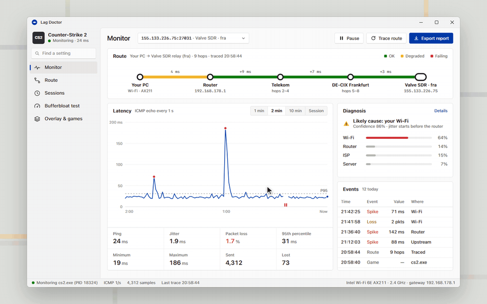

# 一个 Windows 上的免费网络诊断工具，找出导致你上网速度变慢的原因： Wi-Fi 信号、路由器、互联网服务提供商，还是游戏服务器的问题。
> 💡 备注属性未写入，可能是备注属性名称或者类型被修改了，建议将字段类型设置为 rich_text，可以在小程序-操作-修改文章数据库页面进行调整
> 💡 原文链接:[https://mp.weixin.qq.com/s?__biz=Mzg2MjY1NDIzNg==&mid=2247502697&idx=1&sn=d90d8e09be91cc7cdcf172b5b8f09d0e&chksm=cf8fd1f332abe8bf7dd9dfe79b93b2b0743a324fca69095e1af1d8ef6084335ac39ed291a8b3#rd](https://mp.weixin.qq.com/s?__biz=Mzg2MjY1NDIzNg%3D%3D&mid=2247502697&idx=1&sn=d90d8e09be91cc7cdcf172b5b8f09d0e&chksm=cf8fd1f332abe8bf7dd9dfe79b93b2b0743a324fca69095e1af1d8ef6084335ac39ed291a8b3#rd)
lag-doctor
> “
> 这工具自动识别你正在玩的游戏，找到真实连接的服务器地址，然后一路 ping 过去，用"责任判定"告诉你延迟和丢包发生在哪一段，省得你瞎猜是重启路由还是换网线。
> 
Github地址
**https://github.com/PlateParrotTerminal/lag-doctor**

功能特性
- 自动跟游戏：不用手动查 IP，启动 CS2、VALORANT、Dota 2、Fortnite、Apex、LOL 等游戏后，它从进程连接表里读出服务器地址直接开测；没游戏时 fallback 到 1.1.1.1
- 逐跳追踪+责任判定：像 MTR 那样 traceroute 每一跳，但做了智能过滤——某个路由器如果只是对 ICMP 限速，不会冤枉它；只有持续影响到终点的丢包和抖动才算数。最后给出明确结论：你的 Wi-Fi、你的路由、你的 ISP 还是游戏服务器
- 卡顿 spike 记录： spike 出现的时间、峰值、根因都记下来。如果 spike 那秒你的路由也炸了，就是本地问题（Wi-Fi 重传或 bufferbloat）；不然就是上游。整晚的 session 能压缩成三行摘要，直接贴给客服
- Bufferbloat 评级：空闲和满载时的 ping 对比，按 A+ 到 F 打分，顺便告诉你现在用的是 Wi-Fi 还是网线，换线能有多大改善
- 游戏内 overlay：置顶、穿透点击的小 HUD，显示实时 ping、jitter、丢包率，热键开关，支持无边框窗口模式
对比同类工具
| **能力** | **Lag Doctor** | **Windows ping/tracert** | **WinMTR** | **游戏内 net_graph** |
| 自动找游戏真实服务器 | ✓ | ✗ | ✗ | ✓ |
| 实时 ping/jitter/丢包 | ✓ | 只有 ping | ✓ | ✓ |
| 逐跳丢包抖动分析 | ✓ | ✗ | ✓ | ✗ |
| 责任判定（Wi-Fi/路由/ISP/服务器） | ✓ | ✗ | ✗ | ✗ |
| Spike 日志 + session 报告 | ✓ | ✗ | ✗ | ✗ |
| Bufferbloat 评级 | ✓ | ✗ | ✗ | ✗ |
| 单工具覆盖多游戏 | ✓ | ✓ | ✓ | ✗ |
| 游戏内 overlay | ✓ | ✗ | ✗ | ✓ |
怎么用
1. 去 Releases 下 ，解压直接跑 
1. 免安装、不要管理员权限、不留后台服务，配置存在 ，删了就是恢复默认
1. 开游戏，它自动识别；看 Monitor 页的总体情况，去 Route 页看哪一跳变色，读诊断结论就行
自己编译
要 Windows 10/11 + Rust stable（MSVC 工具链）：
```
git clone https://github.com/PlateParrotTerminal/lag-doctor
cd lag-doctor
cargo build --release
.\target\release\LagDoctor.exe

```
代码结构挺清楚：`games.rs` 加新游戏就一行，`diagnosis.rs` 管判定逻辑，`icmp.rs` 和 `trace.rs` 封装 Windows ICMP API 和 TTL 路由追踪，没驱动没注入，VAC/Vanguard/EAC 不会误报。
