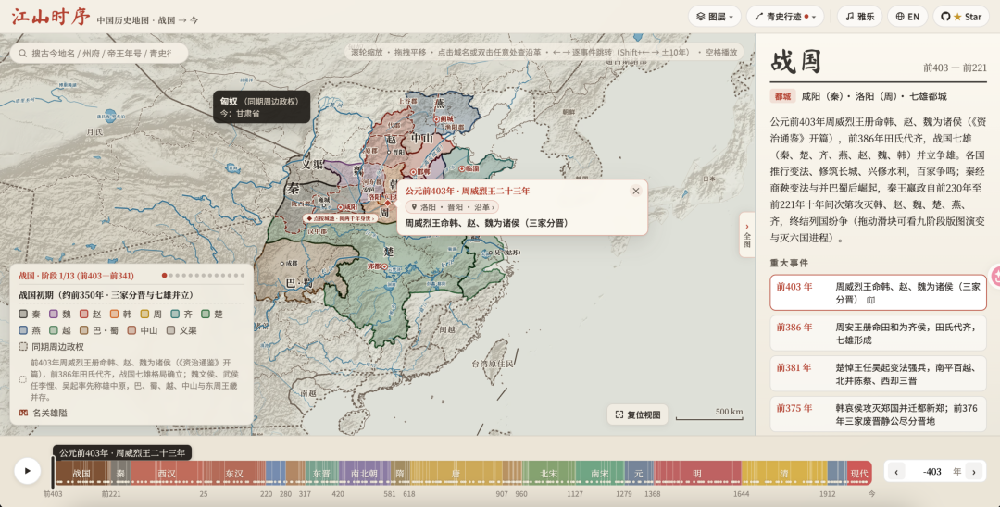

# 一个中国历史交互地图，把两千多年的疆域变化、古城位置、历史事件全塞进了一张能拖动的古地图里，不用翻厚书，鼠标拉拉点点就能看。
> 💡 备注属性未写入，可能是备注属性名称或者类型被修改了，建议将字段类型设置为 rich_text，可以在小程序-操作-修改文章数据库页面进行调整
> 💡 原文链接:[https://mp.weixin.qq.com/s?__biz=Mzg2MjY1NDIzNg==&mid=2247502369&idx=1&sn=c52122e6ab7104ecfb97b39af01f8124&chksm=cf4cb037728468437777957b6d80beb132454461d52fd10aac76948f5c675d95f1764f7e445c#rd](https://mp.weixin.qq.com/s?__biz=Mzg2MjY1NDIzNg%3D%3D&mid=2247502369&idx=1&sn=c52122e6ab7104ecfb97b39af01f8124&chksm=cf4cb037728468437777957b6d80beb132454461d52fd10aac76948f5c675d95f1764f7e445c#rd)
jiangshan-map
> 💡 “
这个项目叫"江山时序"，是个中国历史交互地图，时间跨度从公元前403年三家分晋一直到今天。说白了就是把两千多年的疆域变化、古城位置、历史事件全塞进了一张能拖动的古地图里，不用翻厚书，鼠标拉拉点点就能看。

Github地址
**https://github.com/DeanChensj/jiangshan-map**

功能特性
- 拖时间轴看天下分合。战国七雄怎么打的、三国怎么分的、宋朝跟辽金西夏怎么对峙的，同屏高亮显示。切年份的时候还会留个虚线残影，一眼看出地盘是大了还是小了。左下角显示当时在位的皇帝和年号，悬停州郡能看到古今地名对照，还能叠一层现代省界做对比。
- 点城看身世。双击地图或点任意古城、关隘，弹出卡片告诉你这地方两千多年改过什么名、归哪个朝代管、有没有当过都城、发生过什么大事。函谷关、潼关、剑门关这些雄关有专门图标，赤壁、五丈原、蓝关这些诗词里的地名也能搜到。
- 跟着古人走路。内置了七条路线：秦始皇灭六国、张骞通西域、诸葛亮北伐、玄奘西行、李白漫游、苏轼贬谪、王阳明立功。点"下一站"地图年份和版图自动跟着变，卡片里还会弹出当事人写的诗文。
- 有个小游戏。地图隐去城名，给你线索让你在空白地图上扎针猜古地名位置，按准确度打分，最后封你个"太史令"或者"州郡从事"之类的头衔。
怎么玩
在线直接玩，网址是 https://deanchen.me/jiangshan-map/ 。想本地跑也行，纯静态页面不用搭环境，git clone下来用python -m http.server或者直接双击index.html都能打开。支持URL传参，比如?year=208&place=赤壁就能直接跳到赤壁之战那年。
