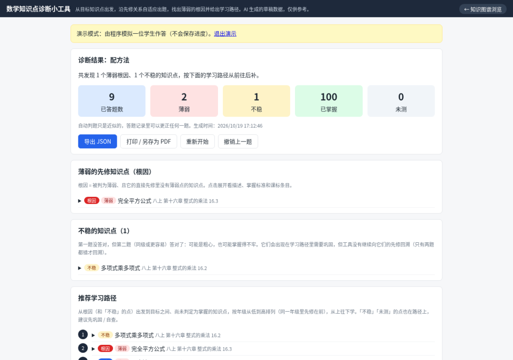

# 一个中小学数学知识图谱，覆盖一到九年级，对齐2022年版义务教育数学课标和人教版教材
> 💡 备注属性未写入，可能是备注属性名称或者类型被修改了，建议将字段类型设置为 rich_text，可以在小程序-操作-修改文章数据库页面进行调整
> 原文链接:[https://mp.weixin.qq.com/s/9RwTCGL-rblTEr7SJG1aNQ](https://mp.weixin.qq.com/s/9RwTCGL-rblTEr7SJG1aNQ)
cn-math-taxonomy
> “
> 一个中小学数学知识图谱，覆盖一到九年级，对齐2022年版义务教育数学课标和人教版教材。531个知识点连成有向图，答错题目会自动往回追到小学基础，告诉你到底哪块没跟上
> 
Github地址
**https://github.com/xiaoyang111222/cn-math-taxonomy**

功能特性
- 知识点按年级、学期、章节排好，每个点有掌握标准和诊断题
- 自适应诊断：选个目标知识点开始做题，对了就往上走，错了就沿着先修关系往回测，直到找到根子上的薄弱点
- 输出学习路径，按年级从低到高排，附上相关课标原文
- 题库2271道，小学每知识点4题、初中4-5题，全是AI生成的，有自动核验但没过教师手
- 纯静态页面，可以离线用，进度存本地，能导出JSON
数据来源与对齐依据
- **课程标准**：教育部《义务教育数学课程标准（2022年版）》第一至第四学段（1—9 年级）的【内容要求】（数与代数、图形与几何、统计与概率、综合与实践）。`data/cn-curriculum-standards.json` 现有 **230** 条（第一至三学段 73 + 第四学段 157）。第四学段条文仍是原先从教育部 PDF 识别的原文；第一至三学段据公开转写整理，**未与教育部 PDF 逐页核对**，`page_or_ref` 为「待核」。来源、规则、覆盖率与局限见 docs/standards-mapping.md。
- **教材顺序**：人民教育出版社（人教版）义务教育教科书数学，**采用 2024 年审定的新版**。章节目录取自第三方电子课本目录站 dzskb.com（非人教社官方页面），核对情况如下：新版教材相对旧版有较大调整（如多边形移入八下“四边形”、反比例函数移入九上、新增“数据的四分位数”“综合与实践”主题、概率由九上移到九下并改名“随机事件的概率”等），本图谱按新版目录处理。
怎么用
本地起个HTTP服务就行：
```
python3 -m http.server 8000

```
然后开浏览器访问 `http://localhost:8000/` 看图谱，`/diagnose/` 进诊断工具。带演示参数的直接试：`?target=cnm_221&demo=1`
线上也有部署：`https://math.pansgo.com/`
要注意的
项目自己标明了是AI初稿，没经教师审核。先修关系哪些算硬门槛、哪些只是有帮助，诊断题的难度区分度，都还没用真实学生数据验证过。小学部分和九下目录有不少"非官方、待核"的标注，用的时候得自己掂量。
