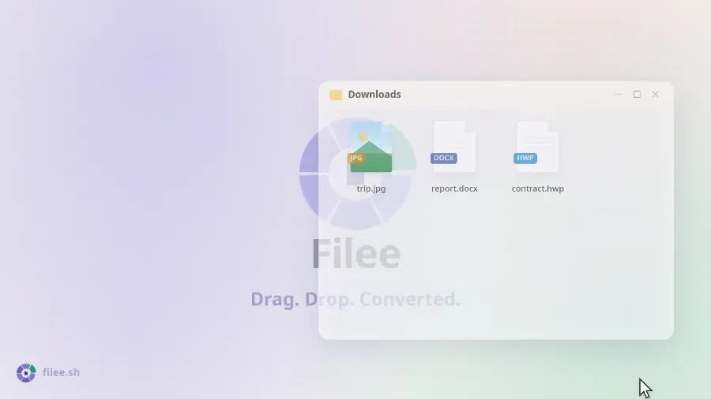

# 一个免费开源的文件转换工具，按住 Ctrl,把文件拖到光标附近弹出的圆环菜单上，直接选格式就能转
> 💡 备注属性未写入，可能是备注属性名称或者类型被修改了，建议将字段类型设置为 rich_text，可以在小程序-操作-修改文章数据库页面进行调整
> 💡 原文链接:[https://mp.weixin.qq.com/s?__biz=Mzg2MjY1NDIzNg==&mid=2247502341&idx=1&sn=f99f95d5fc1deae9246074357c0b9cab&chksm=cfc0facffb9ecac78a6a927ebeeb8027bb7765a8f75ee30f5d3867eb416aa9034485690dc815#rd](https://mp.weixin.qq.com/s?__biz=Mzg2MjY1NDIzNg%3D%3D&mid=2247502341&idx=1&sn=f99f95d5fc1deae9246074357c0b9cab&chksm=cfc0facffb9ecac78a6a927ebeeb8027bb7765a8f75ee30f5d3867eb416aa9034485690dc815#rd)
Filee
> 💡 “
一个免费开源的文件转换工具，它最特别的地方是不用打开软件窗口——按住 Ctrl（Mac 上是 Option），把文件拖到光标附近弹出的圆环菜单上，直接选格式就能转。支持 180 多种格式，图片、PDF、Word、Excel、PPT、HWP、视频、音频、电子书、压缩包都能处理，全程本地离线完成，文件不会上传到任何地方

Github地址
**https://github.com/KnifeLemon/Filee**

功能特性
- 转的东西够杂：图片、PDF、Word、Excel、PPT、韩文的 HWP/HWPX、视频、音频、电子书、压缩包、字体、CAD 图纸，还有 JSON/YAML/TOML/XML/CSV 这些数据格式互相倒，拢共 238 种格式
- 智能匹配：你拖什么文件，圆环只显示能转的目标格式，不会瞎列
- 批量并行：一堆文件同时处理，遇到 HWP 这种需要多步转换的，自动找路径
- 监视文件夹：指定目录往里塞文件就自动转
- 多种入口：除了拖拽，还有右键菜单、快捷键、固定拖放区、命令行 filee 指令
- 跨平台：Windows 10/11 成熟可用，macOS 14+ 和 Linux 是预览版，后两者在 Wayland 上得用拖放区代替手势
- 主题和语言：明暗模式，支持英文、韩文、简体中文
怎么用
Windows 最省事：去 Releases 下 `Filee--win-Setup.exe` 一路下一步，或者下免安装版解压直接跑 `Filee.exe`。装完可选加进资源管理器右键、开机自启、命令行调用，还能按需下载额外引擎。
macOS 下 `osx-arm64` 或 `osx-x64` 包，解压跑 `./install.sh`。注意还没做公证，首次去系统设置-隐私与安全性点"仍要打开"。
Linux 类似，解压跑 `./install.sh`，不用 root，但要 Python 3。X11 下拖拽正常，Wayland 得靠拖放区或文件管理器右键。
命令行示例
```
filee convert photo.heic --to jpg
filee convert *.png --to webp --quality 80 -o converted
filee watch D:\Inbox --to pdf --move-originals

```
自己会检查更新，设置里能关。转换引擎也是头回用到时才下载，平时完全离线。

## 摘要

（待补充）

## 我的笔记

（待补充）
