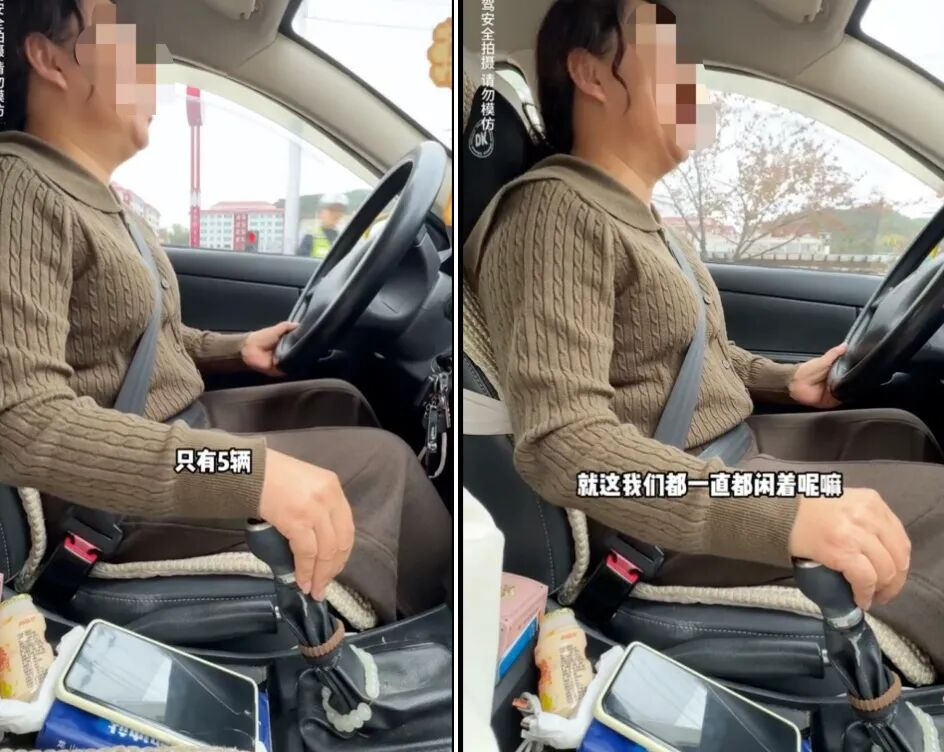
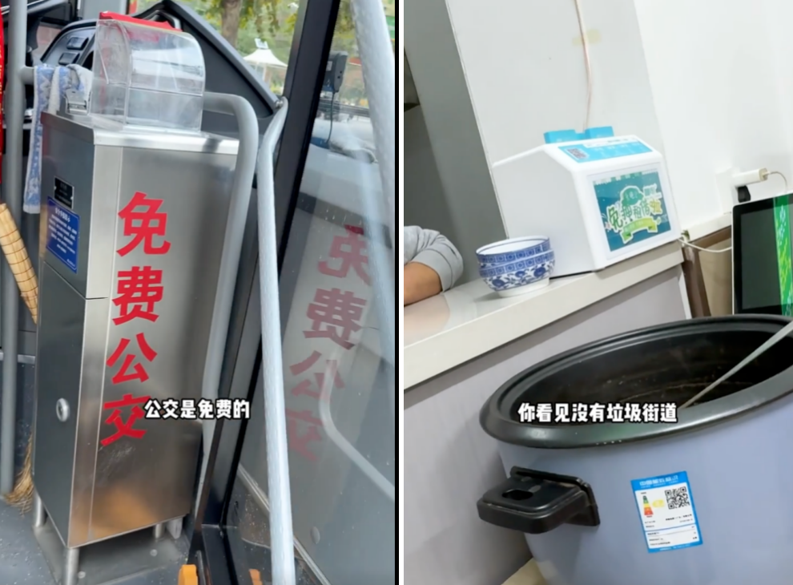

# 一个县城五辆出租车，这才是最美好的生活！
> 💡 备注属性未写入，可能是备注属性名称或者类型被修改了，建议将字段类型设置为 rich_text，可以在小程序-操作-修改文章数据库页面进行调整
> 💡 原文链接:[https://mp.weixin.qq.com/s?__biz=Mzg5MzgzODYyMw==&mid=2247493973&idx=1&sn=66fa034c6eac314d62deee235c6c7698&chksm=c174f40b9f60cb7c31b60c480b012034edc8f2f7883e5e65a79f78cad198af697b0ac1de4d9a#rd](https://mp.weixin.qq.com/s?__biz=Mzg5MzgzODYyMw%3D%3D&mid=2247493973&idx=1&sn=66fa034c6eac314d62deee235c6c7698&chksm=c174f40b9f60cb7c31b60c480b012034edc8f2f7883e5e65a79f78cad198af697b0ac1de4d9a#rd)

作者 | 梳子姐
最近赵本山一句歌词，治愈了无数焦虑的成年人：
“慌啥子嘛，慢慢来，太阳下山有月亮爬上来，云会在、花会开，好运总会为你而等待。”

短短几句话，道破了如今很多人的痛处，太急、太卷、太慌张。

回头看看，很多人这一生，总是在赶路、在追逐，人人步履匆匆，个个身心紧绷，根本不敢停下来。
我们活着到底是为了什么，人生的意义究竟在哪里？
真正幸福的生活，恐怕不在于急匆匆的奔赴，而是慢悠悠的安稳。

这份让人羡慕的人间静好，在甘肃两当县，给出了最真实的答案。

两当是藏在秦岭南麓的小县城，全县常住人口仅3.75万人，不足四万，整座县城只有五辆出租车。

没有车水马龙的喧嚣，没有没完没了的堵车，没有此起彼伏的喇叭声，街道干净、人烟疏朗、节奏舒缓，全城公交免费，停车免费。

在这里生活，难道不香吗？我们从出生就被灌输一个执念，繁华热闹的大城市，才是幸福奔赴的方向。

大城市有机会、有平台、有资源，但也有透支、焦虑、内耗和无尽的浮躁，并不滋养人的幸福感。

凡事物极必反，我们必须正视一个时代大势：中国人口已经进入持续下降通道，今年总人口大概率会跌破14亿，进入只减不增的长期趋势。

未来很长一段时间，很多县城、很多乡镇、很多乡村人口会越来越少，空巢、安静、稀疏成为常态。有人觉得人口减少是衰败、是萧条、是遗憾，其实不尽然。

人口减少的背后，是喧嚣的减少，是浮躁的退潮，是人心的归位。

当大家不再扎堆拥挤，不必疯狂内卷，社会会慢慢降温、减速、降噪，我们终于可以不用抢、不用卷、不用慌。

时代的风向，正在悄悄逆转。过去几十年，是轰轰烈烈的进城潮。
一代代80后、90后，年少背井离乡，拼命奔赴大城市，挤高楼、闯职场、拼前程，以为城市才是归宿。

但未来二十年，一定会迎来一场不可逆的返乡潮、归乡潮、田园潮。

等80后、90后慢慢老去，褪去奋斗的锐气，卸下谋生的重担，他们终将厌倦城市的钢筋森林，重新选择乡村田园。

届时，很多人会逃离城市，回到山清水秀的乡村，回到空气干净、节奏缓慢、灵魂松弛的故土。

这就是中国人刻在骨子里的宿命：落叶归根。

人这一生，是一个出走的过程，也是一个回归的过程，年轻时向外闯荡是生存，年老时向内归静是归宿。

**我们拼命追逐，最终会发现最宝贵的东西不是霓虹灯火，高楼大厦，而是山川草木，烟火从容。**
**曾经不少人追捧广西巴马，以为单单喝上这里的泉水，就能延年益寿。**
**其实哪有什么神水，真正养人的，是这里山水相融的自然环境，和谐安宁的天地气息。**
**只有五辆出租车的两当小城，不是落后，恰恰是未来最好的生活模板。**

**未来的幸福，不再是谁跑得快、赚得多，而是谁活得更安静、更从容。能把日子过慢，这才是人生赢家。**
**- 完 - **
** 笔不阿贵，文不奉承**

@关注和转发，就是最大的支持@
