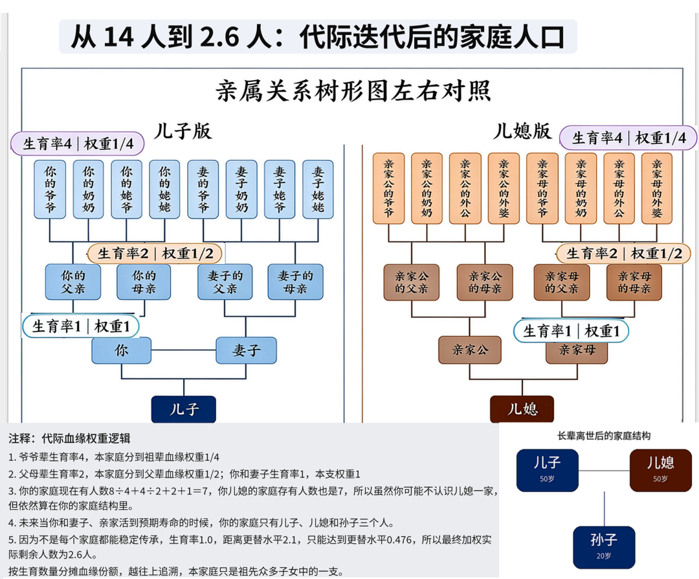
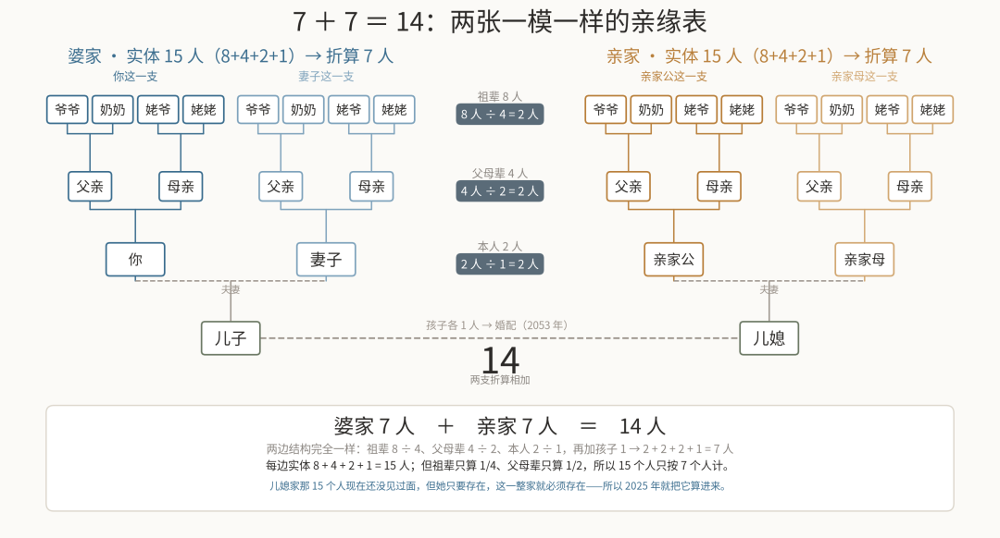
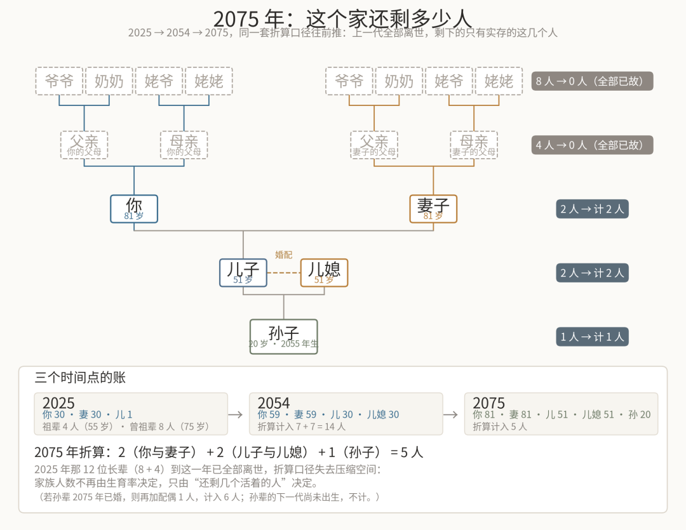

# 一个家庭是怎么从 14 人变成 2.6 人，直观显示
> 💡 备注属性未写入，可能是备注属性名称或者类型被修改了，建议将字段类型设置为 rich_text，可以在小程序-操作-修改文章数据库页面进行调整
> 原文链接:[https://mp.weixin.qq.com/s/Wr719cNWfADnVpmEhmonIg](https://mp.weixin.qq.com/s/Wr719cNWfADnVpmEhmonIg)
先依据中国人口统计做一个假设：如果2025年的你 30 岁，刚有一个 1 岁的孩子，按现在的人口曲线，2025 年你这一大家子其实有 14 个人；五十年后你（80岁）离开的时候，这个家只剩 3 个人；因为不是每个家庭都可以稳定传承，所以实际人口是 2.6 人。
这不是算命，是一道可以一层层拆开的算术题。拆开之后你会发现，真正让人数塌下来的不是某一次意外，而是每一代都在打折的生育率。
## 01 表面 15 人，只按 7 个人算
2025 年，你 30 岁，妻子 30 岁，儿子 1 岁；双方父母 4 人，55 岁；双方的爷爷奶奶、姥姥姥爷 8 人，75 岁。摆在户口本上的数字是 8 + 4 + 2 + 1，一共 15 个人。
**但这 15 个人，并不是平均地属于你家。**你爷爷奶奶那一辈，一家生了 4 个孩子，你父亲只是其中 1 个，所以在祖辈的 8 个人里，你家只占四分之一，8 ÷ 4 = 2；你父母这一辈，一家生 2 个，你家占二分之一，4 ÷ 2 = 2；到了你和妻子，2 个人 ÷ 1 = 2；下面是儿子，1 个人。
加起来：2 + 2 + 2 + 1 = 7。
同一个家里，人数要按"你占了几支"来折算，这是整套账最关键的一步。下面这两张一模一样的表，就是把这件事摆在一起看：左边是你家，右边是亲家——不是两类人，是同一个算法的两个样本。

图1：两个 15 人的家，各折成 7 人（来源：作者自绘）
两边都是 8 位祖辈 ÷ 4、4 位父母辈 ÷ 2、2 位本人 ÷ 1，再加一个孩子。所以两个家，各是 7 个人。
## 02 为什么 2025 年就该算 14 个人
问题来了：儿媳现在还没出现，她家凭什么算进来？
这里有个容易被忽略的事实——只要一个人存在，她背后那一整条链就必须存在过。你儿子将来要娶的那个女孩，不是从天上掉下来的：她有父母，有爷爷奶奶姥姥姥爷，那是一个完整的 7 人结构。这个结构今天已经在世界某个角落里运行着，只是你们还没见面。
所以 2025 年这个家的真实规模是 7 + 7 = **14 个人**。
这也是为什么"表面 15 人"和"实际 14 人"会同时出现：15 是数人头，14 是数结构。数人头会漏掉那个还没见面的家，数结构则会把儿子在两边各算一次。
## 03 时间开始减人：四次减法
接下来的五十年，这个家只做一件事——减人。按中国的人均预期寿命推，大致有四个节点。
**2028 年，祖辈离场。**75 岁那 4 位老人陆续离世，14 − 4 = 10。
**2053 年，父母离场，儿子成家。**那一年儿子 29 岁，你和妻子 55 岁，你的父母 85 岁——按预期寿命，这一辈也走了。10 − 4 = 6。同一年，儿子结婚，那个 7 人的家正式并了进来。
**2054 年，孙辈出生。**6 + 1 = 7。这是整条曲线上唯一一次回升。
**2075 年，你和妻子离场。**那一年你们 80 岁，儿子 51 岁。7 − 4 = 3。

图2：2075 年这个家剩下的 3 个人
五十年，从 14 到 3。中间没有战争，没有灾难，只是每一代人都按时老去、按时离开，而新来的人越来越少。
## 04 为什么最后是 2.6，不是 3
上面算出的 3 个人，是"某一年某一刻"的人数。但这道题真正想问的不是某一年，而是**这个家能不能一直传下去**。
能不能传下去，看一个数：更替水平。一对夫妻要生 2.1 个孩子，人口才能不缩水——多出来的那 0.1，是用来抵消意外、疾病和不婚不育的。而现在的总和生育率是 1.0。
1.0 对 2.1，大约是 47.6%。也就是说，每一代人都只完成了上一代不到一半的任务。一代 3 个人，下一代不到 1.5 个，再下一代更少。把这条连续的损耗折算下来，这个家最终会停在一个小于 3 的数——**2.6 个人**。
2.6 不是一个年份的人口数，而是一个家庭在低生育率下能达到的稳态规模。它意味着：这个家不会彻底消失，但也再回不到 7，更回不到 14。
所以这道题真正的答案不是数字，而是那句话——**不是每一代人都能留下足够的人，接住上一代人留下的家。**
回到 2025 年。你现在关于"要不要再生一个"的每一个犹豫，其实都在改这张图的走向。
