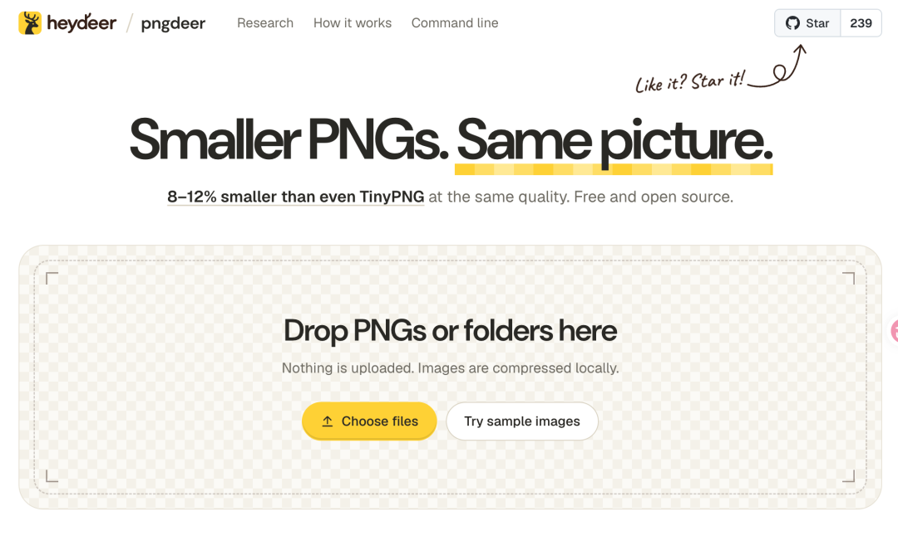

# 一个开源的PNG 图片压缩工具，号称同样画质下比 TinyPNG 还能再小 8%–12%
> 💡 备注属性未写入，可能是备注属性名称或者类型被修改了，建议将字段类型设置为 rich_text，可以在小程序-操作-修改文章数据库页面进行调整
> 💡 原文链接:[https://mp.weixin.qq.com/s?__biz=Mzg2MjY1NDIzNg==&mid=2247502490&idx=1&sn=848ab17a4b4e1b17eb0d3f6a8ea33fb9&chksm=cf359cae515b101180d47c84ff7bc5408376774c55015efd845b7ceda3c3d8f6b4faa61b243f#rd](https://mp.weixin.qq.com/s?__biz=Mzg2MjY1NDIzNg%3D%3D&mid=2247502490&idx=1&sn=848ab17a4b4e1b17eb0d3f6a8ea33fb9&chksm=cf359cae515b101180d47c84ff7bc5408376774c55015efd845b7ceda3c3d8f6b4faa61b243f#rd)
pngdeer
> 💡 “
一个 PNG 图片压缩工具，用 Rust 写的。它走有损压缩路线，但不用你手动调质量参数，程序自己会试 2 到 256 色的调色板，加不加抖动也轮一遍，最后用 SSIMULACRA2 这个视觉算法打分，挑个文件最小、人眼还看不出毛病的版本。按官方跑分，同样画质下比 TinyPNG 还能再小 8%–12%

Github地址
**https://github.com/heydeer/pngdeer**

功能特性
- 压 PNG：支持单张、批量、整个文件夹拖进去，WebAssembly 在本地多核并行处理
- 质量可控：自动搜 2 到 256 色板，带不带抖动都试一遍，用 SSIMULACRA2 算视觉分，不是瞎压
- 透明图特殊处理：会过一遍亮底和暗底，避免半透明边缘发虚
- 输出一致：浏览器压的和命令行压的字节级相同，CI/CD 里用不担心结果对不上
- 目标质量可设：默认自动，加 --target 85 这类参数能锁死分数线
怎么用
命令行一行搞定：
```
brew install heydeer/tap/pngdeer
pngdeer input.png -o output.png

```
想自己指定质量阈值也行：`pngdeer input.png -o output.png --target 85`
浏览器版直接访问 heydeer.ai/open-source/pngdeer，本地处理不上传。要本地跑 Web 版，先执行 `sh web/build.sh`，再用 `python3 web/serve.py` 起服务，开 `localhost:8770` 就行。
