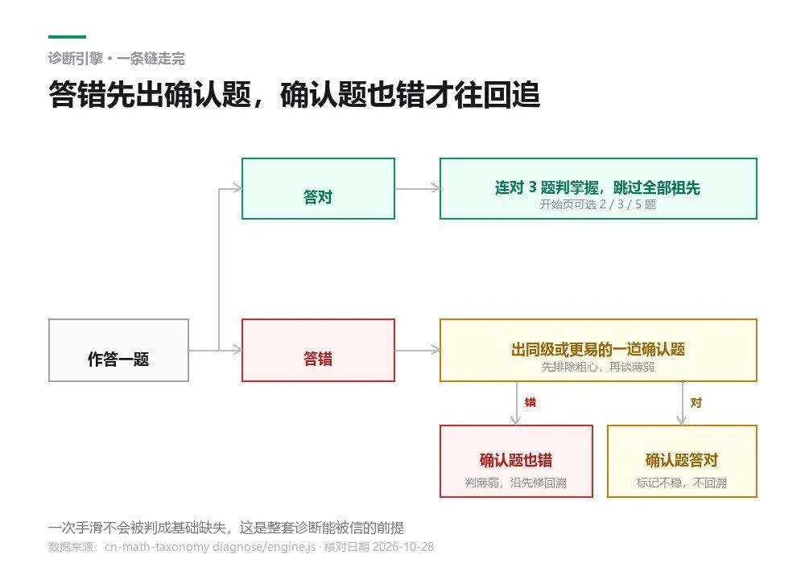
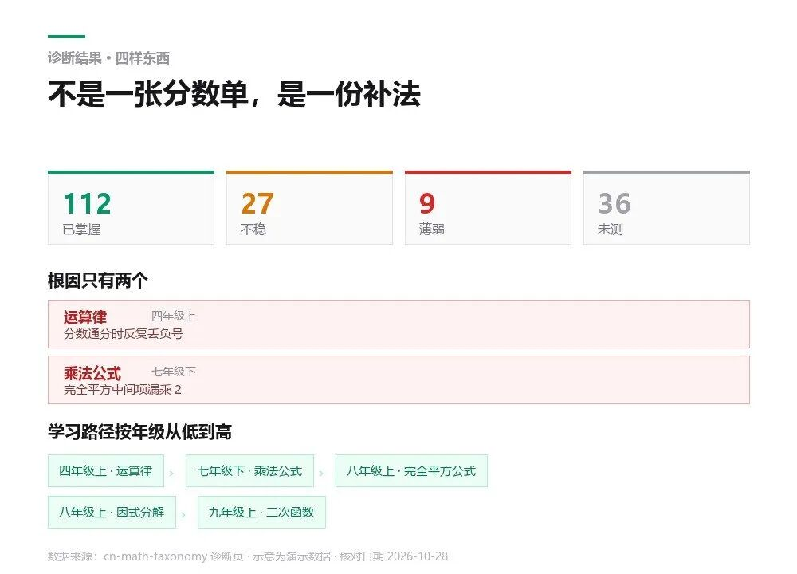

# 一个开源项目，把 1 到 9 年级数学拆成五百多个知识点 孩子数学做错题，还有初中，高中学习 用这个一步解决
> 💡 备注属性未写入，可能是备注属性名称或者类型被修改了，建议将字段类型设置为 rich_text，可以在小程序-操作-修改文章数据库页面进行调整
> 💡 原文链接:[https://mp.weixin.qq.com/s?__biz=MzI4ODU3OTI5Mw==&mid=2247486990&idx=1&sn=f02932d6e344fc2c3137672da8cbd7e4&chksm=ed1dcf5838f9989b75e3c229c0e75bb0a66a151ff9c770901a3dda7a350a155c6d3156584afa#rd](https://mp.weixin.qq.com/s?__biz=MzI4ODU3OTI5Mw%3D%3D&mid=2247486990&idx=1&sn=f02932d6e344fc2c3137672da8cbd7e4&chksm=ed1dcf5838f9989b75e3c229c0e75bb0a66a151ff9c770901a3dda7a350a155c6d3156584afa#rd)
知识图谱 · 4283 STAR · 在线可试
**数学答错一道，它追到小学哪一课**
1828 个知识点连成网，答错沿依赖往回追
结果给到缺口、补法、顺序和课标原文
数学 + 英语 + 物理 · 网页直接能试 · 不用装环境
我是葛胡说，热衷于 AI 技术与工具分享。
孩子二次函数一塌糊涂，你翻他的卷子，公式写着，步骤也有，就是算不对。问哪里不会，他说不上来。你猜是配方没学明白，让他重做几道配方题，对了。回去再做二次函数，还是错。这份上线十天涨到四千多星的开源知识图谱，干的就是把这种说不清的断点找出来。
CONTENTS
**01**
一张卷子说不清的事
**02**
它把知识点连成了一张网
**03**
诊断怎么跑：答对三道才算过
**04**
出结果时你能看到什么
**05**
怎么用：网页直接开，或者本地起服务
**06**
它还能拿来干什么
**07**
规模与覆盖
**01**
**一张卷子说不清的事**
初二数学掉下来，最麻烦的地方在于你没法定位。
孩子二次函数这章彻底垮了。你拿着卷子看，方法他学过，步骤也照着写了，就是算不对。问他是哪里不会，答不上来。你按经验猜，大概是配方没掌握牢固，让他把配方的十道题重做一遍，全对。回到二次函数，照样错。
这种情况下，真正断掉的地方往往在更早。可能是完全平方公式的展开没吃透，可能是分数运算在某个环节一直不稳，也可能要追到小学四年级的运算律。孩子自己都不记得那一年学过什么。
靠人找这个断点，成本极高。请老师一对一，两个小时能把一章捋一遍，想往前追三个年级，得连着上好几节课。家长自己找，只能凭印象猜。
这个项目做的就是这件事，而且做得很直接：把所有知识点按「学 A 之前必须先会 B」的关系连起来，答错一道题，就顺着这些关系往回追。
**02**
**它把知识点连成了一张网**
核心数据是三层：知识点、先修关系、诊断题。
现在的规模是 1828 个知识点，2926 条先修关系，7459 道诊断题。知识点覆盖三科：数学 835 个，从小学一年级到高中选择性必修；英语 724 个，三年级到高中；物理 269 个，八年级到高三。先修关系里，1769 条是硬依赖，1157 条是软依赖，硬边意思是「不学 B 就没法理解 A」，软边是「学过 B 会更顺」。
导航方式很有意思。打开知识图谱页，左边是搜索框和三层筛选：学段、年级、领域。选一个知识点，比如「配方法」，中间会画出一张局部图。
默认向上看两层先修，向下看一层后继。硬先修画实线，软先修画虚线，小学初中高中三种颜色分开。点任何一个节点就切换选中项，可以缩放、拖动，也可以点「适配画面」把整张图缩到刚好。
它不会一打开就把所有知识点铺满屏幕。超过 40 个点的时候，会先按年级折叠起来，你点「共 N 个，点此展开全部」才画每一个。这个设计很实用，2926 条边的全图铺开会糊成一团没法看。
右侧是详情面板，一个知识点能看到的包括：名称、年级册章、领域、类型、描述、掌握标准、对应的课标条目原文、样题（答案默认折叠）、它的先修列表，以及它被哪些后续知识点依赖。
「被哪些依赖」这一栏比「先修」更有用。它告诉你：这个知识点现在没学好，将来会在哪几个地方爆出来。

从九年级的二次函数往下追到四年级的运算律，中间跨了四层，绿色是小学节点
**03**
**诊断怎么跑：答对三道才算过**
知识图谱看起来爽，真正解决家长问题的是 diagnose 那个页面。
流程是这样。先选目标，可以是一个具体知识点，也可以直接选一整册。选完整册，就是整册范围筛查。
然后它开始出题，题目按先修关系自适应。规则不复杂，但对结果影响很大：
同一个知识点，**连续答对 3 题才算掌握**。掌握之后，这个知识点下面的全部祖先节点直接跳过，不再问。开始页可以选 2 题、3 题或者 5 题，孩子基础差就选 2 题，能省一半时间。
**答错一题不算数，它会再出一道同级或更容易的确认题。** 这一步是为了排除粗心。确认题也错，才判定为「薄弱」，并且顺着先修关系往回追。追的时候硬边优先于软边，先查必须会的，再查最好会的。
**确认题答对，标记为「不稳」。** 不稳不回溯，意思是这个知识点本身没塌，只是不牢，不用往下挖。
这套规则的关键在于「确认题」这个环节。没有它，一次手滑就会被判成基础缺失，然后一路往回追到小学，整份诊断结果全废。加了一道确认，误判率降下来很多。
每道题作答之后会立刻显示解析和参考答案，孩子当场就能知道错在哪，不用等你讲。
进度存在浏览器本地，中途关掉明天打开还在。做完可以导出 JSON、直接打印，也可以生成一张分享图。

从作答开始只有两条主干，真正分叉的地方在确认题那一步
**04**
**出结果时你能看到什么**
跑完一份诊断，结果页给四样东西。
**薄弱的知识点清单，带根因。** 它会告诉你哪些点是真的没掌握，并且标出最上游的那几个。这个「最上游」就是根因，通常只有两三个。
**不稳的知识点清单。** 会做但不牢的那批。这批东西不用重学，刷几道题就行，属于性价比最高的补法。
**按年级从低到高排的学习路径。** 同一年级里，先修排在前面。这条路径直接可以当成补习计划用，从哪一天补什么，顺序都给你排好了。
**相关课标条目原文。** 每个薄弱知识点对应的课程标准条文都列出来，你能看到这个点在教学大纲里的位置，也能判断老师为什么在这个学期讲它。
路径还配了一张图，用的和知识图谱同一套引擎，小学初中高中分色，硬边实线软边虚线，薄弱根因用红框标出。文字版列表也保留着，方便复制。
「生成分享图」这个功能做得很讨巧。在浏览器里用 canvas 画一张 1080×1920 的竖图，写上站名、学科、诊断范围、已掌握/不稳/薄弱/未测各多少、最薄弱的几章、一两个根因和日期，底部一个二维码。图上不写孩子姓名，不涉及任何付费内容，发到家长群里也不用担心。

四张统计卡对应诊断页的四个分类，两条红框是最上游的根因，路径按年级从低到高排
**05**
**怎么用：网页直接开，或者本地起服务**
最省事的方式是直接开网站。线上版在 math.pansgo.com，GitHub Pages 上还有一份备份。手机上也能用，页面是响应式的，诊断页的按钮和选项都做到 44px 以上，手指点得准。
想看它到底怎么跑，官方给了一个现成的演示链接：打开诊断页，参数带上 ?target=cnm_221&demo=1，直接进「配方法」这个知识点的诊断，一路走到底。
想把数据拿到自己手上，本地跑。整个站是纯静态的，不需要数据库也不需要后端：
python3 -m http.server 8000
# 首页 http://localhost:8000/
# 知识图谱 http://localhost:8000/explore/
# 诊断 http://localhost:8000/diagnose/
# 英语 http://localhost:8000/?subject=english
注意别用 file:// 直接双击打开，页面靠 fetch 读 data/*.json，浏览器会拦住。
数据是纯 JSON，两个文件：topics.json 存知识点，dependencies.json 存先修关系。你要往里加自己学校的校本课程，或者删掉不讲的章节，改这两个文件就行。改完跑一遍校验：
python3 scripts/validate.py
它会检查 ID 唯一、每条边两端都存在、没有自环没有重复边、整张图没有环。有环的时候会直接把环路打印出来，这个检查很关键：先修关系一旦成环，诊断就会无限往回追。全部通过会打印 VALIDATION PASSED。
诊断的算法单独放在 diagnose/engine.js 里，是纯函数，浏览器和 Node 都能跑。仓库带了测试：node tests/test_engine.js。你想改判题规则，改完跑一下测试就知道有没有改坏。
要发布到线上，仓库里有 scripts/deploy-cf.sh，一条命令打包部署到 Cloudflare Pages。静态站，托管成本接近于零。
**06**
**它还能拿来干什么**
对家长，最直接的用法是**定位 + 排计划**。孩子哪科掉下来，跑一遍整册诊断，拿到根因和学习路径，按路径补。比盲目报班省事。
对老师，可以拿它做**班级共性错因分析**。一个班三十个孩子各跑一遍，把薄弱的根因汇总，能看出这个班的共同断点在哪个更早的章节。这比看平均分有用得多。
对做教育产品的人，这套数据的价值在结构。2926 条先修关系是现成的依赖图，你要做课程推荐、自适应练习、学习路径规划，不用从零建。
对自学者，英语那张图也能用。724 个知识点从三年级铺到高中，语法点之间的依赖关系都标了。想补英语语法，从「现在完成时」往回追，能看到它依赖哪些时态。
**07**
**规模与覆盖**
最后把数字列清楚，都是 validate.py 跑出来的实际值。
数学 835 个知识点：小学 249，初中 315，高中必修 143，高中选择性必修 128。领域分布是数与代数 412、图形与几何 266、统计与概率 113、综合与实践 39。数学先修边 1389 条，其中小学内部 389，初中内部 563，初中指向小学 45，高中必修 198，选择性必修约简后 194。数学诊断题 3487 道。
英语 724 个知识点，先修边 914 条，诊断题 2896 道。物理 269 个知识点，先修边 637 条，诊断题 1076 道。
课标条目 627 条，分成数学 314、英语 116、物理 197。知识点里有 1818 个挂上了课标映射，覆盖率接近百分之百。
项目在 GitHub 上叫 xiaoyang111222/cn-math-taxonomy，十月十八号建仓，十天到四千二百多星，现在 4283 星、1073 个 fork，作者还在更新，最近一次提交在十月二十七号。仓库名里的 math 是历史遗留，现在实际是三科。
想给自家孩子找一个能说清楚「到底哪里不会」的工具，这个大概是目前门槛最低的一个：不用装环境，不用注册，打开网页选个知识点就能开始跑。
我是葛胡说，热衷于 AI 技术与工具分享。
