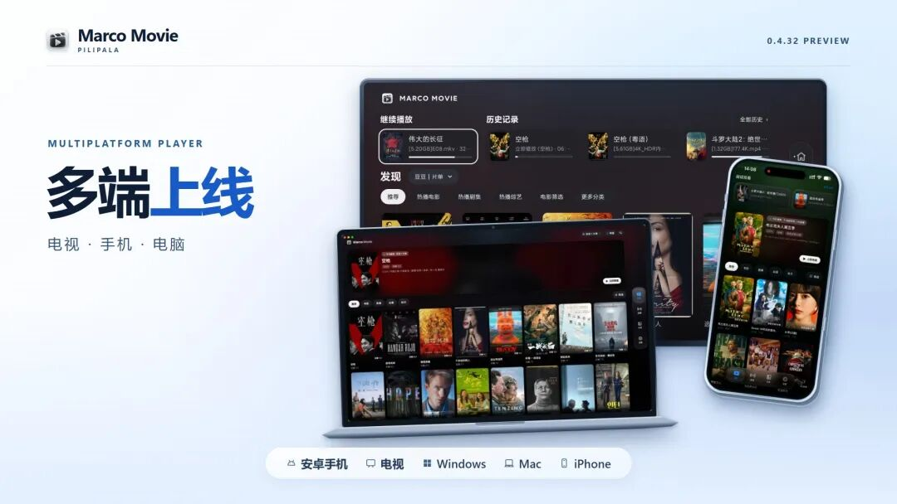
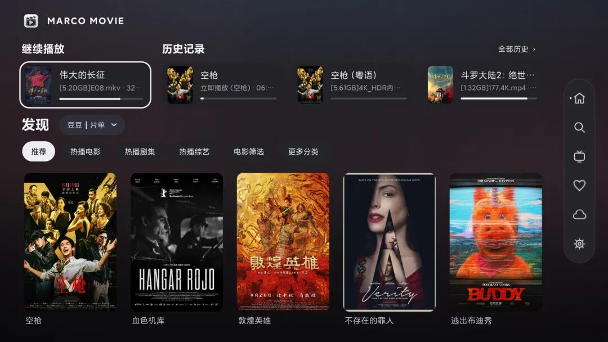
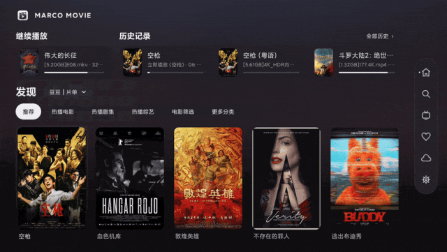
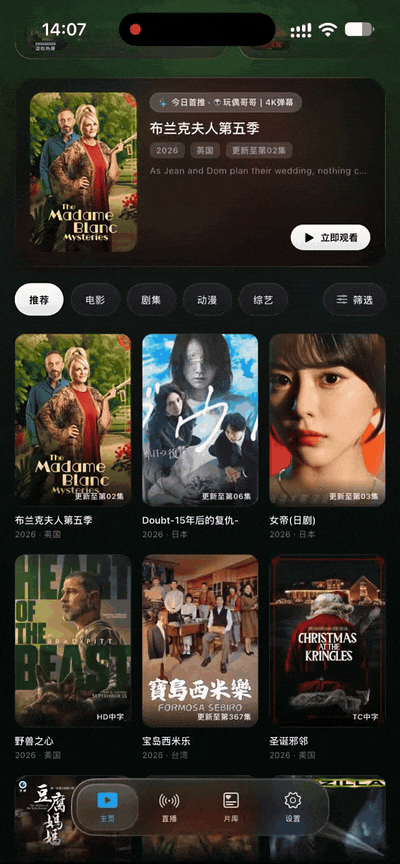
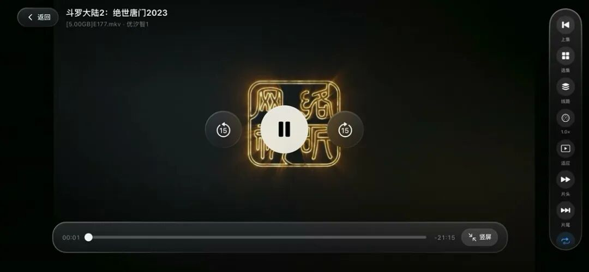
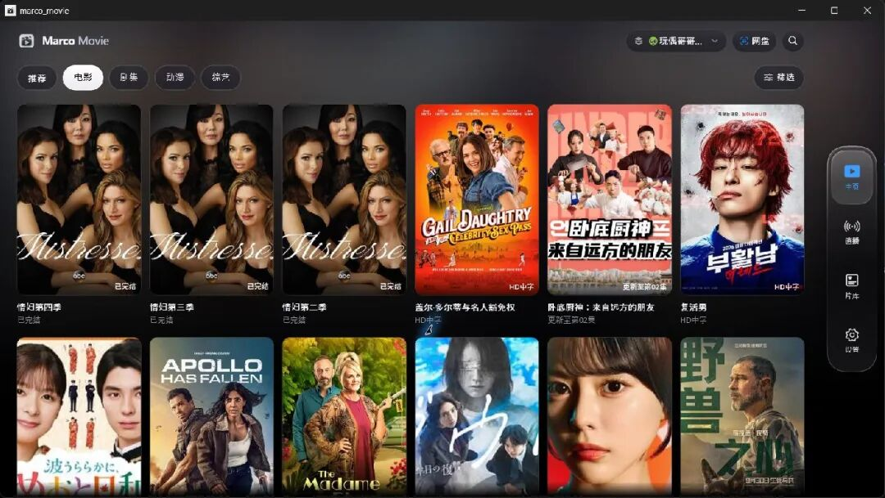
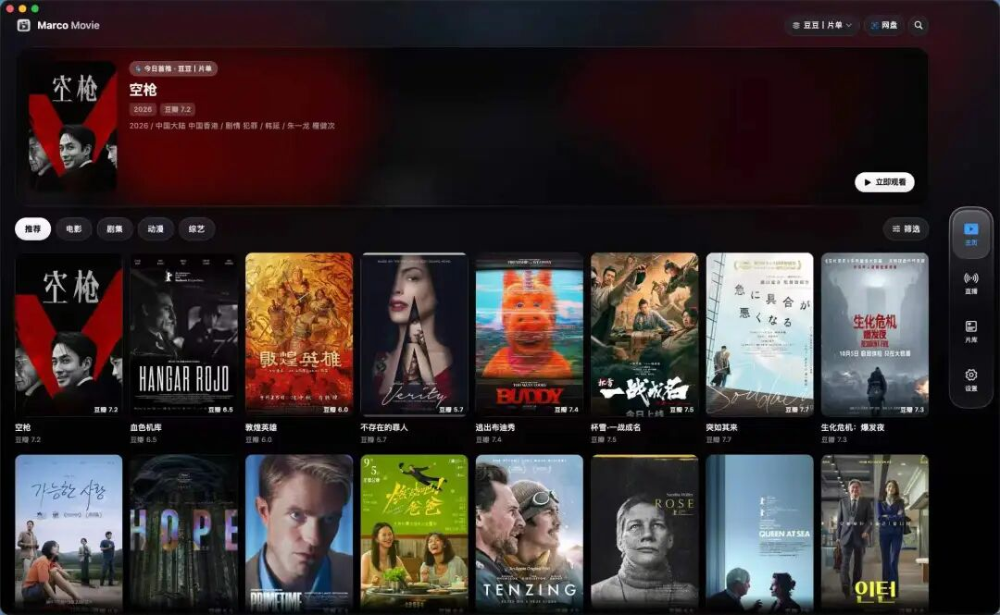
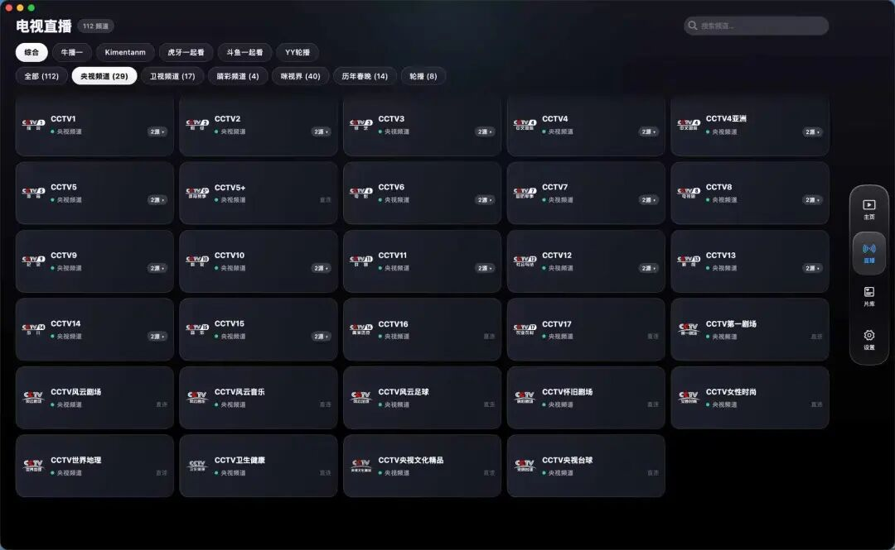
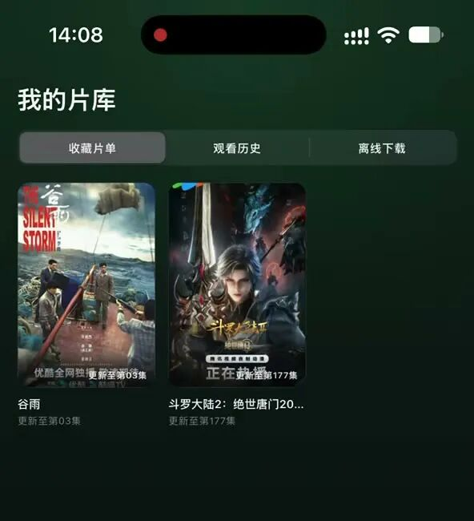
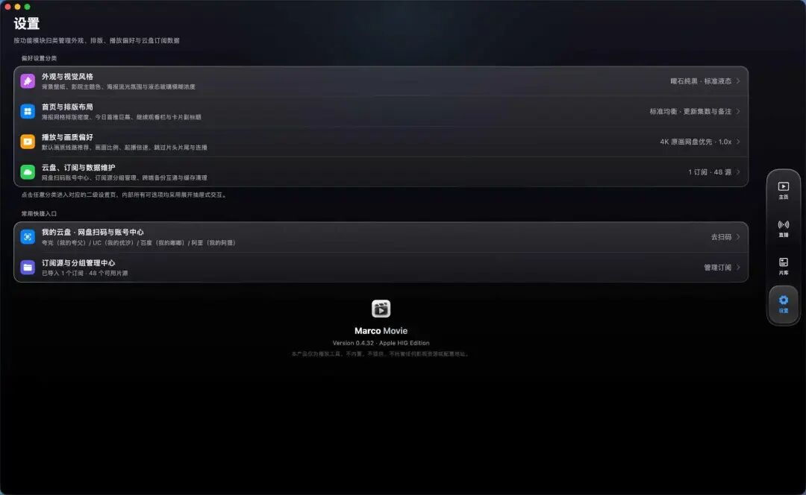

# 一个播放器打通电视、手机和电脑：Marco Movie 多端实测，把看片的主动权交还给你
> 💡 备注属性未写入，可能是备注属性名称或者类型被修改了，建议将字段类型设置为 rich_text，可以在小程序-操作-修改文章数据库页面进行调整
> 💡 原文链接:[https://mp.weixin.qq.com/s?__biz=MzU2ODg4MDU5OA==&mid=2247484981&idx=1&sn=8b68013a41411acd5e3980447ca44b86&chksm=fda5da78b90d0ff089c3b3b6547140774e527c7b977cbe39fc916ee78d62cf4a670e0a214203#rd](https://mp.weixin.qq.com/s?__biz=MzU2ODg4MDU5OA%3D%3D&mid=2247484981&idx=1&sn=8b68013a41411acd5e3980447ca44b86&chksm=fda5da78b90d0ff089c3b3b6547140774e527c7b977cbe39fc916ee78d62cf4a670e0a214203#rd)
找一部想看的片子，往往比看片本身还累。客厅的小米电视装一套壳子应用，通勤路上的 iPhone 换另一个播放器，到了书房打开 Mac 和 Windows，还得重新折腾一遍源配置和播放进度——更别提不少软件一打开就是满屏杂乱的弹窗和来路不明的推荐。
如果你只想要一个干净、纯粹、能把家里所有屏幕串起来的容器，**Marco Movie** 给出了一个很克制的解法。它横跨 Android（电视、盒子、手机、平板）、iPhone、iPad、Windows 和 macOS；刚装好时是个彻头彻尾的「空壳」，没有任何预置片库。只要导入你有权使用的内容配置，海报墙、全拼搜索、选集播放、收藏夹和观看记录就会瞬间就位；它甚至还留了独立的直播入口，能直接读取合规的频道列表。

### 一、 客厅大屏：窝在沙发里按遥控器，焦点走到哪都清清楚楚
很多多端应用上了电视就水土不服，要么字小得像蚂蚁，要么遥控器按半天不知道光标在哪。Marco Movie 的电视端把最常用的「继续播放」和历史记录直接摆在首页上方，往下则是分类和铺开的海报墙。握着遥控器按方向键游走时，一道醒目的白色高亮框会稳稳咬住当前选中的卡片或按钮，盲操起来心里很有底。

想找特定片子也不用对着九宫格抓狂。切进搜索页，左边是清爽的屏幕键盘，敲入全拼或首字母，右边就会实时跳出已导入配置里的匹配结果，找片效率很干脆。

### 二、 手机与平板：单手刷海报，横屏过来就是趁手的掌上影院
到了 iPhone 上，交互逻辑自然切回了熟悉的触控手势。上下滑动首页刷海报，看到感兴趣的点进去就是简介；详情页把海报、片名和播放键放在最顺手的上半区，底下紧跟着集数与剧集卡片。遇到几十集的长剧，点开「全部剧集」就能一键直达想看的那一集。

播放时的横竖屏切换也做了顺手的人体工学适配：竖屏握持时，操作工具条收在底部方便大拇指够到；一旦把手机横过来，底部只留一根干净的进度条，选集、切线路和调倍速全部挪到了右手边，大拇指一伸就能点按。Android 手机和平板同样有一套贴合触控的界面，平板横屏时还能利用大屏优势并排展示更多信息。

### 三、 Windows 与 Mac：宽屏海报墙配键盘盲操，把桌面显示器用满
在电脑端，Marco Movie 没有简单把手机界面拉大糊弄事，而是拿出了正经的桌面级多列海报布局。通过侧边栏可以在主页、直播、片库和设置之间秒切，手指划动触控板或滚轮就能一路逛下去。

点进宽屏详情页，海报、简介和播放按钮并排展开，视野很舒展，下方整块区域都留给了选集。如果片源识别出了多季多集，可以在这里直接切换，也能点「选源」挑一条最顺畅的线路。看片时完全不用找鼠标——敲一下空格暂停或继续，按左右方向键就能快退或快进 15 秒，符合桌面端老玩家的肌肉记忆。

### 四、 直播、私人片库与数据迁移：不仅能看，还能把记录稳稳带走
除了点播，把合规的直播列表导进去之后，这里还能变身电视直播台。你可以按分组慢慢翻，也能直接搜频道名；遇到同一个频道有多条备用线路，直接在频道卡片里就能切换。

常看的片子全收在「我的片库」里，收藏夹、观看历史一目了然，还单独留出了离线下载入口，出门断网前可以先囤好粮。

要是换了新设备，也不必从头配置。设置页除了能调外观、首页排版和播放偏好，还支持用备份文件把配置和观看记录手动迁移过去（具体支持的内容源与扩展范围会因系统平台略有不同）。

### 五、 适配设备与折腾指南：按需认领你的安装包
如果你也想在手头的设备上试一试，安装前可以先对照一下各平台的包体要求：
- Android 全家桶（电视、盒子、手机、平板）：共用同一个 APK 安装包，打开后应用会自动识别设备形态并匹配对应界面。本文电视端实测用的是 0.4.32 预览包，要求系统在 Android 6.0 及以上，且硬件需支持 32 位 ARM 应用。
- 桌面端（Windows 与 Mac）：分别提供独立的 Windows x64 与 macOS 安装包，开箱即用。
- 苹果移动端（iPhone 与 iPad）：提供未签名的 IPA 文件，需要通过自己习惯的签名工具或侧载方式安装。
直接前往 Marco Movie 项目下载页，按手头的设备挑好预览版安装包即可。装好打开、导入你自己有权使用的内容配置，剩下的时间，就放心交给好故事吧。
好用的工具从来不替你做决定，它只是安安静静地退到幕后，把折腾的门槛降下来，让每一块屏幕都回归看片原本的快乐。
PILIPALA来信
**世界噼里啪啦地变，
我们一起看，也动手试。**
下一封，见。
