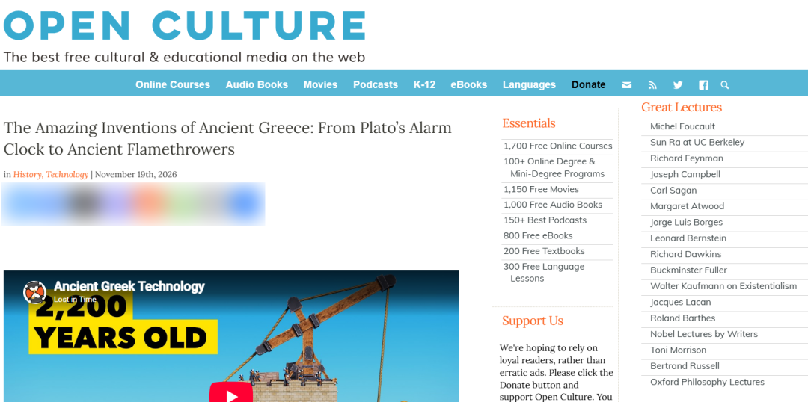
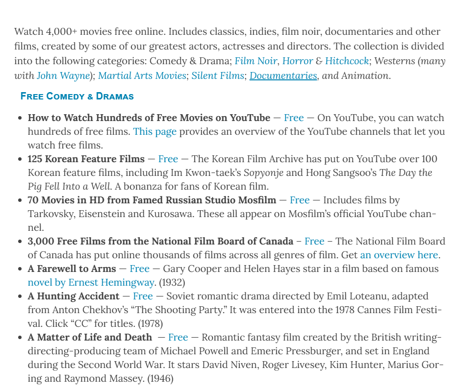

# 一个网站，免费看4000+部电影和1000+门世界名校公开课
> 💡 备注属性未写入，可能是备注属性名称或者类型被修改了，建议将字段类型设置为 rich_text，可以在小程序-操作-修改文章数据库页面进行调整
> 💡 原文链接:[https://mp.weixin.qq.com/s?__biz=Mzg5NTA4MzQzNA==&mid=2247491346&idx=1&sn=aab780fa803d0981f290fdf51de0bb09&chksm=c1461f598896573b6a59467532b2da623a1f841d1d9f8a40f9ad9ed816babc2e14e309d6d04d#rd](https://mp.weixin.qq.com/s?__biz=Mzg5NTA4MzQzNA%3D%3D&mid=2247491346&idx=1&sn=aab780fa803d0981f290fdf51de0bb09&chksm=c1461f598896573b6a59467532b2da623a1f841d1d9f8a40f9ad9ed816babc2e14e309d6d04d#rd)
同名朋友圈更多英语资源
先问大家一个问题：
如果你浏览器里只能留下一个网站，它得同时满足——能看电影、能听世界名校公开课、能听有声书、能学英语，还不用花一分钱，你会选哪个？
真的有这样的网站？
没错，它就是 Open Culture（开放文化）。
网址：https://www.openculture.com
网站的介绍很霸气：
> "The best free cultural & educational media on the web"
> 
——互联网上最好的免费文化与教育媒体。

一位斯坦福老师的理想主义
Open Culture 由斯坦福大学继续教育项目的 Dan Colman 在 2006 年创办。到今天，它还在日更——没有会员、没有广告、没有“开通 VIP 解锁剩余内容”。
成立近20多年来，Open Culture 全网搜罗优质教育资源，为你寻觅所需的免费课程、有声书，以及你想要的语言课、教育影片，其间还有诸多启智内容。
哪些大学上线开放课程、哪些电影进入公版期、哪个档案馆公开了绝版杂志、哪位学者上线了公开课——它都替你翻出来、分好类。
在这个看什么都要开会员的年代，Open Culture 就像一间不打烊的免费图书馆，这多少有点理想主义。
4000+部免费正版电影
网站最吸引人的可能是，是4,000+部免费电影。

经典片、独立电影、黑色电影、西部片、默片、纪录片、动画片……按类型分好类，每部都标明来源——包括公版电影和版权方官方放出的免费资源。
比如，卓别林作品，希区柯克早期英国作品，100 多部韩国老电影……更多老电影，大家可以自己去探索。
不用开会员，不用担心侵权，点开就看。
有电影，更能“听课自由”
对自学的人来说，Open Culture 更像一所没有围墙的大学。
1,700 门免费公开课，覆盖文学、历史、哲学到计算机、物理、生物，来源包括耶鲁、MIT、哈佛、牛津、北京大学等，可按学科浏览。
不想看视频？还有 1,000 本免费有声书和 800 本免费电子书。
马克·吐温、托尔斯泰、海明威、奥威尔、尼采、简·奥斯汀、莎士比亚……经典名著，名人朗读。
想学外语？网站有免费的语言课，涵盖英语、西班牙语、中文等45+种语言，多数配有文本，可以边听边读。
还有优质的播客和K12教育资源。
### 日更推文开“盲盒”
Open Culture 每天更新的文章仿佛是知识盲盒：
- 柏拉图的“闹钟”到底怎么工作：一套靠水流触发笛声的古希腊装置；
- 黑泽明的导演天才被拆成一支视频，斯皮尔伯格、斯科塞斯、卢卡斯都在夸他；
- 博尔赫斯参与编剧的 1969 年阿根廷科幻黑色电影《Invasión》，全文可看；
- 1938 年达利见弗洛伊德，竟改变了弗洛伊德对超现实主义的看法；
- 特洛伊出土的一支 2800 年前骨笛，可能和荷马生活在同一个时代；
- 用 3D 动画，看首尔 6500 年的城市演变……
网站无需注册即可使用，快收藏起来，总能学点东西的。
**推荐阅读 **
[**免费资源：百部BBC纪录片和TED演讲**](https://mp.weixin.qq.com/s?__biz=Mzg5NTA4MzQzNA%3D%3D&mid=2247487965&idx=1&sn=13e2149e5245189b3e8b6d2f34e984e3&scene=21&token=1282683642&lang=zh_CN#wechat_redirect)
[分享一个雅思备考网站，免费内容够用了](https://mp.weixin.qq.com/s?__biz=Mzg5NTA4MzQzNA%3D%3D&mid=2247491229&idx=1&sn=0181626afb86015649b31c07f642fac3&scene=21#wechat_redirect)
[分享一个免费学英语的工具，用英文片段练听力、口语](https://mp.weixin.qq.com/s?__biz=Mzg5NTA4MzQzNA%3D%3D&mid=2247490996&idx=1&sn=fc191079bfdf070246c60e6a96a90686&scene=21#wechat_redirect)
[推荐一个雅思主办方出的儿童英语网站](https://mp.weixin.qq.com/s?__biz=Mzg5NTA4MzQzNA%3D%3D&mid=2247490597&idx=1&sn=f2d88d5c6a5bd4583b2ef49de29e4f2e&scene=21#wechat_redirect)
[推荐一个免费、可下载的英文原著网站](https://mp.weixin.qq.com/s?__biz=Mzg5NTA4MzQzNA%3D%3D&mid=2247490524&idx=1&sn=af5ff099e0ac1cb27b605e1e6145a071&scene=21#wechat_redirect)
[推荐一个免费的分级英文新闻网站，好看！](https://mp.weixin.qq.com/s?__biz=Mzg5NTA4MzQzNA%3D%3D&mid=2247490241&idx=1&sn=2ce86d0cdfa48736d480b22232efbc06&scene=21#wechat_redirect)
[挖到一个宝藏工具：搞翻译、考CATTI、备考研的人不能错过](https://mp.weixin.qq.com/s?__biz=Mzg5NTA4MzQzNA%3D%3D&mid=2247490015&idx=1&sn=f892510cdde054d6ceb787816fdf98c9&scene=21#wechat_redirect)
[推荐一个历年高考真题试卷汇总，建议收藏！](https://mp.weixin.qq.com/s?__biz=Mzg5NTA4MzQzNA%3D%3D&mid=2247489988&idx=1&sn=d3ed87cc71df7795fbe072e18be0ecfc&scene=21#wechat_redirect)
[The Week Junior 2025合集！读完词汇量提高到10000+！](https://mp.weixin.qq.com/s?__biz=Mzg5NTA4MzQzNA%3D%3D&mid=2247489439&idx=1&sn=fd5bad3011ffd61e44fe7b1fa1fb0c80&scene=21#wechat_redirect)
[2025合集！6分钟英语，音频+文本+练习](https://mp.weixin.qq.com/s?__biz=Mzg5NTA4MzQzNA%3D%3D&mid=2247489405&idx=1&sn=e60195990d54ca115d6414063d1f8114&scene=21#wechat_redirect)
[**推荐「中华文化英文知识库」，这个英语学习利器太全面了！**](https://mp.weixin.qq.com/s?__biz=Mzg5NTA4MzQzNA%3D%3D&mid=2247487802&idx=1&sn=3a6eed031eefec7992f5850fc46a26df&scene=21#wechat_redirect)
