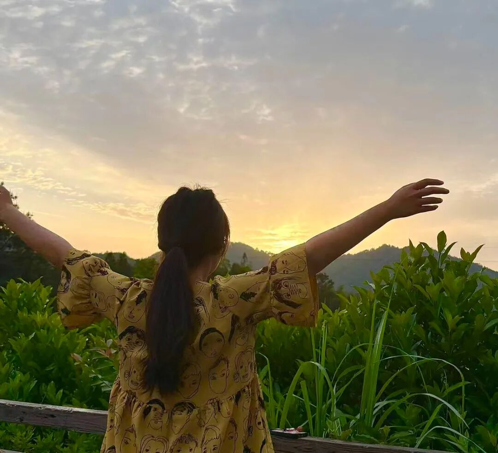
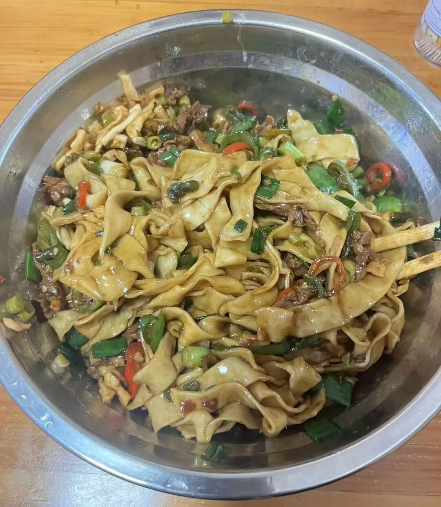
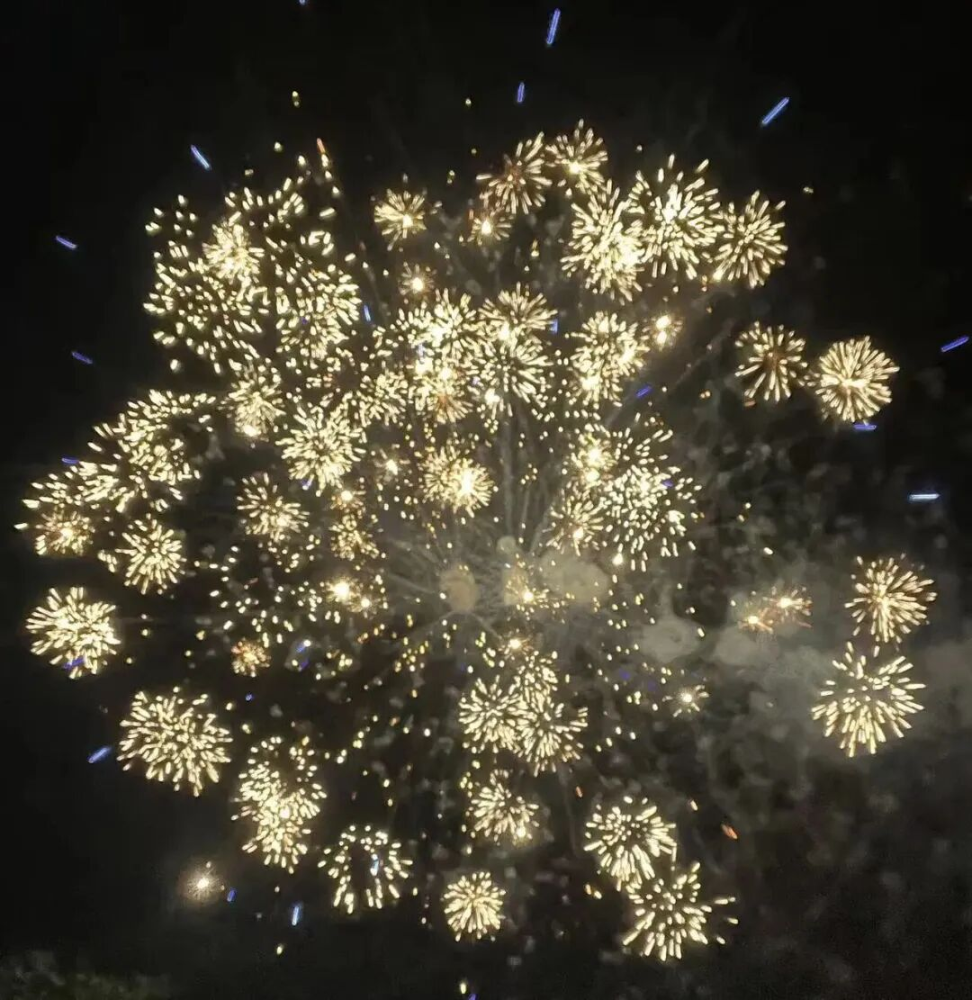

# 一周可视化｜清晰感是记录出来~
> 💡 备注属性未写入，可能是备注属性名称或者类型被修改了，建议将字段类型设置为 rich_text，可以在小程序-操作-修改文章数据库页面进行调整
> 💡 原文链接:[https://mp.weixin.qq.com/s?__biz=MzE5ODQxOTk3Nw==&mid=2247485111&idx=1&sn=486b08741b72403343d3e7edefe5e93f&chksm=97e04abfabd311f589ce1f160afaceb163b9596a0285d72fcf949863e385c265f5e5c4ceea01#rd](https://mp.weixin.qq.com/s?__biz=MzE5ODQxOTk3Nw%3D%3D&mid=2247485111&idx=1&sn=486b08741b72403343d3e7edefe5e93f&chksm=97e04abfabd311f589ce1f160afaceb163b9596a0285d72fcf949863e385c265f5e5c4ceea01#rd)
点击上方蓝字【-三冬-07】关注我
设为星标不错过我们的见面

阅读 | 写作 | 赚钱 | 运动 | 复盘
对比前一周的周复盘，这一周的✅明显多了很多，对于计划的安排、执行更从容自如了，这不就是周复盘可视化的具象成效吗？
这是10月的第4周，
提前知道这周会有团建、周末要回老家，所以在定本周计划时，就给自己降低了目标值，所以这周还是能有条不紊地执行本周计划，没有内耗，只有成就感和超额完成的意外之喜。

**本周总结：**
睡眠：这周的睡眠不太好，主要还是那该死的蚊子，连续两个晚上，不是在我耳朵边上吵，就是咬得我满手是包。秋天的蚊子简直是成精了，专门只在我耳朵边上嗡嗡叫，我一开灯想拍死它，它就飞得没影了。
饮食+体重：这周末回了趟老家，在家吃三餐，回来一称，又重3斤，上个月白干了😂
运动：这周的运动主要以上下班步行为主，还有周五下午团建运动了一会，第二天全身酸痛。
工作：总算在这个月的倒数第二个工作日把工资发下来了，不容易呀，这公司，从我入职到现在就没准时发放过。
阅读：每天都坚持安排10分钟阅读，加油。
备考：本周投入时间比较少，下周还得加油补回来。
账单：本周开销286.12，这周的花销大部分就是用来日常吃饭和充话费了，在外面和同事吃了两顿，其中有一次同事带我去了一家巨贵的面店，一碗面的最高价格是71元，我没敢点，只点了一个中等价位的，32元，也挺奢侈的，这也是我吃过得最贵的面了。

**本周不开心的事情：**
周二晚上二楼又有人一直在关门开门，搞了一会，我们这屋的另外一个租客小姐姐找了我发小反馈这个事情，希望我发现能去业主群说一下，然后今天一早7点多，我发小就截图那个小姐姐的微信记录发给我，问我有没有这个情况，我说有，因为我上次也和她说过，然后我后面还说要么是在吵架，要么是有抑郁症。结果她就把我和她说的话全部都截图发给了2楼的房东，并且还不给我的名字打码，因为她是给我备注了我的真名。她发那个小姐姐的聊天记录给我时，是只截了小姐姐的头像和那段话，并没有把人家的名字截出来，说明她是有“保护他人隐私”的意识。可到了我这，就把我的真名都截出来，并且还特意把我最后那一句猜测也截图出来，生怕别人看到了不和我起冲突。我当时还去她房间和她面对面讨论分析了一会，我说有这种行为，肯定是情绪不稳定，她却还把我那句猜测截图发出去，我真的很想不通。
-
**本周开心的事情：**
周五下午和同事出去团建，我突破了i人属性，主动去唱了一首歌，嘿嘿，不容易。虽然晚上的游戏中一直被表演节目的恐惧所支配，但还是玩得很开心。

**下周计划：**
继续保持这个节奏，好好工作、好好生活；
希望能继续多掉几斤，争取下周把体重稳定到113以下；
下周又是新的一个月了，加油，继续努力。
感谢你看到这里，未来很长，一路相伴不孤单
我们一起成长一起加油！
