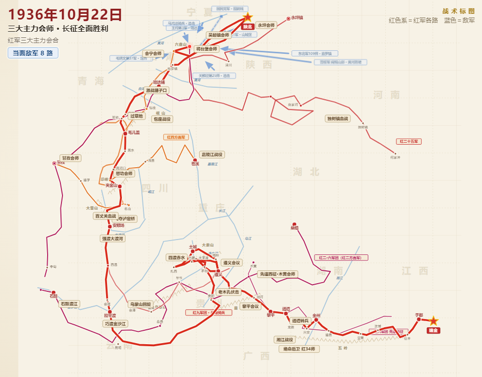

# 一图看清红军长征行军路线——敌我态势全程动态推演
> 💡 备注属性未写入，可能是备注属性名称或者类型被修改了，建议将字段类型设置为 rich_text，可以在小程序-操作-修改文章数据库页面进行调整
> 💡 原文链接:[https://mp.weixin.qq.com/s?__biz=Mzg5NDA4MTA4NA==&mid=2247484829&idx=1&sn=65c338d07ab10acb84a46d660b32be7c&chksm=c176be080de5aa704156849bc1c175323623c71189086e03bb6e6ae4b5c569ae8cea8ad31af7#rd](https://mp.weixin.qq.com/s?__biz=Mzg5NDA4MTA4NA%3D%3D&mid=2247484829&idx=1&sn=65c338d07ab10acb84a46d660b32be7c&chksm=c176be080de5aa704156849bc1c175323623c71189086e03bb6e6ae4b5c569ae8cea8ad31af7#rd)
平常，我们看到的红军长征线路图都是静态的，如下图：

静态图虽然标注的非常详细，但对于敌我态势的变化，也只能通过文献了解，看不到敌军的围追堵截，也看不出在敌军重重包围之下，红军的纵横捭阖、灵活机动。于是，我用AI帮助生成一份红军长征路线全景动态图。先 提出需求，AI先搜集史料，我检查，确保史料正确，然后规划实施，最后不断的修改 ——
仅是示意图，画面所限，无法面面俱到。请批评指正！（背景音乐由Ai制作）
