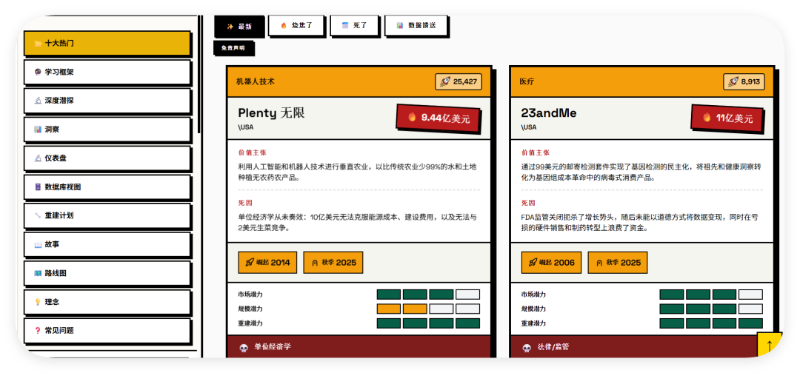
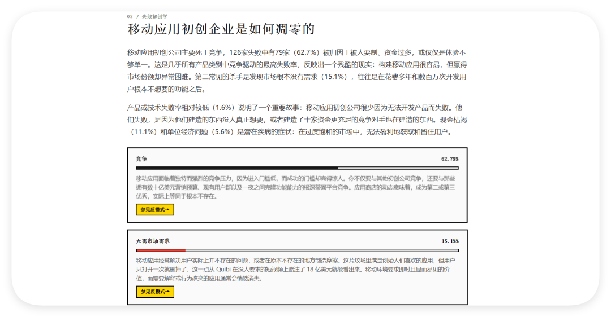

# 一天一个宝藏网站｜1749 家倒闭公司，死因全被写进了这个网站
> 💡 备注属性未写入，可能是备注属性名称或者类型被修改了，建议将字段类型设置为 rich_text，可以在小程序-操作-修改文章数据库页面进行调整
> 💡 原文链接:[https://mp.weixin.qq.com/s?__biz=MzcwODExMzgwNg==&mid=2247484238&idx=1&sn=546f29f219daf5e6a9a06bd30d3145db&chksm=f455de2796abc5d73cf59e13a0c97a1cbe219ccff7895d89270474c109428cbefbc7c2199647#rd](https://mp.weixin.qq.com/s?__biz=MzcwODExMzgwNg%3D%3D&mid=2247484238&idx=1&sn=546f29f219daf5e6a9a06bd30d3145db&chksm=f455de2796abc5d73cf59e13a0c97a1cbe219ccff7895d89270474c109428cbefbc7c2199647#rd)
前阵子有个朋友琢磨着要自己做产品，拉着我聊了一晚上，从功能想到推广，越想越起劲，就是从头到尾没提过：**现实前景怎么样，有借鉴别人的失败案例了吗？**
我后来想起一个网站，网友都称其为创业版“草船”，当别人都在晒融资、晒上线，它专门收已经死掉的项目，一家家把底档摊开，写明当初想干什么、钱烧到哪一步、最后倒在哪个病根上。
这就像古代史，好好利用我们真能在这“草船”上借箭。
这就是 Loot Drop，网址： loot-drop.io

打开首页，印入眼帘的创业墓地四个大字，会给人一点小震撼，然后是第一行扎眼的数字：**超过 1749 家**已倒闭的初创企业，背后是 **535.4 亿美元以上**的风险投资被烧成灰烬。
看到这表明创业的一个危险系数之高，引发了我的好奇，那就不得不进去好好探索一番了。
仔细看会发现网站每周二和周五还在往里添新的病例，底下分了 7 个失败反模式、22 个失败类别。你可以把它理解成一片创业墓地，但墓地里每块碑都写了验尸报告，并不是光摆个名字。

**点进去往下看，发现档案分得很细。**先是记它当初的价值主张——想解决什么问题；再记死因，也就是病根在哪；然后是崛起和倒下的时间；最后还估一估市场潜力、规模潜力和重建潜力。
这样一套下来分析的是明明白白的，堪比庖丁解牛。
比如机器人技术那一栏的 Plenty 无限，这是来自美国的一个公司，烧掉 9.44 亿美元，最后倒闭了。其产品本质上是用人工智能和机器人做垂直农业，想用少量的水和土地种无农药农产品。
**死因写得很直白**：单位经济学从来没跑通，10 亿美元压上去，也克服不了能源成本和建设费用，最后没法跟两块钱的生菜竞争。2014 年起步，2025 年秋季收场。

还想了解更仔细的话，**网站还有按产品类型开专题，单独把一类项目拎出来解剖。**
就拿移动应用这一栏说，126 次启动失败，90 亿美元资本被烧毁，平均寿命 4.2 年，头号杀手是竞争。在全站 1670 多家失败初创里，移动应用占了 126 家，其中通信服务类 71 家，消费类 26 家——最挤的战场，往往正是大家最想上场的地方，也是最容易出现问题的地方。

再往下翻我们就可以详细看到这些企业是如何走向失败的，**这里能看出一个反直觉的结论。**
第一是这 126 家移动应用里，79 家、占 62.7%，栽在竞争上：被对手压制、资金拼不过，或者体验不够单一。
**第二是根本没有市场需求，占 15.1%，往往是花了多年和几百万次开发，做出来用户并不想要的功能。**现金枯竭占 11.1%，单位经济问题占 5.6%。而产品或技术本身做不出来。
换句话说，多数公司不是死在造不出来，是死在造出来没人要，或者造得太挤、跑不出来。
这个网站有意思的地方，就是它不只让你看坟。每一家留下的空档、被验证过的需求和踩过的坑，都会被整理成重建方案：该做什么、市场怎么分析、分几步做、技术栈怎么搭、收入模型怎么收。说白了，残骸里还能用的东西，让后来者捡走重做。
这样对普通人也好，对想做点小项目的人也好，这个站的用处不只教你怎么创业，而是动手之前先看看前人交过的学费。它保证不了你能成，但至少能让你少踩几个已经标明位置的坑。
小编提醒
档案里的死因是别人踩过的坑，不是你项目的体检报告；重建方案也只是参考思路，不等于照着做就能成。真要动手，需求、成本和自己的账，还是得一项项算清楚。别拿一两个案例就下结论，也别觉得前人倒过的路，自己走一遍就能通。
你有没有想做又犹豫的产品？何不来这草船借箭一番呢？
