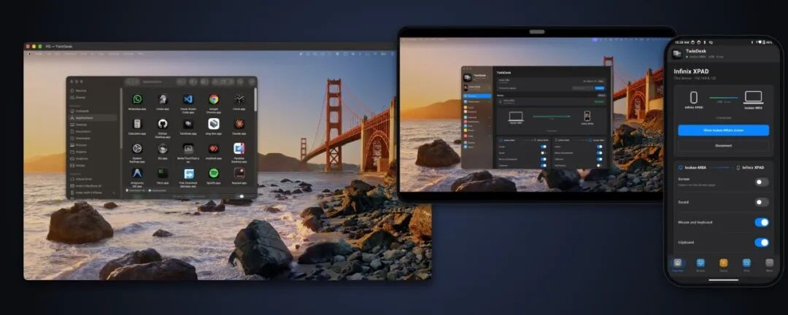

# 一套键鼠管所有设备，让你的 Mac、Windows、Linux 电脑和 Android 手机像一套设备那样协同工作
> 💡 备注属性未写入，可能是备注属性名称或者类型被修改了，建议将字段类型设置为 rich_text，可以在小程序-操作-修改文章数据库页面进行调整
> 原文链接:[https://mp.weixin.qq.com/s/vYsMJJW0O31FITU0jrutKg](https://mp.weixin.qq.com/s/vYsMJJW0O31FITU0jrutKg)
TwinDesk
> “
> 一个免费开源的软件，能让你的 Mac、Windows、Linux 电脑和 Android 手机像一套设备那样协同工作。不用注册账号，不经过云端，甚至不需要连同一个 Wi-Fi
> 
Github地址
**https://github.com/InukaAsith/TwinDesk**

功能特性
 一套键鼠管所有设备，文件一拖就过去，手机来电电脑接，还能把手机摄像头当电脑摄像头用。
- 键鼠共享：鼠标从 Mac 屏幕边缘滑出去，直接进到 Windows 电脑里继续用，键盘跟着走。按 Scroll Lock 可以锁住光标不让乱跑。
- 传文件：直接拖过去，或者复制粘贴，图片也能传（10MB 以内）。
- 手机当摄像头：手机前后摄像头变成电脑的视频源，Zoom、Teams、腾讯会议都能直接调用。
- 手机变遥控器：躺沙发上用手机当触控板操作电脑，或者虚拟游戏手柄（Windows 上识别成 Xbox 手柄）。
- 手机功能搬到电脑：接打电话、收发短信、看照片、管文件，都在电脑上完成。手机响了不用到处找。
- 多屏扩展：旧平板当副显示器用，或者单独开某个安卓 App 的窗口。
- Mesh 模式（测试版）：三台以上设备同时在线，鼠标横跨所有屏幕，剪贴板全局共享。
怎么连上
1. 各设备去 GitHub 下载对应版本安装
- Mac（M1/Intel）、Windows（x64/ARM）、Linux（AppImage/deb/Arch）、Android APK
1. 打开软件，设备自动发现附近同伴
1. 比对配对码（USB 连线的话点允许就行）
1. 需要哪个功能去对应标签页打开开关
连接方式： 同个 Wi-Fi 最快；没网就用蓝牙；传大文件自动切 Wi-Fi Direct；插 USB 线延迟最低（不到 10ms）。手机开热点的话电脑一键连上，密码记住下次自动连。
隐私方面： 端到端 TLS 加密，数据不过第三方服务器，就更新时查一下 GitHub 有没有新版（可以关掉）。
