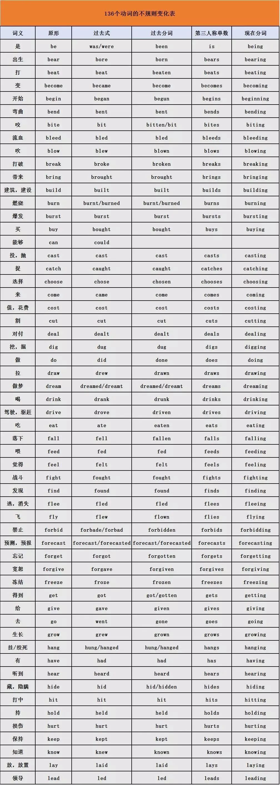
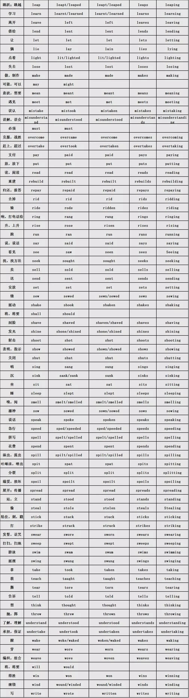

# 一张图牢记136个英语动词的不规则变化！
> 💡 备注属性未写入，可能是备注属性名称或者类型被修改了，建议将字段类型设置为 rich_text，可以在小程序-操作-修改文章数据库页面进行调整
> 💡 原文链接:[https://mp.weixin.qq.com/s?__biz=MzU4NjE2MzczMg==&mid=2247486067&idx=1&sn=809ccc1e209b075854ca3072d0e76e92&chksm=fc0b9fe7ec07ce140b8e6c00a59152d52471497b922f1b56882e07913622e91e6060474743a5#rd](https://mp.weixin.qq.com/s?__biz=MzU4NjE2MzczMg%3D%3D&mid=2247486067&idx=1&sn=809ccc1e209b075854ca3072d0e76e92&chksm=fc0b9fe7ec07ce140b8e6c00a59152d52471497b922f1b56882e07913622e91e6060474743a5#rd)
还在死磕英语不规则动词变化吗？
这份汇总整理了136个高频不规则动词，清晰罗列原形、过去式、过去分词、三单和现在分词。
表格排版直观好查，不用来回翻课本。初中、高中备考都能用，建议保存打印出来，利用碎片时间反复巩固，轻松攻克语法难点，考试少丢分！

