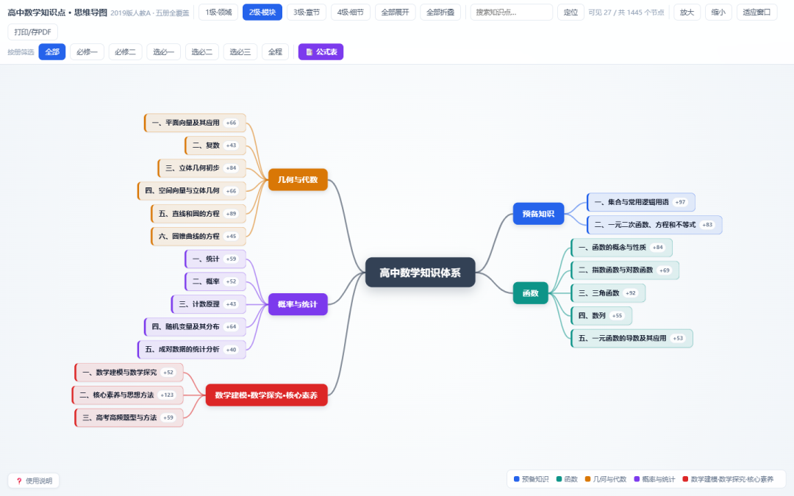
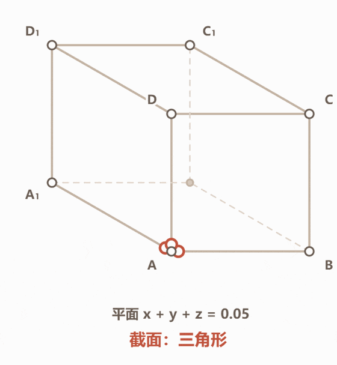
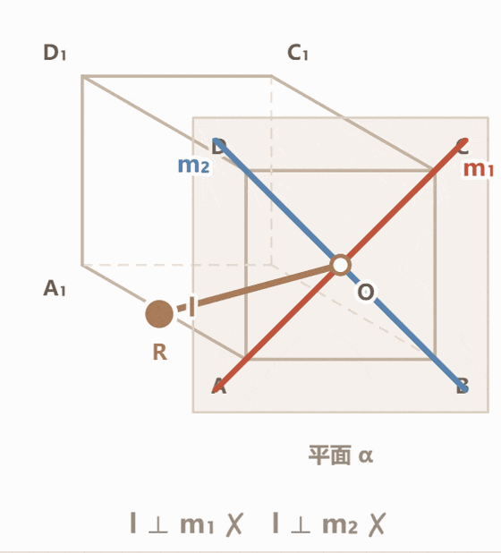
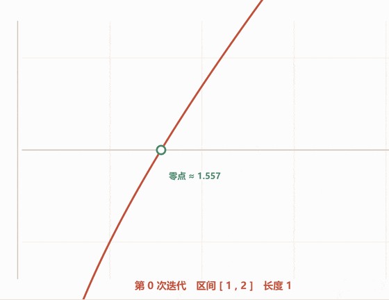
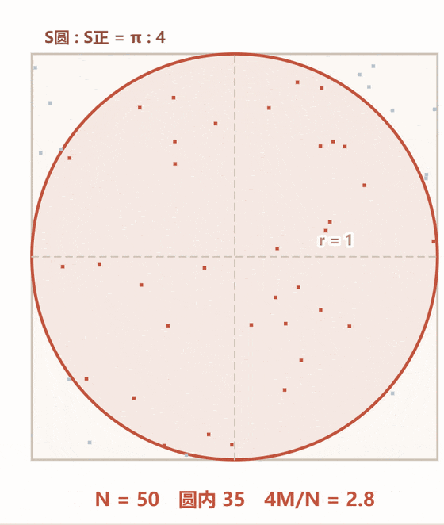

# 一张导图 + 52 个会动的模型：高中数学，孩子真的可以自己学
> 💡 备注属性未写入，可能是备注属性名称或者类型被修改了，建议将字段类型设置为 rich_text，可以在小程序-操作-修改文章数据库页面进行调整
> 💡 原文链接:[https://mp.weixin.qq.com/s?__biz=MzY5OTQzODc5Nw==&mid=2247483985&idx=1&sn=b7e873d56d28fac362123a45fc0346a2&chksm=f5049b5a1f5185a9d4f6a5fdbb0b4b80aede230919e403988778356bd15ee6eb26ee1a613e7e#rd](https://mp.weixin.qq.com/s?__biz=MzY5OTQzODc5Nw%3D%3D&mid=2247483985&idx=1&sn=b7e873d56d28fac362123a45fc0346a2&chksm=f5049b5a1f5185a9d4f6a5fdbb0b4b80aede230919e403988778356bd15ee6eb26ee1a613e7e#rd)
一张导图 + 52 个会动的模型：高中数学，孩子真的可以自己学
带过一些学生之后，我发现一个特别普遍的现象。
孩子的定理背得滚瓜烂熟。比如"线面垂直的判定定理"——一条直线与平面内两条相交直线都垂直，这条直线就与这个平面垂直。一个字不差。
但题目里那条线是斜着的，那个平面也是斜着的。他盯着图看了半天，笔不动。
你问他定理呢？他说：背出来了。
你问他为什么不动笔？他说：
**想不到。**
这篇文章，就说说怎么把"想不到"这三个字，一点点拆掉。
先补一句前面的话：导图给的是一张网
之前写过一篇思维导图的文章。做那张导图的起因很简单：我带过的孩子里，大多数卡住不是因为题难，而是因为
**不知道这道题在考哪一节**
。
知识点在他们脑子里是一堆散的点。函数是一章，导数是一章，不等式又是一章。平时上课一章一章往下走，感觉都会；一到考试，题目把三章的知识揉在一起，他就懵了。
所以第一样东西，是那张高中数学思维导图：1445 个知识点、229 条公式，按人教新教材的章节，织成一张网。

高中数学思维导图：1445 个知识点织成一张网
它管三件事。
**第一，定位。**
 错一道题，顺着网往回找，能找到具体是哪一节的哪个点漏了。孩子对自己的判断，就从"我数学不好"，变成"我立体几何的判定这块有洞"。前者是情绪，后者才能修。
**第二，串联。**
 网织起来之后，跨章节的线自己冒出来：函数的图像、导数的符号、不等式的解集，其实是一条线上的三站。单看每一章都懂，连起来才算真懂。
**第三，考前自查。**
 229 条公式摊开，像一张体检单：哪些背熟了，哪些眼熟但写不出来，一目了然。复习不再是"把书翻一遍"，而是"把没亮的格子补上"。
一句话总结导图的价值：它让孩子回答得出——
**"这道题在考什么。"**
但用着用着，我遇到了一个新问题。
网是联动的，可题目是立体的
回到开头那个孩子。他顺着导图定位到了：这题考"线面垂直的判定"，在立体几何那一节。定位很准。
然后呢？
判定定理他也会背。但那个定理描述的其实是一个
**动作**
：一条直线，要"立"起来，立到和面内两条相交的线都垂直。这个"立起来"的过程，他脑子里没有画面。
纸上的图是印死的。他缺的不是"知道考什么"，是
**脑子里转不出那个画面**
。
这一步，讲十遍，不如让他自己动一次手。
于是有了第二样东西：52 个会动的模型
我又做了一样东西，叫
**《一拖就懂的数学》**
：52 个会动的模型，覆盖高中数学 13 个大领域，函数、三角、立体几何、圆锥曲线、导数、概率统计都在里面。
每一个都能拖。拖一下，图就跟着变，屏幕上的角度、长度、读数实时跟着跳。
随便说几个画面。
**正方体的截面。**
 拖动一个滑块，切面从一个小三角形，长成四边形、五边形，最后停在漂亮的正六边形。"截面最多是几边形"这种以前全靠想象的题，现在他亲眼看着它"长"出来。

动图：正方体截面从三角形一路长成正六边形
**线面垂直。**
 把那条斜着的线一点一点立直，旁边的读数从 45°、60° 一路变过去，89.4°✓、89.7°✓，最后"结论"那一栏，"垂直"两个字变绿。判定定理不再是需要背的一句话，而是他亲手拉到位的一个瞬间。

动图：把斜着的线一点点立直，两条读数打勾，结论变绿
**二分法。**
 每按一次，区间对半砍。砍 14 次之后，区间长度只剩 0.00006，零点在屏幕上"自己冒出来"。"逼近"这两个字，他以前只是在书上见过，现在是真的看见了。

动图：每按一次区间对半砍，14 次后零点自己冒出来
**蒙特卡洛。**
 往正方形里撒 6000 个随机点，用"落在圆里的比例"反推 π。撒到 6000 个点的时候，屏幕上算出 π ≈ 3.1427，误差 0.03%。"频率稳定在概率附近"这句话，概率这一章从此不用背，他亲眼看过它发生。

动图：往正方形里撒点，撒到 6000 个，π 自己浮出来
模型看懂了，还有知识点不清楚的就可以——"在思维导图中查看该章节"。知道这个模型长在哪根树枝上。
**网负责"知道考什么"，模型负责"看见为什么"，两边是咬合的。**
两样东西放在一起，孩子到底变了什么
"自主学习能力"这个词，说出来挺空的。落到具体的事上，是三个变化。
**一，他从"等讲"变成了"自己找答案"。**
 以前卡住了，第一反应是问老师、翻答案。现在卡住了，他会先去导图上定位"这是哪一节"，再把对应的模型拖出来，自己看着它动一遍。多数时候，不用谁开口，他自己就看通了。
**二，他从"背结论"变成了"看过程"。**
 背下来的结论，考试一紧张就碎；亲眼看过怎么来的结论，碎了还能自己拼回去。因为他记住的不是那句话，是那个画面。
**三，他敢试错了。**
 滑块拖错了没关系，再拖回来就是。数学第一次变成一个可以随便折腾的东西，不怕错，才敢想。孩子的提问都变了：以前是"这题考什么"，现在会问"我再拉一点会怎么样"——问题换了方向，这就是开窍的迹象。
家长这边的变化也很具体：
**不用会辅导，也不用盯着。**
 孩子自己拖一拖、看一看、再回去做题。你只需要在他弄懂之后说一句"你给我讲讲为什么"——能讲出来，就是真懂了。
这两样东西，其实是有顺序的
说到这儿，我得把一件事讲在明面上：
**它们不是并列的两样，是有先后的。**
分开看，各自干的活很清楚。
**思维导图，是帮孩子找到"哪里不会"。**
 一道题错了，顺着网往回找，能找到具体是哪一节的哪个点漏了。它给的是坐标。
**会动的模型，是把"想不出来"的题立起来。**
 那些抽象的、在纸上怎么也想象不出的题，拖一拖，角度长度跟着变，画面就在脑子里站住了。它给的是立体感。
但顺序不能反。
如果你现在是冲着模型来的，我的建议是：
**先把导图拿到手，再上模型。**
原因很实在——模型是"点"上的深入，它不会告诉你自己长在哪一章、和别的知识是什么关系。孩子手里没有那张网的时候，看模型的第一反应往往是"好玩、好看"，拖完了还是不知道这跟今天做的题有什么关系。
**只有已经知道整个体系在讲什么，一个模型才能真正嵌进他脑子里，而不是看过就忘。**
导图是地基，模型是往上盖的那一层。地基不在，盖得越高，越晃。
所以这不是我非要搭着卖，是这两样东西本来就是这个关系：
**先知道在哪，再看见为什么。**
最后说句实话
我不想把这套东西说成神器。该背的公式还得背，该刷的题还得刷，工具替代不了做题本身。
它只做一件事：
**把"想不到"变成"看得见"。**
看见之后，再去做题，那些定理就不再是纸上的黑字，而是他脑子里能自己转起来的东西。
最后说一件跟钱有关的事。
**体验版以前是免费发的，从这篇起，我改成 9.9 元。**
先说为什么。
免费的时候，来问的人多，我一份一份发、一句一句回，真正想给孩子用的人，反而被我耽误了。再说得直白一点——太容易得到的东西，多数人拿回去不会真的打开。
9.9 不是为了赚这个钱，连一杯奶茶都不够。它只是一道门槛，帮我筛出真正想给孩子试一试的人。
**愿意花这 9.9 的，我大概知道你是认真的；愿意为这 9.9 跟我聊两句的，我也更愿意把时间花在你身上。**
想给孩子试的，不用在后台等了——
**直接扫下面的二维码加我微信**
（这是我另一个手机号在用的号，专门用来跟家长聊的），加的时候说一声"体验版"，转我 9.9，体验版当天就发。

扫码加我微信，备注「体验版」
觉得不值这个价的，这次就先别加我——把话说明白，咱们彼此都省点事，不耽误你，也不耽误真正想用的孩子。
（另外说清楚：体验版是完整版里的一小部分，免激活、能长期用，就是内容少。想直接拿完整版的，两样都在我这儿，还是那句话——先有导图，再挑模型。）
—— 完美宝宝
