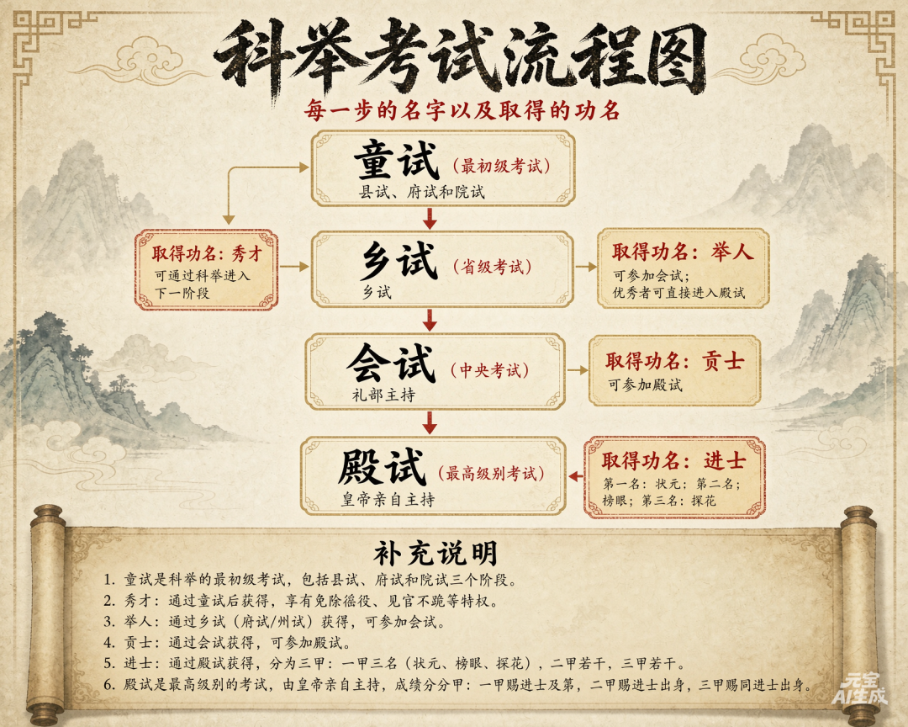

# 一文说透中国科举考试
> 💡 备注属性未写入，可能是备注属性名称或者类型被修改了，建议将字段类型设置为 rich_text，可以在小程序-操作-修改文章数据库页面进行调整
> 💡 原文链接:[https://mp.weixin.qq.com/s?__biz=Mzk5MDI4ODQ1Nw==&mid=2247483816&idx=1&sn=a7fcba91f151523b9276d236074d1f92&chksm=c47484c36b4a6764559420170cd294789f2d65b449960ef8eab63b34624d59cf2987468d643b#rd](https://mp.weixin.qq.com/s?__biz=Mzk5MDI4ODQ1Nw%3D%3D&mid=2247483816&idx=1&sn=a7fcba91f151523b9276d236074d1f92&chksm=c47484c36b4a6764559420170cd294789f2d65b449960ef8eab63b34624d59cf2987468d643b#rd)
我们从小就从各处都在说科举制度腐朽，主要是禁锢士人思想，那么科举制度到底是如何进行的？科举制度始于隋朝，1905年清廷废除科举，这项延续一千三百余年的选官制度正式落幕，为何其考试选才理念仍对后世及世界公职体系当今又被褒奖？
## 01
—
## 起源与发展历史
科举制度起源于隋朝，具体是由隋炀帝确立的，也就是我们历史书上批判的骄奢淫逸的那个隋炀帝。科举制度主要是为了解决为国选拔人才的问题，决定谁来做官来管理国家的问题，那就要说一说隋以前的选拔制度了。隋以前主要是推荐制度，汉代以前商周先秦主要是世袭制度，看血统，造就了阶级固化，汉代时候采用察举制，也就是推荐加考察模式，最出名的就是举孝廉，有名的孝子黄香就是这样入仕，官至尚书令，魏晋南北朝时期采用九品中正制，也就是中央给一定的标准打分，还是由地方推荐。
这种推荐制的弊病就是豪门肯定推荐自己家族的人，到后期就形成了各种豪门望族，如刘禹锡诗写的“旧时王谢堂前燕，飞入寻常百姓家”中的王氏和谢氏就是百年望族。隋以前的这种推荐制度一方面阻碍了真正的人才为国所用，另一方面导致了门阀世族出现威胁皇权的统治，所以才在隋朝确立了相对较为公正的科举制度，且一直延续千年，同时也成为现今世界的主流，像欧美国家的德国美国等也都是公务员录用都要考试。大家印象中欧美国家都是选举，其实是不对的，像英法美这些国家是选举加考试的双模式，选举产生的是掌权人，比如国家元首、内阁以及议会成员等，普通技术官僚是要考试的，比如普通行政、海关、税务、邮政、公共事业等公职人员。
所谓科举二字，就是分科推举的意思，类似我们现在考大学文科理科艺术科类似，比如明法科就是选拔法律人才，明算科选拔数学人才，至于我们最熟悉的进士科就是考诗赋策论，看起来是不是还是很科学的。那什么时候变成了我们经常听说且被诟病的八股文呢？废除各科统一考进士科源自北宋王安石改革，主要原因呢，一来进士科一直是主流，其他科选拔的人才都是专业技术人才，普遍干的都是下层吏的，不能出任各级行政长官，出路有限，生源慢慢的就少了；二来王安石觉得那些科偏重死记硬背，缺少时务策论能力，三来呢，在儒学之国的背景下，国家认为精通儒家经义，懂得仁义礼法，就可以统领一方。四来呢，也是比较重要的一个因素六科并行，科目太多，考法、教材、考官体系都不一样，礼部管理负担很重。
后来到了明朝初年，一方面要加强思想统一，强化皇权，因为元末社会思想纷乱，朝廷要确立程朱理学为官方正统意识形态，四书五经以朱熹注解为唯一标准答案，强制要求 “代圣贤立言”，考生不能抒发个人见解。第二个方面，唐宋科举文体自由，策论、诗赋文体五花八门，文章风格差异极大。考官个人喜好对分数影响极强，容易出现主观判分、徇私偏袒，还容易形成考官和考生的门生派系。八股有固定的篇章结构、对偶格式、字数范围，格式上规定破题、承题、起讲、入手、起股、中股、后股、束股 8 个内容，所以叫八股文，其实我们以前高中做议论文作文也是有类似的套路。
八股文到底要不要才华？那是必须要的，八股文虽然不能随意发挥个人思想，但是依旧考察逻辑思辨能力，层层递进，说理透彻周密，同时要求文字功底也要强，能够引经据典，对仗工整，所以明清能考上进士的绝对不是书呆子，靠死记硬背肯定是不行的。为什么后代一直诟病八股文，其实主要原因还是在于晚清随着世界科技的发展，国家比历史任何朝代都需要工程师、外交官、军事家、实业人才、法务人才这样的现代化人才，挽救国家于来自工业国家的冲击，而旧科举培养的文人官僚，不仅无法推动国家近代化，反而因守旧迂腐阻碍洋务改革、抵制新学，成为时代进步的阻力。所以 1905 年，清廷正式颁布上谕，停止所有乡会试、各省岁科考试，延续 1300 余年的科举制度彻底终结。
## 02
—
## 考试过程及难度
科举制度经过隋唐发展到明清已经成熟，我们以明清时代的科举聊一聊考试过程及其难度。科举考试分为三级，基本如下图：

第一级就是所谓的考秀才，也叫童子试，需要经过县试、府试、院试三级，逐层淘汰，县试一般由县令主持，府试相当于市级考试，由知府主持，通过后参加由中央学政巡考官主持的院试，通过后才授予 “秀才”，这个时候就已经脱离普通平头百姓了，有了功名。一个州县的童生常年有数百甚至上千人，而每届院试录取的秀才仅数十人，整体录取率不足 5%，难度相当于今天高考考上 985 院校吧。考上秀才之前的身份叫 “童生”，很多士子寒窗苦读数十年，始终卡在童生阶段，无法考取秀才，这也是古代 “老童生” 遍地的核心原因，比如清朝著名的曾国藩，其父亲一次考了 17 次童试，43 岁才考上秀才，而且还是几百年来家族第一个考上秀才的人。考上秀才后就晋级士绅阶层，区别普通百姓就有很多特权，政治上见官不跪、不能随意用刑，最重要的是经济上免除徭役杂差。明清百姓最大负担不是田赋，而是徭役，平民为躲避沉重徭役，会主动把土地挂靠在士绅名下，这样就为士绅兼并土地提供了天然便利。秀才是没有做官资格的，大多做的是去私塾当老师，做师爷幕僚，管理乡土事务（官府有事时会找来他们牵头负责）。
想要做官，就要继续考第二级，乡试了。乡试相当于省级统考，每三年考一次，一般在省会，明清固定在 8 月，所以也叫 “秋闱”。乡试的淘汰率就高了，整体录取率仅 1%-3%，明清时期，全省应试秀才动辄数千人，各省每届乡试录取举人名额固定，大省百人左右，小省仅数十人，难度比今天考清华北大还要高很多，同时好处肯定是比考上清华北大要多，考上举人就有了做官的资格了；所以范进 54 岁中举，高兴的疯了，放在你身上也可能会疯。再例如我们课文中出现的明代三个才子之一的徐文长（徐渭），20 岁就中秀才了，8 次乡试落第，终身未中举。举人有了做官资格，但是不等于一定能做官，因为举人做官要靠等，就是候补，等哪里有空缺才有机会被任命。当然了，历史上以举人身份入仕，取得较高成就的也很多，最著名的就是明朝的 “海青天” 海瑞，还有就是晚清收复新疆的著名的重臣左宗棠多次会试不中，以举人身份做幕僚开始仕途的。
第三级别就是中央礼部主持的在京城举行的会试，一般在乡试后的第二年的春天，所以也叫 “春闱”。会试是全国精英的终极博弈，竞争激烈程度可想而知，很多在本地成为天才的人都在会试中屡次不中。会试通过后叫 “贡士”，此时还不叫进士，之所以说是终极博弈，是因为后面的殿试原则上不淘汰人，只是个排名赛。之所以叫殿试，是因为由皇帝亲自主持，明到清初在太和殿举行，皇帝出题考治国大事，前十名送皇帝亲阅，批示前三名，状元、榜眼、探花，排名分为 3 等，如下：
一甲 3 名：赐进士及第 → 状元、榜眼、探花
二甲若干：赐进士出身
三甲若干：赐同进士出身
这个时候就正式进入了官员的序列了，最差也是个县令（县委书记 + 县长 + 政法委书记），此时可以光宗耀祖了。考中进士有多难？每届全国应试举人数千人，最终录取进士仅三百人左右，录取率不足 10%，综合从童生到进士的全流程，千年科举的整体上岸率仅有千分之一左右，清朝统计中进士平均年纪 35 岁，50 岁以上中进士也不算怪事。当然也有天才，这就跟我们考试时候，不管多难的试卷，总有那么几个人能拿到变态的满分，如唐宋八大家的苏洵所说“莫道登科易，老夫如登天。莫道登科难，小儿如拾芥”。苏洵跟两个儿子苏轼苏辙（3人都是唐宋八大家）一起考试，终身都没考中，但是苏轼苏辙都是一次考中举人，次年中进士，而且都极其年轻，苏轼22岁，苏辙19岁。明清时候天才选手大概有明代三大才子之首的杨慎（写《临江仙》滚滚长江东逝水的那位）24岁状元，他爹杨廷和更厉害12岁中举，19岁中进士；另外嘉靖年间电视剧中大家都比较熟悉的徐阶24岁探花，高拱21岁进士，张居正23岁进士，也难怪政治斗争激烈，都是神仙打架。此外，乡试第一名叫“解元”，会试第一名“会元”，殿试第一名“状元”，同时三阶段都是第一名，叫“连中三元”，历史上有记载的明清连中三元者，明清各2人。
最后，考进士抛开读书的苦外，去参加考试的过程也苦。为什么叫 “春闱”、“秋闱”，“闱，宫中之门也”，以前贡院是封闭禁地，考试一启动，立刻锁门，隔绝内外，防止作弊。整个试院像一座关起门的宫室。以乡试、会试为例，一共考三场，每场三天两夜，每场中间休息一天，这强度已经很考验人了。再者，考试环境堪比坐牢，一人一间，大概 1㎡出头的小格子，三面墙，前面敞开，吃喝拉撒全在这里，成千的号舍连在一起，夏天中暑冬天受冻也很常见。此外，还要大多数考生还要跋山涉水几百上千公里去京城赶考，有些还没到地方就因为疾病、土匪等突发事故死亡。
