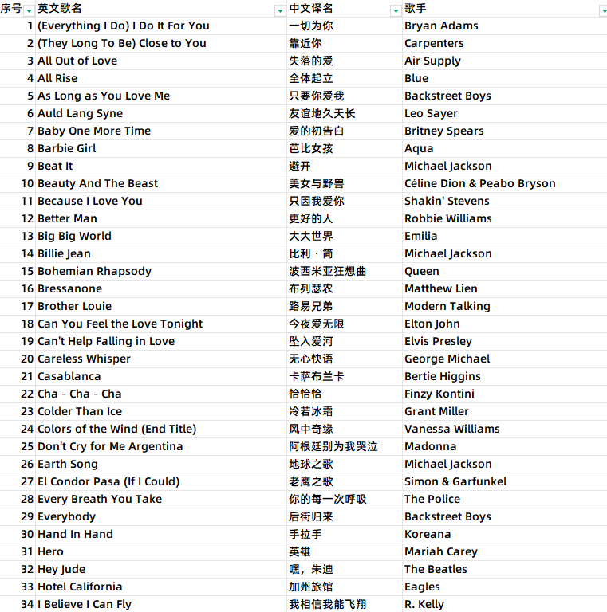
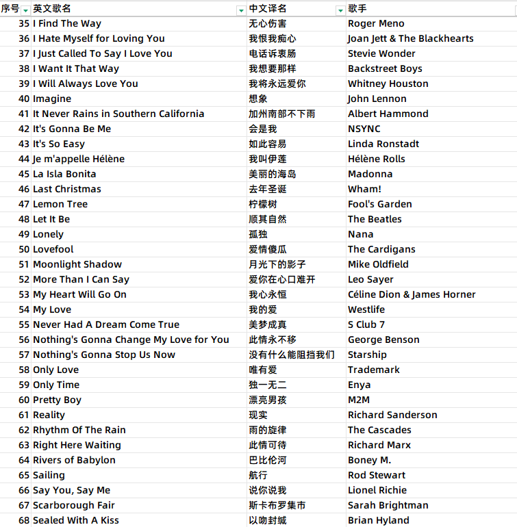
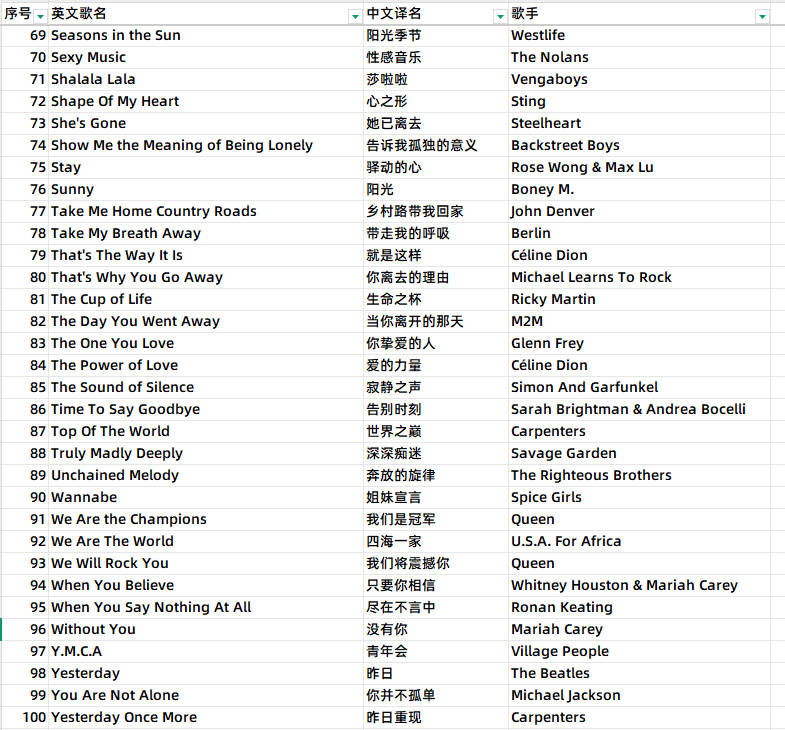

# 一次性收藏！百首殿堂级英文老歌合集
> 💡 备注属性未写入，可能是备注属性名称或者类型被修改了，建议将字段类型设置为 rich_text，可以在小程序-操作-修改文章数据库页面进行调整
> 💡 原文链接:[https://mp.weixin.qq.com/s?__biz=Mzg3OTEyNjQ3Ng==&mid=2247483900&idx=1&sn=535c6d5e193c75a973431d6d50668f52&chksm=ce18db7e6474d7d2cb54a5ec50a6274fc3110057dcfa5c7e7054f98f1977faebfd4b6afb7f01#rd](https://mp.weixin.qq.com/s?__biz=Mzg3OTEyNjQ3Ng%3D%3D&mid=2247483900&idx=1&sn=535c6d5e193c75a973431d6d50668f52&chksm=ce18db7e6474d7d2cb54a5ec50a6274fc3110057dcfa5c7e7054f98f1977faebfd4b6afb7f01#rd)

**点击蓝字 关注我们**

不知道从什么时候开始，我们听歌不再追新歌，反而越来越喜欢翻旧歌。
不是新歌不好听，而是我们渐渐明白：**真正的好歌，是经得起时间反复冲刷的。**
它们诞生于 2000 年及更早的岁月，没有华丽的特效编曲，没有精修的电子音色，只用一副干净的嗓音、一段动人的词曲，跨越语言和国界，打动了一代又一代人。
耳机换了一副又一副，播放器从一个时代换到另一个时代，可这些旋律，始终躺在我们的歌单最深处，从未离开。
经典最大的魅力就是：**永远不会随着时间褪色**。
今天整理了 **100 首 2000 年及以前发行的经典英文老歌合集**，首首都是经过时间筛选的传世金曲，适合收藏、通勤循环、安静时慢慢听。
先给大家分享十首公认封神、永远不会过时的顶级经典英文歌。
每一首，都是时代的眼泪。
---
### 1、《My Heart Will Go On》我心永恒
永恒的世纪金曲，《泰坦尼克号》主题曲。
大气又温柔的旋律，唱出了跨越生死的深情。无论过多少年，前奏一响，依旧会心头一颤。
它不仅是一首歌，更是一代人心中最浪漫、最悲壮的爱情信仰。
**有些歌，注定要和一个时代、一段爱情绑在一起。**
### 2、《Yesterday Once More》昨日重现
无数人的英文启蒙神曲，温柔又治愈。
轻快的节奏，怀旧感满满。年少时听不懂歌词，听懂已是曲中人。
每次听到，都忍不住想起那些无忧无虑、单纯美好的旧时光——夏天的冰棍、放学路上的夕阳、还有收音机里循环不停的歌曲。
### 3、《Scarborough Fair》斯卡布罗集市
被称为"世间最温柔的英文民谣"。
空灵、干净、治愈，像一阵温柔的晚风拂过耳边。
没有浓烈的情绪，却自带治愈人心的力量。适合深夜独处、安静放空的时候慢慢听，仿佛整个世界都慢了下来。
### 4、《Casablanca》卡萨布兰卡
最经典的怀旧情歌，温柔又深情。
旋律舒缓慵懒，歌词浪漫又克制，藏着成年人的温柔与遗憾。
很多人说：**年少听的是旋律，长大听的是遗憾。**
### 5、《We Will Rock You》
全球无人不晓的热血神曲。
简单的跺脚拍手节奏，一出瞬间燃爆全场。
充满力量、热血、震撼，是体育赛场、舞台永远的经典。几十年过去，依旧气场全开——这就是节奏本身的魔力。
### 6、《Hotel California》加州旅馆
摇滚史上的神作，迷幻又充满故事感。
绵长的吉他 solo，耐得住反复品味。年少时以为它只是一首好听的曲子，长大后才发现，歌词里写满了人生的隐喻。
**每一次重听，都能听出新的东西——这就是经典的特权。**
### 7、《You Are Not Alone》你并不孤单
迈克尔·杰克逊传世经典。
温柔治愈的抒情曲，歌声柔软又有力量。
一句"You Are Not Alone"，穿越了年代，治愈了所有孤单的时刻。
### 8、《The Sound of Silence》寂静之声
清冷、空灵、治愈又孤独。
适合安静的夜晚、独处的时候聆听。旋律低沉温柔，歌词充满深意，越听越沉淀内心。
喧嚣的世界里，这首歌反而让我们听见了自己。
### 9、《Bressanone》布列瑟农
被称为"治愈世界的天籁"。
温柔苍凉，干净纯粹，带着淡淡的不舍与释然。
很多人把它当作治愈单曲循环无数次——岁月沉淀下来的质感，无可替代。
### 10、《Rhythm Of The Rain》雨的旋律
超级治愈的怀旧老歌。
轻快清新、温柔解压，满满的夏日氛围感。
听完整个人都变得松弛治愈，是刻在青春记忆里的经典旋律。
---
上面这 10 首，只是这份歌单里的冰山一角。
这里一共整理了 **100 首**，全部都是 2000 年及以前发行的经典英文老歌，通勤路上、深夜加班、周末午后，刚好接住你此刻的心情。

✨ 预告：本期是 2000 年前老歌专场，下期将为大家推荐 **2000 年之后的经典英文歌曲**，别错过！
---
🎵 **评论区聊聊：你心中最封神的一首英文老歌是哪首？**
如果喜欢这份歌单，欢迎点赞、在看，分享给同样热爱老歌的朋友❤️
---
#经典英文歌曲 #英文老歌 #怀旧金曲 #歌单分享 #泰坦尼克号 #治愈系音乐 #经典永流传 #无损音乐

