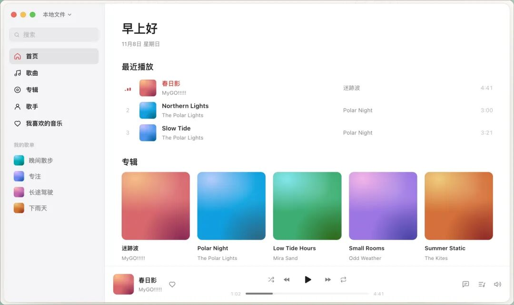
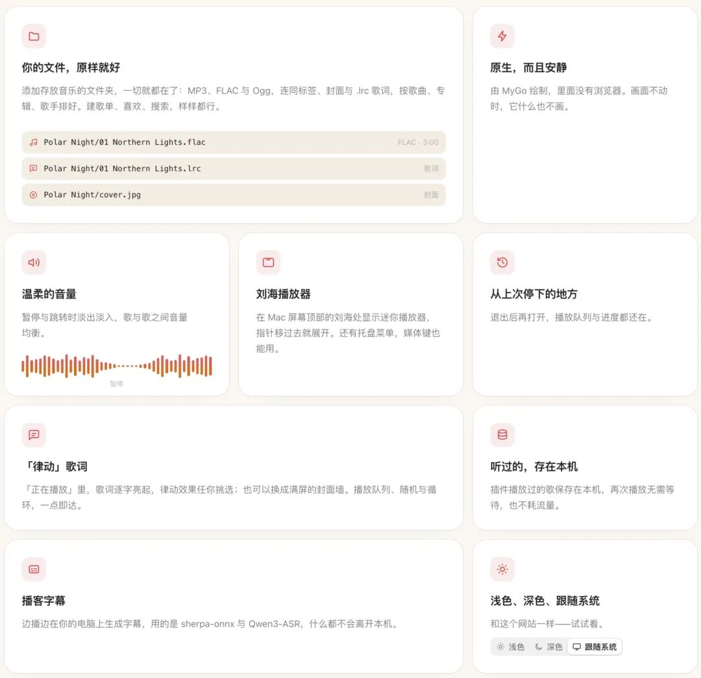

# 一款可通过插件扩展的原生音乐播放器
> 💡 备注属性未写入，可能是备注属性名称或者类型被修改了，建议将字段类型设置为 rich_text，可以在小程序-操作-修改文章数据库页面进行调整
> 💡 原文链接:[https://mp.weixin.qq.com/s?__biz=MzkwODQzNzk1OQ==&mid=2247503710&idx=1&sn=371acea934fa54540fedfff12b56250c&chksm=c18ef4a49fbf4ad49dcf118d0728bc96638012b6e560ff06ef78b55b7aa5545c98a0473ef4ba#rd](https://mp.weixin.qq.com/s?__biz=MzkwODQzNzk1OQ%3D%3D&mid=2247503710&idx=1&sn=371acea934fa54540fedfff12b56250c&chksm=c18ef4a49fbf4ad49dcf118d0728bc96638012b6e560ff06ef78b55b7aa5545c98a0473ef4ba#rd)
> ❝
> **MyGo Music 是一款用 Go 语言编写的开源原生桌面音乐播放器——不用 WebView、不套网页壳，本体只负责本地播放，账号、在线曲库、播客、电台等一切额外能力都交给插件扩展。
> **
作者表示，插件就是它的生态：一个文件夹加一个 plugin.json 和一个 JS/TS 文件就是一个插件，免构建，全平台通用；插件可以给它加账号、目录、播客、电台、评论和自己的页面。

**要点**
- **本地播放开箱即用**：支持 MP3、FLAC、Ogg Vorbis、WAV、ALAC 等格式，自动读取标签、封面和 .lrc 歌词。
- **曲库管理完整**：播放列表、喜欢的歌曲、搜索、专辑与艺术家视图一应俱全。
- **沉浸式“正在播放”**：舞台风格歌词、封面墙、播放队列、随机播放与循环播放。
- **macOS 专属体验**：Notch 播放器（刘海屏变身播放控制台）、托盘、媒体键。
- **音频细节讲究**：音频缓存、暂停与跳转时的淡入淡出、响度标准化、会话恢复（重启接着播）。
- **播客字幕本地生成**：播放时用 sherpa-onnx + Qwen3-ASR 在设备上转写字幕，无需联网转录。
- **中英双语界面**：英文与简体中文原生支持。
- **插件即生态**：一个文件夹 + plugin.json + 一个 JS/TS 文件就是一个插件，免构建、全平台通用，可添加第三方账号、目录、播客、电台、评论和自定义页面。
- **插件能力上限很高**：支持搜索、流式播放、歌单增删改、评论互动、带逐字时间轴的双语歌词，甚至远程控制其他设备播放。
**上手**
- **获取方式**：普通用户直接从官网 music.egoist.dev 下载（已提供中英文下载页），GitHub Releases 现有 20 个版本、最新为 v0.1.22；想自行构建则需要 Go 工具链（`go tool mygo build`）。
- **无需账号即可用**：本地播放开箱即用；接入在线音乐服务时才需要对应插件及其账号体系。
- **插件默认零网络权限**：plugin.json 里不声明 `network` 主机白名单，`fetch` 一个请求都发不出去，这是写插件最容易卡死的地方。
- **权限与版本门槛**：插件要调用外部程序（如 ffmpeg）需 `process` 权限，且用户必须在设置中手动放行；插件标注的 `minAppVersion` 只有 0.1.8 及以上的应用才识别，更老的版本会直接忽略。
项目由 egoist（EGOIST）开发，采用 AGPL-3.0 协议开源，当前 788 Stars、122 Forks。
> ❝
> **项目地址：github.com/egoist/mygo-music
> **

