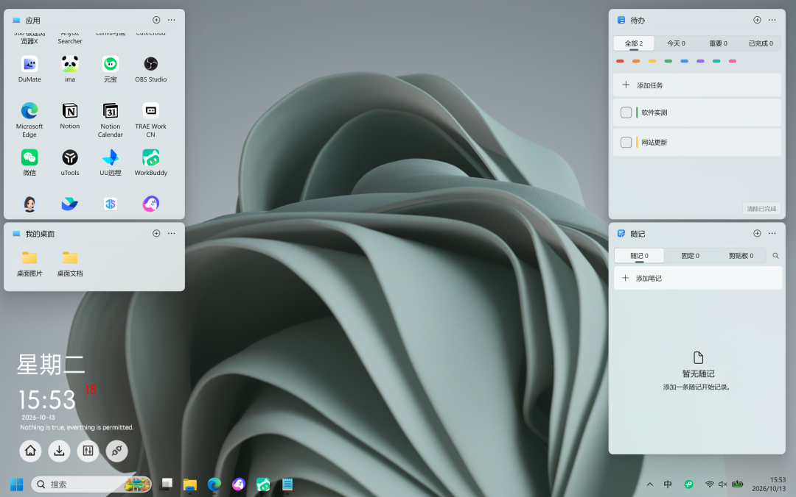
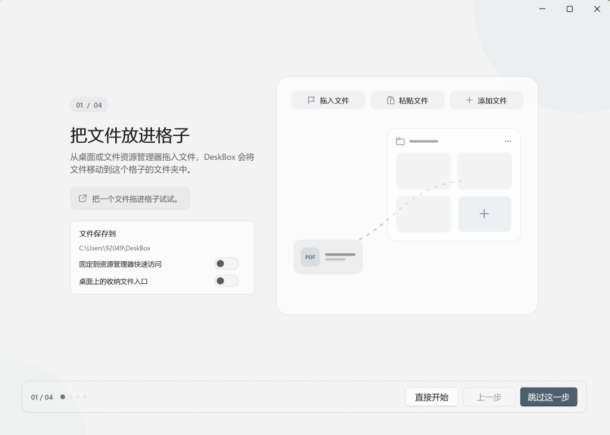
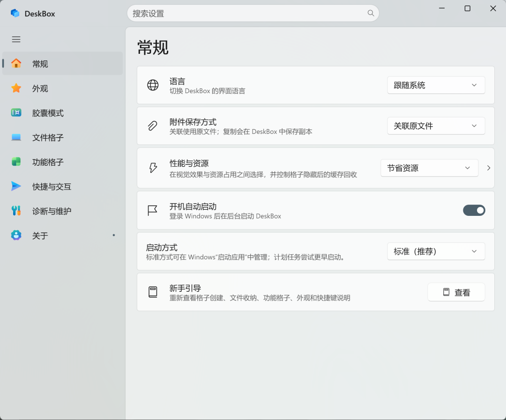
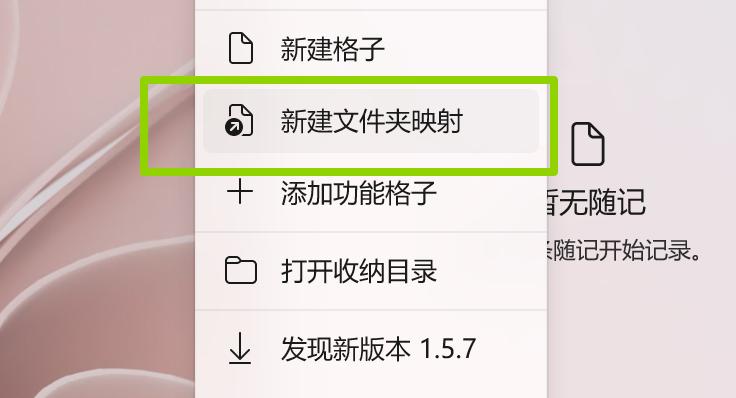
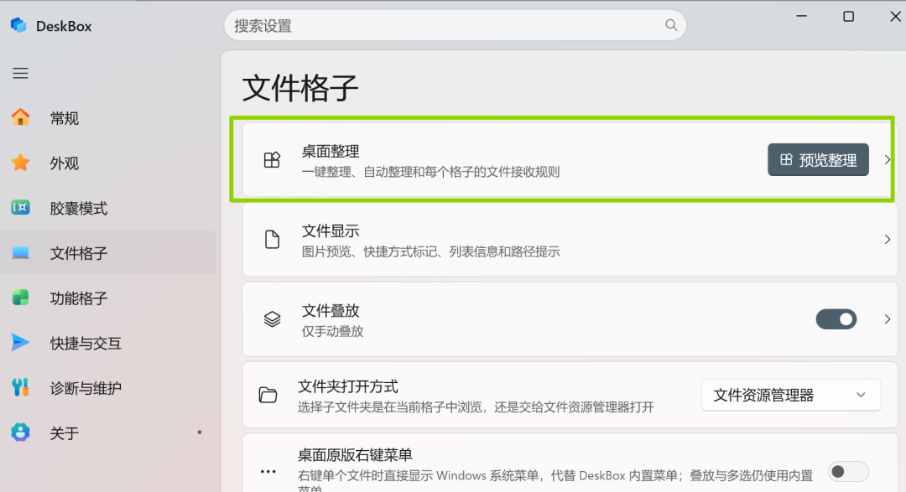
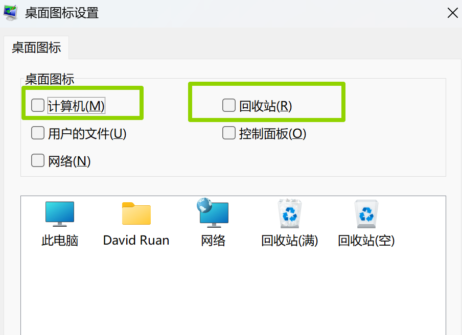
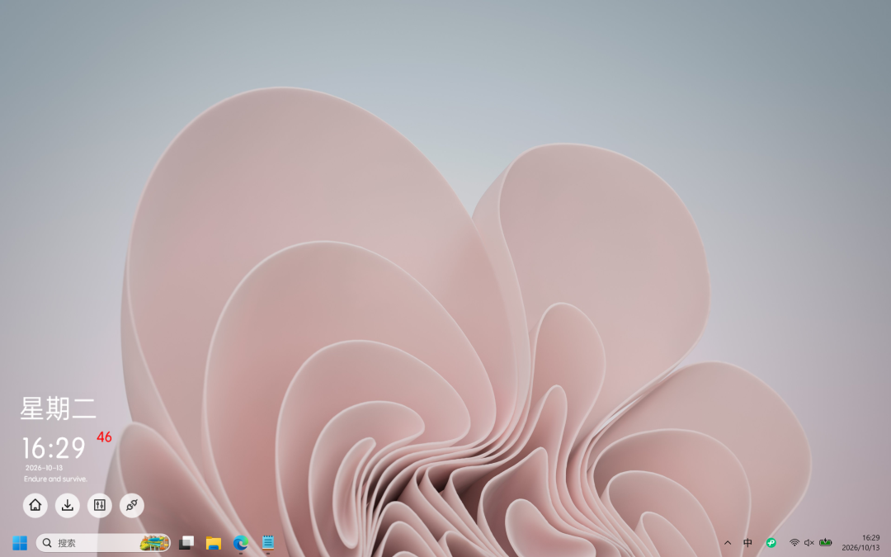

# 一款同时具备桌面收纳和待办清单的工具
> 💡 备注属性未写入，可能是备注属性名称或者类型被修改了，建议将字段类型设置为 rich_text，可以在小程序-操作-修改文章数据库页面进行调整
> 💡 原文链接:[https://mp.weixin.qq.com/s?__biz=Mzk1NzEzMTQ3Mg==&mid=2247486532&idx=1&sn=3a95e5e0d423a8e5cdd231823b671933&chksm=c2c2df88d0226992218436b27e0b86226ebfc17cbfbb15bf289992e178d1c3fc9e5301b96e5d#rd](https://mp.weixin.qq.com/s?__biz=Mzk1NzEzMTQ3Mg%3D%3D&mid=2247486532&idx=1&sn=3a95e5e0d423a8e5cdd231823b671933&chksm=c2c2df88d0226992218436b27e0b86226ebfc17cbfbb15bf289992e178d1c3fc9e5301b96e5d#rd)
今天给大家推荐一款同时具备了桌面收纳和待办清单功能的软件。
之前的推文大家讨论了很多桌面整理和日程管理、待办清单的工具。我在给小伙伴们推荐待办清单的时候推了Microsoft To Do。

Microsoft To Do待办清单很实用。虽然功能简单，但结合其他日历视图工具基本上就可以免费实现日程管理功能，甚至还有桌面提醒。
但有的小伙伴下载不了Microsoft To Do，我也没找到微软官网除商店以外的正版安装包。
在折腾一款新的桌面收纳工具的时候，发现这款软件除了桌面收纳功能很不错，它附带的待办清单意外的好用。
于是测试完全部功能后，赶紧推荐给大家试试。
这款软件是DeskBox，来自小伙伴们的推荐。

DeskBox是一款windows专用的桌面整理+桌面组件工具，开源免费，在github上已超过5000星。
DeskBox给windows原生桌面增加一个整理收纳的功能，它将桌面文件收纳进一个个可以自由摆放的格子里进行分类管理，同时附带其他小组件比如待办清单等。

我们可以任意选择自己想要的功能组件进行添加。

除待办清单组件外，还有随记、本地搜索、天气、音乐、时光等小功能自由选择。

通过新建文件夹映射，我们可以实现快速到达对应路径的操作。

支持一键整理桌面，晚风测试中部分图标无法拖入格子，如我的电脑、回收站等，可以选择放在桌面不管，也可以将其隐藏。

系统桌面图标的隐藏方式是右键电脑桌面，选择个性化，选择主题，打开桌面图标设置，取消对应图标勾选。

可一键隐藏桌面。

这款桌面收纳工具十分简单，就不多介绍了，大家自己上手看看是否适合自己。
今天的办公工具推荐就到这里，DeskBox已放到上班狗专用小程序班班的库。小程序班班的库直达方式在文末自取。
觉得软件实用还请给上班狗点个关注，晚风会持续给大家找好用的办公软件。
如果有想要的办公软件，可以在评论区留言，如果有用得好的工具软件，也欢迎大家分享。
小程序直达方式1：班班的库
小程序直达方式2：
#桌面收纳 #桌面整理 #待办清单

## 摘要

（待补充）

## 我的笔记

（待补充）
