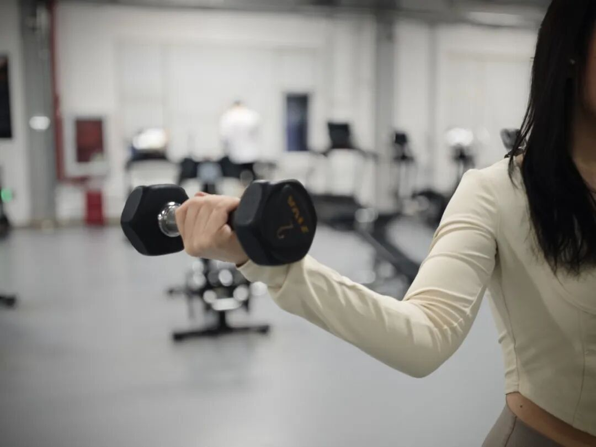

# 一种被忽视的抗炎运动！研究：每周3次坚持4周，炎症降了、大脑年轻了
> 💡 备注属性未写入，可能是备注属性名称或者类型被修改了，建议将字段类型设置为 rich_text，可以在小程序-操作-修改文章数据库页面进行调整
> 💡 原文链接:[https://mp.weixin.qq.com/s?__biz=MzA4NDI3NjcyNA==&mid=2650245704&idx=1&sn=2b5aabeaee9143d2c3d1761c58e5be14&chksm=86df19d0c371becaae7b9628dcf64e5cc353291d72bde28240f670b64513057dd7cccb1f79cb#rd](https://mp.weixin.qq.com/s?__biz=MzA4NDI3NjcyNA%3D%3D&mid=2650245704&idx=1&sn=2b5aabeaee9143d2c3d1761c58e5be14&chksm=86df19d0c371becaae7b9628dcf64e5cc353291d72bde28240f670b64513057dd7cccb1f79cb#rd)

生活中很多人有这种感觉：没干什么重活，却一整天都发沉发累；睡了七八小时，醒来还是昏昏沉沉。我们总以为“年纪大了，就这样”，但其实这可能是身体发出的信号：**肌肉在悄悄流失，慢性炎症在悄悄上升。**
对此，很多人第一反应是多运动——跑步、快走、跳操。但2026年一项针对50~65岁人群的最新研究，给出了一个更省心的答案：**每周只练3次抗阻训练，坚持4周，身体就会给出意想不到的反馈。**

人民日报健康客户端图
**抗阻运动**
**一种被忽视的抗炎运动**
2026年8月，国际期刊《大脑与行为》发表了一项研究，选取500名平时不怎么运动的50~65岁的健康人群，专门观察他们开始规律抗阻运动后，短短4周身体会发生什么改变？研究发现，有2项核心变化非常亮眼：**身体的慢性炎症降了、大脑状态更好了！**
**研究里的标准训练方案是**：周一、周三、周五各一次，每次约50分钟，包含5分钟热身、35分钟力量循环、10分钟放松，一共6个复合动作：深蹲、卧推、坐姿划船、高位下拉、自重深蹲和平板支撑。参与者全程共有12次监督下的抗阻训练。 
4周结束后，参与者的两项核心变化非常亮眼：
**✅ 慢性炎症降了**：反映全身炎症水平的白介素-6（IL-6）平均下降0.74皮克/毫升，肿瘤坏死因子-α（TNF-α）平均下降0.49皮克/毫升。
**✅ 大脑状态改善**：大脑的“营养因子”——脑源性神经营养因子（BDNF）平均升高2.7纳克/毫升。 这种分子负责神经元的生长和修复，和记忆力、反应力直接相关。也就是说，炎症下降的同时，认知状态也得到了适度改善。
**增加抗阻运动**
**是给衰老进程踩了一脚“刹车”**
中年以后，身体在几条线上同时“走下坡路”，而抗阻运动，或许能帮你在下坡路上踩一脚刹车。
**1. 慢性炎症升高——抗阻运动是抗炎处方**
中年以后，慢性低度炎症更容易找上门。它不红不肿不痛，却与代谢紊乱、心血管疾病和认知衰退都有关联。2025年，发表在国际期刊《老化研究评论》的一项荟萃分析显示，40岁及以上社区居民，**C反应蛋白/超敏C反应蛋白升高和白细胞介素-6升高的全因死亡风险分别显著提高1.54倍和1.47倍**。而上述《大脑与行为》上的研究提示，抗阻运动正是值得尝试的“抗炎运动处方”。
**2. 肌肉逐年流失——抗阻运动防肌肉流失**
中年以后，肌肉流失是身体“下坡”的一条暗线。中国工程院院士钟南山曾在一次访谈中指出，“人体肌肉量大概在25岁达到顶峰，之后就开始逐渐下降。40岁是一个关键节点，**40岁之后，每十年肌肉量就会流失8%～10%**；到70岁以后，流失速度还会加快，每十年可达15%，这是一个非常可怕的数字。”
而抗阻运动，是肌肉主动对抗外部阻力来发力的一种运动方式，**运动中会造成肌纤维的微小损伤，身体修复时会增粗肌纤维，从而实现肌肉增长。**

AI生成图
**3. 大脑衰老加速——抗阻运动给大脑减龄**
2024年一项刊发在《美国国家科学院院刊》上的研究发现，大脑衰老并非匀速，第一个转折点在44岁左右，这是衰老进程的“起点”；67岁左右是一个加速拐点，大脑网络的退化速度达到峰值。
而抗阻运动则是对抗大脑衰老的好办法。2026年2月，国际期刊《老年科学》发表的一项研究显示，**坚持抗阻运动一年后，大脑“年龄”可以年轻约2.3岁。**那些没有进行抗阻力量锻炼的人，则没有这种“逆龄”效果。
**4. 骨量大幅下降——抗阻运动增加骨密度 **
中山大学附属第五医院内分泌与代谢病科主任丛丽表示，人从出生到20岁，骨量会随着年龄明显增加；30~40岁是人一生中骨密度最高的时刻，骨骼生长处于相对平衡状态；40岁之后，人体开始丢失骨量，骨骼将会“断崖式”衰老，尤其是女性在绝经后，骨量流失得更快。
湖北省武汉市第一医院临床营养科营养师喻彬表示，肌肉在收缩时会对骨骼产生应力刺激，这种刺激会促使骨骼增加钙质沉积，提高骨密度，有效预防和改善骨质疏松，降低骨折风险。
**想开始力量训练**
**从这几步入手**
**1. 选择动作：可以直接跟练的5个动作 **
- **动作一：壶铃摇摆＋高摆**

- **动作二：壶铃颈后绕肩**

- **动作三：壶铃推举高抬腿**

- **动作四：哑铃侧平举**

- **动作五：哑铃前平举**
**2. 练习原则：每周2次，循序渐进**
2026年3月，美国运动医学会（ACSM）发布最新版《成年人抗阻训练处方立场声明》，指出每周1～2次、每次2～3个动作、每个动作1～3组，就能显著改善力量、肌肉和功能，尤其适合初学者、忙碌者、老年人或伤后恢复人群。另外，不必练到力竭，可以根据自身情况“渐进式”提升，比如练习一段时间后，重量稍微加一点，或每组多做1～2次。
**3. 注意事项：不要憋气，有不适立刻停**
抗阻运动时要保持自然呼吸状态，特别注意避免憋气，以免缺氧或血压波动幅度过大。运动中出现胸痛、胸闷、头晕、心悸、异常的呼吸困难或疲劳、关节肌肉明显疼痛等不适感觉，应立即降低运动强度或停止运动，采取对应措施，必要时就医。
来源：新华社微信公众号综合人民日报健康客户端
---

**转发给咱家人！**

## 摘要

（待补充）

## 我的笔记

（待补充）
