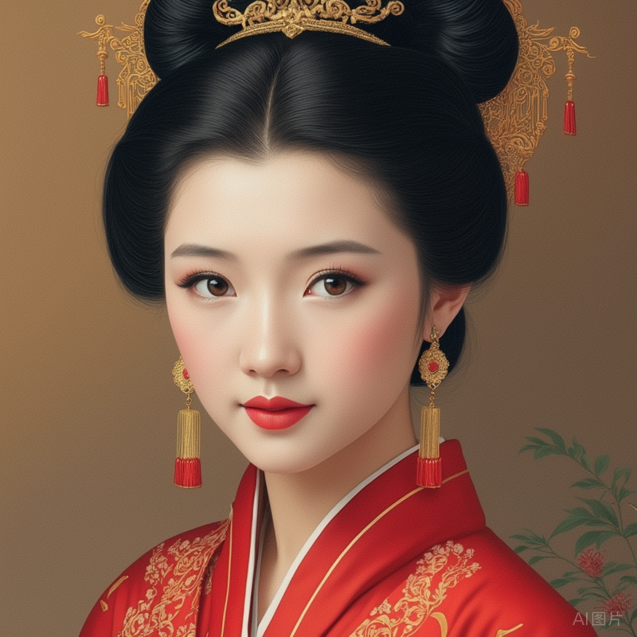

# 一首情诗写死16个人，堪称史上最狠情诗！
> 💡 备注属性未写入，可能是备注属性名称或者类型被修改了，建议将字段类型设置为 rich_text，可以在小程序-操作-修改文章数据库页面进行调整
> 原文链接:[https://mp.weixin.qq.com/s/eJqylXYvFH5Uz4PU7yJPPA](https://mp.weixin.qq.com/s/eJqylXYvFH5Uz4PU7yJPPA)
敬请关注

有这样一首奇妙的诗，每一句都蕴藏一个爱情典故，而这些爱情故事大多以悲剧结局，读后让人感慨万千，一起来欣赏吧！

金屋犹自赋长门，渔阳鞞鼓正销魂。
冲冠一怒自古有，花丛懒顾又几人。
泪洒倾盆长城断，银汉清浅两下分。
彩蝶无奈舞翩翩，青衫湿遍泣孤坟。
金石录成声声慢，断桥残雪恋君恩。
良驹不去江难渡，至尊缘何入空门。
孔雀年年东南去，三生石畔葬花魂。
莫待白头吟钗凤，扇底桃花又一春。
**01**
**金屋犹自赋长门**
** 汉武帝与陈阿娇 **
刘彻筑就金屋，让阿娇居住，终于实现了当年的承诺，但金屋内的阿娇并不幸福，反而上演了一幕幕悲情大剧。刘彻最终将那颗曾经火热的心带走，却把阿娇锁在了那里。金屋的坚不可摧，并不能代表情感的永恒。皇后的地位，金子筑就的房子，物质的坚硬质地并不能托起爱情的大厦。
**02**
**渔阳鞞鼓正销魂**
** 唐玄宗与杨玉环 **
唐明皇因杨玉环貌美而倍加宠幸，终日沉湎于歌舞酒色之中，不理朝政。安史之乱爆发，安禄山从渔阳起兵反叛后，唐玄宗逃亡西南，在马嵬坡被哗变的军队逼迫，处死了杨贵妃。白居易《长恨歌》中写道：“渔阳鼙鼓动地来，惊破霓裳羽衣曲。” 
**03**
**冲冠一怒自古有**
** 吴三桂与陈圆圆 **
陈圆圆是明末名满天下的“秦淮八艳”之一，红颜薄命，先被田弘遇所掠，献给了崇祯皇帝，岂料没有得到崇祯的宠幸，后被吴三桂纳为妾。李自成攻破北京，其部下刘宗敏掠走吴的爱妾陈圆圆。吴三桂降而复叛，上演了一幕绝世的“冲冠一怒为红颜”。
**04**
**花丛懒顾又几人**
** 元稹与韦丛 **
唐代诗人元稹与韦丛夫妻恩爱，妻子不幸早逝。元稹心失所爱，却难忘旧情，他曾写过一首《离思》：“取次花丛懒回顾，半缘修道半缘君。”
**05**
**泪洒倾盆长城断**
** 孟姜女与范喜良 **
孟姜女哭长城的传说在民间广为流传，其夫范喜良被魏王征召修筑长城（今卫辉与辉县交界的战国长城）劳累饥饿而死，埋于长城之下。孟姜女寻夫哭至卫辉池山段长城，感动天地，哭塌长城，露出丈夫尸骨。
**06**
**银汉清浅两下分**
** 牛郎与织女 **
传说古代天帝的孙女织女擅长织布，每天给天空织彩霞。她讨厌这枯燥的生活，就偷偷下到凡间，私自嫁给河西的牛郎，过上男耕女织的生活。此事惹怒了天帝，把织女捉回天宫，责令他们分离，只允许他们每年的农历七月七在鹊桥上相会一次。他们坚贞的爱情感动了喜鹊，无数喜鹊飞来，用身体搭成一道跨越天河的喜鹊桥，让牛郎织女在天河上相会。
**07**
**彩蝶无奈舞翩翩**
** 梁山伯与祝英台 **
祝英台女扮男装出门求学，爱上同窗梁山伯。临行前祝英台不断暗示自己的女儿身份，梁山伯却始终不解其意。当梁山伯知悉真相时，祝英台已被父亲许配马家，梁山伯忧郁而终。祝英台在大婚之日到梁山伯墓前跳坟殉情，化成一对形影相随的蝴蝶。
**08**
**青衫湿遍泣孤坟**
** 纳兰性德与卢氏 **
清代词人纳兰性德与卢氏婚后美满和谐，但好景不长，结婚三年时卢氏因难产去世。卢氏的离世给了纳兰性德极为沉重的打击，半个月后，纳兰性德写下了《青衫湿遍·悼亡》一词，悼念亡人。
**09**
**金石录成声声慢**
** 李清照与赵明诚 **
李清照是宋代女词人，和赵明诚婚后两情相悦，情投意合。两人共同致力于金石书画的收藏，并撰写整理《金石录》一书。后金兵南侵，赵明诚在南下赴任途中不幸得病而死。
**10**
**断桥残雪恋君恩**
** 白素贞与许仙 **
传说南宋绍兴年间，有一千年修炼的蛇妖化作美丽女子叫白素贞，及其侍女青青在杭州西湖遇药店之王主管许宣（或名许仙）邂逅相遇，同舟避雨，一见钟情，白蛇逐生欲念，欲与书生缠绵，乃嫁与他，遂结为夫妻。婚后，经历诸多是非，白娘子屡现怪异，许不能堪。镇江金山寺高僧法海赠许一钵盂，令罩其妻。白、青被子罩后，显露原形，乃千年成道白蛇、青鱼。法海遂携钵盂，置雷寺峰前，令人于其上砌成七级宝塔，名曰雷峰，永镇白、青于塔中。
**11**
**良驹不去江难渡**
** 项羽与虞姬 **
项羽兵败垓下，面对虞姬和乌骓马慷慨悲歌：力拔山兮气盖世，时不利兮骓不逝。骓不逝兮可奈何！虞兮虞兮奈若何！虞姬含泪和唱后拔剑自刎。
**12**
**至尊缘何入空门**
** 顺治帝与董鄂妃 **
顺治皇帝对董鄂妃宠爱有加，董后因爱子病逝，身体每况愈下，在二十二岁时病逝。 顺治抛弃江山社稷，到五台山出家。
**13**
**孔雀年年东南去**
** 刘兰芝与焦仲卿 **
刘兰芝与焦仲卿真心相爱，可偏执顽固的焦母却对她百般挑剔。刘兰芝毅然请归，焦仲卿向母求情无效，就劝说刘兰芝暂避娘家，待日后再设法接她回来。谁知刘兰芝回娘家后，趋炎附势的哥哥逼她改嫁太守的儿子。焦仲卿闻讯赶来，两人双双殉情而死。
**14**
**三生石畔葬花魂**
** 贾宝玉与林黛玉 **
林黛玉前世为离恨天上三生石畔一棵绛珠仙草，神瑛侍者日以甘露灌溉，后来又受天地精华和雨露滋润而修成女体，心中郁结一段缠绵不尽之意。后神瑛侍者下凡，绛珠仙子愿随他去世间走一遭，将毕生眼泪还给他。以报灌溉之恩，最后林黛玉为贾宝玉泪尽而死。
**15**
**莫待白头吟钗凤**
** 陆游与唐琬 **
宋代诗人陆游与唐琬本是恩爱夫妻，两人诗书唱和，感情深厚。但因陆母不喜唐琬，夫妻俩被迫分离。两人各自婚娶十年后，陆游在沈园春游时，与偕夫同游的唐琬不期而遇。唐琬遣致酒肴，聊表对陆游的抚慰之情。陆游乘醉在园壁上题写《钗头凤》词，唐琬也写词相和。不久，唐琬抑郁病死。
**16**
**扇底桃花又一春**
** 李香君与侯方域 **
明代诗人侯方域和秦淮名妓李香君一见倾心，留赠扇子做为定情物，不久纳李香君为妾。

因时局变化，侯方域远走他乡，李香君就天天手持定情扇等侯方域归来。阉党阮大钺为泻私愤，强迫李香君嫁人，香君誓死不从，头撞楼柱，血溅定情扇，在扇面上染成一朵朵桃花。
**来源：国学名人堂，版权归原作者所有，侵权必删。**

声明：本文版权归原作者及原出处所有，内容为作者观点，并不代表本公众号赞同其观点和对其真实性负责。如涉及版权等问题，请及时与我们联系，我们将立即更正或删除相关内容。本公众号拥有对此声明的最终解释权。
**精彩推荐：**
[王军先生对联选辑（十六）](https://mp.weixin.qq.com/s?__biz=MzU1MzYzODYxNA%3D%3D&mid=2247707927&idx=2&sn=c581cfed6656836080c460af3c640480&scene=21#wechat_redirect)
[【女子十二词坊】勘破是非心似月 何须世外觅桃源](https://mp.weixin.qq.com/s?__biz=MzU1MzYzODYxNA%3D%3D&mid=2247707462&idx=3&sn=cc479f1052b73a56afb19d69a142c261&scene=21#wechat_redirect)
[甘肃8岁女童在黄河壶口瀑布游玩，指出石碑上“黄”字写错了，网友懵了！](https://mp.weixin.qq.com/s?__biz=MzU1MzYzODYxNA%3D%3D&mid=2247708069&idx=1&sn=8c2deac6cecd67cc45a951c731b1262f&scene=21#wechat_redirect)

[和珅被嘉庆赐死，他拿出乾隆给的保命诏书，不料里面只有3个字](https://mp.weixin.qq.com/s?__biz=MzU1MzYzODYxNA%3D%3D&mid=2247708068&idx=1&sn=d355938f7e976204e2f5c4a3fa14c844&scene=21#wechat_redirect)

[中国历史上存在感最弱的王朝，被一群20岁少妇统治了近百年！](https://mp.weixin.qq.com/s?__biz=MzU1MzYzODYxNA%3D%3D&mid=2247707928&idx=1&sn=8c0070c34f57a3cce1623902c2cf41b7&scene=21#wechat_redirect)

[他三度出家，风流好色，嗜酒贪吃，却写下一首最催泪的分手诗，最后两句人人会背](https://mp.weixin.qq.com/s?__biz=MzU1MzYzODYxNA%3D%3D&mid=2247707927&idx=1&sn=1515d209231d72a89889b785dbb66b89&scene=21#wechat_redirect)

[清亡后，格格们都嫁给了谁？好几位大明星，其实都是皇室后裔](https://mp.weixin.qq.com/s?__biz=MzU1MzYzODYxNA%3D%3D&mid=2247707926&idx=1&sn=303307409516ad015b8b2d58b78031c6&scene=21#wechat_redirect)

[毛泽东个人简历！无人能比](https://mp.weixin.qq.com/s?__biz=MzU1MzYzODYxNA%3D%3D&mid=2247707923&idx=1&sn=1fb31a7962d01a9c5f848ef1383eada9&scene=21#wechat_redirect)

[李世民52岁早逝，死因史书都不好意思记录，太丢人说不出口](https://mp.weixin.qq.com/s?__biz=MzU1MzYzODYxNA%3D%3D&mid=2247707918&idx=1&sn=196208c84798c1bc9ab8c8425b26def8&scene=21#wechat_redirect)

[济公圆寂前留下一首诗，堪称千古绝唱，仅凭24字，点醒无数人！](https://mp.weixin.qq.com/s?__biz=MzU1MzYzODYxNA%3D%3D&mid=2247707916&idx=1&sn=f1d7774f9064078309b0282c346c9cb7&scene=21#wechat_redirect)

[史上最牛师生恋：他追求人妻一直追到家里，丈夫却拱手让妻，还和他拜把子](https://mp.weixin.qq.com/s?__biz=MzU1MzYzODYxNA%3D%3D&mid=2247707909&idx=1&sn=aefadebbb75669d19a0acb85695ea674&scene=21#wechat_redirect)

[“10月1日国庆节文案，句句封神”](https://mp.weixin.qq.com/s?__biz=MzU1MzYzODYxNA%3D%3D&mid=2247707884&idx=1&sn=cf68f59d90f7d0cbe1612de67b24c36e&scene=21#wechat_redirect)

["白虎"是什么？晚清首富胡雪岩，临终前告诫子孙：勿近白虎](https://mp.weixin.qq.com/s?__biz=MzU1MzYzODYxNA%3D%3D&mid=2247707748&idx=1&sn=fd393e396bb8703a0295861b6aa096b0&scene=21#wechat_redirect)

[吕小姐结婚，有人送上联“吕家姑娘，下口大于上口”，下联更绝](https://mp.weixin.qq.com/s?__biz=MzU1MzYzODYxNA%3D%3D&mid=2247707744&idx=1&sn=3749f7af0f05f54a271b5ea61b7f6793&scene=21#wechat_redirect)
