# 七上数学压轴难点｜数轴动点，吃透这6大题型，考试不丢分
> 💡 备注属性未写入，可能是备注属性名称或者类型被修改了，建议将字段类型设置为 rich_text，可以在小程序-操作-修改文章数据库页面进行调整
> 💡 原文链接:[https://mp.weixin.qq.com/s?__biz=MzcwMDE4NTk3NQ==&mid=2247487097&idx=1&sn=72bda6b0910529d3541e30de725c2dca&chksm=f5f406558047187eeec29adf93a516483f09eabe1ab089c68a0fa962e4c322fed83d818cd204#rd](https://mp.weixin.qq.com/s?__biz=MzcwMDE4NTk3NQ%3D%3D&mid=2247487097&idx=1&sn=72bda6b0910529d3541e30de725c2dca&chksm=f5f406558047187eeec29adf93a516483f09eabe1ab089c68a0fa962e4c322fed83d818cd204#rd)
很多刚上七年级的孩子，学到有理数这一章，都会被数轴动点题难住。今天这篇把可能出现的每一种情况都列出来了，家长可以收藏打印出来给孩子慢慢看。

它是初一上册数学的压轴常客，题型灵活，条件多变，一不小心就漏解扣分。其实动点题不是靠硬刷，掌握底层公式、固定解题步骤，分清6大类题型，就能稳稳地拿分。

**一、数轴动点，先背会三大核心公式**

所有动点题，都离不开这3个基础公式，基础没吃透，后面做题很容易不稳。

**1.两点间距离公式**
若A对应数字a，B对应数字b，则两点距离：AB=｜a-b |
位置确定：距离=右边数字 − 左边数字
位置不确定：距离一定要加绝对值，常见形式：|x-6|、|x+4|
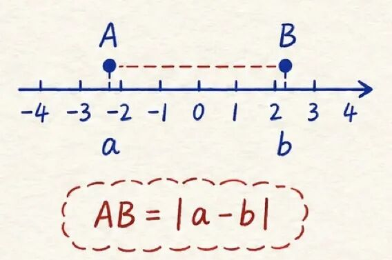
**2.点的移动公式**
{位置=起点±速度×时间}，口诀：向右加，向左减
路程=速度×时间；动点三要素：起点、方向、速度。
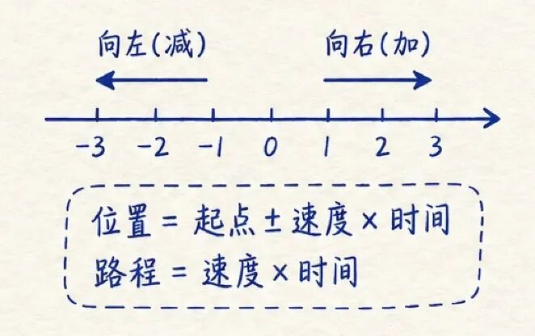
**3.中点公式**
若A对应a，B对应b，线段AB中点M对应的数字m=(a+b)/2
中点到线段两端距离相等，动态中点，也是先写出两个端点位置，再求平均数。
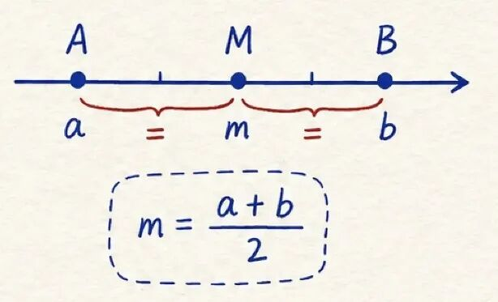
**二、万能解题三步法，所有动点题通用**

**记住解题口诀：**画图→设时→表示点→表示段→列方程

✅**第一步：表示点**
写出每个动点t秒后的位置；向右移动用起点加，向左移动用起点减；多个动点，要分别列式表达。
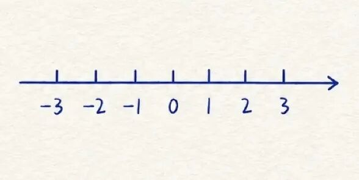

✅**第二步：表示线段**
两点顺序确定：直接用右边数字 − 左边数字；
两点顺序不确定：必须带上绝对值；
做题优先判断点的相对位置，再列式。
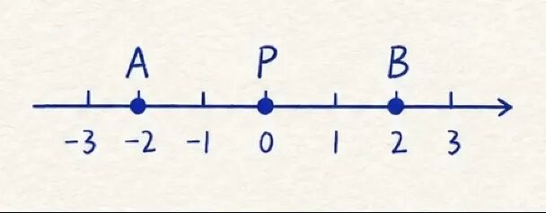
✅**第三步：列等式**
相遇：两个点位置相等
距离为定值：两点之差的绝对值=常数
中点：中点坐标=(两端点之和)÷2
不变量：化简含t的代数式，消去参数
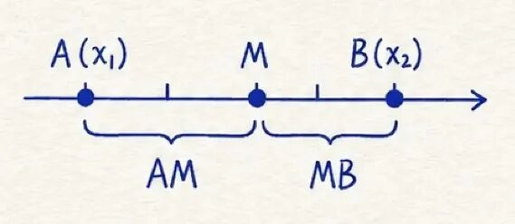
**三、6大必考题型，逐个突破**

**题型一：单动点问题｜分类讨论最容易丢分**
看到“可能”“距离”这类关键词，就要立刻想到分类讨论。

**三种常考方向：**
1.已知点到原点距离求位置：距离相同，点的位置有2种可能；
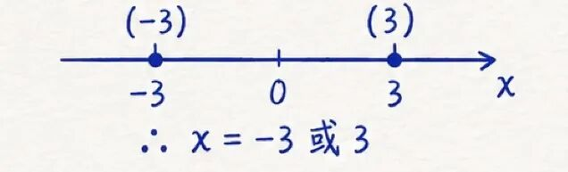
2.点沿数轴移动，方向不确定，要分向左、向右两种情况；
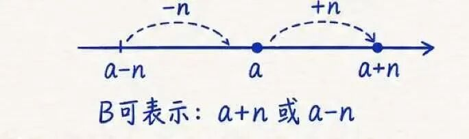
3.点在区间内外，列绝对值方程，先判断点的位置。
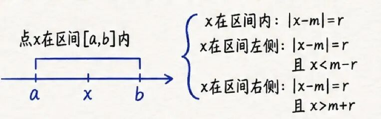
**核心提醒：**方向不明、位置不明、绝对值不明，一定要分类！

**题型二：单动点变化规律｜找周期，算净位移**
这类题目动点来回往返运动，核心就是找周期。

**1.交替运动：**写出前几次位置，观察奇数、偶数次位置规律；
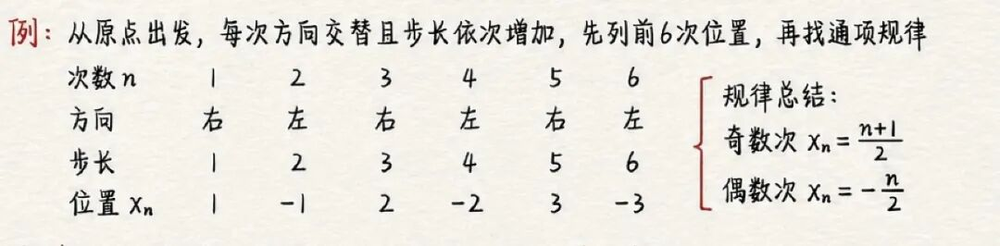

**2.周期循环：**先算出一个完整周期的时间，用总时间÷周期，看余数，余数决定最终位置；
①先确定一个完整周期的时间T和末位置。 
②总时间t,商q=(t÷T)(表示完成q个完整周期),余数r=t-qT。 
③最终位置=q个周期后的净位移+余数r对应的位置。

**3.数轴图形翻滚：**跟踪关键点的位置变化，结合周期求解。

**解题关键：找周期、算净位移、看余数、再定位。**

**题型三：双动点问题｜相遇、追及、背向**
基础模型：P点位置a±v₁t，Q点位置b±v₂t

**1.相向运动：**距离不断变小，常考相遇，相遇时两点位置相等；

**2.同向运动：**重点分清前后位置，追及要求后面点速度大于前面点；

**3.背向运动：**两点距离越来越大，常考察固定距离求值。
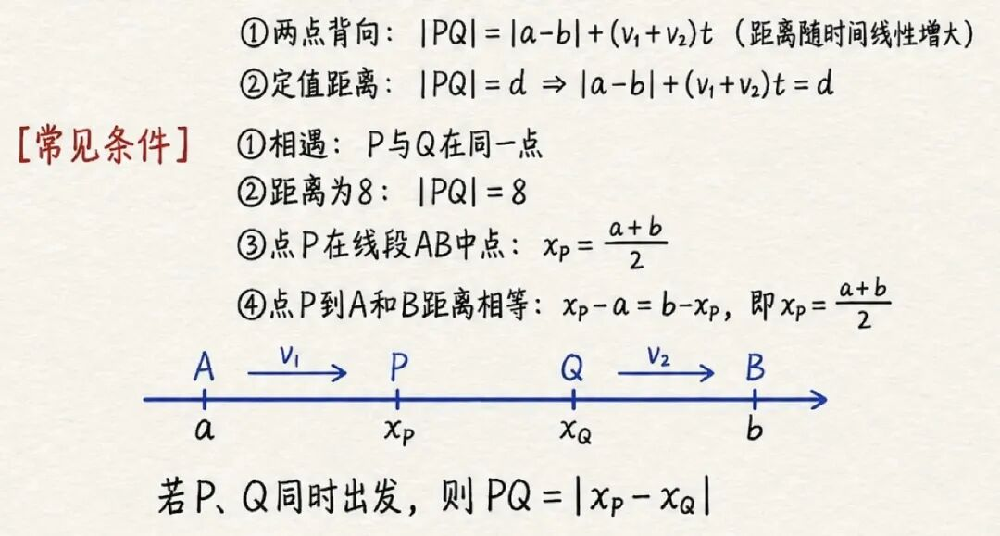
**一句话总结：**双动点不难，关键先把两个点的位置表达式写出来。

**题型四：双动点变速｜分段讨论是核心**

变速题的难点不是计算，在于分段。

**四类场景：**相遇后继续运动、到达端点停留、到端点折返、运动途中改变速度。
**解题顺序：**找分界时刻→分阶段写出点的位置→每一段分别列式→综合所有答案。
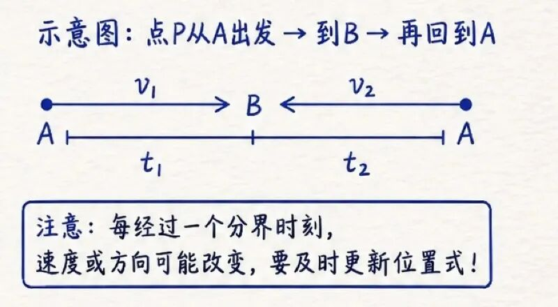
⚠️**注意：**到达分界时刻，速度、运动方向改变，位置表达式要同步更新。

**题型五：多动点综合（3个及以上动点）**

三个点同时运动，推荐列表法，最不容易乱。

表格列出：起点、运动方向、速度、t秒后的位置。
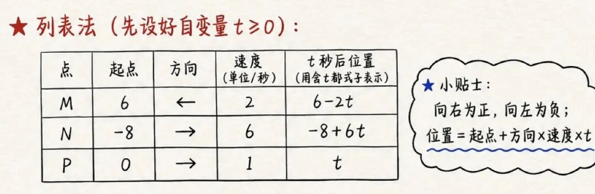
解题步骤：
①求出相遇等关键时刻；②划分时间段，写出各点位置；③分段讨论距离关系。
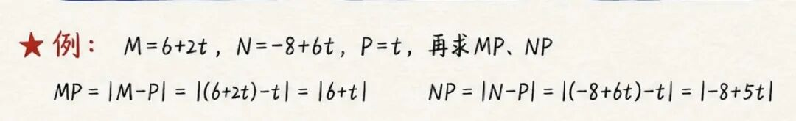
多动点最容易漏解：每一个动点都要单独表示位置，理清位置关系再计算。

**题型六：新定义问题**

新定义题目难点不在计算，在于读懂题目规则。
**解题三步：**先审题读懂定义 → 把新定义转化成距离、中点、线段这类熟悉知识 → 列式计算。
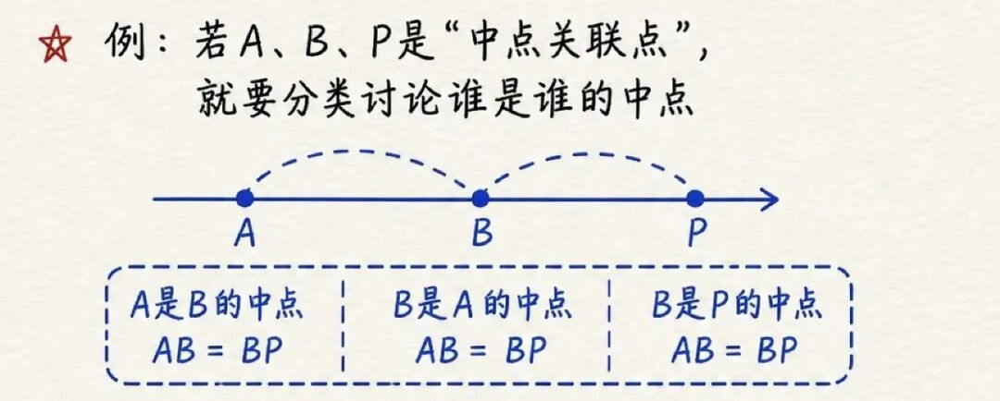
像木棒、长方形平移、年龄模型，本质都可以转化为数轴上线段平移。
遇到关联点题型，记得分类讨论，判断谁是中点。

**四、压轴题易错点&提分技巧**

❌**高频易错汇总**
忘记分类讨论，只写一个答案，直接丢分；
计算距离忘记加绝对值，直接两数相减；
动点方向搞反：向左运动却用加法；
双动点、多动点没有单独写出每个点的位置；
点的相对位置改变，没有分段列式。

💡**压轴解题小技巧**
先画图，位置变化后，重新画图，减少盲目计算；
先设时间t，写出位置表达式，不要急于计算；
题目说“不变”，就化简含t式子，尝试消去t；
求最小值，优先考虑中点或者端点；
往返、变速题目，标记分界时刻，分段建模。
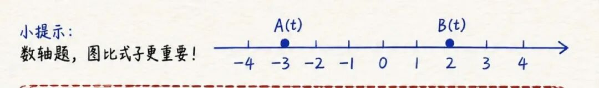
**总结**：数轴动点想拿高分，不用盲目刷题，靠吃透模型。

审题完整、分类不漏、规范书写，位置、方向、距离、速度四要素一个都不能少，压轴大题也能轻松拿下。
